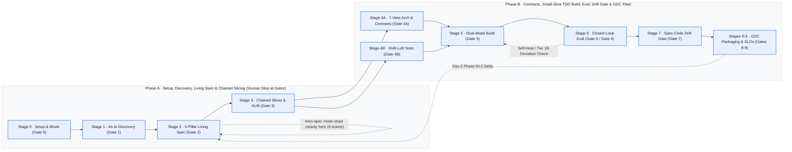

# Enterprise Agentic Development Lifecycle Harness — `agentic-dlc` (`v4.6.0`)

> **Version:** `4.6.0` · **Architecture:** Living Spec-Driven Development (SDD) + Conditional `grill-me` Decision-Tree Intake + Dual-Plane Enterprise ALM & Git Governance
>
> **"Think Big, Start Small, Move Fast"** — the **Elephant** (deep-context discovery & living-specification architect), the **Judge**
> (adversarial spec/architecture critics + closed-loop browser & API test runner), and the **Goldfish** (clean-context target-stack coder).
> `agentic-dlc` is **domain-neutral**, **scenario-aware**, and **visually verified**: it modernises legacy applications beyond 1:1 lift-and-shift (`clean-room-rebuild` or brownfield `in-place-upgrade`), baselines existing production systems (`retro-spec`), evolves living specifications (`delta`), and builds greenfield systems from requirements documents — interviewing humans in bounded **`grill-me` frontier rounds** *only when clarification or modernization scope is needed*, and tracking approvals via **Jira / Azure DevOps thin-pointer boards** or **Git-Native Docs-as-Code Pull Requests**.

---

## 1. Key Capabilities (`v4.6.0`)

| Dimension | `agentic-dlc` v4.6.0 Capability |
| :-- | :-- |
| **Who Authors vs. Who Verifies** | **The LLM (8 subagents, 13 skills) authors every artefact** from user inputs; Python 3.10+ stdlib scripts **scan, crawl, derive, lint, execute, and enforce human gates** |
| **Conditional `grill-me` Decision-Tree Intake (`clarification-griller`)** | Runs **bounded Frontier Rounds** (`2–4` independent root questions with evidence citations, `➡️ Recommended` answers, and `accept recommendations` fast-exit) **only when needed**: always at Gate 1 for Legacy Modernization (`retire` vs. `parity` vs. `reimagine-enhance` `REQ-ENH-*` capabilities + approach), conditionally on BRD/codebase workflow/formula/acronym gaps, and **auto-bypassing (`CLEAR_AUTO_BYPASSED`) with zero extra turns when inputs are complete** |
| **Living Spec-Driven Development (`standard` · `delta` · `retro-spec`)** | Supports full delivery (`standard`), **Phase `N+1` Living Spec Delta Mode** (`delta` with `--baseline-spec` byte-for-byte preservation of completed items and historic approvals), and **Brownfield Retro-Spec Mode** (`retro-spec` with Zero Backlog Ticket Creation Guarantee) |
| **Dual-Plane Human Review (With ALM or Pure Git PRs)** | **Pattern A (`alm-and-git`):** Thin-pointer, dependency-chained Jira / Azure DevOps stories (`specPointer`, `dependsOnStories`) with 1-page 5-Question Gate Decision Briefs. **Pattern B (`git-pr-docs-as-code`):** Git PRs + `CODEOWNERS` + inline `* **Approvals:**` ledger (`>= 2` distinct humans on `regulated` track, strict bot exclusion) when no external ALM is used |
| **3D Small-Slice Execution & 3-Tier Spec Deviation Gate** | Enforces `<= 3` prod files, `<= 400` LOC, co-located `unitTestTargets`, and 4-part `verificationPlan` (no bare `"N/A"`), compacts `Done` slices (`compact-completed`), and halts *before* mutating `src/` on `Tier 1B` Spec Deviations |
| **`.NET` & Java Brownfield Readiness + `codmod-assessment`** | Stage 1 classifies `.sln`/`.csproj`/`web.config`/`pom.xml`/`.gradle`, builds `<ProjectReference>` & `DbSet<T>` DAG tiers (`specs/dependency_dag.json`), extracts `runtimeReadinessSignals`, integrates optional 1P Migration Center `codmod` MCP (`codmod-assessment`), and supports `clean-room-rebuild` (default) or `in-place-upgrade` (`src/MODERNIZATION_CHANGELOG.md`) |
| **Adaptive Ceremony Tracks & Adversarial Judges** | Stage 0 configures `quick`, `standard`, or `regulated` tracks; Stage 2 `spec-judge` (`schemas/spec_rubric.json`) and Stage 4A `architecture-critic` (`schemas/architecture_rubric.json`) require `>= 90/100` with substring-verified verbatim quotes |
| **Executable `BR-NN` Vectors, Parity Oracles & Closed-Loop Eval** | Compiles Spec `§3.4` `Examples` (`input -> expected`) into `TC-EDGE-BR-*` and `test/legacy_parity_goldens.jsonl` into `TC-PARITY-*`; Stage 6 runs Playwright / headless Chrome hit-testing, negative HTTP assertions, and `@dlc-guard` pragma diff audits |
| **Google Cloud UI Design & `A2UI v0.9` Surfaces** | Builds target-stack UIs following the **Google Cloud UI Design System** (`skills/google-cloud-ui-design`, Material 3 `--g-*` tokens, ShadCN/Radix, 4-state coverage) and declarative **`A2UI v0.9`** agent surfaces |
| **Stateless Container Contract, Pre-Deploy Drift & GDC Fleet** | Stage 7 (`08-drift-and-evolution`) blocks deployment on `DRIFT_DETECTED`; Stages 8–9 enforce non-privileged rootless containers (`EXPOSE >= 1024`, zero `InProc` sticky sessions/OS blockers, BuildKit `docker build --check`), GDC KRM overlays (`on-prem-gdc`, `gcp`, `aws`, `azure`), Policy Controller, Service Mesh, and SLO GitOps |

---

## 2. End-to-End Lifecycle & Governance Gates



| Stage | Skill | Subagent(s) | Key Artefacts Authored | Gate & Verification Script |
| :-- | :-- | :-- | :-- | :-- |
| **0. Setup & Mode** | [`00-setup-and-connection`](skills/00-setup-and-connection/SKILL.md) | coordinator | `specs/project_setup.json` (`ceremonyTrack`, `specLifecycleMode`, `reviewPlane`, `domainPacks`, `activeWave`; disambiguates `"reverse engineer"` → `retro-spec` vs `standard`), `specs/gate_approvals.json` | **Gate 0 (`gate_0_setup`)** · `setup_project_connection.py`, `gate_tracker.py` |
| **1. Discovery & Grill-Me** | [`01-discovery-and-grouping`](skills/01-discovery-and-grouping/SKILL.md), [`clarification-griller`](skills/clarification-griller/SKILL.md) | `discovery-architect` | `specs/input_inventory.json` (`runtimeReadinessSignals`), `specs/dependency_dag.json`, `specs/discovery_architecture_and_inventory.md` (As-Is only), `specs/clarification_decisions.json` (`DECISION-NN` + `capabilityDispositions`), `specs/target_stack.json` | **Gate 1 (`gate_1_discovery`)** · `scan_input_sources.py`, `validate_discovery_blueprint.py`, `clarification_interview.py` |
| **2. Living Spec** | [`02-spec-architect-and-judge`](skills/02-spec-architect-and-judge/SKILL.md) | `discovery-architect`, `spec-judge` | `specs/application_spec.md` (with `* **Approvals:**` & `§3.4` `Examples`), `specs/traceability_matrix.md`, `specs/application_eval_scorecard.{md,json}` | **Gate 2 (`gate_2_spec`, `>= 90`)** · `lint_spec_structure.py`, `validate_spec_scorecard.py` |
| **3. Chained Slices** | [`03-story-and-sprint-planner`](skills/03-story-and-sprint-planner/SKILL.md) | `sprint-planner-agent` | `backlog/user_stories.{md,json}` (`specPointer`, `dependsOnStories`, `scopeBounds`, `verificationPlan`), `backlog/sprint_plan.{md,json}` | **Gate 3 (`gate_3_backlog`)** · `alm_jira_ado_bridge.py` (`audit`, `sync-stories`, `sync-sprints`, `compact-completed`) |
| **4A. Architecture** | [`04-solution-architect`](skills/04-solution-architect/SKILL.md) | `solution-architect`, `architecture-critic` | 7 perspective `design/*_architecture.md` docs + `architecture_design.md` + `solution_design.md` + `architecture_eval_scorecard.{md,json}` (+ `data_migration_and_cutover.md` if legacy) | **Gate 4A/4B (`gate_4_design_and_tests`)** · `extract_contracts.py`, `validate_architecture_scorecard.py` |
| **4B. Test Plan** | [`05-test-plan-designer`](skills/05-test-plan-designer/SKILL.md) | `testing-agent` | `test/test_plan.md`, `test/test_cases.json` (incl. `TC-EDGE-BR-*` & `TC-PARITY-*`) | **Gate 4A/4B (`gate_4_design_and_tests`)** · `derive_test_cases.py`, `validate_test_cases.py` |
| **5. Build** | [`06-coding-agent`](skills/06-coding-agent/SKILL.md), [`google-cloud-ui-design`](skills/google-cloud-ui-design/SKILL.md) | `coding-agent` | Dual-mode `src/{ui,backend,run.sh,README.md}` with co-located unit tests, `@dlc-guard` pragmas (+ `src/MODERNIZATION_CHANGELOG.md` if `in-place-upgrade`) | **Gate 5 (`gate_5_build`)** · `validate_build.py` (Stateless Container check; stories → `In Progress`) |
| **6. Closed Loop** | [`07-test-runner-and-healer`](skills/07-test-runner-and-healer/SKILL.md) | `testing-agent`, `coding-agent`, `solution-architect` | Guardrail-audited fixes; `test/eval_report.md`, `test/remediation_and_guardrail_audit_report.md`, `backlog/defects.{md,json}`, `test/history/iter-N/` | **Gate 6 (`gate_6_eval`)** · `run_closed_loop_eval.py` (stories → `Done`; **Gate 4** guardrail pause) |
| **7. Drift & ADR** | [`08-drift-and-evolution`](skills/08-drift-and-evolution/SKILL.md) | `discovery-architect`, `solution-architect` | Pre-deployment & Day-2 `test/drift_report.{md,json}`, `design/adrs/ADR-*.md` | **Gate 7 (`gate_7_drift`)** · `check_spec_code_drift.py` (`ALIGNED` required before Stage 8) |
| **8–9. GDC Fleet** | [`09-container-and-gdc-packager`](skills/09-container-and-gdc-packager/SKILL.md), [`10-gdc-fleet-deployer-and-observability`](skills/10-gdc-fleet-deployer-and-observability/SKILL.md) | `platform-ops-agent` | `deploy/containers/*`, `deploy/coexistence/*` (opt), `deploy/gdc/*`, `deploy/observability/*`, `deploy/deployment_and_runbook.md` | **Gate 8 & Gate 9** · `validate_gdc_packaging.py` (`docker build --check`), `run_gdc_fleet_deploy_and_verify.py` |

---

## 3. Execution Modes, Modernization Strategies & Human Review Planes

### 3.1 Three SDD Lifecycle Modes (`--spec-mode` / `--mode`)
1. **`standard` (Default — Full Delivery or Capability Wave):** Runs Discovery → 5-Pillar Spec → Chained Slices → Architecture & Tests → Dual-Mode Build → Closed-Loop Eval → Pre-Deployment Drift Gate → GDC Packaging. Combine with `--wave GRP-01` for phased Strangler delivery.
2. **`retro-spec` (Onboard an Existing Production Codebase Without Creating Tickets):** Scans an already-working codebase, compiles its 5-Pillar Living Specification (`* **Status:** 🟢 COMPLETED (Retro-Spec)`) + `traceability_matrix.md`, validates `>= 90/100` via `spec-judge`, and **halts cleanly after Stage 2** (`Zero Backlog / Zero Child Ticket Creation Guarantee`).
3. **`delta` (Day-2 / Phase `N+1` Enhancement on a Living Spec):** Appends new capability phases to an existing `specs/application_spec.md` while verifying **byte-for-byte preservation** of prior completed items and historic `* **Approvals:**` sub-bullets (`lint_spec_structure.py --baseline-spec <prior_spec>`), creating ALM stories only for the new delta scope.

### 3.2 Two Brownfield Modernization Modes (`specs/target_stack.json#modernizationMode`)
- **`clean-room-rebuild` (Default — Goldfish Context Isolation):** `resources/inputs/` stays strictly off-limits to `coding-agent`, preventing legacy table/form names or technical debt from leaking into `src/`.
- **`in-place-upgrade` (Human-Approved Structured OOP Upgrade):** For structured `.NET` / Java / Node / Python / Go repositories (`runtimeReadinessSignals.recommendedModernizationMode == "in-place-upgrade"`), seeds `src/` read-only from `resources/inputs/<repo>/`, upgrades frameworks/ORM/12-Factor config in-place to match `openapi.yaml` & `schema.sql`, removes `InProc` session/OS blockers, and requires `src/MODERNIZATION_CHANGELOG.md`.

### 3.3 Dual-Plane Human Review & Approval (`specs/project_setup.json#reviewPlane`)
- **With Jira or Azure DevOps (`alm-and-git`):** Humans review the 1-Page **5-Question Executive Gate Decision Brief** (`specs/gate_briefs/<gate_id>.md`) + Spec PR diff, approve via `gate_tracker.py --action approve --approvers <users>`, and track thin-pointer chained stories (`specPointer` + `dependsOnStories` → Jira `Blocks` / ADO `Predecessor`) moving `To Do → In Progress → Done` on the live board.
- **Without External ALM (`git-pr-docs-as-code`, when `almPlatform == "none"`):** Humans review a dedicated **Spec & Contract Pull Request** governed by `CODEOWNERS`; CI runs `lint_spec_structure.py --strict-approvals` (verifying human usernames in `* **Approvals:**`, excluding bots, enforcing `>= 2` distinct humans on `regulated` track), and implementation lands as small atomic per-slice PRs answering the 5 Structured Review Questions.

### 3.4 Conditional `grill-me` Clarification & Modernization Ambition (`skills/clarification-griller`)
- **Legacy Modernization (`SCENARIO_LEGACY_APP` in `standard` / `delta` mode):** Always conducts at least **Frontier Round 1** at Gate 1 (unless already specified in the prompt) so you explicitly decide which discovered capabilities (`CAP-*` / `GRP-*`) to **`retire`**, keep at **1:1 `parity`**, or **`reimagine-enhance`** (`REQ-ENH-*`: self-service UX, workflow automation, live rule calculation, AI/RAG copilot or `A2UI v0.9`), plus `clean-room-rebuild` vs. `in-place-upgrade`.
- **Greenfield BRD / Requirements (`SCENARIO_REQUIREMENTS_DOC`) & `retro-spec` Mode:** Activates **only when concrete gaps exist** (`§3.1 Open Workflow Questions`, `[UNVERIFIED_ACRONYM]`, missing formula edge cases, or `scenarioConfidence == LOW`). When inputs are complete, `clarification_interview.py --action detect --auto-bypass-if-clear` records `CLEAR_AUTO_BYPASSED` and asks **zero extra questions**.
- **Bounded Frontier Rounds:** `2–4` independent root questions per round with file/section citations, `➡️ Recommended` answers, dependent child Round 2 *only if* opened by Round 1 answers, and a 1-phrase **`accept recommendations`** fast-exit persisted to `specs/clarification_decisions.json` (`DECISION-01..NN`, enforced by `SD-GRILL-01` & `SD-GRILL-02` in `lint_spec_structure.py`).

---

## 4. Project Layout (`<PROJECT_ROOT>`, never the plugin directory)

```text
<PROJECT_ROOT>/
├── resources/
│   ├── inputs/                     # Legacy repos/exports (.sln, .csproj, pom.xml, .sql, .xsd) or BRDs (.md, .docx, .pdf)
│   ├── design_references/          # User-provided reference URLs (.url, .url.json, .txt) & HTML prototypes (read-only)
│   ├── policies_and_statutes/      # Business policies, compliance rules, regulatory standards & UX mandates
│   └── shared_services/            # Enterprise shared service catalogs & style guides
├── specs/
│   ├── project_setup.json · gate_approvals.json · gate_briefs/*.md · clarification_decisions.json
│   ├── input_inventory.json · dependency_dag.json · design_reference/ (manifest + screenshots)
│   ├── discovery_architecture_and_inventory.md · target_stack.json
│   └── application_spec.md · traceability_matrix.md · application_eval_scorecard.{md,json}
├── backlog/
│   └── user_stories.{md,json} · sprint_plan.{md,json} · defects.{md,json} · jira_import.csv
├── design/
│   ├── architecture_design.md · {business,high_level_solution,logical,application,data,security,infrastructure}_architecture.md
│   ├── diagrams/ (.svg/.png + .specs/*.mmd) · adrs/ADR-*.md · architecture_eval_scorecard.{md,json}
│   └── solution_design.md · data_migration_and_cutover.md (legacy scenario only)
├── test/
│   ├── test_plan.md · test_cases.json · legacy_parity_goldens.jsonl (opt) · .testid_contract.json
│   ├── eval_report.md · eval_results.json · remediation_and_guardrail_audit_report.md · drift_report.{md,json}
│   └── history/iter-N/ · .snapshots/iter-N/ · .build_logs/
├── src/
│   └── contracts/openapi.yaml · db/schema.sql · ui/ · backend/ · run.sh · README.md · MODERNIZATION_CHANGELOG.md (opt)
└── deploy/
    ├── containers/ · coexistence/ (opt Strangler ACL) · gdc/{base,overlays/{on-prem-gdc,gcp,aws,azure},policy-controller,service-mesh,config-sync}/
    └── observability/ · deployment_and_runbook.md · deployment_eval_report.{md,json}
```

---

## 5. Shared Guardrails (`_shared/`)

- [`_shared/project_root.md`](_shared/project_root.md) — `<PROJECT_ROOT>` resolution and containment rules.
- [`_shared/gate_matrix.md`](_shared/gate_matrix.md) — Ceremony tracks (`quick`, `standard`, `regulated`) and Executive Gate Decision Briefs.
- [`_shared/conditional_grilling.md`](_shared/conditional_grilling.md) — Conditional `grill-me` frontier rounds, evidence-backed `➡️ Recommended` answers, `capabilityDispositions` (`retire` | `parity` | `reimagine-enhance`), and Zero-Noise Bypass.
- [`_shared/sdd_governance_and_alm.md`](_shared/sdd_governance_and_alm.md) — Living SDD lifecycle (`standard`/`delta`/`retro-spec`), thin-pointer ALM chaining, 3D slice bounds, 3-Tier Spec Deviation Gate, and Git PR review.
- [`_shared/mcp_domain_packs.md`](_shared/mcp_domain_packs.md) — Pluggable MCP domain packs (`codmod-assessment`, `mainframe-mat`, `cloud-dms`, `bqms`, `hadoop-oozie-flink`, `agentic-audit`).
- [`_shared/workflow_chain_of_custody.md`](_shared/workflow_chain_of_custody.md) — Lifecycle state machine extraction (Stage 1) → frozen Spec `§3.3` → stories, tests, UI, and backend guards.
- [`_shared/well_architected_and_diagram_standards.md`](_shared/well_architected_and_diagram_standards.md) — 7-perspective architecture portfolio & FinOps TCO standards.
- [`_shared/google_cloud_ui_design.md`](_shared/google_cloud_ui_design.md) & [`_shared/ux_guardrails.md`](_shared/ux_guardrails.md) — Material 3 (`--g-*`) tokens, ShadCN/Radix, `A2UI v0.9`, tab exclusivity, and UX guardrails.
- [`_shared/zero_leak.md`](_shared/zero_leak.md) — Zero internal column names, enum codes, legacy identifiers, or unmasked PII in visible UI text.
- [`_shared/gdc_multicloud_guardrails.md`](_shared/gdc_multicloud_guardrails.md) — Stateless Container Contract, non-privileged ports (`>= 1024`), `docker build --check`, and GDC portability guardrails.

---

## 6. Installation & Committing `agentic-dlc` to Git

### 6.1 Unpack & Commit to Your Git Repository

**Option A — New or Standalone Repository (`git` or `./push-to-github.sh`):**
```bash
# 1. Extract the release bundle (extracts into ./agentic-dlc/)
unzip -q agentic-dlc-v4.6.0.zip -d ~/workspace/
cd ~/workspace/agentic-dlc

# 2. Initialize Git and create the v4.6.0 commit + tag
git init -b main
git add .
git commit -m "feat: release agentic-dlc v4.6.0 (Conditional grill-me intake + Living SDD + .NET/Java readiness)"
git tag v4.6.0

# 3a. Push with GitHub CLI helper (creates a private repo if missing)
GITHUB_OWNER="<your-org-or-user>" GITHUB_REPO="agentic-dlc" ./push-to-github.sh main
git push origin v4.6.0

# 3b. Or push manually to any Git remote (GitHub, GitLab, Azure Repos)
git remote add origin https://github.com/<your-org>/agentic-dlc.git
git push -u origin main --tags
```

**Option B — Updating an Existing `agentic-dlc` Git Checkout:**
```bash
# Extract into a staging directory and sync cleanly over your existing checkout (preserving .git/)
unzip -q agentic-dlc-v4.6.0.zip -d /tmp/dlc-stage
rsync -a --delete --exclude '.git' /tmp/dlc-stage/agentic-dlc/ ~/workspace/agentic-dlc/
rm -rf /tmp/dlc-stage

cd ~/workspace/agentic-dlc
git status
git add -A
git commit -m "feat: upgrade agentic-dlc to v4.6.0 (Conditional grill-me intake, Living SDD, .NET/Java readiness)"
git tag v4.6.0
git push origin main --tags
```

### 6.2 Install on macOS / Linux / WSL2 (`bootstrap.sh`)
```bash
chmod +x ./bootstrap.sh
./bootstrap.sh \
  --project-root ~/projects/my-target-project \
  --install-playwright
```

### 6.3 Install on Windows PowerShell (`bootstrap.ps1`)
```powershell
Set-ExecutionPolicy -Scope Process -ExecutionPolicy Bypass
.\bootstrap.ps1 `
  -ProjectRoot "C:\projects\my-target-project" `
  -InstallPlaywright
```

---

## 7. Step-by-Step CLI & Verification Playbook

Configure optional credentials (`ADO_ORG_URL`, `ADO_PROJECT`, `ADO_PAT`, or `JIRA_URL`, `JIRA_EMAIL`, `JIRA_API_TOKEN`) in `<PROJECT_ROOT>/.env` or `~/.gemini/config/agentic-dlc.env` (`chmod 600`), then run:

```bash
PLUGIN="$HOME/.gemini/config/plugins/agentic-dlc"
ROOT="$(cat ~/.gemini/config/project_root.txt)"

# 1. Stage 0 — Configure ceremony track, SDD lifecycle mode, review plane & optional domain packs
python3 "$PLUGIN/skills/00-setup-and-connection/scripts/setup_project_connection.py" \
  --project-root "$ROOT" --action save-setup \
  --input-kind ado --ado-project "<ADO_PROJECT>" --repo-name "<ADO_REPO>" \
  --alm-platform ado --ceremony-track standard --spec-mode standard \
  --domain-packs "codmod-assessment,cloud-dms" --persist-env

# 2. Record human gate approval (with human attribution; >= 2 distinct humans enforced on 'regulated' track)
python3 "$PLUGIN/scripts/gate_tracker.py" \
  --project-root "$ROOT" --action approve --gate gate_0_setup \
  --user-response "Approved Gate 0" --approvers alice,bob --original-author carol

# 3. Stage 1 — Ingest & scan repository (extracts dependency_dag.json + runtimeReadinessSignals)
python3 "$PLUGIN/skills/01-discovery-and-grouping/scripts/scan_input_sources.py" --project-root "$ROOT"

# 4. Stage 2 — Lint Living Spec (conciseness, codebase refs, approvals & optional delta preservation)
python3 "$PLUGIN/skills/02-spec-architect-and-judge/scripts/lint_spec_structure.py" \
  --project-root "$ROOT" --check-codebase [--strict-approvals] [--baseline-spec prior_spec.md]

# 5. Run the verify + derive pipeline (supports --mode standard | delta | retro-spec and --wave GRP-01)
python3 "$PLUGIN/scripts/run_agentic_dlc_pipeline.py" \
  --project-root "$ROOT" --mode standard [--wave GRP-01] [--autonomous]

# 6. Compact completed ('Done') slices in living backlog to prevent multi-wave context bloat
python3 "$PLUGIN/skills/03-story-and-sprint-planner/scripts/alm_jira_ado_bridge.py" \
  --project-root "$ROOT" --action compact-completed

# 7. Plugin CI / Pre-Commit Verification Suite (run after editing any plugin file)
python3 "$PLUGIN/scripts/lint_domain_neutrality.py"
python3 "$PLUGIN/evals/run_skill_ablation.py" --selftest
python3 "$PLUGIN/skills/07-test-runner-and-healer/scripts/run_closed_loop_eval.py" --selftest-guardrail-patterns
python3 "$PLUGIN/scripts/verify_golden_projects.py"
```
