# Enterprise Agentic Development Lifecycle Harness — `agentic-dlc`

> **"Think Big, Start Small, Move Fast"** — the **Elephant** (deep-context discovery & specification architect), the **Judge**
> (adversarial spec judge + closed-loop browser & API test runner), and the **Goldfish** (clean-context target-stack coder).
> `agentic-dlc` is **domain-neutral**, **scenario-aware**, and **visually verified**: it modernises legacy applications **and**
> builds greenfield systems from requirements documents, extracts live UI tokens & topology from reference portals,
> enforces view/tab mutual exclusivity and default-persona reachability, executes real browser layout/hit-testing,
> and automatically transitions Jira/Azure DevOps stories from `To Do` → `In Progress` → `Done` as verification passes.

---

## 1. Key Capabilities

| Dimension | `agentic-dlc` Capability |
| :-- | :-- |
| **Who Authors vs. Who Verifies** | **The LLM (8 subagents, 12 skills) authors every artefact** from user inputs; Python scripts **scan, crawl, derive, lint, execute, and enforce human gates** |
| **Adaptive Ceremony Tracks & Gate Briefs** | **Stage 0 (`00-setup-and-connection`)** configures ceremony tracks (`quick`, `standard`, `regulated`) and auto-generates 1-page **Executive Gate Decision Briefs** (`specs/gate_briefs/<gate_id>.md`) while locking `specs/gate_approvals.json` via `scripts/gate_tracker.py` |
| **Domain Neutrality & Acronym Provenance** | Zero domain literals baked into prompts (`scripts/lint_domain_neutrality.py`), plus strict `unverifiedAcronyms` detection preventing hallucinated domain acronym expansions |
| **Large-Estate Map-Reduce, `.NET`/Java Readiness & Strangler Waves** | Stage 1 builds `specs/dependency_dag.json` (including `<ProjectReference>` & EF `DbSet<T>` edges), extracts `runtimeReadinessSignals` + optional 1P `codmod-assessment` (`codmod-server` MCP), supports `clean-room-rebuild` (default) or brownfield `in-place-upgrade`, and supports Strangler Fig waves (`--wave GRP-ID`) |
| **Dual Adversarial Judges (`spec-judge` + `architecture-critic`)** | Stage 2 scores the 5-Pillar Spec (`schemas/spec_rubric.json`) and Stage 4A scores the 7-Perspective Architecture + 3NF DDL + OpenAPI + FinOps TCO (`schemas/architecture_rubric.json`, `≥ 90` with verbatim evidence) |
| **Google Cloud UI Design & `A2UI v0.9` Surfaces** | Stage 5 builds target-stack UIs following the **Google Cloud UI Design System** (`skills/google-cloud-ui-design`) including declarative **`A2UI v0.9`** generative agent surfaces (`references/gemini-enterprise-a2ui.md`) |
| **Differential Parity Oracles & Closed-Loop Eval** | Stage 4B derives `TC-PARITY-*` tests from `test/legacy_parity_goldens.jsonl`; Stage 6 executes hermetic `commands.reset` hooks, Playwright / headless Chrome hit-testing, inline browser `httpRequest` steps, negative API assertions, and `@dlc-guard` pragma-backed diff audits |
| **Pre-Deployment Drift Gate, GDC Multi-Cloud & Skill Evals** | **Stage 7 (`08-drift-and-evolution`)** verifies zero spec↔contract↔code drift *before* deployment (and governs Day-2 brownfield ADRs); **Stages 8–9** package OCI containers + GDC KRM multi-cloud overlays & SLO GitOps; `evals/` runs counterfactual A/B skill ablation benchmarks |

---

## 2. End-to-End Lifecycle & Governance Gates

```mermaid
flowchart LR
    subgraph P1["Phase A · Setup, Discovery, Specification & Planning (Explicit Human Stop at Every Gate)"]
        direction LR
        S0["<b>Stage 0 · Setup & ADO</b><br/>Connect & Pick Project<br/><i>Gate 0: Human Stop</i>"]:::stage
        S1["<b>Stage 1 · Discovery</b><br/>As-Is Model & Groups<br/><i>Gate 1: Human Stop</i>"]:::stage
        S2["<b>Stage 2 · 5-Pillar Spec</b><br/>Spec & LLM Judge<br/><i>Gate 2: Human Stop</i>"]:::stage
        S3["<b>Stage 3 · Backlog & ALM</b><br/>Stories & Sprints<br/><i>Gate 3: Human Stop</i>"]:::stage
        S0 --> S1 --> S2 --> S3
    end

    subgraph P2["Phase B · Architecture, Build, Closed-Loop Eval, Drift Gate & GDC Deploy"]
        direction LR
        S4A["<b>Stage 4A · Architecture</b><br/>3NF DDL & OpenAPI<br/><i>Gate 4A: Stack & Contracts</i>"]:::stage
        S4B["<b>Stage 4B · Test Plan</b><br/>Shift-Left Test Cases<br/><i>100% AC Coverage</i>"]:::stage
        S5["<b>Stage 5 · Clean Build</b><br/>Target-Stack UI & API<br/><i>Build & Smoke Pass</i>"]:::stage
        S6["<b>Stage 6 · Eval & Heal</b><br/>Playwright + API Loop<br/><i>Gate 4: Guardrail Audit</i>"]:::stage
        S7["<b>Stage 7 · Drift & ADR</b><br/>Spec↔Contract↔Code<br/><i>Gate 7: Pre-Deploy Align</i>"]:::stage
        S89["<b>Stages 8–9 · GDC Fleet</b><br/>OCI, KRM & SLO GitOps<br/><i>Gates 8–9: Multi-Cloud</i>"]:::stage
        S4A & S4B --> S5 --> S6 --> S7 --> S89
    end

    S3 --> S4A & S4B
    S6 -.->|"Self-Heal"| S5
    S89 -.->|"Day-2 Evolution"| S7

    classDef stage fill:#E8F0FE,stroke:#1A73E8,stroke-width:1.5px,color:#202124;
    style P1 fill:#F8F9FA,stroke:#DADCE0,stroke-width:1px,color:#202124
    style P2 fill:#F8F9FA,stroke:#DADCE0,stroke-width:1px,color:#202124
```



| Stage | Skill | Subagent(s) | Key Artefacts Authored | Gate & Verification Script |
| :-- | :-- | :-- | :-- | :-- |
| **0. Setup & ADO** | [`00-setup-and-connection`](skills/00-setup-and-connection/SKILL.md) | coordinator | `specs/project_setup.json`, `specs/gate_approvals.json` (lists ADO Projects & Repos, asks which ADO Project to work on) | **Gate 0 (`gate_0_setup`)** · `setup_project_connection.py`, `gate_tracker.py` |
| **1. Discovery** | [`01-discovery-and-grouping`](skills/01-discovery-and-grouping/SKILL.md) | `discovery-architect` | `specs/discovery_architecture_and_inventory.md` (As-Is only), `specs/target_stack.json` | **Gate 1 (`gate_1_discovery`)** · `scan_input_sources.py`, `validate_discovery_blueprint.py` |
| **2. Spec & Judge** | [`02-spec-architect-and-judge`](skills/02-spec-architect-and-judge/SKILL.md) | `discovery-architect`, `spec-judge` | `specs/application_spec.md`, `specs/traceability_matrix.md`, `specs/application_eval_scorecard.{md,json}` | **Gate 2 (`gate_2_spec`, `≥ 90`)** · `lint_spec_structure.py`, `validate_spec_scorecard.py` |
| **3. Stories & ALM** | [`03-story-and-sprint-planner`](skills/03-story-and-sprint-planner/SKILL.md) | `sprint-planner-agent` | `backlog/user_stories.{md,json}`, `backlog/sprint_plan.{md,json}` | **Gate 3 (`gate_3_backlog`)** · `alm_jira_ado_bridge.py` (`audit`, `sync-stories`, `sync-sprints`) |
| **4A. Architecture** | [`04-solution-architect`](skills/04-solution-architect/SKILL.md) | `solution-architect`, `architecture-critic` | 7 separate perspective artifacts + `architecture_design.md` (index) + `solution_design.md` + `architecture_eval_scorecard.{md,json}` | **Gate 4A/4B (`gate_4_design_and_tests`)** · `extract_contracts.py`, `validate_architecture_scorecard.py` |
| **4B. Test Plan** | [`05-test-plan-designer`](skills/05-test-plan-designer/SKILL.md) | `testing-agent` | `test/test_plan.md`, `test/test_cases.json` (incl. `TC-PARITY-*`) | **Gate 4A/4B (`gate_4_design_and_tests`)** · `derive_test_cases.py`, `validate_test_cases.py` |
| **5. Clean Build** | [`06-coding-agent`](skills/06-coding-agent/SKILL.md) + [`google-cloud-ui-design`](skills/google-cloud-ui-design/SKILL.md) | `coding-agent` | Runnable `src/` in confirmed Target Stack (`src/ui/`, `src/backend/`, `src/run.sh`, `@dlc-guard` pragmas) | **Gate 5 (`gate_5_build`)** · `validate_build.py` (transitions stories to `In Progress`) |
| **6. Closed Loop** | [`07-test-runner-and-healer`](skills/07-test-runner-and-healer/SKILL.md) | `testing-agent`, `coding-agent`, `solution-architect` | Self-healing fixes; `test/eval_report.md`, `test/remediation_and_guardrail_audit_report.md`, `test/history/iter-N/` | **Gate 6 (`gate_6_eval`)** · `run_closed_loop_eval.py` (transitions stories to `Done`) |
| **7. Drift & ADR** | [`08-drift-and-evolution`](skills/08-drift-and-evolution/SKILL.md) | `discovery-architect`, `solution-architect` | Pre-deployment & Day-2 `test/drift_report.{md,json}`, `design/adrs/ADR-*.md` | **Gate 7 (`gate_7_drift`)** · `check_spec_code_drift.py` (`ALIGNED` required before packaging) |
| **8–9. GDC Fleet** | [`09-container-and-gdc-packager`](skills/09-container-and-gdc-packager/SKILL.md), [`10-gdc-fleet-deployer-and-observability`](skills/10-gdc-fleet-deployer-and-observability/SKILL.md) | `platform-ops-agent` | `deploy/containers/*`, `deploy/coexistence/*` (opt), `deploy/gdc/*`, `deploy/observability/*`, `deploy/deployment_and_runbook.md` | **Gate 8 (`gate_8_packaging`) & Gate 9 (`gate_9_deployment`)** · `validate_gdc_packaging.py`, `run_gdc_fleet_deploy_and_verify.py` |

---

## 3. Project Layout (`<PROJECT_ROOT>`, never the plugin directory)

```text
<PROJECT_ROOT>/
├── resources/
│   ├── inputs/                     # Legacy exports (.xsd, .sql, .txt, .bas) or greenfield requirements docs (.md, .docx)
│   ├── design_references/          # User-provided reference URLs (.url, .url.json, .txt) & HTML prototypes (read-only)
│   ├── policies_and_statutes/      # Business policies, compliance rules, regulatory standards & UX mandates
│   └── shared_services/            # Enterprise shared service catalogs & style guides
├── specs/
│   ├── project_setup.json · gate_approvals.json · input_inventory.json · design_reference/ (manifest + screenshots)
│   └── discovery_architecture_and_inventory.md · target_stack.json · application_spec.md · traceability_matrix.md · application_eval_scorecard.{md,json}
├── backlog/
│   └── user_stories.{md,json} · sprint_plan.{md,json} · defects.{md,json} · jira_import.csv
├── design/
│   ├── architecture_design.md          # Executive Multi-Perspective Architecture Portfolio Index
│   ├── business_architecture.md        # Value-Stream Chevrons + Capability Map + Foundational Matrix
│   ├── high_level_solution_architecture.md # AI-Era System of Engagement / System of Intelligence & AI / Systems of Record
│   ├── logical_architecture.md         # Concentric Multi-Zone Functional Topology
│   ├── application_architecture.md     # 4-Tier C4 Application & AI Component Topology + sequenceDiagram
│   ├── data_architecture.md            # 5-Stage Data & AI Grounding Pipeline + Normalised 3NF erDiagram
│   ├── security_architecture.md        # 5-Layer Defense-in-Depth & AI Trust Layer
│   ├── infrastructure_architecture.md  # Multi-Region Cloud-Agnostic Topology + Well-Architected & Anti-Pattern Matrices
│   ├── solution_design.md              # Normalised 3NF erDiagram, Legacy→Target mapping, 3NF DDL block, OpenAPI 3.1 YAML block
│   ├── diagrams/                       # 7 rendered perspective diagrams (.svg/.png)
│   └── data_migration_and_cutover.md   # Required for SCENARIO_LEGACY_APP only
├── test/
│   ├── test_plan.md · test_cases.json · .testid_contract.json
│   ├── eval_report.md · eval_results.json · remediation_and_guardrail_audit_report.md
│   └── history/iter-N/ · .snapshots/iter-N/ · *.iter-NN.*   # Non-overwriting per-iteration archives
├── src/
│   └── contracts/openapi.yaml · db/schema.sql · ui/ · backend/ · run.sh · README.md
└── deploy/
    ├── containers/ · gdc/{base,overlays/{on-prem-gdc,gcp,aws,azure},policy-controller,service-mesh,config-sync}/
    └── observability/ · deployment_and_runbook.md · deployment_eval_report.{md,json}
```

---

## 4. Shared Guardrails (`_shared/`)

- [`_shared/workflow_chain_of_custody.md`](_shared/workflow_chain_of_custody.md) — Lifecycle state machine is extracted in Stage 1, frozen in `specs/application_spec.md §3.3`, and enforced across stories, tests, UI, and backend.
- [`_shared/well_architected_and_diagram_standards.md`](_shared/well_architected_and_diagram_standards.md) — Google Cloud Well-Architected Framework & 3-tier architecture diagramming standards (`§1` Capability Map, `§2` Logical Architecture, `§3` Technical Architecture).
- [`_shared/google_cloud_ui_design.md`](_shared/google_cloud_ui_design.md) & [`_shared/ux_guardrails.md`](_shared/ux_guardrails.md) — Google Material 3 (`--g-*`) tokens, ShadCN/Radix patterns, tab mutual exclusivity, and 11 UX guardrails.
- [`_shared/zero_leak.md`](_shared/zero_leak.md) — Zero internal column names (`snake_case`), raw `UPPER_SNAKE_CASE` enum codes, legacy object identifiers (`tbl*`, `frm*`), or unmasked PII in visible UI text.
- [`_shared/gdc_multicloud_guardrails.md`](_shared/gdc_multicloud_guardrails.md) — 8 GDC Multi-Cloud & On-Prem Portability Guardrails.

---

## 5. Installing on a Developer Laptop (macOS, Linux & Windows)

### Option A — 1-Command Install on macOS / Linux / WSL2 (`bootstrap.sh`)

```bash
# 1. Clone from GitHub (or unzip agentic-dlc.zip) into a tools folder
git clone https://github.com/<your-org>/agentic-dlc.git ~/Downloads/agentic-dlc

# 2. Run the installer and bind --project-root to your working project folder
chmod +x ~/Downloads/agentic-dlc/bootstrap.sh
~/Downloads/agentic-dlc/bootstrap.sh \
  --project-root ~/projects/my-modernized-app \
  --install-playwright
```

### Option B — 1-Command Install on Windows (`bootstrap.ps1` in PowerShell)

```powershell
# 1. Clone from GitHub (or extract agentic-dlc.zip)
git clone https://github.com/<your-org>/agentic-dlc.git "$HOME\Downloads\agentic-dlc"

# 2. Run the PowerShell installer and bind your target project folder
Set-ExecutionPolicy -Scope Process -ExecutionPolicy Bypass
& "$HOME\Downloads\agentic-dlc\bootstrap.ps1" `
  -ProjectRoot "C:\projects\my-modernized-app" `
  -InstallPlaywright
```

---

## 6. Verification & CLI Commands

Configure optional Jira, Azure DevOps (`ADO_ORG_URL`, `ADO_PROJECT`, `ADO_PAT`), and GDC Fleet settings in `<PROJECT_ROOT>/.env` or `~/.gemini/config/agentic-dlc.env`, then run:

```bash
# Stage 0: Connect to Azure DevOps, list ADO Projects & Repositories, and save Gate 0 setup
python3 ~/.gemini/config/plugins/agentic-dlc/skills/00-setup-and-connection/scripts/setup_project_connection.py \
  --project-root "$(cat ~/.gemini/config/project_root.txt)" --action list-ado-projects
python3 ~/.gemini/config/plugins/agentic-dlc/skills/00-setup-and-connection/scripts/setup_project_connection.py \
  --project-root "$(cat ~/.gemini/config/project_root.txt)" --action save-setup \
  --input-kind ado --ado-project "<SELECTED_PROJECT>" --repo-name "<SELECTED_REPO>" --alm-platform ado

# Record human Gate 0 approval (in the subsequent turn after human review) before starting Stage 1
python3 ~/.gemini/config/plugins/agentic-dlc/scripts/gate_tracker.py \
  --project-root "$(cat ~/.gemini/config/project_root.txt)" --action approve --gate gate_0_setup \
  --user-response "Approved Gate 0"

# Stage 1: Scan & ingest the selected repository from specs/project_setup.json
python3 ~/.gemini/config/plugins/agentic-dlc/skills/01-discovery-and-grouping/scripts/scan_input_sources.py \
  --project-root "$(cat ~/.gemini/config/project_root.txt)"

# Run the verify + derive pipeline against a project root (Stages 1..9, steps 01..10)
python3 ~/.gemini/config/plugins/agentic-dlc/scripts/run_agentic_dlc_pipeline.py \
  --project-root "$(cat ~/.gemini/config/project_root.txt)" [--autonomous]

# Sync Stage 6 evaluation status or Stage 9 GDC deployment status to Jira / Azure DevOps
python3 ~/.gemini/config/plugins/agentic-dlc/skills/03-story-and-sprint-planner/scripts/alm_jira_ado_bridge.py \
  --project-root "$(cat ~/.gemini/config/project_root.txt)" --platform jira --action sync-status-from-eval

# Run the repo-wide domain-neutrality & PII linter (must report 0 hits)
python3 ~/.gemini/config/plugins/agentic-dlc/scripts/lint_domain_neutrality.py

# Run the counterfactual A/B skill ablation suite & guardrail classifier selftest
python3 ~/.gemini/config/plugins/agentic-dlc/evals/run_skill_ablation.py --selftest
python3 ~/.gemini/config/plugins/agentic-dlc/skills/07-test-runner-and-healer/scripts/run_closed_loop_eval.py --selftest-guardrail-patterns

# Run the full golden project verification suite (both greenfield and legacy MS Access scenarios)
python3 ~/.gemini/config/plugins/agentic-dlc/scripts/verify_golden_projects.py
```
