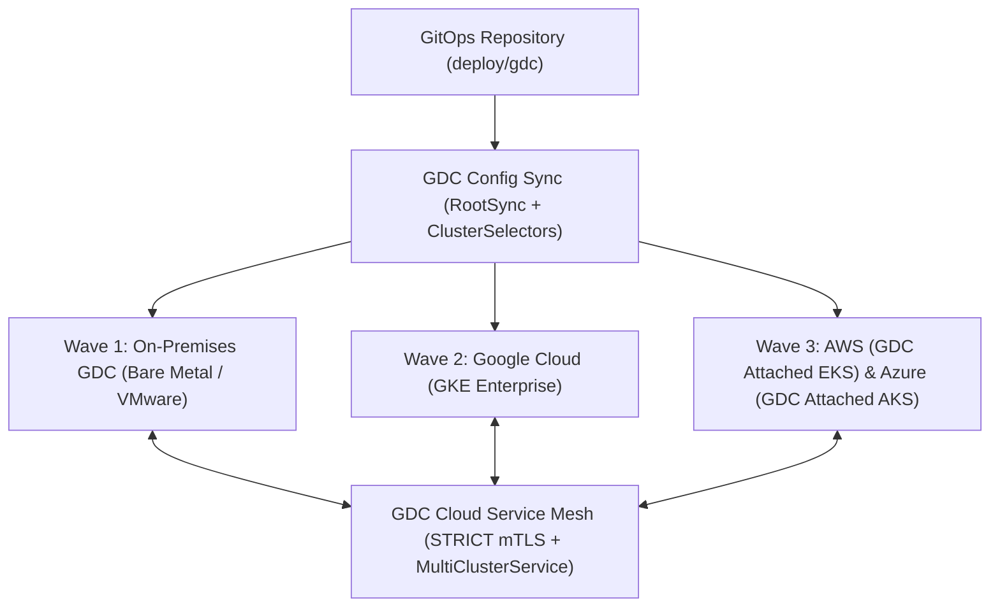

# GDC Fleet Multi-Cloud & On-Premises Deployment Runbook — Employee Leave Request & Certification Portal

## 1. Multi-Cloud & On-Premises GDC Fleet Topology

| Environment | GDC Cluster Selector | StorageClass | Ingress Class | Portable Database Tier |
| :-- | :-- | :-- | :-- | :-- |
| `on-prem-gdc` | `selector-on-prem-gdc` | `local-scsi` | `gdc-metallb-ingress` | `alloydb-omni-onprem` |
| `gcp` | `selector-gcp` | `standard-rwo` | `gke-l7-rilb` | `alloydb-omni-gcp` |
| `aws` | `selector-aws` | `gp3-ebs` | `gdc-attached-eks-alb` | `alloydb-omni-aws` |
| `azure` | `selector-azure` | `managed-csi` | `gdc-attached-aks-ilb` | `alloydb-omni-azure` |

---

## 2. Progressive Rollout Waves & Capability-Group Ordering

- **Capability Groups Deployed:** `GRP-01,GRP-02,GRP-03` (Spec SHA-256: `122f76cd2e984239…`)
- **Greenfield Schema Initialization (Greenfield Requirements Specification):** Before Wave 1 traffic shift, `Job/{slug}-db-schema-migration` applies `src/db/schema.sql`.
- **Wave 1 (`on-prem-gdc`):** Reconciles via `selector-on-prem-gdc`, verifies `/health` on port `8766` and zero Policy Controller violations.
- **Wave 2 (`gcp`):** Reconciles via `selector-gcp`, verifies Cloud Service Mesh `MultiClusterService` endpoint discovery.
- **Wave 3 (`aws` & `azure`):** Reconciles via `selector-aws` and `selector-azure`, completing full multi-cloud active-active readiness.

---

## 3. Unified Observability, OpenTelemetry & SLOs

- **OpenTelemetry Collector (`deploy/observability/otel-collector.yaml`):** Injects `gdc.cluster.provider`, `dlc.domain_slug=leave-request-portal`, and `dlc.capability_group=GRP-01,GRP-02,GRP-03` into all traces, metrics, and logs.
- **SLOs & Burn-Rate Alerts (`deploy/observability/slo_and_alerts.yaml`):** Enforces 99.9% availability SLO (`leave-request-portal-availability-slo`), `GdcFleetHighErrorBurnRate`, and `GdcConfigSyncDriftDetected`.
- **Single-Pane Fleet Dashboard (`deploy/observability/fleet_dashboard.json`):** Aggregates golden signals across `on-prem-gdc`, `gcp`, `aws`, and `azure`.

---

## 4. Cross-Cloud / On-Premises Failover & Rollback SOP

1. **Automated Traffic Failover:** If any provider cluster breaches `GdcFleetHighErrorBurnRate`, GDC Cloud Service Mesh `MultiClusterService` (`leave-request-portal-global-mcs`) automatically drains unhealthy endpoints and shifts traffic to healthy clusters across `on-prem-gdc`, `gcp`, `aws`, and `azure`.
2. **GitOps Rollback:** Revert the offending commit in the GitOps repository; GDC Config Sync (`leave-request-portal-fleet-rootsync`) reconciles all fleet clusters back to the previous verified revision within 60 seconds.
3. **GDC Air-Gapped / Disconnected Operations:** Mirror OCI images (`registry.gdc.local/leave-request-portal/backend:1.0.0`) to the local Harbor registry and reconcile `RootSync` from the air-gapped Git mirror.
