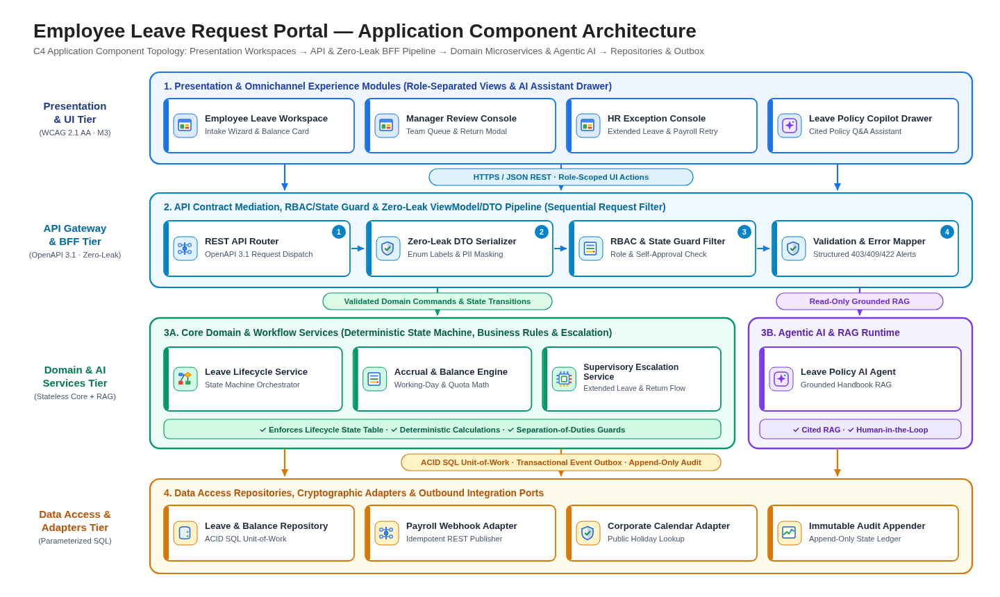
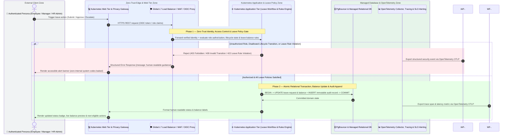

# Application Architecture (`design/application_architecture.md`)

- **Project:** Employee Leave Request Portal (`SCENARIO_REQUIREMENTS_DOC`)
- **Perspective:** **Application Component & Service Architecture (C4 Component View & Runtime Sequence)** (Standalone Perspective Artifact 4 of 7)
- **Visual Renderer:** `design/diagrams/application_architecture.svg` (`.png`) — 4-Tier C4 Application & AI Component Topology
- **Architecture Portfolio Index:** [`design/architecture_design.md`](architecture_design.md)

---

## 1. Application Component & Service Topology (4-Tier C4 Component View)

*(Depicts the application's internal modular structure across **Tier 1 (Presentation & Omnichannel UI Modules)**, **Tier 2 (API Gateway, BFF & Zero-Leak DTO Tier)**, **Tier 3 (Core Domain & AI Agent Services Tier)**, and **Tier 4 (Data Access, Event Bus & Integration Adapters Tier)**.)*



<details>
<summary>Architecture Diagram Specification (parsed by 04/scripts/extract_contracts.py into diagrams/application_architecture.png)</summary>

```diagram-dsl
flowchart TB
    %% title: Employee Leave Request Portal — Application Component Architecture
    %% subtitle: 4-Tier Modular Application, BFF/DTO Boundary, Domain & AI Services, and Repository Adapters
    subgraph SG_Tier1["Tier 1 — Presentation & Omnichannel UI Modules (WCAG 2.1 AA · Material 3 Tokens)"]
        UI1["<b>Employee Leave Workspace</b><br/>Intake Wizard &amp; Balance Card"]:::appCard
        UI2["<b>Manager Review Console</b><br/>Team Queue &amp; Return Modal"]:::appCard
        UI3["<b>HR Exception Console</b><br/>Extended Leave &amp; Payroll Retry"]:::appCard
        UI4["<b>Leave Policy Copilot Drawer</b><br/>Cited Policy Q&amp;A Assistant"]:::appCard
    end

    subgraph SG_Tier2["Tier 2 — API Gateway, BFF & Zero-Leak ViewModel/DTO Tier (OpenAPI 3.1)"]
        API1["<b>REST API Router</b><br/>OpenAPI 3.1 Request Dispatch"]:::appCard
        API2["<b>Zero-Leak DTO Serializer</b><br/>Enum Labels &amp; PII Masking"]:::appCard
        API3["<b>RBAC &amp; State Guard Filter</b><br/>Role &amp; Self-Approval Check"]:::appCard
        API4["<b>Validation &amp; Error Mapper</b><br/>Structured 403/409/422 Alerts"]:::appCard
    end

    subgraph SG_Tier3["Tier 3 — Core Leave Domain & AI Agent Services Tier (Stateless Business Logic)"]
        SVC1["<b>Leave Lifecycle Service</b><br/>State Machine Orchestrator"]:::appCard
        SVC2["<b>Accrual &amp; Balance Engine</b><br/>Working-Day &amp; Quota Math"]:::appCard
        SVC3["<b>Leave Policy AI Agent</b><br/>Grounded Handbook RAG"]:::appCard
        SVC4["<b>Supervisory Escalation Service</b><br/>Extended Leave &amp; Return Flow"]:::appCard
    end

    subgraph SG_Tier4["Tier 4 — Data Access, Event Outbox & Integration Adapters Tier"]
        DAO1["<b>Leave &amp; Balance Repository</b><br/>ACID SQL Unit-of-Work"]:::appCard
        DAO2["<b>Payroll Webhook Adapter</b><br/>Idempotent REST Publisher"]:::appCard
        DAO3["<b>Corporate Calendar Adapter</b><br/>Public Holiday Lookup"]:::appCard
        DAO4["<b>Immutable Audit Appender</b><br/>Append-Only State Ledger"]:::appCard
    end

    SG_Tier1 ==>|"HTTPS JSON / Action Triggers"| SG_Tier2
    SG_Tier2 ==>|"Validated Domain Commands"| SG_Tier3
    SG_Tier3 ==>|"Transactional Repository Calls"| SG_Tier4

    classDef appCard fill:#FFFFFF,stroke:#1A73E8,stroke-width:1.5px,color:#202124;
```

</details>

---

## 2. End-to-End Request & Workflow Execution Sequence (`sequenceDiagram`)



---

## 3. Application Component Responsibilities & Guardrails

| Application Tier | Component | Runtime & Pattern | Input / Output Contract | Guardrail Enforced |
| :-- | :-- | :-- | :-- | :-- |
| **Tier 1 — Presentation** | `Employee Leave Workspace`, `Manager Review Console`, `HR Exception Console`, `Leave Policy Copilot Drawer` | Semantic HTML5 + Vanilla ES2022 (`static-html`) | Consumes Zero-Leak DTO JSON; emits user actions | Mutual tab exclusivity; role-gated action visibility; zero dead controls |
| **Tier 2 — API & DTO** | `REST API Router`, `Zero-Leak DTO Serializer`, `RBAC & State Guard Filter`, `Validation & Error Mapper` | Python 3.11 HTTP/REST (`python-stdlib-http`) | OpenAPI 3.1 request/response schemas | Strips internal keys (`x-internal: true`); maps enum codes to human labels |
| **Tier 3 — Domain & AI** | `Leave Lifecycle Service`, `Accrual & Balance Engine`, `Leave Policy AI Agent`, `Supervisory Escalation Service` | Stateless Domain Services | Domain command objects & validated state transitions | Enforces `(fromState, trigger, role)` transition table and no-self-approval guard |
| **Tier 4 — Data & Adapters** | `Leave & Balance Repository`, `Payroll Webhook Adapter`, `Corporate Calendar Adapter`, `Immutable Audit Appender` | Parameterized SQL + REST Outbox | ACID transactions + append-only audit rows | Zero string-interpolated SQL; transactional audit logging on every state change |
