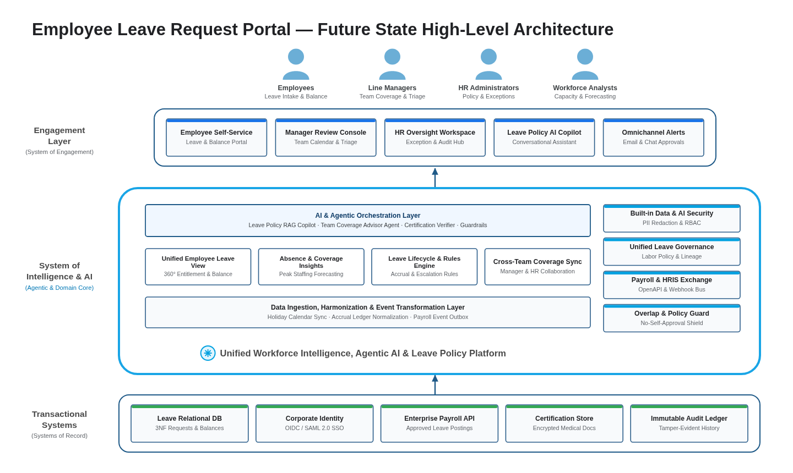
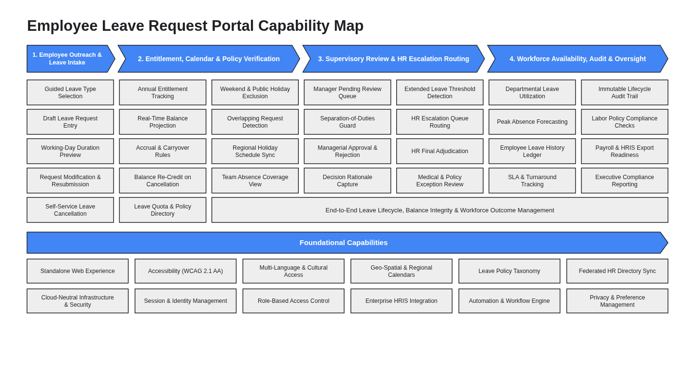
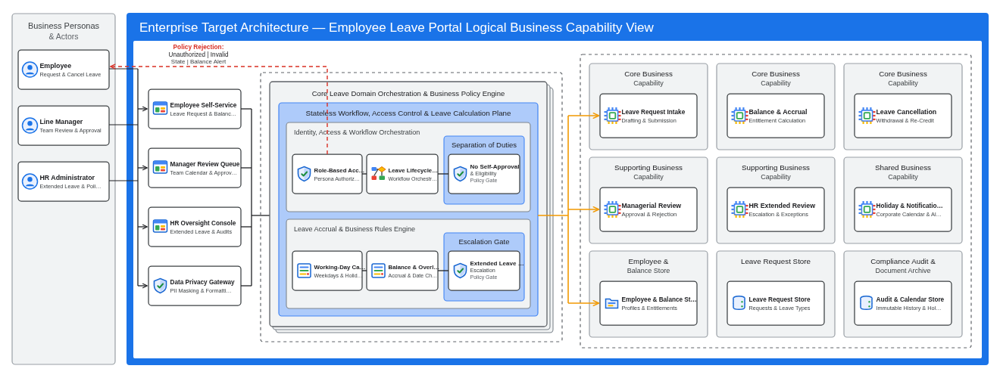
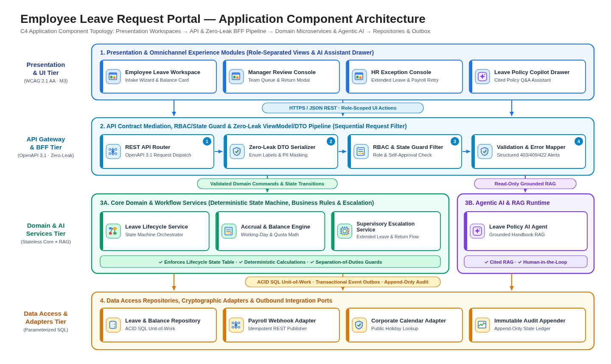
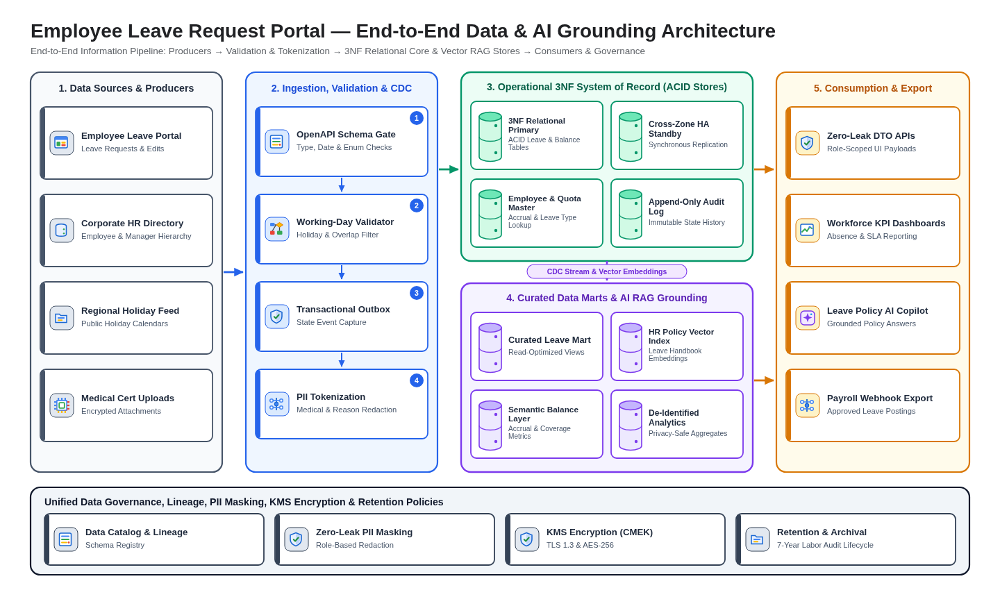
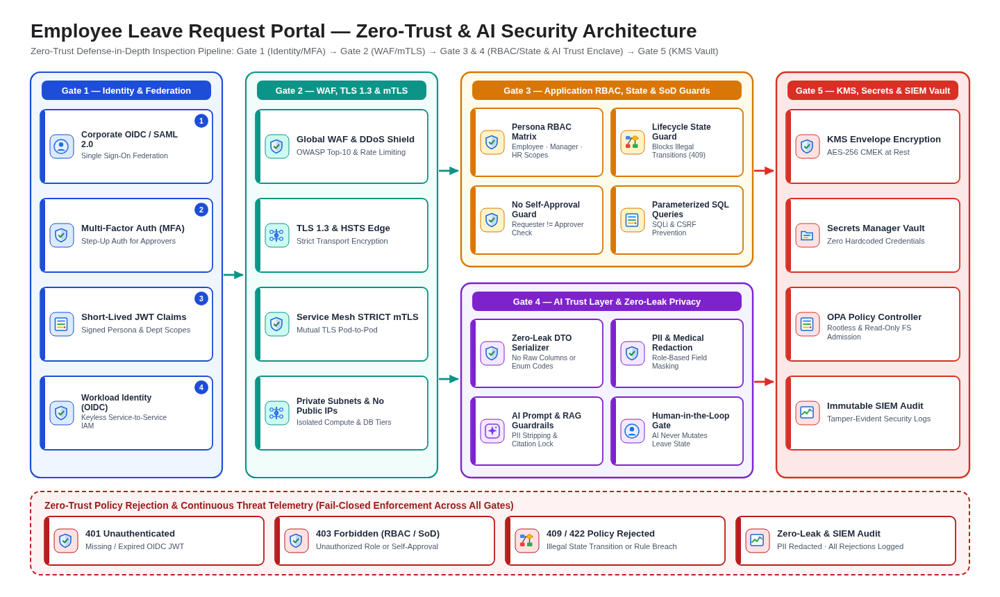
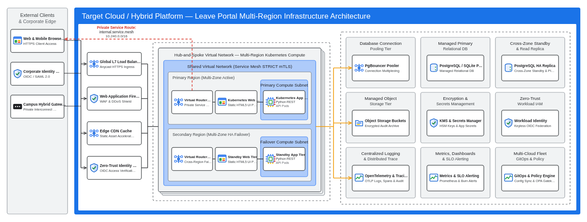

# Architecture Portfolio Index (`design/architecture_design.md`)

- **Project:** Employee Leave Request Portal (`SCENARIO_REQUIREMENTS_DOC`)
- **Confirmed Future-State Tech Stack (`specs/target_stack.json`):** frontend `static-html` (Semantic HTML5 + Vanilla ES2022) · backend `python-stdlib-http` (Python 3.11 HTTP/REST server) · database `sqlite` (SQLite 3.x / Managed PostgreSQL HA) · deployment `gdc-fleet` (`on-prem-gdc`, `gcp`, `aws`, `azure`; `decidedBy: "autonomous-default"`)
- **Architecture & Diagramming Standard:** **Well-Architected Framework (6 Core Pillars + Sustainability)** & **Multi-Perspective Cloud-Agnostic Architecture Suite** (`_shared/well_architected_and_diagram_standards.md`)

---

## 1. Multi-Perspective Architecture Artifact Suite (Separate Artifacts per Perspective)

To ensure each architectural perspective is easy to consume, review, and govern by its target audience, the Future-State ("To-Be") architecture is organized into **7 dedicated perspective artifacts** under `design/`, each paired with its own purpose-built visual diagram rendering in `design/diagrams/`:

| # | Architectural Perspective | Dedicated Artifact (`design/`) | Rendered Diagram (`design/diagrams/`) | Visual Layout Style | Target Audience & Scope |
| :-: | :--- | :--- | :--- | :--- | :--- |
| **1** | **Business Architecture & Capability Map** | [`design/business_architecture.md`](business_architecture.md) | [`diagrams/business_capability_map.svg`](diagrams/business_capability_map.svg) | Value-Stream Chevrons + Capability Grid + Foundational Matrix | Executive Sponsors, Product Owners, Business Analysts |
| **2** | **High-Level Solution Architecture (AI Era)** | [`design/high_level_solution_architecture.md`](high_level_solution_architecture.md) | [`diagrams/high_level_solution_architecture.svg`](diagrams/high_level_solution_architecture.svg) | Personas → Engagement Layer → System of Intelligence & Agentic AI → Systems of Record | CIO/CTO, Enterprise Architects, AI & Digital Strategy Leaders |
| **3** | **Logical Architecture** | [`design/logical_architecture.md`](logical_architecture.md) | [`diagrams/logical_architecture.svg`](diagrams/logical_architecture.svg) | Concentric Multi-Zone Functional & Policy Topology | Domain Architects, Lead Engineers, Business Rules Owners |
| **4** | **Application Architecture** | [`design/application_architecture.md`](application_architecture.md) | [`diagrams/application_architecture.svg`](diagrams/application_architecture.svg) | 4-Tier C4 Component Stack + End-to-End `sequenceDiagram` | Frontend, Backend & AI Application Engineers |
| **5** | **Data Architecture** | [`design/data_architecture.md`](data_architecture.md) | [`diagrams/data_architecture.svg`](diagrams/data_architecture.svg) | 5-Stage Left-to-Right Information Pipeline + Governance Bar + 3NF `erDiagram` | Data Architects, DBAs, AI/RAG Engineers, Privacy Officers |
| **6** | **Security Architecture** | [`design/security_architecture.md`](security_architecture.md) | [`diagrams/security_architecture.svg`](diagrams/security_architecture.svg) | 5-Layer Defense-in-Depth + AI Trust Layer Stack | CISO, Security Architects, Compliance & Risk Auditors |
| **7** | **Infrastructure Architecture** | [`design/infrastructure_architecture.md`](infrastructure_architecture.md) | [`diagrams/infrastructure_architecture.svg`](diagrams/infrastructure_architecture.svg) | Multi-Region Cloud-Agnostic Deployment Topology + Well-Architected & Grilling Matrices | Platform Ops, SRE, Network & Cloud Infrastructure Engineers |
| **8** | **Detailed Solution Design & Contracts** | [`design/solution_design.md`](solution_design.md) | Extracted to `src/db/schema.sql` & `src/contracts/openapi.yaml` | 3NF SQL DDL, OpenAPI 3.1 YAML, ViewModel/DTO & RBAC Enforcement | Coding Agent, Testing Agent & API Consumers |

---

## 2. Visual Architecture Gallery Overview

### 2.1 High-Level Solution Architecture — System of Engagement, System of Intelligence & AI, and Systems of Record
Full specification: [`design/high_level_solution_architecture.md`](high_level_solution_architecture.md)

### 2.2 Business Architecture & Capability Map
Full specification: [`design/business_architecture.md`](business_architecture.md)

### 2.3 Logical Solution Architecture
Full specification: [`design/logical_architecture.md`](logical_architecture.md)

### 2.4 Application Architecture
Full specification: [`design/application_architecture.md`](application_architecture.md)

### 2.5 Data Architecture
Full specification: [`design/data_architecture.md`](data_architecture.md)

### 2.6 Security Architecture
Full specification: [`design/security_architecture.md`](security_architecture.md)

### 2.7 Infrastructure & Deployment Architecture
Full specification: [`design/infrastructure_architecture.md`](infrastructure_architecture.md)

