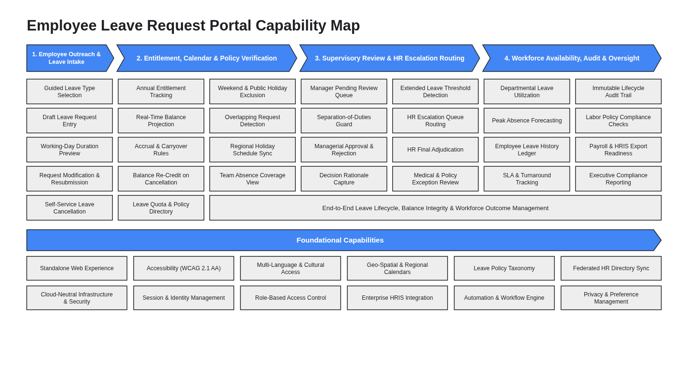

# Business Architecture & Capability Map (`design/business_architecture.md`)

- **Project:** Employee Leave Request Portal (Greenfield Requirements Specification)
- **Perspective:** **Business Architecture & Value-Stream Capability Map** (Standalone Perspective Artifact 1 of 7)
- **Visual Renderer:** `design/diagrams/business_capability_map.svg` (`.png`) — Value-Stream Chevrons + Core Capability Grid + Cross-Cutting Outcome Bar + Foundational Capabilities Matrix
- **Architecture Portfolio Index:** [`design/architecture_design.md`](architecture_design.md)

---

## 1. Business Architecture & Capability Map (Value Streams, Core Business Capabilities & Foundational Capabilities)

*(Depicts the Employee Leave Request Portal's cloud-agnostic **Business Architecture & Capability Map**: top horizontal Blue (`#4285F4`) Value-Stream Chevrons (`1. Employee Outreach & Leave Intake`, `2. Entitlement, Calendar & Policy Verification`, `3. Supervisory Review & HR Escalation Routing`, `4. Workforce Availability, Audit & Oversight`), multi-column Level-2 Core Business Capability cards in uniform `#EEEEEE` fill with `#202124` borders, a bottom Cross-Cutting Outcome bar, and a full-width `Foundational Capabilities` banner above a 2×6 Foundational Capabilities grid.)*

---

## 2. Business Capability & Value-Stream Alignment Summary

| Value-Stream Pillar / Tier | Business Capabilities Included | Primary Business Personas | Delivery Scope (`Phase 1 MVP` vs. `Full Scope`) | Business Outcome & Value Delivered |
| :-- | :-- | :-- | :-- | :-- |
| **1. Employee Outreach & Leave Intake** | `Guided Leave Type Selection`, `Draft Leave Request Entry`, `Working-Day Duration Preview`, `Request Modification`, `Self-Service Cancellation` | `Employee` | `Phase 1 MVP` | Eliminates manual paper/spreadsheet requests with instant working-day feedback |
| **2. Entitlement, Calendar & Policy Verification** | `Annual Entitlement Tracking`, `Real-Time Balance Projection`, `Balance Re-Credit`, `Weekend & Holiday Exclusion`, `Overlapping Request Detection` | `Employee`, `Line Manager` | `Phase 1 MVP` + `Full Scope` | Guarantees accurate business-day deductions and prevents overlapping or over-balance submissions |
| **3. Supervisory Review & HR Escalation Routing** | `Manager Pending Review Queue`, `Separation-of-Duties Guard`, `Managerial Approval & Rejection`, `Extended Leave Threshold Detection`, `HR Final Adjudication` | `Line Manager`, `HR Administrator` | `Phase 1 MVP` + `Full Scope` | Enforces no-self-approval governance and routes requests `> 10` working days to HR oversight |
| **4. Workforce Availability, Audit & Oversight** | `Departmental Leave Utilization`, `Employee Leave History Ledger`, `Immutable Lifecycle Audit Trail`, `Labor Policy Compliance Checks` | `Line Manager`, `HR Administrator` | `Phase 1 MVP` + `Full Scope` | Provides tamper-evident auditability and real-time departmental capacity visibility |
| **Foundational Capabilities** | `Standalone Web Experience`, `Accessibility (WCAG 2.1 AA)`, `Cloud-Neutral Infrastructure & Security`, `Session & Identity Management`, `Role-Based Access Control`, `Automation & Workflow Engine`, `Privacy & Preference Management` | All Personas | `Phase 1 MVP` Foundation | Delivers zero-trust security, WCAG 2.1 AA accessibility, and multi-cloud portability |
