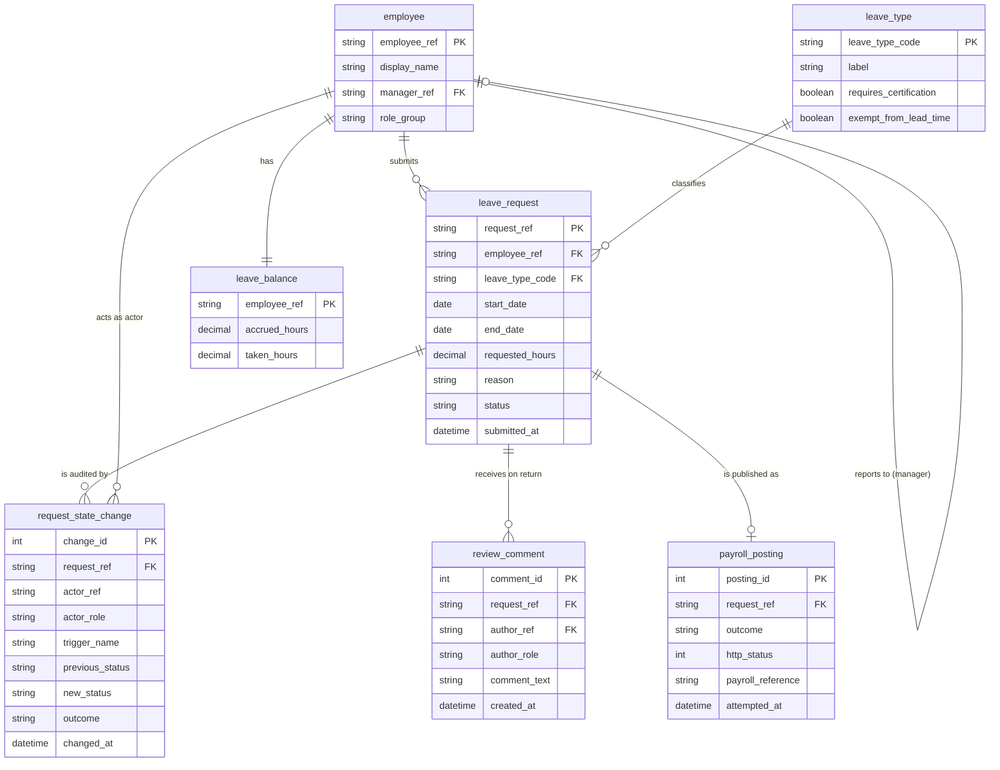

# Data Architecture (`design/data_architecture.md`)

- **Project:** Employee Leave Request Portal (Greenfield Requirements Specification)
- **Perspective:** **Data Architecture — Information Pipeline, Normalised 3NF Domain Model, AI Grounding & Data Governance** (Standalone Perspective Artifact 5 of 7)
- **Visual Renderer:** `design/diagrams/data_architecture.svg` (`.png`) — 5-Stage Left-to-Right Information Pipeline + Bottom Governance Bar
- **Architecture Portfolio Index:** [`design/architecture_design.md`](architecture_design.md)

---

## 1. End-to-End Data & AI Grounding Pipeline Architecture

*(Depicts the end-to-end flow of leave data across **5 Pipeline Stages** — **Data Sources & Producers**, **Ingestion, Validation & CDC**, **Operational 3NF System of Record & MDM**, **Unified Data & AI Grounding / RAG**, and **Consumption, Analytics & Archival** — underpinned by the **Unified Data Governance, Lineage, PII Masking & Retention** bar.)*

![Data Architecture]()

*Standalone diagram files: [Vector SVG](./diagrams/data_architecture.svg) · [Raster PNG](./diagrams/data_architecture.png)*

---

## 2. Normalised 3NF Domain Data Model (`erDiagram`)

---

## 3. Data Governance, Classification & Retention Matrix

| Domain Entity | Data Classification | PII / Sensitive Fields | Masking & Zero-Leak Rule | Storage Tier & Retention Policy |
| :-- | :-- | :-- | :-- | :-- |
| `employee` | `Internal / Confidential` | `employee_ref`, `display_name` | Expose human-readable `display_name`; mask internal reference IDs where required | Operational 3NF DB; retained for active employment + 7 years |
| `leave_balance` | `Confidential` | `accrued_hours`, `taken_hours` | Visible only to the owning `Employee`, their `Line Manager`, and `HR Administrator` | Operational 3NF DB; recalculated transactionally |
| `leave_request` | `Confidential / Sensitive` | `reason`, medical certification notes | Masked for unauthorized roles; enum status mapped to human-readable labels | Operational 3NF DB + 7-year encrypted archive |
| `request_state_change` | `Compliance Audit` | `actor_ref`, `previous_status`, `new_status` | Append-only (`INSERT` only; `UPDATE`/`DELETE` revoked); exported to WORM storage | Immutable Audit Ledger; 7-year statutory retention |
