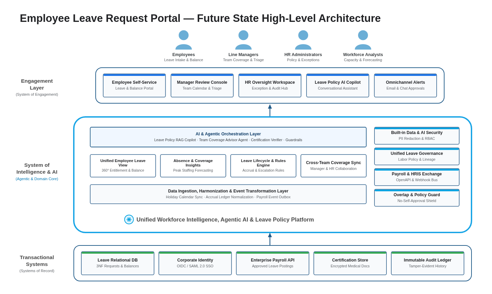

# High-Level Solution Architecture — AI-Era Enterprise View (`design/high_level_solution_architecture.md`)

- **Project:** Employee Leave Request Portal (`SCENARIO_REQUIREMENTS_DOC`)
- **Perspective:** **High-Level Solution Architecture — System of Engagement, System of Intelligence & AI, and Systems of Record** (Standalone Perspective Artifact 2 of 7)
- **Visual Renderer:** `design/diagrams/high_level_solution_architecture.svg` (`.png`) — 3-Tier Enterprise Architecture with Top Personas, Engagement Layer, Cyan System of Intelligence & Agentic AI Layer, and Transactional Systems of Record
- **Architecture Portfolio Index:** [`design/architecture_design.md`](architecture_design.md)

---

## 1. Future-State High-Level Solution Architecture (Engagement, Agentic Intelligence & Systems of Record)

*(Synthesizes the executive 3-tier enterprise architecture across **Business Personas**, the **Engagement Layer (`System of Engagement`)**, the **System of Intelligence & AI (`Agentic AI, Leave Policy RAG, Balance Forecasting & Governance Core`)**, and **Transactional Systems (`Systems of Record`)**.)*



<details>
<summary>Architecture Diagram Specification (parsed by 04/scripts/extract_contracts.py into diagrams/high_level_solution_architecture.png)</summary>

```diagram-dsl
flowchart TB
    %% title: Employee Leave Request Portal — Future State High-Level Architecture
    %% subtitle: Unified System of Engagement, Agentic AI & Leave Intelligence Core, and Transactional Systems of Record
    %% platform_title: Unified Workforce Intelligence, Agentic AI & Leave Policy Platform
    subgraph SG_Personas["Personas & Actors"]
        P1["<b>Employees</b><br/>Leave Intake &amp; Balance"]:::personaCard
        P2["<b>Line Managers</b><br/>Team Coverage &amp; Triage"]:::personaCard
        P3["<b>HR Administrators</b><br/>Policy &amp; Exceptions"]:::personaCard
        P4["<b>Workforce Analysts</b><br/>Capacity &amp; Forecasting"]:::personaCard
    end

    subgraph SG_Engagement["Engagement Layer (System of Engagement)"]
        E1["<b>Employee Self-Service</b><br/>Leave &amp; Balance Portal"]:::engageCard
        E2["<b>Manager Review Console</b><br/>Team Calendar &amp; Triage"]:::engageCard
        E3["<b>HR Oversight Workspace</b><br/>Exception &amp; Audit Hub"]:::engageCard
        E4["<b>Leave Policy AI Copilot</b><br/>Conversational Assistant"]:::engageCard
        E5["<b>Omnichannel Alerts</b><br/>Email &amp; Chat Approvals"]:::engageCard
    end

    subgraph SG_Intelligence["System of Intelligence & AI"]
        subgraph SG_AILayer["AI & Agentic Orchestration Layer (Leave Policy Copilot · Coverage Advisor Agent · Medical Document Triage · Prompt Guardrails)"]
            AI_CORE["<b>AI &amp; Agentic Orchestration Layer</b><br/>Leave Policy RAG Copilot · Team Coverage Advisor Agent · Certification Verifier · Guardrails"]:::aiBanner
        end
        subgraph SG_CoreCaps["Core Intelligence & Domain Capabilities"]
            C1["<b>Unified Employee Leave View</b><br/>360° Entitlement &amp; Balance"]:::capBox
            C2["<b>Absence &amp; Coverage Insights</b><br/>Peak Staffing Forecasting"]:::capBox
            C3["<b>Leave Lifecycle &amp; Rules Engine</b><br/>Accrual &amp; Escalation Rules"]:::capBox
            C4["<b>Cross-Team Coverage Sync</b><br/>Manager &amp; HR Collaboration"]:::capBox
        end
        subgraph SG_DataLayer["Data Ingestion, Harmonization & Event Transformation Layer (Calendar Sync · Accrual Normalization · Payroll Outbox)"]
            DATA_CORE["<b>Data Ingestion, Harmonization &amp; Event Transformation Layer</b><br/>Holiday Calendar Sync · Accrual Ledger Normalization · Payroll Event Outbox"]:::dataBanner
        end
        subgraph SG_Governance["Built-in Security, Governance & Trust"]
            G1["<b>Built-in Data &amp; AI Security</b><br/>PII Redaction &amp; RBAC"]:::govBox
            G2["<b>Unified Leave Governance</b><br/>Labor Policy &amp; Lineage"]:::govBox
            G3["<b>Payroll &amp; HRIS Exchange</b><br/>OpenAPI &amp; Webhook Bus"]:::govBox
            G4["<b>Overlap &amp; Policy Guard</b><br/>No-Self-Approval Shield"]:::govBox
        end
    end

    subgraph SG_Transactional["Transactional Systems (Systems of Record)"]
        T1["<b>Leave Relational DB</b><br/>3NF Requests &amp; Balances"]:::sorCard
        T2["<b>Corporate Identity</b><br/>OIDC / SAML 2.0 SSO"]:::sorCard
        T3["<b>Enterprise Payroll API</b><br/>Approved Leave Postings"]:::sorCard
        T4["<b>Certification Store</b><br/>Encrypted Medical Docs"]:::sorCard
        T5["<b>Immutable Audit Ledger</b><br/>Tamper-Evident History"]:::sorCard
    end

    SG_Personas ==> SG_Engagement
    SG_Engagement <==> SG_Intelligence
    SG_Transactional ==> SG_Intelligence

    classDef personaCard fill:#FFFFFF,stroke:#1A73E8,stroke-width:1.5px,color:#202124;
    classDef engageCard fill:#FFFFFF,stroke:#2B5B84,stroke-width:1.5px,color:#202124;
    classDef aiBanner fill:#E8F4FD,stroke:#19A5E6,stroke-width:2px,color:#0D47A1,font-weight:bold;
    classDef capBox fill:#FFFFFF,stroke:#2B5B84,stroke-width:1.5px,color:#202124;
    classDef dataBanner fill:#FFFFFF,stroke:#2B5B84,stroke-width:1.5px,color:#202124;
    classDef govBox fill:#FFFFFF,stroke:#2B5B84,stroke-width:1.5px,color:#202124;
    classDef sorCard fill:#FFFFFF,stroke:#2B5B84,stroke-width:1.5px,color:#202124;

    style SG_Personas fill:#FFFFFF,stroke:#DADCE0,stroke-width:1px,color:#202124
    style SG_Engagement fill:#FFFFFF,stroke:#2B5B84,stroke-width:1.5px,color:#202124
    style SG_Intelligence fill:#FFFFFF,stroke:#19A5E6,stroke-width:3.5px,color:#0D47A1
    style SG_Transactional fill:#FFFFFF,stroke:#2B5B84,stroke-width:1.5px,color:#202124
```

</details>

---

## 2. High-Level Architectural Tiers & System-of-Intelligence Responsibilities

| Architectural Tier | Core Role in Target State | Key Capabilities & Components | Governance & Trust Boundary |
| :-- | :-- | :-- | :-- |
| **Personas & Actors** | Role-authenticated human actors interacting with the leave platform | `Employees`, `Line Managers`, `HR Administrators`, `Workforce Analysts` | OIDC / SAML 2.0 identity federation with role-scoped session claims |
| **Engagement Layer (`System of Engagement`)** | Responsive, accessible multi-channel user experience and embedded AI assistance | `Employee Self-Service Portal`, `Manager Review Console`, `HR Oversight Workspace`, `Leave Policy AI Copilot`, `Omnichannel Alerts` | Zero-Leak ViewModel/DTO boundary (`_shared/zero_leak.md`); WCAG 2.1 AA compliance |
| **System of Intelligence & AI (`Agentic & Domain Core`)** | Combines deterministic leave policy/accrual rules with grounded AI copilots and team coverage forecasting | • **AI & Agentic Layer:** Leave Policy RAG Copilot, Team Coverage Advisor Agent, Medical Certification Verifier, Prompt Guardrails<br>• **Core Domain Capabilities:** `Unified Employee Leave View`, `Absence & Coverage Insights`, `Leave Lifecycle & Rules Engine`, `Cross-Team Coverage Sync`<br>• **Data Ingestion & Transformation:** Holiday Calendar Sync, Accrual Ledger Normalization, Payroll Event Outbox | • `Built-in Data & AI Security` (PII redaction before prompt grounding)<br>• `Unified Leave Governance`<br>• `Payroll & HRIS Exchange`<br>• `Overlap & Policy Guard` (deterministic state/role check before any write) |
| **Transactional Systems (`Systems of Record`)** | Authoritative ACID persistence, identity federation, payroll integration, and immutable audit storage | `Leave Relational DB` (3NF), `Corporate Identity (OIDC/SAML)`, `Enterprise Payroll API`, `Certification Store`, `Immutable Audit Ledger` | Encryption at rest (`KMS CMEK`), mTLS in transit, append-only audit constraints |
