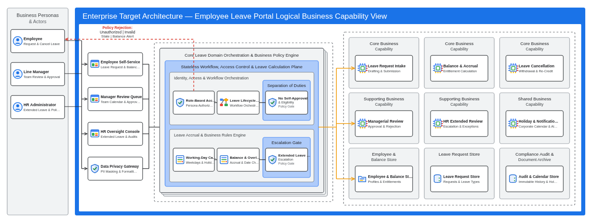

# Logical Solution Architecture (`design/logical_architecture.md`)

- **Project:** Employee Leave Request Portal (Greenfield Requirements Specification)
- **Perspective:** **Logical Business Capability & Functional Domain Architecture** (Standalone Perspective Artifact 3 of 7)
- **Visual Renderer:** `design/diagrams/logical_architecture.svg` (`.png`) — Concentric Multi-Zone Functional Topology
- **Architecture Portfolio Index:** [`design/architecture_design.md`](architecture_design.md)

---

## 1. Logical Solution Architecture (Business Personas, User Experience Channels, Domain Policy Core, Business Capabilities & Domain Data Stores)

*(Depicts the Employee Leave Request Portal's cloud-agnostic **Business Capability & Functional Domain Architecture**: Business Personas (`Employee`, `Line Manager`, `HR Administrator`) in the left `#F1F3F4` column, User Experience Channels & Data Privacy Gateway in Column 1, Core Leave Policy & Calculation Orchestration in Column 2 with red dashed policy-rejection feedback, and the 3×3 grid of Business Capability Services and Logical Domain Data Stores in Column 3.)*

---

## 2. Logical Functional Zone & Capability Responsibilities

| Logical Architecture Zone | Logical Components | Functional Responsibility | Domain Policy Enforced |
| :-- | :-- | :-- | :-- |
| **1. Business Personas & Actors** | `Employee`, `Line Manager`, `HR Administrator` | Initiates leave intake, supervisory review, and HR exception workflows | Role-scoped access and separation of duties |
| **2. User Experience & Channel Capabilities** | `Employee Self-Service`, `Manager Review Queue`, `HR Oversight Console`, `Data Privacy Gateway` | Role-tailored workspaces and outbound PII masking / human-readable label mapping | Zero internal column names or enum codes in UI |
| **3. Core Leave Domain Orchestration & Policy Engine** | `Role-Based Access Control`, `Leave Lifecycle Engine`, `No Self-Approval Gate`, `Working-Day Calculator`, `Balance & Overlap Engine`, `Extended Leave HR Gate` | Evaluates lifecycle state transitions, separation of duties, working-day durations, and HR escalation rules | Rejects illegal transitions (`409`), unauthorized roles (`403`), and balance/overlap violations (`422`) |
| **4. Business Capability Services & Logical Stores** | `Leave Request Intake`, `Balance & Accrual`, `Leave Cancellation`, `Managerial Review`, `HR Extended Review`, `Holiday & Notifications`, plus 3 Logical Stores | Executes bounded leave capabilities and persists state changes with append-only audit trails | Transactional consistency across requests, balances, and audit records |
