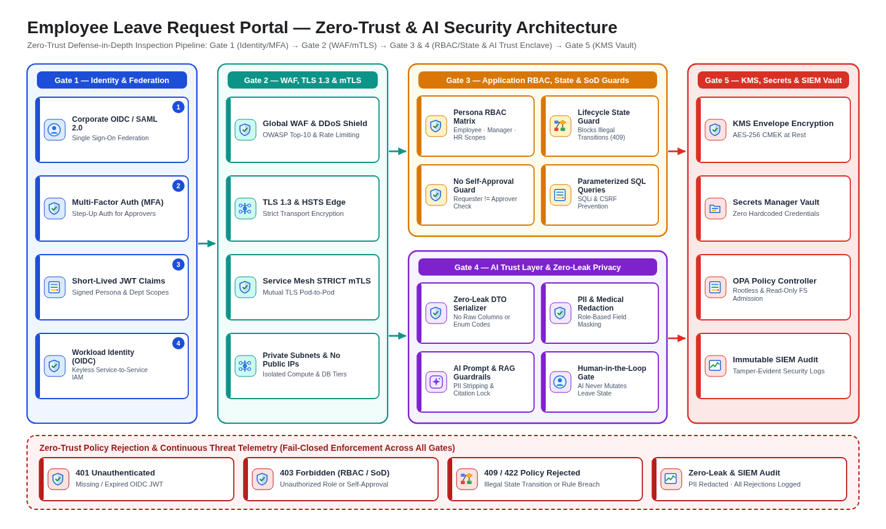

# Security Architecture (`design/security_architecture.md`)

- **Project:** Employee Leave Request Portal (Greenfield Requirements Specification)
- **Perspective:** **Security, Zero-Trust & AI Trust Layer Architecture** (Standalone Perspective Artifact 6 of 7)
- **Visual Renderer:** `design/diagrams/security_architecture.svg` (`.png`) — 5-Layer Defense-in-Depth & AI Trust Layer Stack
- **Architecture Portfolio Index:** [`design/architecture_design.md`](architecture_design.md)

---

## 1. Defense-in-Depth & AI Trust Layer Architecture (5 Security Perimeters)

*(Depicts the concentric 5-layer defense-in-depth security model across **Perimeter 1 (Identity & Federation)**, **Perimeter 2 (Network & Edge)**, **Perimeter 3 (Application RBAC, State-Guard & Separation of Duties)**, **Perimeter 4 (AI Trust Layer & Zero-Leak Data Privacy)**, and **Perimeter 5 (Data Encryption, Secrets & Continuous Compliance)**.)*

---

## 2. Role-Based Access Control (RBAC) & Separation-of-Duties Matrix

| Business Persona | Authentication & Scope | Permitted Views | Permitted Workflow Actions | Prohibited Actions & Separation-of-Duties Guards |
| :-- | :-- | :-- | :-- | :-- |
| **Employee** | Corporate OIDC + Employee ID claim | Employee Leave Workspace, Personal Balance & History | Create Draft, Submit Request, Withdraw/Cancel Own Request, Resubmit Returned Request | Cannot view other employees' requests; cannot approve, reject, or return any request (`403 Forbidden`) |
| **Line Manager** | Corporate OIDC + Manager Role + MFA | Manager Review Queue, Team Calendar, Own Leave Workspace | Approve, Return for Correction, or Reject direct-report requests (`<= 10` working days); Escalate extended leave | **No Self-Approval Guard:** Cannot approve, return, or reject their own leave request (`403 Forbidden`) |
| **HR Administrator** | Corporate OIDC + HR Role + MFA | HR Oversight Console, Extended Leave Queue, Payroll Retry, Audit Trail | Adjudicate extended/exception leave (`> 10` working days), retry failed payroll postings, inspect audit trail | Cannot bypass immutable audit logging or mutate historical `request_state_change` rows |

---

## 3. AI Trust Layer & Zero-Leak Privacy Controls

| Control Domain | Threat / Risk Mitigated | Enforcement Mechanism | Verification Gate |
| :-- | :-- | :-- | :-- |
| **Zero-Leak DTO Boundary** | Leaking internal SQL column names (`employee_ref`, `leave_type_code`) or raw enum codes (`PENDING_HR`) in UI | Dedicated ViewModel/DTO mapper converts all status codes and errors into human-readable labels | `TC-UI-LEAK-01..04` Zero-Leakage Runtime & Static Verification |
| **AI Prompt & RAG Privacy** | Sensitive medical reasons or employee PII sent to external LLM endpoints | Pre-prompt PII redaction strips personal identifiers; RAG retrieves only public HR leave handbook policies | Static & runtime security checks |
| **Human-in-the-Loop Governance** | Autonomous AI agent approving or rejecting leave without human accountability | AI Copilot is strictly advisory (`read-only`); all state transitions require authenticated human actor JWT | Backend state-transition guard (`403`/`409`) |
