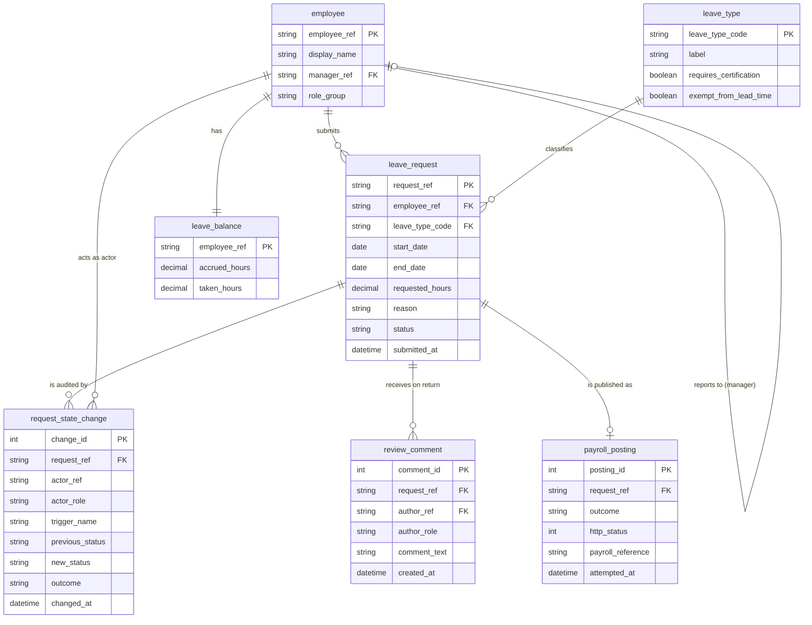

# Solution Design (`design/solution_design.md`) — Employee Leave & Exception Request Portal

- **Input Scenario:** `Greenfield Requirements Specification`
- **Target stack:** frontend `static-html` · backend `python-stdlib-http` · database `sqlite` (from `specs/target_stack.json`)
- **Companion Architecture Document:** `design/architecture_design.md` (Google Cloud Well-Architected Logical & Technical Architecture, Sequence Diagram, Layering Table & 6-Pillar Grilling Matrices)
- **Principles:** clean greenfield target; contract-first (this document is the source of `src/contracts/openapi.yaml` and `src/db/schema.sql`, while `design/architecture_design.md` owns all Logical & Technical Architecture diagrams); the spec §3.3 state table is encoded once as data and enforced in the backend **and** mirrored in the UI; Zero-Leak ViewModel/DTO boundary; the payroll REST interface is a first-class outbound integration component (BRD §8), not legacy carry-over.

## 1. Future-State ("To-Be") Domain Model — Normalised 3NF ERD & SQL DDL Schema
Entities refine the conceptual entities from discovery into a normalised 3NF target schema. Derived values (`pending`, `available`, `requires_certification` of a request) are computed, never stored. Lookup table `leave_type` carries the certification / lead-time behaviour. Audit rows and payroll attempts are append-only (no UPDATE/DELETE path exists in the API).



```sql ddl
-- Employee Leave & Exception Request Portal — SQLite 3 DDL (3NF). Status values = spec §3.3 state codes.
PRAGMA foreign_keys = ON;

CREATE TABLE employee (
    employee_ref      TEXT PRIMARY KEY,                 -- format EMP-NNNNN (masked at the ViewModel boundary)
    display_name      TEXT NOT NULL,
    role_group        TEXT NOT NULL CHECK (role_group IN ('employees', 'managers', 'hr-certifiers', 'system')),
    manager_ref       TEXT REFERENCES employee(employee_ref)
);

CREATE TABLE leave_balance (
    employee_ref      TEXT PRIMARY KEY REFERENCES employee(employee_ref),
    accrued_hours     REAL NOT NULL CHECK (accrued_hours >= 0),
    taken_hours       REAL NOT NULL CHECK (taken_hours >= 0)
);

CREATE TABLE leave_type (
    leave_type_code        TEXT PRIMARY KEY,            -- vacation | sick | exception
    label                  TEXT NOT NULL UNIQUE,        -- Vacation | Sick | Exception
    requires_certification INTEGER NOT NULL DEFAULT 0 CHECK (requires_certification IN (0, 1)),
    exempt_from_lead_time  INTEGER NOT NULL DEFAULT 0 CHECK (exempt_from_lead_time IN (0, 1))
);

CREATE TABLE leave_request (
    request_ref       TEXT PRIMARY KEY,                 -- LR-NNNN, shown to users as the request reference
    employee_ref      TEXT NOT NULL REFERENCES employee(employee_ref),
    leave_type_code   TEXT NOT NULL REFERENCES leave_type(leave_type_code),
    start_date        TEXT NOT NULL,                    -- ISO-8601 date
    end_date          TEXT NOT NULL CHECK (end_date >= start_date),
    requested_hours   REAL NOT NULL CHECK (requested_hours > 0),
    reason            TEXT CHECK (reason IS NULL OR length(reason) <= 500),
    status            TEXT NOT NULL CHECK (status IN ('DRAFT', 'SUBMITTED', 'MANAGER_APPROVED', 'APPROVED', 'POSTED', 'WITHDRAWN')),
    created_at        TEXT NOT NULL,
    updated_at        TEXT NOT NULL,
    submitted_at      TEXT
);
CREATE INDEX idx_leave_request_employee_status ON leave_request(employee_ref, status);
CREATE INDEX idx_leave_request_status ON leave_request(status);

CREATE TABLE review_comment (
    comment_id        INTEGER PRIMARY KEY AUTOINCREMENT,
    request_ref       TEXT NOT NULL REFERENCES leave_request(request_ref),
    author_ref        TEXT NOT NULL REFERENCES employee(employee_ref),
    author_role       TEXT NOT NULL,
    comment_text      TEXT NOT NULL CHECK (length(trim(comment_text)) >= 1),
    created_at        TEXT NOT NULL
);
CREATE INDEX idx_review_comment_request ON review_comment(request_ref, created_at);

CREATE TABLE request_state_change (                    -- append-only audit (FR-08)
    change_id         INTEGER PRIMARY KEY AUTOINCREMENT,
    request_ref       TEXT NOT NULL REFERENCES leave_request(request_ref),
    actor_ref         TEXT NOT NULL,
    actor_role        TEXT NOT NULL,
    trigger_name      TEXT NOT NULL,
    previous_status   TEXT NOT NULL,
    new_status        TEXT NOT NULL,
    outcome           TEXT NOT NULL CHECK (outcome IN ('applied', 'denied')),
    detail            TEXT,
    changed_at        TEXT NOT NULL
);
CREATE INDEX idx_state_change_request ON request_state_change(request_ref, changed_at);

CREATE TABLE payroll_posting (                         -- one row per posting attempt (FR-07)
    posting_id        INTEGER PRIMARY KEY AUTOINCREMENT,
    request_ref       TEXT NOT NULL REFERENCES leave_request(request_ref),
    outcome           TEXT NOT NULL CHECK (outcome IN ('accepted', 'failed')),
    http_status       INTEGER,
    payroll_reference TEXT,
    attempted_at      TEXT NOT NULL
);
CREATE INDEX idx_payroll_posting_request ON payroll_posting(request_ref, attempted_at);
```

## 3. API Contract (OpenAPI 3.1)
One operation per §3.3 trigger (`Create`, `Submit`, `Manager Approve`, `Return`, `Certify`, `Withdraw`; `Post` is executed by the system inside the approval/certification call and is observable through `getPayrollPostings`), read endpoints per view, a common `Error {code, message}` schema with a user-readable `message`, and `x-internal: true` on fields the UI never renders. Identity: OIDC / IAP bearer token and verified `X-Actor-Role` / `X-Actor-Ref` identity headers (REQ-ARCH-08).

```yaml openapi
openapi: 3.1.0
info:
  title: Employee Leave & Exception Request Portal API
  version: 1.0.0
  description: Transition endpoints validate (fromState, trigger, role, ownership) against the spec §3.3 table and answer 409 (state) / 403 (role) with a user-readable message.
servers:
  - url: http://127.0.0.1:8766
security:
  - actorHeaders: []
paths:
  /health:
    get:
      operationId: healthcheck
      security: []
      responses:
        "200":
          description: Service and database readiness
          content:
            application/json:
              schema:
                $ref: "#/components/schemas/Health"
  /api/me:
    get:
      operationId: getCurrentActor
      responses:
        "200":
          description: The signed-in actor as a display model
          content:
            application/json:
              schema:
                $ref: "#/components/schemas/Actor"
        "401":
          $ref: "#/components/responses/Unauthenticated"
  /api/balance:
    get:
      operationId: getBalance
      description: BR-01 figures for the signed-in employee (available = accrued - taken - pending).
      responses:
        "200":
          description: Balance
          content:
            application/json:
              schema:
                $ref: "#/components/schemas/Balance"
        "401":
          $ref: "#/components/responses/Unauthenticated"
        "403":
          $ref: "#/components/responses/Forbidden"
  /api/requests:
    get:
      operationId: listMyRequests
      description: History of the signed-in employee's own requests (FR-06).
      responses:
        "200":
          description: Requests, newest first
          content:
            application/json:
              schema:
                type: array
                items:
                  $ref: "#/components/schemas/RequestView"
        "403":
          $ref: "#/components/responses/Forbidden"
    post:
      operationId: createRequest
      description: Trigger Create ([*] -> DRAFT). Employee only.
      requestBody:
        required: true
        content:
          application/json:
            schema:
              $ref: "#/components/schemas/RequestInput"
      responses:
        "201":
          description: Draft created
          content:
            application/json:
              schema:
                $ref: "#/components/schemas/RequestView"
        "400":
          $ref: "#/components/responses/ValidationError"
        "403":
          $ref: "#/components/responses/Forbidden"
  /api/requests/{reference}:
    parameters:
      - $ref: "#/components/parameters/reference"
    get:
      operationId: getRequest
      responses:
        "200":
          description: Request display model including the actions the current actor may take
          content:
            application/json:
              schema:
                $ref: "#/components/schemas/RequestView"
        "403":
          $ref: "#/components/responses/Forbidden"
        "404":
          $ref: "#/components/responses/NotFound"
    put:
      operationId: updateDraft
      description: Edit fields while DRAFT (ASSUMPTION-02). Employee owner only.
      requestBody:
        required: true
        content:
          application/json:
            schema:
              $ref: "#/components/schemas/RequestInput"
      responses:
        "200":
          description: Draft updated
          content:
            application/json:
              schema:
                $ref: "#/components/schemas/RequestView"
        "400":
          $ref: "#/components/responses/ValidationError"
        "403":
          $ref: "#/components/responses/Forbidden"
        "409":
          $ref: "#/components/responses/StateConflict"
  /api/requests/{reference}/submit:
    parameters:
      - $ref: "#/components/parameters/reference"
    post:
      operationId: submitRequest
      description: Trigger Submit (DRAFT -> SUBMITTED) after BR-01, BR-03, BR-04.
      responses:
        "200":
          description: Submitted
          content:
            application/json:
              schema:
                $ref: "#/components/schemas/RequestView"
        "400":
          $ref: "#/components/responses/ValidationError"
        "403":
          $ref: "#/components/responses/Forbidden"
        "409":
          $ref: "#/components/responses/StateConflict"
  /api/requests/{reference}/withdraw:
    parameters:
      - $ref: "#/components/parameters/reference"
    post:
      operationId: withdrawRequest
      description: Trigger Withdraw (DRAFT | SUBMITTED | MANAGER_APPROVED -> WITHDRAWN), BR-05.
      responses:
        "200":
          description: Withdrawn
          content:
            application/json:
              schema:
                $ref: "#/components/schemas/RequestView"
        "403":
          $ref: "#/components/responses/Forbidden"
        "409":
          $ref: "#/components/responses/StateConflict"
  /api/requests/{reference}/approve:
    parameters:
      - $ref: "#/components/parameters/reference"
    post:
      operationId: managerApproveRequest
      description: Trigger Manager Approve (SUBMITTED -> MANAGER_APPROVED when BR-02 applies, else -> APPROVED, then system Post).
      responses:
        "200":
          description: Approved (routing applied)
          content:
            application/json:
              schema:
                $ref: "#/components/schemas/RequestView"
        "403":
          $ref: "#/components/responses/Forbidden"
        "409":
          $ref: "#/components/responses/StateConflict"
  /api/requests/{reference}/return:
    parameters:
      - $ref: "#/components/parameters/reference"
    post:
      operationId: returnRequest
      description: Trigger Return (SUBMITTED -> DRAFT by Manager, MANAGER_APPROVED -> DRAFT by HR Certifier); comment required (BR-07).
      requestBody:
        required: true
        content:
          application/json:
            schema:
              $ref: "#/components/schemas/ReturnInput"
      responses:
        "200":
          description: Returned to Draft
          content:
            application/json:
              schema:
                $ref: "#/components/schemas/RequestView"
        "400":
          $ref: "#/components/responses/ValidationError"
        "403":
          $ref: "#/components/responses/Forbidden"
        "409":
          $ref: "#/components/responses/StateConflict"
  /api/requests/{reference}/certify:
    parameters:
      - $ref: "#/components/parameters/reference"
    post:
      operationId: certifyRequest
      description: Trigger Certify (MANAGER_APPROVED -> APPROVED, then system Post).
      responses:
        "200":
          description: Certified
          content:
            application/json:
              schema:
                $ref: "#/components/schemas/RequestView"
        "403":
          $ref: "#/components/responses/Forbidden"
        "409":
          $ref: "#/components/responses/StateConflict"
  /api/requests/{reference}/audit:
    parameters:
      - $ref: "#/components/parameters/reference"
    get:
      operationId: getRequestAudit
      description: Append-only audit trail (FR-08). Internal roles see actors; the owning employee sees states only. No write methods exist (405).
      responses:
        "200":
          description: Audit entries, oldest first
          content:
            application/json:
              schema:
                type: array
                items:
                  $ref: "#/components/schemas/AuditEntry"
        "403":
          $ref: "#/components/responses/Forbidden"
  /api/queues/manager:
    get:
      operationId: getManagerQueue
      description: SUBMITTED requests of the signed-in manager's direct reports (FR-04).
      responses:
        "200":
          description: Queue
          content:
            application/json:
              schema:
                type: array
                items:
                  $ref: "#/components/schemas/RequestView"
        "403":
          $ref: "#/components/responses/Forbidden"
  /api/queues/certification:
    get:
      operationId: getCertificationQueue
      description: MANAGER_APPROVED requests meeting BR-02 (FR-05).
      responses:
        "200":
          description: Queue
          content:
            application/json:
              schema:
                type: array
                items:
                  $ref: "#/components/schemas/RequestView"
        "403":
          $ref: "#/components/responses/Forbidden"
  /api/payroll-postings:
    get:
      operationId: getPayrollPostings
      description: Every payroll posting attempt (trigger Post outcome) with alerts for failures. Payroll Integration role only.
      responses:
        "200":
          description: Posting attempts, newest first
          content:
            application/json:
              schema:
                type: array
                items:
                  $ref: "#/components/schemas/PayrollPostingView"
        "403":
          $ref: "#/components/responses/Forbidden"
  /payroll/leave-postings:
    post:
      operationId: payrollStubReceivePosting
      description: Local stand-in for the external payroll REST interface (BRD §8). Production points PAYROLL_BASE_URL at the real system. The stub answers 503 while PAYROLL_STUB_OUTAGE=1.
      security: []
      requestBody:
        required: true
        content:
          application/json:
            schema:
              $ref: "#/components/schemas/PayrollPostingRequest"
      responses:
        "201":
          description: Accepted by payroll
          content:
            application/json:
              schema:
                type: object
                properties:
                  payrollReference:
                    type: string
        "400":
          $ref: "#/components/responses/ValidationError"
        "503":
          description: Payroll unavailable (simulated outage)
components:
  securitySchemes:
    actorHeaders:
      type: apiKey
      in: header
      name: X-Actor-Role
      description: Verified identity header (with X-Actor-Ref) propagated by the OIDC / Identity-Aware Proxy gateway; handlers only see the Actor object.
  parameters:
    reference:
      name: reference
      in: path
      required: true
      schema:
        type: string
        pattern: "^LR-[0-9]{4,}$"
  responses:
    Unauthenticated:
      description: No identity supplied
      content:
        application/json:
          schema:
            $ref: "#/components/schemas/Error"
    Forbidden:
      description: Role or ownership does not allow the action
      content:
        application/json:
          schema:
            $ref: "#/components/schemas/Error"
    NotFound:
      description: Unknown request reference
      content:
        application/json:
          schema:
            $ref: "#/components/schemas/Error"
    ValidationError:
      description: A business rule or field validation failed
      content:
        application/json:
          schema:
            $ref: "#/components/schemas/Error"
    StateConflict:
      description: The trigger is not allowed from the request's current state
      content:
        application/json:
          schema:
            $ref: "#/components/schemas/Error"
  schemas:
    Error:
      type: object
      required: [code, message]
      properties:
        code:
          type: string
          enum: [BALANCE_EXCEEDED, LEAD_TIME, OVERLAP, COMMENT_REQUIRED, STATE_NOT_ALLOWED, ROLE_NOT_ALLOWED, VALIDATION, NOT_FOUND, UNAUTHENTICATED]
          x-internal: true
        message:
          type: string
          description: User-readable, names what failed and the fix (spec §1.3)
        field:
          type: string
          description: Field name the UI should mark aria-invalid
    Health:
      type: object
      properties:
        status:
          type: string
        database:
          type: string
        today:
          type: string
    Actor:
      type: object
      properties:
        role:
          type: string
          enum: [Employee, Manager, HR Certifier, Payroll Integration]
        displayName:
          type: string
        maskedReference:
          type: string
          description: EMP-•••NN
    Balance:
      type: object
      properties:
        accruedHours:
          type: number
        takenHours:
          type: number
        pendingHours:
          type: number
        availableHours:
          type: number
        today:
          type: string
        leadTimeDays:
          type: integer
        certificationThresholdHours:
          type: number
    RequestInput:
      type: object
      required: [leaveType, startDate, endDate, hours]
      properties:
        leaveType:
          type: string
          enum: [Vacation, Sick, Exception]
        startDate:
          type: string
          format: date
        endDate:
          type: string
          format: date
        hours:
          type: number
        reason:
          type: string
          maxLength: 500
    ReturnInput:
      type: object
      required: [comment]
      properties:
        comment:
          type: string
    RequestView:
      type: object
      description: Display model (ViewModel). Codes are mapped to labels; the raw status code is carried for client-side gating only and never rendered.
      properties:
        reference:
          type: string
        employee:
          $ref: "#/components/schemas/Actor"
        leaveType:
          type: string
        startDate:
          type: string
        endDate:
          type: string
        hours:
          type: number
        reason:
          type: string
        statusCode:
          type: string
          enum: [DRAFT, SUBMITTED, MANAGER_APPROVED, APPROVED, POSTED, WITHDRAWN]
          x-internal: true
        statusLabel:
          type: string
        nextApprover:
          type: string
        requiresCertification:
          type: boolean
        certificationLabel:
          type: string
        returnComment:
          type: string
        returnedByRole:
          type: string
        allowedActions:
          type: array
          description: Action names the current actor may trigger now (derived from the §3.3 table)
          items:
            type: string
            enum: [submit, withdraw, approve, return, certify, edit]
        posting:
          $ref: "#/components/schemas/PayrollPostingView"
        updatedAt:
          type: string
    AuditEntry:
      type: object
      properties:
        at:
          type: string
        actor:
          type: string
        role:
          type: string
        fromLabel:
          type: string
        toLabel:
          type: string
        outcome:
          type: string
        detail:
          type: string
    PayrollPostingView:
      type: object
      properties:
        reference:
          type: string
        outcomeLabel:
          type: string
        payrollReference:
          type: string
        attemptedAt:
          type: string
        alert:
          type: string
        statusLabel:
          type: string
    PayrollPostingRequest:
      type: object
      required: [requestReference, employeeReference, leaveType, startDate, endDate, hours]
      properties:
        requestReference:
          type: string
        employeeReference:
          type: string
        leaveType:
          type: string
        startDate:
          type: string
        endDate:
          type: string
        hours:
          type: number
```

## 4. ViewModel / DTO Boundary & Label Mapping
`viewmodel.py` is the only module that produces JSON for the UI; `app.js` renders only ViewModel fields and never a code.

| Internal field / code | Exposed as | Visible label / masked format |
| :-- | :-- | :-- |
| `leave_request.status = DRAFT` | `statusLabel` | Draft (caption "Returned by Manager / HR Certifier" when `returnComment` exists) |
| `SUBMITTED` | `statusLabel`, `nextApprover` | Submitted · next approver "Manager" |
| `MANAGER_APPROVED` | `statusLabel`, `nextApprover` | Manager approved · next approver "HR Certifier" |
| `APPROVED` | `statusLabel`, `nextApprover` | Approved · next approver "Payroll" |
| `POSTED` | `statusLabel` | Posted to payroll · next approver "—" |
| `WITHDRAWN` | `statusLabel` | Withdrawn · next approver "—" |
| trigger `Submit` / `Withdraw` / `Manager Approve` / `Return` / `Certify` | `allowedActions` names → button labels | Submit request · Withdraw request · Approve · Return to employee · Certify |
| `payroll_posting.outcome = accepted / failed` | `outcomeLabel`, `alert` | Accepted by payroll · Payroll posting failed |
| error codes `BALANCE_EXCEEDED`, `LEAD_TIME`, `OVERLAP`, `COMMENT_REQUIRED`, `STATE_NOT_ALLOWED`, `ROLE_NOT_ALLOWED`, `VALIDATION` | `message` (+ `field`) | the sentences of spec §1.3 |
| `leave_type.leave_type_code` | `leaveType` | Vacation · Sick · Exception (`leave_type.label`) |
| `employee.employee_ref` (EMP-NNNNN) | `employee.maskedReference` | `EMP-•••NN` (last two digits) |
| national identifier | *not exposed* | — (not stored by the portal) |
| `requested_hours`, `start_date`, `end_date` | `hours`, `startDate`, `endDate` | "8 h", ISO dates rendered as entered |
| `comment_id`, `change_id`, `posting_id`, `created_at`, `role_group`, `manager_ref` | *not exposed* | — |
| `request_state_change.previous_status / new_status` | `fromLabel`, `toLabel` | labels as above, rendered "Draft → Submitted" |

## 5. Workflow & Authorization Enforcement
- **Transition table source:** spec §3.3 → `workflow.py: TRANSITIONS` (list of `(from, to, trigger, role, guard)`), served to the UI as `allowedActions` per request so the browser never re-implements the table.
- **Backend guard:** `WorkflowService.apply(actor, reference, trigger, payload)` checks, in order: identity present (401) → trigger owned by role and ownership/direct-report constraint (403 `ROLE_NOT_ALLOWED`) → `(fromState, trigger)` present in `TRANSITIONS` (409 `STATE_NOT_ALLOWED`, message "This action is not available for a request that is {label}.") → rule guards BR-01/03/04 on Submit, BR-07 on Return (400 with the §1.3 message) → persist new state + audit row in one transaction → on `APPROVED` call the payroll client and apply `Post` (system actor) when 2xx, else record a failed posting (alert). Denied attempts are written to `request_state_change` with `outcome = denied`.
- **UI derivation:** `app.js` renders transition buttons only for names in `allowedActions`; the Employee view contains no Approve/Return/Certify markup at all; the role switcher sets the identity headers for subsequent calls and re-renders the role's single view.
- **RBAC matrix:** spec §2.1 → `workflow.py: ROLE_TRIGGERS` + queue filters in `repositories.py` (manager queue = direct reports only; certification queue = BR-02 only; payroll view = Payroll Integration only).

## 6. Frontend Design Tokens & Components
- Design references applied: none — Enterprise UX Simplicity Guardrail defaults; `<body data-design-references="default-ux-guardrails">`.
- Tokens: `--color-primary #1a5fb4`, `--color-on-primary #fff`, `--color-surface #f7f8fa`, `--color-text #1b1b1f`, `--color-success #1e7e34`, `--color-warning #8a5a00`, `--color-error #b3261e` (all ≥ 4.5:1 on their surfaces); spacing `--space-1 … --space-5` on an 8 px grid; type scale title 1.5 rem / section 1.25 rem / body 1 rem / caption 0.875 rem; focus ring `3px solid #1a5fb4`.
- Components: header (h1, role switcher `select`), skip link, one `main` with one view per role (`employee-view`, `manager-view`, `hr-view`, `payroll-view`), balance panel (`aria-live=polite`), request form (4 visible fields + `<details>` for reason), validation summary (`role=alert`), request detail card with status chip + action buttons, history/queue tables (`<th scope=col>`), audit list, status region (`role=status`).
- `data-testid` convention: kebab-case `<entity>-<field>` for inputs (`leave-type`, `start-date`), `<action>-btn` for controls (`submit-btn`, `approve-btn`), `<entity>-status` for status displays, `<role>-view` for views, `queue-row-<reference>` / `open-<reference>` for rows. The exact set is declared in `test/test_cases.json` (contract-first).

## 7. Cross-Cutting Concerns (Target-State Production Architecture)
- **Validation:** server-side in `rules.py` (types, ranges, 500-char reason, ISO dates, BR-01/03/04/06/07); the UI mirrors BR-01/02/03/06 live for feedback but never decides.
- **Error handling:** every error is `Error {code, message, field?}`; unexpected exceptions become 500 with a generic message and are logged with a correlation id; nothing technical reaches visible text.
- **Audit / logging:** `request_state_change` append-only; structured JSON request logs (`severity`, `httpRequest`, `trace`, `actorRole`, `capabilityGroup`) streamed to `Cloud Logging`, `Cloud Trace`, and `OpenTelemetry Collector` (`OTEL_EXPORTER_OTLP_ENDPOINT`).
- **Configuration & Target Database:** `PORT`, `DATABASE_URL` (connecting via `PgBouncer` connection pooling to `AlloyDB for PostgreSQL` / `Cloud SQL`), `PAYROLL_BASE_URL` (external payroll REST interface), and `OTEL_EXPORTER_OTLP_ENDPOINT`.
- **Security controls (spec §2):** Enterprise OIDC / Google Cloud `IAP` identity adapter (REQ-ARCH-08); role/ownership checks in the workflow service; masked references in all ViewModels; national identifier never stored; CORS headers restricted to the UI origin; CMEK encryption at rest (`Cloud KMS`) and `STRICT` mTLS in transit (`Cloud Service Mesh`).
- **Accessibility obligations per component (spec §3):** labels bound by `for/id`; `aria-live` balance; `role=alert` summary with `aria-describedby` links; `role=status` announcements; focus moved to the view `h2` on role change and to the summary on validation failure; skip link; visible focus ring; status chips always carry text.

## 8. Target-State Build, Packaging & Runtime Specification
| Target-State Concern | Specification (per `specs/target_stack.json` & `design/architecture_design.md`) |
| :-- | :-- |
| **Frontend Packaging** | Static web assets (`src/ui/`) packaged into rootless OCI web tier container (`deploy/containers/Dockerfile.ui`) behind `Cloud CDN` & `Cloud Load Balancing` |
| **Backend Runtime** | Stateless HTTP/REST application tier (`src/backend/`) packaged into rootless OCI app container (`deploy/containers/Dockerfile.backend`, `USER 65532:65532`) |
| **Database Schema & Migration** | `src/db/schema.sql` applied via idempotent `db-schema-migration` Kubernetes `Job` (`deploy/gdc/base/workloads.yaml`) |
| **Health & Readiness Probes** | `GET /health` (`livenessProbe` & `readinessProbe` verifying relational database connectivity) |
| **Target Deployment Plane** | Multi-cloud / hybrid GDC Fleet (`on-prem-gdc`, `gcp`, `aws`, `azure`) managed by `GDC Config Sync`, `Policy Controller`, and `Cloud Service Mesh` |

## 9. Migration Reference
Not applicable — Greenfield Requirements Specification; no `design/data_migration_and_cutover.md`.
