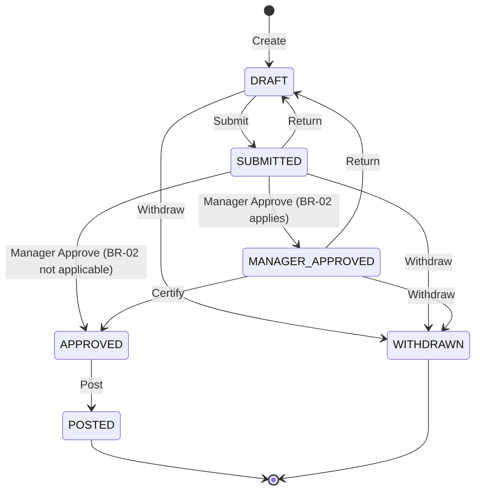

# Employee Leave & Exception Request Portal — Application Specification

- **Input Scenario:** `Greenfield Requirements Specification`
- **Domain Slug:** `employee-leave-exception-request-portal`
- **Accessibility Standard(s):** `WCAG 2.1 AA`
- **Regulations / Policies in Scope:** none declared (the document cites an internal HR policy §4.1–§4.5 and a data-quality standard; no statute)
- **Scope statement:** scope is strictly the input document (BRD v1.0, FR-01…FR-08, NFR-01…NFR-05, BR-01…BR-05); nothing unsolicited is added and no modernization enhancements exist for this scenario.
- **Assumptions (autonomous answers to the open workflow questions in `specs/discovery_architecture_and_inventory.md §3.1`, most restrictive reading):**
  - `ASSUMPTION-01` — "Returned" is not a persisted state: a Return moves the request to `DRAFT`; the mandatory return comment is shown on the request and in its history. Impact: no `RETURNED` row in §3.3; the employee sees "Draft" plus the return comment.
  - `ASSUMPTION-02` — Editing is allowed only while the request is `DRAFT` (including after a return). Impact: edit controls are hidden in every other state.
  - `ASSUMPTION-03` — `POSTED` and `WITHDRAWN` are terminal and can never be reopened. Impact: no transition leaves them.
  - `ASSUMPTION-04` — Withdrawal is possible from `DRAFT`, `SUBMITTED` and `MANAGER_APPROVED` only; an `APPROVED` request can no longer be withdrawn even if payroll posting has not yet succeeded.
  - `ASSUMPTION-05` — No automatic retry schedule for failed payroll postings is specified; a failed posting raises an alert visible to the Payroll Integration view and the request stays `APPROVED`; the next posting attempt is a system transition, not a human control.
  - `ASSUMPTION-06` — No hold or escalation states exist.
  - `ASSUMPTION-07` — The HR Certifier queue shows every `MANAGER_APPROVED` request that meets BR-02, without a population filter.
  - `ASSUMPTION-08` — Requested hours are entered as a number; start/end dates are used for BR-03 (lead time) and BR-04 (overlap) only.
  - `ASSUMPTION-09` — `pending` in BR-01 counts every request that is not `DRAFT` or `WITHDRAWN` (`SUBMITTED`, `MANAGER_APPROVED`, `APPROVED`, `POSTED`) until the HR system of record reports the hours as taken; the portal never adds approved hours to `taken` itself (accrual engine out of scope, BRD §7). Impact: approved and posted requests reduce the available balance immediately.
- **Architectural & UX Standards:** Enterprise UX Simplicity Guardrails, Zero Internal Data Leakage Boundary, and Deterministic Workflow Chain of Custody

---

## 1 Pillar 1 — Functionality & Business Rules

### 1.1 Functional Requirements (`REQ-FUNC-NN`)
Capability coverage is complete: all 11 capabilities CAP-01…CAP-11 of the discovery inventory map to at least one requirement below (see the coverage table in `specs/traceability_matrix.md §1`).

| ID | Requirement (testable statement) | Actors | Capability ref | Source |
| :-- | :-- | :-- | :-- | :-- |
| REQ-FUNC-01 | An Employee can create a request in state `DRAFT` with leave type (Vacation, Sick, Exception), start date, end date, requested hours (> 0, in 0.5 h steps) and an optional reason of at most 500 characters (BR-06), and can edit every field while the request is `DRAFT`. | Employee | CAP-01 | FR-01; §4 step 1; ASSUMPTION-02 |
| REQ-FUNC-02 | While the Employee edits the request form, the UI recomputes and displays the available balance (`accrued − taken − pending`, BR-01) and the post-request balance (`available − requested`) on every `input` event, without a submit. | Employee | CAP-02 | FR-02; BR-01 |
| REQ-FUNC-03 | Submit (`DRAFT → SUBMITTED`) is blocked, the request stays `DRAFT`, and a plain-language message naming the failed rule and the concrete fix (amount of hours or number of days needed, or the overlapping request) is shown when BR-01, BR-03 or BR-04 fails; the same checks run server-side. | Employee | CAP-03 | FR-03; §4 step 2 |
| REQ-FUNC-04 | An Employee can withdraw an own request while it is `DRAFT`, `SUBMITTED` or `MANAGER_APPROVED` (BR-05); `WITHDRAWN` is terminal. | Employee | CAP-04 | §4 step 6; BR-05; ASSUMPTION-04 |
| REQ-FUNC-05 | The Employee's history lists own requests with the human-readable status label (§3.3 label table), the next approver ("Manager", "HR Certifier", "Payroll", or "—"), and the latest return comment when one exists. | Employee | CAP-05 | FR-06; ASSUMPTION-01 |
| REQ-FUNC-06 | The Manager queue lists only `SUBMITTED` requests whose requester reports directly to the signed-in Manager; Approve routes to `MANAGER_APPROVED` when BR-02 applies and to `APPROVED` otherwise; Return requires a non-empty comment (BR-07) and moves the request to `DRAFT`. | Manager | CAP-06 | FR-04; §4 steps 3–4; BR-02 |
| REQ-FUNC-07 | The HR Certifier queue lists `MANAGER_APPROVED` requests that meet BR-02 (hours > 40 or type Exception); Certify moves them to `APPROVED`; Return requires a comment (BR-07) and moves them to `DRAFT`. | HR Certifier | CAP-07 | FR-05; §4 step 4; ASSUMPTION-07 |
| REQ-FUNC-08 | When a request becomes `APPROVED` the system posts it as JSON to the payroll REST endpoint `POST /payroll/leave-postings`; a 2xx answer moves the request to `POSTED` and records the payroll reference; any other outcome keeps it `APPROVED`, records the failure and raises an alert visible in the Payroll Integration view. | Payroll Integration | CAP-08 | FR-07; §4 step 5; §8; ASSUMPTION-05 |
| REQ-FUNC-09 | Every state change writes an append-only audit record with actor, timestamp (UTC), previous state and new state; the record is visible to internal roles in the request's history. | All | CAP-09 | FR-08; NFR-05 |
| REQ-FUNC-10 | Any attempt to trigger a transition that §3.3 does not allow from the request's current state, or by a role that does not own it, is refused by the backend with HTTP 409 (state) or 403 (role) and a human-readable message; the state is unchanged and the attempt is audited. | All | CAP-06, CAP-07, CAP-04 | §3.3, §4 |

### 1.2 Journeys & Steps
*(Step counts come from the §3.3 states each role passes through.)*

**Employee (external):** 1. Open the portal → "My requests" view with balance summary. 2. Choose "New request", fill type, dates, hours, reason; live balance updates (REQ-FUNC-02); save → `DRAFT`. 3. Submit → validation BR-01/BR-03/BR-04; on failure the message states the fix; on success `SUBMITTED`. 4. Watch history: status label and next approver (REQ-FUNC-05). 5. If returned: request is `DRAFT` again with the comment; edit and resubmit. 6. Optionally withdraw while allowed → `WITHDRAWN` (terminal). 7. Final outcome visible as "Approved" then "Posted to payroll".

**Manager (internal):** 1. Open the portal → "Manager queue" listing `SUBMITTED` requests of direct reports. 2. Select a request → details, balance impact, BR-02 indicator. 3. Approve → `MANAGER_APPROVED` (BR-02 applies) or `APPROVED` (otherwise); or Return with a mandatory comment → `DRAFT`. 4. Queue refreshes; the acted request leaves the queue.

**HR Certifier (internal):** 1. Open the portal → "Certification queue" listing `MANAGER_APPROVED` requests meeting BR-02. 2. Select a request → details and manager decision. 3. Certify → `APPROVED`; or Return with a mandatory comment → `DRAFT`. 4. Queue refreshes.

**Payroll Integration (internal, system):** 1. On each `APPROVED` transition the system posts the request to payroll. 2. 2xx → `POSTED`; failure → request stays `APPROVED` and an alert is listed in the "Payroll postings" view. 3. The view shows every posting attempt with outcome and payroll reference (read-only).

### 1.3 Validation Rules
| ID | Field / Action | Rule | User-readable message (what failed + the fix) |
| :-- | :-- | :-- | :-- |
| VAL-01 | Submit | BR-01 `requested ≤ available` | "Requested hours exceed your available balance by {excess} h. Reduce the request to at most {available} h." |
| VAL-02 | Submit | BR-03 lead time ≥ 3 calendar days unless Exception | "Vacation and Sick requests must be submitted at least 3 calendar days before the start date. Choose a start date on or after {earliest_date}, or request an Exception." |
| VAL-03 | Submit | BR-04 no overlap with own non-withdrawn request | "These dates overlap your existing request {reference} ({start} – {end}). Change the dates or withdraw the other request first." |
| VAL-04 | Save / Submit | hours > 0; end date ≥ start date; required fields present | "Enter the requested hours (more than 0)." / "End date must be on or after the start date." / "Choose a leave type and both dates." |
| VAL-05 | Save | BR-06 reason ≤ 500 characters | "Reason must be 500 characters or fewer; remove {n} characters." |
| VAL-06 | Return | BR-07 comment required | "A comment is required to return a request. Tell the employee what to change." |
| VAL-07 | Any transition | §3.3 state guard / role ownership | "This action is not available for a request that is {status label}." / "Only the employee's manager can approve or return this request." |

---

## 2 Pillar 2 — Security, RBAC, PII & Audit (`REQ-SEC-NN`)
| ID | Requirement | Applies to |
| :-- | :-- | :-- |
| REQ-SEC-01 | Authentication: every role signs in through the organisation's OIDC provider (authorization-code flow); the role is taken from the token's group claims (`employees`, `managers`, `hr-certifiers`); sessions expire after 8 hours of inactivity and an expired session redirects to sign-in with the draft preserved locally. No anonymous access exists. The Payroll Integration actor is a system principal using a client-credentials token. | All roles |
| REQ-SEC-02 | Authorization follows the RBAC matrix in §2.1: the backend evaluates `(role, trigger, fromState, ownership)` for every write; a denied attempt returns 403 (role) or 409 (state) with a user-readable message, changes nothing and is audited (REQ-FUNC-10). External-role views never render internal controls. | All roles |
| REQ-SEC-03 | PII inventory and masking per §2.2: employee identifier and national identifier are masked at the presentation boundary; the national identifier is never returned by any API used by the UI. | Employee, Manager, HR Certifier |
| REQ-SEC-04 | Encryption: TLS 1.2+ for all transport including the call to payroll; the database file and backups are encrypted at rest with keys owned by the platform team's key-management service; secrets (payroll credentials, OIDC client secret) are injected from the environment and never stored in source. | Platform |
| REQ-SEC-05 | Audit trail: every state transition, denied attempt and payroll posting writes an append-only record `{request, actor, role, previous state, new state, timestamp UTC, reason/comment}`; records cannot be updated or deleted through any API and are retained for 7 years; only internal roles can read them. | All roles |
| REQ-SEC-06 | Input hardening: all request bodies are validated server-side (types, ranges, 500-character reason, date formats); responses carry `Content-Type: application/json` and the UI escapes all text it renders. | Backend, UI |

### 2.1 RBAC Matrix *(✓ allowed · ✗ denied — denied attempts answer 403/409 with a readable message and are audited)*
| Capability / Transition | Employee | Manager | HR Certifier | Payroll Integration |
| :-- | :-: | :-: | :-: | :-: |
| Create (`[*] → DRAFT`), edit own Draft | ✓ (own) | ✗ | ✗ | ✗ |
| Submit (`DRAFT → SUBMITTED`) | ✓ (own) | ✗ | ✗ | ✗ |
| Withdraw (`DRAFT/SUBMITTED/MANAGER_APPROVED → WITHDRAWN`) | ✓ (own) | ✗ | ✗ | ✗ |
| Manager Approve (`SUBMITTED → MANAGER_APPROVED / APPROVED`) | ✗ | ✓ (direct reports) | ✗ | ✗ |
| Return (`SUBMITTED → DRAFT`) | ✗ | ✓ (direct reports) | ✗ | ✗ |
| Certify (`MANAGER_APPROVED → APPROVED`) | ✗ | ✗ | ✓ | ✗ |
| Return (`MANAGER_APPROVED → DRAFT`) | ✗ | ✗ | ✓ | ✗ |
| Post (`APPROVED → POSTED`) | ✗ | ✗ | ✗ | ✓ (system) |
| View own requests and balance | ✓ | ✗ | ✗ | ✗ |
| View Manager queue (direct reports) | ✗ | ✓ | ✗ | ✗ |
| View Certification queue | ✗ | ✗ | ✓ | ✗ |
| View payroll postings and alerts | ✗ | ✗ | ✗ | ✓ |
| View audit history of a request | own, states only | ✓ | ✓ | ✓ |

### 2.2 PII Fields & Masking *(source of `piiPatterns` for leakage tests)*
| Field | Classification | Masked display format | Storage protection | Retention |
| :-- | :-- | :-- | :-- | :-- |
| Employee identifier (format `EMP-\d{5}`) | Personal identifier | Last two digits only: `EMP-•••42`; full value never rendered | Encrypted at rest; audit on access | Life of the employment record + 7 years (audit) |
| National identifier (format `\d{3}-\d{2}-\d{4}`) | Sensitive personal identifier | Never displayed by the portal; not included in any API response used by the UI | Encrypted at rest; column-level access restricted to HR system of record | Not stored by the portal |
| Employee display name | Personal data | Shown in full to the employee's own manager, HR Certifier and the employee; never in payroll alerts beyond the request reference | Encrypted at rest | Life of the employment record |
| Reason text | Personal / health-related free text | Shown only to the requester, the direct manager and HR Certifier; never to Payroll Integration | Encrypted at rest | 7 years with the request, then purged |

### 2.3 Audit Events
| Event | Recorded fields | Retention |
| :-- | :-- | :-- |
| State transition (every §3.3 row) | request reference, actor, role, previous state, new state, UTC timestamp, comment (Return) | 7 years, append-only |
| Denied attempt (role or state guard) | request reference, actor, role, attempted trigger, current state, reason | 7 years, append-only |
| Payroll posting attempt | request reference, outcome (accepted / failed), HTTP status, payroll reference, UTC timestamp | 7 years, append-only |

---

## 3 Pillar 3 — Accessibility (`REQ-A11Y-NN`) and Lifecycle Tables
| ID | Requirement (measurable) | Standard clause |
| :-- | :-- | :-- |
| REQ-A11Y-01 | Text contrast ≥ 4.5:1 and large text / UI component contrast ≥ 3:1 using the three semantic status tokens; every status and validation severity is conveyed by text (label or icon with text), never by colour alone. | WCAG 2.1 AA 1.4.3, 1.4.11, 1.4.1 |
| REQ-A11Y-02 | Full keyboard operability: every control is reachable with Tab in a logical order and operable with Enter/Space; no keyboard trap; a "Skip to main content" link is the first focusable element; the role switcher and queues are native `select`/`button`/`table` elements. | WCAG 2.1 AA 2.1.1, 2.1.2, 2.4.1, 2.4.3 |
| REQ-A11Y-03 | Focus management: a visible focus indicator (≥ 3:1 outline) on every control; after Submit, focus moves to the validation summary (on failure) or to the status heading (on success); after a view/role change focus moves to the view's `h2`. | WCAG 2.1 AA 2.4.7, 3.2.2 |
| REQ-A11Y-04 | Programmatic labels and roles: every `input`/`select`/`textarea` has a visible `<label for>`; icon-only buttons carry `aria-label`; landmarks `header`, `nav`, `main` exist; exactly one `h1`, with `h2` per view; data tables use `<th scope>`. | WCAG 2.1 AA 1.3.1, 4.1.2, 2.4.6 |
| REQ-A11Y-05 | Live regions: the live balance uses `aria-live="polite"`; validation summaries use `role="alert"`; status changes announce through a `role="status"` region. | WCAG 2.1 AA 4.1.3 |
| REQ-A11Y-06 | Error identification: each validation message names the field, describes the problem in plain language and states the fix (§1.3); the field gets `aria-invalid="true"` and `aria-describedby` pointing at the message; a summary is shown above the form. | WCAG 2.1 AA 3.3.1, 3.3.3 |

### 3.3 Lifecycle State Machine *(frozen; parsed by scripts — table mirrors the diagram; evidence per row in `specs/discovery_architecture_and_inventory.md §3`)*

| From | To | Trigger | Actor Role | Guard |
| :-- | :-- | :-- | :-- | :-- |
| [*] | DRAFT | Create | Employee | request belongs to the signed-in employee (BRD §4 step 1) |
| DRAFT | SUBMITTED | Submit | Employee | own request; BR-01, BR-03 and BR-04 pass, otherwise stays DRAFT with VAL-01/02/03 (BRD §4 step 2) |
| SUBMITTED | MANAGER_APPROVED | Manager Approve | Manager | requester is a direct report; BR-02 applies — requested hours > 40 or type Exception (BRD §4 steps 3–4) |
| SUBMITTED | APPROVED | Manager Approve | Manager | requester is a direct report; BR-02 does not apply (BRD §4 step 4) |
| SUBMITTED | DRAFT | Return | Manager | requester is a direct report; non-empty comment (BR-07) (BRD §4 step 3) |
| MANAGER_APPROVED | APPROVED | Certify | HR Certifier | BR-02 applies to the request (BRD §4 step 4) |
| MANAGER_APPROVED | DRAFT | Return | HR Certifier | non-empty comment (BR-07) (BRD §4 step 4) |
| APPROVED | POSTED | Post | Payroll Integration | payroll endpoint answered 2xx; otherwise stays APPROVED and an alert is raised (BRD §4 step 5, ASSUMPTION-05) |
| DRAFT | WITHDRAWN | Withdraw | Employee | own request; BR-05 (BRD §4 step 6) |
| SUBMITTED | WITHDRAWN | Withdraw | Employee | own request; BR-05 (BRD §4 step 6) |
| MANAGER_APPROVED | WITHDRAWN | Withdraw | Employee | own request; BR-05; ASSUMPTION-04 |

Terminal states: `POSTED`, `WITHDRAWN` (ASSUMPTION-03). Initial state: `DRAFT`. There is no rejection state (BRD §4 step 7).

**State labels shown to users** *(the UI never shows the code)*:
| State code | Visible label | Next approver shown |
| :-- | :-- | :-- |
| DRAFT | Draft | — (or "Returned by {role}" caption when a return comment exists) |
| SUBMITTED | Submitted | Manager |
| MANAGER_APPROVED | Manager approved | HR Certifier |
| APPROVED | Approved | Payroll |
| POSTED | Posted to payroll | — |
| WITHDRAWN | Withdrawn | — |

Trigger and error codes are likewise mapped: `Submit` → "Submit request", `Manager Approve` → "Approve", `Return` → "Return to employee", `Certify` → "Certify", `Withdraw` → "Withdraw request", `Post` → "Post to payroll"; error codes `BALANCE_EXCEEDED`, `LEAD_TIME`, `OVERLAP`, `COMMENT_REQUIRED`, `STATE_NOT_ALLOWED`, `ROLE_NOT_ALLOWED` → the messages in §1.3.

### 3.4 Business Rules & Formulas *(parsed; thresholds are numbers)*
| Rule ID | Formula / Rule | Inputs | Source |
| :-- | :-- | :-- | :-- |
| BR-01 | `available = accrued − taken − pending` where `pending = Σ requested_hours of the employee's requests in SUBMITTED, MANAGER_APPROVED, APPROVED or POSTED` (ASSUMPTION-09); submit requires `requested ≤ available`; displayed `post_request = available − requested` (hours, 0.5 h precision, no rounding) | accrued hours, taken hours, pending hours, requested hours | BRD §3 BR-01; HR policy §4.1; FR-02 |
| BR-02 | `requires_certification = requested_hours > 40 OR leave_type = Exception`; when true, Manager Approve leads to MANAGER_APPROVED and HR Certifier must Certify; when false Manager Approve leads to APPROVED | requested hours, leave type | BRD §3 BR-02; HR policy §4.3 |
| BR-03 | `start_date − submit_date ≥ 3` calendar days unless `leave_type = Exception`; `earliest_date = submit_date + 3 days` | start date, submit date (today, UTC), leave type | BRD §3 BR-03; HR policy §4.2 |
| BR-04 | duplicate if another request of the same employee with status ≠ WITHDRAWN (and not the request itself) satisfies `start_date ≤ other.end_date AND end_date ≥ other.start_date` | start date, end date, the employee's other requests | BRD §3 BR-04; data-quality standard |
| BR-05 | Withdraw allowed only if `status ∈ {DRAFT, SUBMITTED, MANAGER_APPROVED}` | status | BRD §3 BR-05; HR policy §4.5 |
| BR-06 | `length(reason) ≤ 500` characters; reason optional | reason | BRD FR-01 |
| BR-07 | Return requires `length(trim(comment)) ≥ 1` | comment | BRD FR-04; §4 step 3 |

### 3.5 Roles *(parsed; Kind is `external` or `internal` — no other values)*
| Role | Kind | Views | Allowed Transitions |
| :-- | :-- | :-- | :-- |
| Employee | external | My requests (balance summary, request form, history) | Create, Submit, Withdraw |
| Manager | internal | Manager queue (direct reports' Submitted requests, request detail) | Manager Approve, Return |
| HR Certifier | internal | Certification queue (Manager-approved requests meeting BR-02, request detail) | Certify, Return |
| Payroll Integration | internal | Payroll postings (read-only log of posting attempts and alerts) | Post |

---

## 4 Pillar 4 — User Experience & Zero Internal Data Leakage (`REQ-UX-NN`)
| ID | Requirement | Derived from |
| :-- | :-- | :-- |
| REQ-UX-01 | The ten Enterprise UX Simplicity Guardrails are adopted as defaults with no overrides (§4.1): one primary action per view, role-separated views, ≤ 3 task tabs per role, ≤ 5 visible fields per step (reason inside progressive disclosure), single-column layout 720–840 px, live calculation, actionable errors, 4-level typography with 3 semantic status tokens, zero internal data. | Enterprise UX Simplicity Guardrails |
| REQ-UX-02 | Design reference: `resources/design_references/` is empty, so the default clean Material-Design-3-style theme (system font stack, 8 px spacing grid, tonal surfaces) is applied; the applied set is stamped in `<body data-design-references="default-ux-guardrails">`. | Gate 1 (autonomous) |
| REQ-UX-03 | Zero internal-data leakage boundary: visible text never contains database table/column identifiers, raw `UPPER_SNAKE_CASE` state/trigger/error codes, internal keys or UUIDs, API paths, SQL, or engineering notes; every code is mapped to the label table in §3.3 at the ViewModel boundary (§4.2). | Zero-Leak ViewModel Boundary |
| REQ-UX-04 | Role-separated navigation: the Employee view contains no Approve/Return/Certify/Post control; a role switcher (`select[data-testid=role-switcher]`) represents the signed-in identity's group claim in the pretotype, defaulting to the external role Employee. | §3.5; guardrail 2 |
| REQ-UX-05 | Controls are rendered and enabled from `(currentState, currentRole)` using the §3.3 table as one data structure; a transition control that is not allowed is absent (not merely disabled) and any server refusal shows the VAL-07 message with the status unchanged. | §3.3 Deterministic State Table |
| REQ-UX-06 | Live reactive calculation: available and post-request balance (BR-01), lead-time earliest date (BR-03) and the certification indicator (BR-02) recompute on `input`; validation banners say what failed and the fix (§1.3). | guardrails 7–8 |
| REQ-UX-07 | No dead controls: every button, select, row action and tab has a handler with a visible DOM effect; empty queues show an explicit "No requests waiting" line instead of an empty table. | guardrail 10; TC-UI-INTERACT |

### 4.1 UX Guardrail Overrides
| Guardrail # | Override | Justification / reference |
| :-- | :-- | :-- |
| — | none | no design reference or Gate 1 instruction overrides the defaults |

### 4.2 View & Component Topology
| View ID | Navigation Tab / Route | UI Pattern | Bound Role(s) | Primary CTA & Lifecycle Trigger |
| :-- | :-- | :-- | :-- | :-- |
| my-requests | My requests | Form & History Console | Employee | Submit request (`Submit`) |
| policy-guide | Policy & rules guide | Reference Panel | Employee | New request (`Create`) |

### 4.3 Zero-Leakage Obligations
The ViewModel layer (`design/solution_design.md §4`) is the single label-mapping boundary: it converts status, trigger and error codes to the labels of §3.3, masks the employee identifier (`EMP-•••42`), omits the national identifier, internal primary keys and audit identifiers, and exposes only display fields. Domain-specific tokens added to the forbidden list: `BALANCE_EXCEEDED`, `LEAD_TIME`, `OVERLAP`, `COMMENT_REQUIRED`, `STATE_NOT_ALLOWED`, `ROLE_NOT_ALLOWED`, `requires_certification`.

---

## 5 Pillar 5 — Target Architecture & Engineering Guidelines (`REQ-ARCH-NN`)
| ID | Requirement | Stack element (`specs/target_stack.json`) |
| :-- | :-- | :-- |
| REQ-ARCH-01 | Target stack alignment: frontend `static-html` (one page `src/ui/index.html` + `app.js` + `styles.css`, no framework), backend `python-stdlib-http` (Python 3 standard library `http.server`, no third-party packages) serving the UI, `/api/*`, `/health` and the local payroll stub on port 8766, database `sqlite` created from `src/db/schema.sql`; start command `python3 src/backend/server.py`, healthcheck `GET /health` → 200. | frontend, backend, database, commands |
| REQ-ARCH-02 | Layering: UI → HTTP handlers → domain services (workflow, rules BR-01…BR-07) → repositories → SQLite; the workflow table of §3.3 is encoded once as data and enforced in the backend for every transition, and mirrored in the UI for control visibility. | backend |
| REQ-ARCH-03 | Normalised 3NF schema in business `snake_case` (`employee`, `leave_balance`, `leave_type`, `leave_request`, `review_comment`, `request_state_change`, `payroll_posting`) with primary keys, foreign keys, a `status` column constrained to the §3.3 state codes, no derived columns (`available`, `pending` are computed) and no repeating groups. | database |
| REQ-ARCH-04 | Contract-first API: `design/solution_design.md` contains an OpenAPI 3.1 document with one operation per §3.3 trigger (`submit`, `approve`, `return`, `certify`, `withdraw`; `post` is executed by the system and exposed read-only), read endpoints for balance, requests, queues, history and payroll postings, enums equal to the §3.3 codes, and a common error schema `{code, message}` whose `message` is user-readable; transition endpoints validate `(fromState, trigger, role)`. | backend |
| REQ-ARCH-05 | ViewModel / DTO boundary: API responses consumed by the UI are display models — codes mapped to labels, employee identifier masked, national identifier and internal keys excluded; templates never bind to raw persistence rows. | frontend, backend |
| REQ-ARCH-06 | Testability contract: every interactive control, status display and queue row carries a stable kebab-case `data-testid` declared first in `test/test_cases.json` (contract-first), named by entity/role/transition (e.g. `request-status`, `approve-btn`, `manager-queue`). | frontend |
| REQ-ARCH-07 | Payroll integration component: an outbound HTTP client posts `{requestReference, employeeReference, leaveType, startDate, endDate, hours}` to `POST /payroll/leave-postings` (base URL from `PAYROLL_BASE_URL`, default the local stub); outcome recorded in `payroll_posting`; failures never roll back the approval. | backend |
| REQ-ARCH-08 | Identity adapter: the pretotype resolves identity from the role switcher via request headers `X-Actor-Role` / `X-Actor-Ref`; the same adapter interface is implemented by OIDC token validation in production (REQ-SEC-01), so handlers never read headers directly. | backend |
| REQ-ARCH-09 | Observability and runnability: structured request logs, `/health` reporting database readiness, deterministic demo seed on start, and `src/README.md` documenting install/start/healthcheck/test exactly as in `target_stack.json#commands`. | commands |

---

## 6 Traceability
See `specs/traceability_matrix.md` — every `REQ-*` above maps to capability → source paragraph → business rules → planned story → test category.
