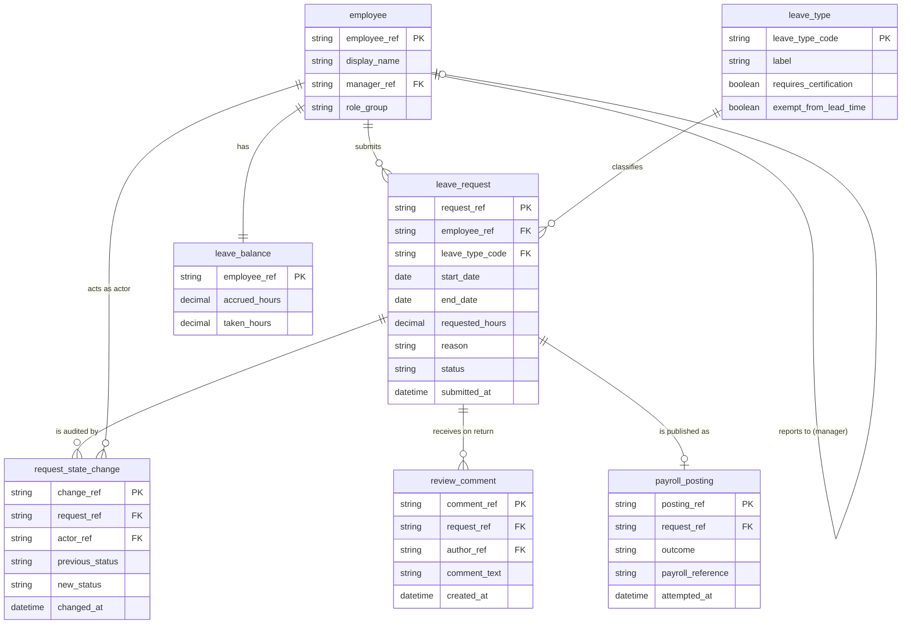

# Employee Leave & Exception Request Portal

- **Project Name:** `Employee Leave & Exception Request Portal`
- **Input Scenario:** `SCENARIO_REQUIREMENTS_DOC` (from `specs/input_inventory.json`; confidence: `HIGH`)
- **Domain Slug:** `employee-leave-exception-request-portal`
- **Include Modernization Enhancements in Spec:** `false`
- **Target Philosophy:** clean target architecture; the payroll REST interface the document demands is a required integration capability, not legacy carry-over.

---

## 1. Executive Summary
*(Narrative only — the single input document is itemised in §6.)*

### 1.1 Business Context & Mission
Human Resources Operations sponsors a greenfield self-service portal through which employees request leave
(vacation, sick) and exceptions, managers and HR certifiers approve or return those requests, and approved
outcomes are published to the organisation's payroll system through its existing REST interface. The portal
exists to remove the e-mail-and-re-keying process that today produces entitlement arithmetic errors and lost
approvals — the two most frequent HR complaints.

### 1.2 Problem Statement (requirements document)
There is no existing system. Requests travel by e-mail, approvals are given by reply, and HR re-keys outcomes
into the payroll ledger by hand. Consequences the document names: wrong entitlement arithmetic (balances are
computed by people), approvals that get lost, and no audit trail. The portal must validate entitlements in
real time while the employee types, route approvals by a numeric threshold and request type, make every state
change auditable, and post approved outcomes to payroll automatically.

### 1.3 Governing Rules, Policies & Constraints
The document cites an internal **HR policy** (§4.1 balance rule, §4.2 lead-time rule, §4.3 certification
threshold, §4.5 withdrawal rule) and a **data-quality standard** (duplicate date ranges). No external regulatory policy or
regulation is declared and `resources/policies_and_statutes/` is empty. Non-functional constraints: OIDC
authentication with roles from group claims, PII masking, TLS in transit and encryption at rest, WCAG 2.1 AA,
p95 interaction < 300 ms at 500 concurrent users, immutable 7-year audit log. Out of scope: payroll
calculation, the accrual engine (balances are read from the HR system of record), native mobile apps.

---

## 2. Current-State ("As-Is") Conceptual Domain Entities
*(Conceptual domain entities identified in the requirements document. Physical target 3NF schema design belongs in Stage 4A `design/solution_design.md`.)*



Normalisation notes: `pending` and `available` hours are derived (BR-01) and never stored; the leave type's
certification/lead-time behaviour is a property of `leave_type`, not repeated per request; return comments
are a separate entity so a request returned twice keeps both comments; every state change is its own row.

---

## 3. Lifecycle State Machine *(extracted from BRD §4 "Workflow (approval path)" and §3 rules — not invented)*

```mermaid
stateDiagram-v2
    [*] --> DRAFT : Create (Employee)
    DRAFT --> SUBMITTED : Submit (Employee; BR-01, BR-03, BR-04 pass)
    SUBMITTED --> MANAGER_APPROVED : Manager Approve (Manager; BR-02 applies)
    SUBMITTED --> APPROVED : Manager Approve (Manager; BR-02 does not apply)
    SUBMITTED --> DRAFT : Return (Manager; comment required)
    MANAGER_APPROVED --> APPROVED : Certify (HR Certifier)
    MANAGER_APPROVED --> DRAFT : Return (HR Certifier; comment required)
    APPROVED --> POSTED : Post (Payroll Integration; payroll accepted)
    DRAFT --> WITHDRAWN : Withdraw (Employee; BR-05)
    SUBMITTED --> WITHDRAWN : Withdraw (Employee; BR-05)
    MANAGER_APPROVED --> WITHDRAWN : Withdraw (Employee; BR-05)
    POSTED --> [*]
    WITHDRAWN --> [*]
```

| From | To | Trigger | Actor Role | Guard | Evidence |
| :-- | :-- | :-- | :-- | :-- | :-- |
| [*] | DRAFT | Create | Employee | request belongs to the signed-in employee | BRD §4 step 1; §2 Employee "Create, edit (while Draft)" |
| DRAFT | SUBMITTED | Submit | Employee | own request; BR-01, BR-03 and BR-04 all pass, otherwise stays DRAFT with a message | BRD §4 step 2; FR-03 |
| SUBMITTED | MANAGER_APPROVED | Manager Approve | Manager | requester is a direct report; BR-02 applies (requested hours > 40 or type Exception) | BRD §4 steps 3–4; BR-02; FR-04 |
| SUBMITTED | APPROVED | Manager Approve | Manager | requester is a direct report; BR-02 does not apply (manager approval is final) | BRD §4 step 4 "otherwise Manager approval is final" |
| SUBMITTED | DRAFT | Return | Manager | requester is a direct report; return comment is mandatory | BRD §4 step 3 "Returned goes back to Draft with a comment"; FR-04 |
| MANAGER_APPROVED | APPROVED | Certify | HR Certifier | BR-02 applies to the request | BRD §4 step 4; FR-05 |
| MANAGER_APPROVED | DRAFT | Return | HR Certifier | return comment is mandatory | BRD §4 step 4 "Approved or Returned" |
| APPROVED | POSTED | Post | Payroll Integration | payroll REST endpoint accepted the posting; on failure the request stays APPROVED and an alert is raised | BRD §4 step 5; FR-07 |
| DRAFT | WITHDRAWN | Withdraw | Employee | own request; BR-05 (not yet Approved) | BRD §4 step 6; BR-05 |
| SUBMITTED | WITHDRAWN | Withdraw | Employee | own request; BR-05 | BRD §4 step 6; BR-05 |
| MANAGER_APPROVED | WITHDRAWN | Withdraw | Employee | own request; BR-05 | BRD §4 step 6; BR-05 |

Terminal states: `POSTED` (fulfilment) and `WITHDRAWN` (BRD §4 step 6 "terminal"). `APPROVED` is not
terminal: it is the hand-off state to payroll. There is no rejection state (BRD §4 step 7).

### 3.1 Open Workflow Questions *(ask at Gate 1; in autonomous mode answered with the most restrictive reading as `ASSUMPTION-NN`)*
| # | Question | Why the inputs do not settle it | Proposed restrictive default |
| :-: | :-- | :-- | :-- |
| 1 | Is "Returned" a persisted state of its own, or does a return move the request straight back to Draft? | §4 step 3 says "Returned goes back to Draft with a comment"; FR-06 asks for human-readable statuses but does not list "Returned". | No separate state: Return moves the request to `DRAFT`; the return comment is shown on the request and in history (`ASSUMPTION-01`). |
| 2 | May an employee edit a request after it was returned? | §2 says "edit (while Draft)"; a returned request is Draft again. | Yes, because it is Draft; edits are limited to Draft (`ASSUMPTION-02`). |
| 3 | Can a Posted or Withdrawn request be reopened? | Not mentioned. | No — both are terminal; a new request must be created (`ASSUMPTION-03`). |
| 4 | Can an Approved request still be withdrawn before payroll posting succeeds? | BR-05 "not yet Approved" vs. the Approved→Posted gap. | No — withdrawal ends at Manager Approved; Approved is never withdrawable (`ASSUMPTION-04`). |
| 5 | What happens when payroll posting fails — retry policy? | §4 step 5 only says the request stays Approved and an alert is raised. | No automatic retry schedule is specified; the alert is surfaced to the Payroll Integration view and the request stays Approved until the next posting attempt (`ASSUMPTION-05`). |
| 6 | Do holds or escalations exist? | Not mentioned. | None (`ASSUMPTION-06`). |
| 7 | Does the HR Certifier see requests of all employees, or only a population? | FR-05 says "lists Manager-Approved requests that meet BR-02" without a population filter. | All Manager-Approved requests meeting BR-02 (`ASSUMPTION-07`). |
| 8 | How are hours per day derived for overlap/lead-time checks? | BR-03 uses calendar days; BR-04 uses the date range; hours are entered by the employee. | Hours are an entered number; dates are used only for BR-03/BR-04 (`ASSUMPTION-08`). |

### 3.2 Roles *(Kind is `external` or `internal`)*
| Role | Kind | Responsibilities | Evidence |
| :-- | :-- | :-- | :-- |
| Employee | external | Create, edit (while Draft), submit, withdraw own requests; view own balance and history | BRD §2 "external (self-service)" |
| Manager | internal | Approve or return Submitted requests from direct reports; comment mandatory on return | BRD §2; FR-04 |
| HR Certifier | internal | Certify or return Manager-Approved requests that meet BR-02 | BRD §2; FR-05 |
| Payroll Integration | internal | System actor: receives approved outcomes; its posting result moves Approved → Posted or raises an alert | BRD §2 "(system)"; §4 step 5; FR-07 |

### 3.3 Business Rules & Formulas (candidates for spec §3.4)
| Rule ID | Rule / Formula | Inputs | Source (file / document section / policy) |
| :-- | :-- | :-- | :-- |
| BR-01 | `available = accrued − taken − pending`; submit allowed only if `requested ≤ available`; `post_request = available − requested` | accrued hours, taken hours, pending hours (sum of hours of the employee's SUBMITTED / MANAGER_APPROVED requests), requested hours | BRD §3 BR-01; HR policy §4.1; FR-02 |
| BR-02 | HR Certifier approval required after Manager approval when `requested_hours > 40` OR `type = Exception` | requested hours, leave type | BRD §3 BR-02; HR policy §4.3 |
| BR-03 | Submission allowed only if `start_date − submit_date ≥ 3 calendar days`, except `type = Exception` | start date, submit date, leave type | BRD §3 BR-03; HR policy §4.2 |
| BR-04 | A request whose `[start_date, end_date]` overlaps an existing request of the same employee whose status is not WITHDRAWN (rejection does not exist) is a duplicate and cannot be submitted | existing requests of the employee | BRD §3 BR-04; data-quality standard |
| BR-05 | Withdraw allowed only while status ∈ {DRAFT, SUBMITTED, MANAGER_APPROVED} | status | BRD §3 BR-05; HR policy §4.5 |
| BR-06 | Reason is optional and `length(reason) ≤ 500` characters | reason | BRD FR-01 |
| BR-07 | Return requires a non-empty comment | comment | BRD FR-04; §4 step 3 |

---

## 4. Non-Functional Requirements Discovered
| Area | Requirement | Source |
| :-- | :-- | :-- |
| Authentication | Organisation OIDC provider; roles from group claims | NFR-01 |
| Privacy / PII | Employee id and national identifier (if ever displayed) masked in UI; TLS in transit; encryption at rest | NFR-02 |
| Accessibility | WCAG 2.1 AA | NFR-03 |
| Performance | p95 page interaction < 300 ms with 500 concurrent users | NFR-04 |
| Retention | Audit log immutable for 7 years | NFR-05; FR-08 |
| Integration | Payroll REST interface `POST /payroll/leave-postings` (JSON) is an external contract the portal must call; result recorded | FR-07; §8 |
| Scope | Payroll calculation, accrual engine and native mobile apps are out of scope; balances read from the HR system of record | §7 |

---

## 6. Capability Inventory
| Capability ID | Capability | Actors | Source Section (requirements doc) | Notes |
| :-- | :-- | :-- | :-- | :-- |
| CAP-01 | Create and edit a Draft leave/exception request (type, start, end, hours, optional reason ≤ 500) | Employee | FR-01; §4 step 1 | Edit only while Draft (ASSUMPTION-02) |
| CAP-02 | Live balance display: available and post-request balance recomputed as the user types | Employee | FR-02; BR-01 | Balances read from HR system of record (§7) |
| CAP-03 | Submit with validation of BR-01, BR-03, BR-04 and actionable plain-language blocking messages | Employee | FR-03; §4 step 2 | Request stays Draft on failure |
| CAP-04 | Withdraw own request before Approved | Employee | §4 step 6; BR-05 | Terminal |
| CAP-05 | Request history with human-readable statuses and next approver | Employee | FR-06 | Includes return comments (ASSUMPTION-01) |
| CAP-06 | Manager queue of Submitted requests from direct reports with Approve / Return (mandatory comment) | Manager | FR-04; §4 step 3 | Approve routes by BR-02 |
| CAP-07 | HR Certifier queue of Manager-Approved requests meeting BR-02 with Certify / Return | HR Certifier | FR-05; §4 step 4 | |
| CAP-08 | Post approved requests to payroll REST endpoint and record the result; failure keeps Approved and raises an alert | Payroll Integration | FR-07; §4 step 5; §8 | External contract `POST /payroll/leave-postings` |
| CAP-09 | Audit log of every state change (actor, timestamp, previous and new state), immutable 7 years | All | FR-08; NFR-05 | |
| CAP-10 | OIDC authentication with roles from group claims; PII masking; encryption | All | NFR-01; NFR-02 | |
| CAP-11 | Accessible UI (WCAG 2.1 AA) with p95 interaction < 300 ms | All | NFR-03; NFR-04 | |

### 6.1 Business Capability Groupings *(by Business Functionality or Business Unit / Department, with Shared Prerequisites)*
| Group ID | Group Name | Grouping Dimension | Capabilities | Prerequisite Groups / Shared | Legacy Artefacts / Source Scope | Notes |
| :-- | :-- | :-- | :-- | :-- | :-- | :-- |
| GRP-01 | Employee Leave Self-Service & Balance Calculation | `functional` | `CAP-01, CAP-02, CAP-03, CAP-04, CAP-05` | `Shared Foundation (pre-req for all)` | BRD FR-01, FR-02, FR-03, FR-06; BR-01..BR-05 | Core employee leave intake, live balance & withdrawal |
| GRP-02 | Manager & HR Certification Adjudication | `business-unit` | `CAP-06, CAP-07` | `GRP-01` | BRD FR-04, FR-05; BR-02, BR-07 | Direct-report manager approval & HR certification queue (depends on GRP-01 intake) |
| GRP-03 | Payroll Posting Integration & Audit Compliance | `functional` | `CAP-08, CAP-09, CAP-10, CAP-11` | `GRP-01` | BRD FR-07, FR-08; NFR-01..NFR-05 | External payroll REST integration & immutable audit trail |

---

## 7. Gate 1 — Context Confirmation Checklist *(autonomous mode — defaults applied and recorded)*
1. **Regulations / policies:** none declared beyond the internal HR policy and data-quality standard cited in the document; `resources/policies_and_statutes/` is empty.
2. **Security, privacy & PII fields to mask:** employee identifier and national identifier (NFR-02); enterprise defaults applied — OIDC/RBAC, masking at the presentation boundary, append-only audit log.
3. **Accessibility standard(s) & design references:** baseline `WCAG 2.1 AA`; design references present: `no` (autonomous mode — proceeding with the default UX guardrails in `_shared/ux_guardrails.md`).
4. **Target stack & coding guidelines:** zero-dependency default — `static-html` frontend / `python-stdlib-http` backend serving UI + API on one port / `sqlite` database → `specs/target_stack.json`.
5. **ALM platform:** `none` (no `JIRA_URL` / `ADO_ORG_URL` in the environment).
6. **Business capability grouping & selected group(s):** `selectedCapabilityGroups: ["ALL"]` (`GRP-01`, `GRP-02`, `GRP-03` all taken forward in autonomous mode).
