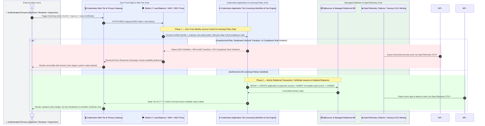

# Application Architecture (`design/application_architecture.md`)

- **Project:** Business Licensing & Renewal Portal — Legacy MS Access Modernization (Legacy Application Modernization)
- **Perspective:** **Application Component & Service Architecture (C4 Component View & Runtime Sequence)** (Standalone Perspective Artifact 4 of 7)
- **Visual Renderer:** `design/diagrams/application_architecture.svg` (`.png`) — 4-Tier C4 Application & AI Component Topology
- **Architecture Portfolio Index:** [`design/architecture_design.md`](architecture_design.md)

---

## 1. Application Component & Service Topology (4-Tier C4 Component View)

*(Depicts the application's internal modular structure across **Tier 1 (Presentation & Omnichannel UI Modules)**, **Tier 2 (API Gateway, BFF & Zero-Leak DTO Tier)**, **Tier 3 (Core Domain & AI Agent Services Tier)**, and **Tier 4 (Data Access, Event Bus & Integration Adapters Tier)**.)*

![Application Architecture]()

*Standalone diagram files: [Vector SVG](./diagrams/application_architecture.svg) · [Raster PNG](./diagrams/application_architecture.png)*

---

## 2. End-to-End Request & Workflow Execution Sequence (`sequenceDiagram`)

---

## 3. Application Component Responsibilities & Guardrails

| Application Tier | Component | Runtime & Pattern | Input / Output Contract | Guardrail Enforced |
| :-- | :-- | :-- | :-- | :-- |
| **Tier 1 — Presentation** | `Applicant Filing Portal`, `Staff Compliance Console`, `Certificate & Agent Card UI`, `Statute AI Copilot Drawer` | Semantic HTML5 + Vanilla ES2022 (`static-html`) | Consumes Zero-Leak DTO JSON; emits user actions | Mutual tab exclusivity; role-gated action visibility; zero legacy MS Access form/table names |
| **Tier 2 — API & DTO** | `REST API Router`, `Zero-Leak DTO Serializer`, `RBAC & State Guard Filter`, `Validation & Error Mapper` | Python 3.11 HTTP/REST (`python-stdlib-http`) | OpenAPI 3.1 request/response schemas | Strips `tax_id_hash` (`x-internal: true`); exposes only masked `***-**-1234` |
| **Tier 3 — Domain & AI** | `License Lifecycle Service`, `Bond & Fee Calculation Engine`, `Licensing Statute AI Agent`, `Good-Standing & Agent Service` | Stateless Domain Services | Domain command objects & validated state transitions | Enforces surety bond formula (`max(10000, min(100000, round(0.10 * purchases)))`), 1.5% quarterly fee, and age `>= 18` |
| **Tier 4 — Data & Adapters** | `Licensing 3NF Repository`, `Supporting Document Adapter`, `Tax ID Crypto Adapter`, `Immutable Audit Appender` | Parameterized SQL + Document Store | ACID transactions + append-only audit rows | Zero string-interpolated SQL; transactional audit logging on every state change |
