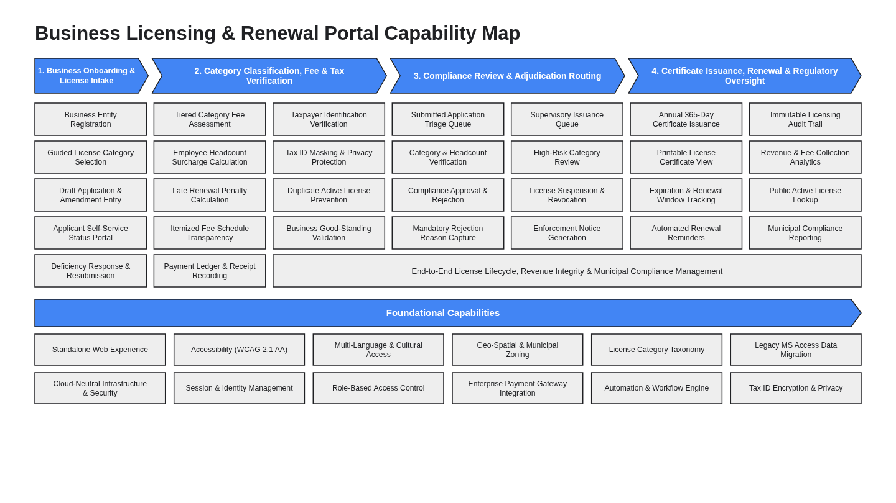

# Business Architecture & Capability Map (`design/business_architecture.md`)

- **Project:** Business Licensing & Renewal Portal — Legacy MS Access Modernization (`SCENARIO_LEGACY_APP`)
- **Perspective:** **Business Architecture & Value-Stream Capability Map** (Standalone Perspective Artifact 1 of 7)
- **Visual Renderer:** `design/diagrams/business_capability_map.svg` (`.png`) — Value-Stream Chevrons + Core Capability Grid + Cross-Cutting Outcome Bar + Foundational Capabilities Matrix
- **Architecture Portfolio Index:** [`design/architecture_design.md`](architecture_design.md)

---

## 1. Business Architecture & Capability Map (Value Streams, Core Business Capabilities & Foundational Capabilities)

*(Depicts the Business Licensing & Renewal Portal's cloud-agnostic **Business Architecture & Capability Map**: top horizontal Blue (`#4285F4`) Value-Stream Chevrons (`1. Business Onboarding & License Intake`, `2. Category Classification, Fee & Tax Verification`, `3. Compliance Review & Adjudication Routing`, `4. Certificate Issuance, Renewal & Regulatory Oversight`), multi-column Level-2 Core Business Capability cards in uniform `#EEEEEE` fill with `#202124` borders, a bottom Cross-Cutting Outcome bar (`:::capSpan`), and a full-width `Foundational Capabilities` banner above a 2×6 Foundational Capabilities grid.)*



<details>
<summary>Architecture Diagram Specification (parsed by 04/scripts/extract_contracts.py into diagrams/business_capability_map.png)</summary>

```diagram-dsl
flowchart TB
    %% title: Business Licensing & Renewal Portal Capability Map
    subgraph VS1["1. Business Onboarding &amp; License Intake"]
        C1_1["Business Entity Registration"]:::capCard
        C1_2["Guided License Category Selection"]:::capCard
        C1_3["Draft Application &amp; Amendment Entry"]:::capCard
        C1_4["Applicant Self-Service Status Portal"]:::capCard
        C1_5["Deficiency Response &amp; Resubmission"]:::capCard
    end

    subgraph VS2["2. Category Classification, Fee &amp; Tax Verification"]
        subgraph VS2_A["Fee &amp; Penalty Calculation"]
            C2_1["Tiered Category Fee Assessment"]:::capCard
            C2_2["Employee Headcount Surcharge Calculation"]:::capCard
            C2_3["Late Renewal Penalty Calculation"]:::capCard
            C2_4["Itemized Fee Schedule Transparency"]:::capCard
            C2_5["Payment Ledger &amp; Receipt Recording"]:::capCard
        end
        subgraph VS2_B["Entity &amp; Tax Validation"]
            C2_6["Taxpayer Identification Verification"]:::capCard
            C2_7["Tax ID Masking &amp; Privacy Protection"]:::capCard
            C2_8["Duplicate Active License Prevention"]:::capCard
            C2_9["Business Good-Standing Validation"]:::capCard
        end
    end

    subgraph VS3["3. Compliance Review &amp; Adjudication Routing"]
        subgraph VS3_A["Compliance Reviewer Triage"]
            C3_1["Submitted Application Triage Queue"]:::capCard
            C3_2["Category &amp; Headcount Verification"]:::capCard
            C3_3["Compliance Approval &amp; Rejection"]:::capCard
            C3_4["Mandatory Rejection Reason Capture"]:::capCard
        end
        subgraph VS3_B["Supervisory Escalation &amp; Enforcement"]
            C3_5["Supervisory Issuance Queue"]:::capCard
            C3_6["High-Risk Category Review"]:::capCard
            C3_7["License Suspension &amp; Revocation"]:::capCard
            C3_8["Enforcement Notice Generation"]:::capCard
        end
    end

    subgraph VS4["4. Certificate Issuance, Renewal &amp; Regulatory Oversight"]
        subgraph VS4_A["Issuance &amp; Renewal"]
            C4_1["Annual 365-Day Certificate Issuance"]:::capCard
            C4_2["Printable License Certificate View"]:::capCard
            C4_3["Expiration &amp; Renewal Window Tracking"]:::capCard
            C4_4["Automated Renewal Reminders"]:::capCard
        end
        subgraph VS4_B["Regulatory Audit &amp; Analytics"]
            C4_5["Immutable Licensing Audit Trail"]:::capCard
            C4_6["Revenue &amp; Fee Collection Analytics"]:::capCard
            C4_7["Public Active License Lookup"]:::capCard
            C4_8["Municipal Compliance Reporting"]:::capCard
        end
    end

    subgraph SPAN_OUTCOME["Cross-Cutting Licensing, Revenue &amp; Compliance Outcome Management"]
        SPAN1["End-to-End License Lifecycle, Revenue Integrity &amp; Municipal Compliance Management"]:::capSpan
    end

    subgraph FOUND["Foundational Capabilities"]
        F1["Standalone Web Experience"]:::capCard
        F2["Accessibility (WCAG 2.1 AA)"]:::capCard
        F3["Multi-Language &amp; Cultural Access"]:::capCard
        F4["Geo-Spatial &amp; Municipal Zoning"]:::capCard
        F5["License Category Taxonomy"]:::capCard
        F6["Legacy MS Access Data Migration"]:::capCard
        F7["Cloud-Neutral Infrastructure &amp; Security"]:::capCard
        F8["Session &amp; Identity Management"]:::capCard
        F9["Role-Based Access Control"]:::capCard
        F10["Enterprise Payment Gateway Integration"]:::capCard
        F11["Automation &amp; Workflow Engine"]:::capCard
        F12["Tax ID Encryption &amp; Privacy"]:::capCard
    end

    VS1 --> VS2 --> VS3 --> VS4
    VS3 --> SPAN_OUTCOME
    VS4 --> SPAN_OUTCOME
    SPAN_OUTCOME --> FOUND

    classDef capCard fill:#EEEEEE,stroke:#202124,stroke-width:1.5px,color:#202124;
    classDef capSpan fill:#EEEEEE,stroke:#202124,stroke-width:1.5px,color:#202124;

    style VS1 fill:#4285F4,stroke:#202124,stroke-width:1.5px,color:#FFFFFF
    style VS2 fill:#4285F4,stroke:#202124,stroke-width:1.5px,color:#FFFFFF
    style VS2_A fill:#FFFFFF,stroke:#DADCE0,stroke-width:1px,color:#202124
    style VS2_B fill:#FFFFFF,stroke:#DADCE0,stroke-width:1px,color:#202124
    style VS3 fill:#4285F4,stroke:#202124,stroke-width:1.5px,color:#FFFFFF
    style VS3_A fill:#FFFFFF,stroke:#DADCE0,stroke-width:1px,color:#202124
    style VS3_B fill:#FFFFFF,stroke:#DADCE0,stroke-width:1px,color:#202124
    style VS4 fill:#4285F4,stroke:#202124,stroke-width:1.5px,color:#FFFFFF
    style VS4_A fill:#FFFFFF,stroke:#DADCE0,stroke-width:1px,color:#202124
    style VS4_B fill:#FFFFFF,stroke:#DADCE0,stroke-width:1px,color:#202124
    style SPAN_OUTCOME fill:#F8F9FA,stroke:#202124,stroke-width:1.5px,color:#202124
    style FOUND fill:#4285F4,stroke:#202124,stroke-width:1.5px,color:#FFFFFF
```

</details>

---

## 2. Business Capability & Value-Stream Alignment Summary

| Value-Stream Pillar / Tier | Business Capabilities Included | Primary Business Personas | Delivery Scope (`Phase 1 MVP` vs. `Full Scope`) | Business Outcome & Value Delivered |
| :-- | :-- | :-- | :-- | :-- |
| **1. Business Onboarding & License Intake** | `Business Entity Registration`, `Guided License Category Selection`, `Draft Application & Amendment Entry`, `Self-Service Status Portal`, `Deficiency Resubmission` | `Business Applicant` | `Phase 1 MVP` | Replaces single-user MS Access forms (`frmLicenseApp`) with concurrent web self-service |
| **2. Category Classification, Fee & Tax Verification** | `Tiered Category Fee Assessment`, `Employee Headcount Surcharge`, `Late Renewal Penalty`, `Tax ID Verification & Masking`, `Duplicate Active License Prevention` | `Business Applicant`, `Compliance Reviewer` | `Phase 1 MVP` + `Full Scope` | Automates deterministic fee/penalty calculation and protects sensitive Tax IDs (`***-**-1234`) |
| **3. Compliance Review & Adjudication Routing** | `Submitted Application Triage Queue`, `Category & Headcount Verification`, `Compliance Approval & Rejection`, `Supervisory Issuance Queue`, `License Revocation` | `Compliance Reviewer`, `Licensing Supervisor` | `Phase 1 MVP` + `Full Scope` | Enforces regulatory workflow and role separation between triage and issuance |
| **4. Certificate Issuance, Renewal & Regulatory Oversight** | `Annual 365-Day Certificate Issuance`, `Printable License Certificate View`, `Expiration & Renewal Tracking`, `Immutable Licensing Audit Trail`, `Revenue Analytics` | `Licensing Supervisor`, `Business Applicant` | `Phase 1 MVP` + `Full Scope` | Replaces legacy Access reports (`rptCertificate`) with verifiable certificates and audit history |
| **Foundational Capabilities** | `Standalone Web Experience`, `Accessibility (WCAG 2.1 AA)`, `Legacy MS Access Data Migration`, `Cloud-Neutral Infrastructure & Security`, `Role-Based Access Control`, `Tax ID Encryption & Privacy` | All Personas | `Phase 1 MVP` Foundation | Eliminates SMB `.mdb` lock corruption and delivers zero-trust security across multi-cloud targets |
