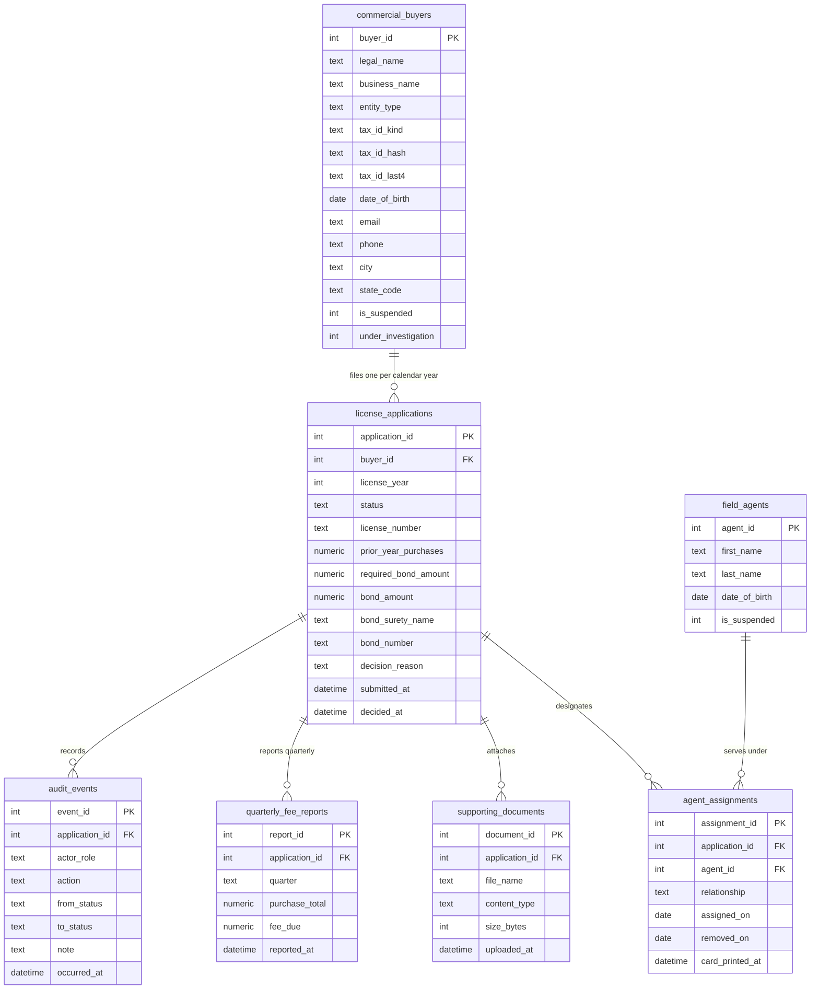

# Data Architecture (`design/data_architecture.md`)

- **Project:** Business Licensing & Renewal Portal — Legacy MS Access Modernization (Legacy Application Modernization)
- **Perspective:** **Data Architecture — Information Pipeline, Normalised 3NF Domain Model, AI Grounding & Data Governance** (Standalone Perspective Artifact 5 of 7)
- **Visual Renderer:** `design/diagrams/data_architecture.svg` (`.png`) — 5-Stage Left-to-Right Information Pipeline + Bottom Governance Bar
- **Architecture Portfolio Index:** [`design/architecture_design.md`](architecture_design.md)

---

## 1. End-to-End Data & AI Grounding Pipeline Architecture

*(Depicts the end-to-end flow of licensing data across **5 Pipeline Stages** — **Data Sources & Producers**, **Ingestion, Validation & CDC**, **Operational 3NF System of Record & MDM**, **Unified Data & AI Grounding / RAG**, and **Consumption, Analytics & Archival** — underpinned by the **Unified Data Governance, Lineage, Tax ID Masking & Retention** bar.)*

![Data Architecture]()

*Standalone diagram files: [Vector SVG](./diagrams/data_architecture.svg) · [Raster PNG](./diagrams/data_architecture.png)*

---

## 2. Normalised 3NF Domain Data Model (`erDiagram`)

---

## 3. Data Governance, Classification & Retention Matrix

| Domain Entity | Data Classification | PII / Sensitive Fields | Masking & Zero-Leak Rule | Storage Tier & Retention Policy |
| :-- | :-- | :-- | :-- | :-- |
| `commercial_buyers` | `Restricted / PII` | `tax_id_hash`, `tax_id_last4`, `date_of_birth` | Full Tax ID hashed (`SHA-256`) at rest; UI/API expose only `***-**-<last4>` (`tax_id_hash` marked `x-internal: true`) | Operational 3NF DB; KMS AES-256 encrypted |
| `license_applications` | `Confidential / Regulatory` | `bond_number`, `prior_year_purchases`, `decision_reason` | Status enum codes mapped to human-readable labels; zero legacy `tbl*` column names | Operational 3NF DB + 7-year statutory archive |
| `field_agents` | `Confidential / PII` | `date_of_birth` | Used to verify statutory age `>= 18`; masked in public lookups | Operational 3NF DB |
| `audit_events` | `Compliance Audit` | `actor_role`, `from_status`, `to_status`, `note` | Append-only (`INSERT` only; `UPDATE`/`DELETE` revoked); exported to WORM storage | Immutable Audit Ledger; 7-year statutory retention |
