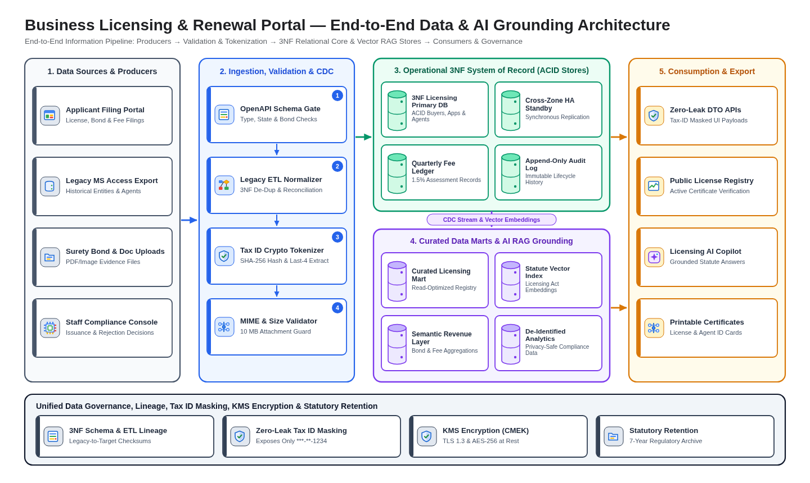
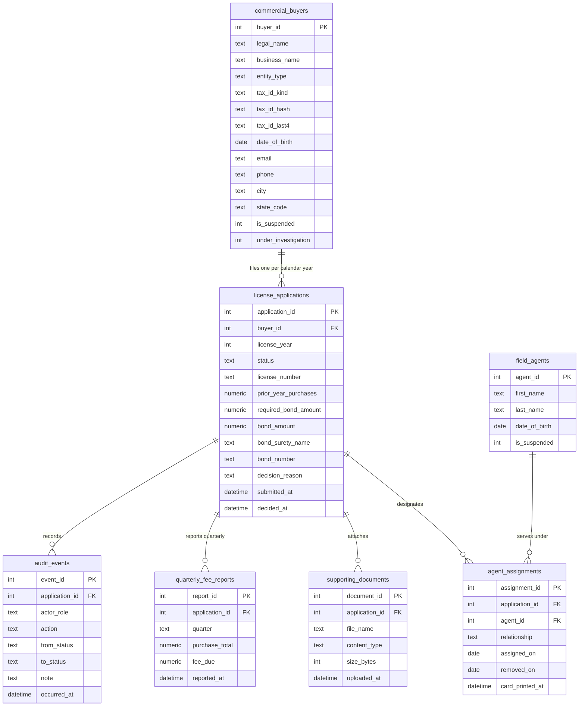

# Data Architecture (`design/data_architecture.md`)

- **Project:** Business Licensing & Renewal Portal — Legacy MS Access Modernization (`SCENARIO_LEGACY_APP`)
- **Perspective:** **Data Architecture — Information Pipeline, Normalised 3NF Domain Model, AI Grounding & Data Governance** (Standalone Perspective Artifact 5 of 7)
- **Visual Renderer:** `design/diagrams/data_architecture.svg` (`.png`) — 5-Stage Left-to-Right Information Pipeline + Bottom Governance Bar
- **Architecture Portfolio Index:** [`design/architecture_design.md`](architecture_design.md)

---

## 1. End-to-End Data & AI Grounding Pipeline Architecture

*(Depicts the end-to-end flow of licensing data across **5 Pipeline Stages** — **Data Sources & Producers**, **Ingestion, Validation & CDC**, **Operational 3NF System of Record & MDM**, **Unified Data & AI Grounding / RAG**, and **Consumption, Analytics & Archival** — underpinned by the **Unified Data Governance, Lineage, Tax ID Masking & Retention** bar.)*



<details>
<summary>Architecture Diagram Specification (parsed by 04/scripts/extract_contracts.py into diagrams/data_architecture.png)</summary>

```diagram-dsl
flowchart LR
    %% title: Business Licensing & Renewal Portal — End-to-End Data & AI Grounding Architecture
    %% subtitle: 5-Stage Data Pipeline from Legacy Migration & Web Intake to 3NF System of Record, Regulatory RAG, and Audit
    subgraph SG_Stage1["1. Data Sources & Producers"]
        S1["<b>Applicant Filing Portal</b><br/>License, Bond &amp; Fee Filings"]:::dataCard
        S2["<b>Legacy MS Access Export</b><br/>Historical Entities &amp; Agents"]:::dataCard
        S3["<b>Surety Bond &amp; Doc Uploads</b><br/>PDF/Image Evidence Files"]:::dataCard
        S4["<b>Staff Compliance Console</b><br/>Issuance &amp; Rejection Decisions"]:::dataCard
    end

    subgraph SG_Stage2["2. Ingestion, Validation & CDC"]
        I1["<b>OpenAPI Schema Gate</b><br/>Type, State &amp; Bond Checks"]:::dataCard
        I2["<b>Legacy ETL Normalizer</b><br/>3NF De-Dup &amp; Reconciliation"]:::dataCard
        I3["<b>Tax ID Crypto Tokenizer</b><br/>SHA-256 Hash &amp; Last-4 Extract"]:::dataCard
        I4["<b>MIME &amp; Size Validator</b><br/>10 MB Attachment Guard"]:::dataCard
    end

    subgraph SG_Stage3["3. Operational 3NF System of Record"]
        D1["<b>3NF Licensing Primary DB</b><br/>ACID Buyers, Apps &amp; Agents"]:::dataCard
        D2["<b>Cross-Zone HA Standby</b><br/>Synchronous Replication"]:::dataCard
        D3["<b>Quarterly Fee Ledger</b><br/>1.5% Assessment Records"]:::dataCard
        D4["<b>Append-Only Audit Log</b><br/>Immutable Lifecycle History"]:::dataCard
    end

    subgraph SG_Stage4["4. Unified Data & AI Grounding"]
        A1["<b>Curated Licensing Mart</b><br/>Read-Optimized Registry"]:::dataCard
        A2["<b>Statute Vector Index</b><br/>Licensing Act Embeddings"]:::dataCard
        A3["<b>Semantic Revenue Layer</b><br/>Bond &amp; Fee Aggregations"]:::dataCard
        A4["<b>De-Identified Analytics</b><br/>Privacy-Safe Compliance Data"]:::dataCard
    end

    subgraph SG_Stage5["5. Consumption, Analytics & Export"]
        C1["<b>Zero-Leak DTO APIs</b><br/>Tax-ID Masked UI Payloads"]:::dataCard
        C2["<b>Public License Registry</b><br/>Active Certificate Verification"]:::dataCard
        C3["<b>Licensing AI Copilot</b><br/>Grounded Statute Answers"]:::dataCard
        C4["<b>Printable Certificates</b><br/>License &amp; Agent ID Cards"]:::dataCard
    end

    subgraph SG_GovBar["Unified Data Governance, Lineage, Tax ID Masking, KMS Encryption & Statutory Retention"]
        G1["<b>3NF Schema &amp; ETL Lineage</b><br/>Legacy-to-Target Checksums"]:::govCard
        G2["<b>Zero-Leak Tax ID Masking</b><br/>Exposes Only ***-**-1234"]:::govCard
        G3["<b>KMS Encryption (CMEK)</b><br/>TLS 1.3 &amp; AES-256 at Rest"]:::govCard
        G4["<b>Statutory Retention</b><br/>7-Year Regulatory Archive"]:::govCard
    end

    SG_Stage1 ==> SG_Stage2 ==> SG_Stage3 ==> SG_Stage4 ==> SG_Stage5
    SG_Stage3 -.-> SG_GovBar

    classDef dataCard fill:#FFFFFF,stroke:#2B5B84,stroke-width:1.5px,color:#202124;
    classDef govCard fill:#E8F0FE,stroke:#1A73E8,stroke-width:1.5px,color:#0D47A1;
```

</details>

---

## 2. Normalised 3NF Domain Data Model (`erDiagram`)



---

## 3. Data Governance, Classification & Retention Matrix

| Domain Entity | Data Classification | PII / Sensitive Fields | Masking & Zero-Leak Rule | Storage Tier & Retention Policy |
| :-- | :-- | :-- | :-- | :-- |
| `commercial_buyers` | `Restricted / PII` | `tax_id_hash`, `tax_id_last4`, `date_of_birth` | Full Tax ID hashed (`SHA-256`) at rest; UI/API expose only `***-**-<last4>` (`tax_id_hash` marked `x-internal: true`) | Operational 3NF DB; KMS AES-256 encrypted |
| `license_applications` | `Confidential / Regulatory` | `bond_number`, `prior_year_purchases`, `decision_reason` | Status enum codes mapped to human-readable labels; zero legacy `tbl*` column names | Operational 3NF DB + 7-year statutory archive |
| `field_agents` | `Confidential / PII` | `date_of_birth` | Used to verify statutory age `>= 18`; masked in public lookups | Operational 3NF DB |
| `audit_events` | `Compliance Audit` | `actor_role`, `from_status`, `to_status`, `note` | Append-only (`INSERT` only; `UPDATE`/`DELETE` revoked); exported to WORM storage | Immutable Audit Ledger; 7-year statutory retention |
