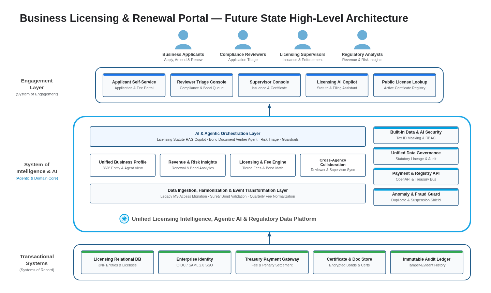

# High-Level Solution Architecture — AI-Era Enterprise View (`design/high_level_solution_architecture.md`)

- **Project:** Business Licensing & Renewal Portal — Legacy MS Access Modernization (`SCENARIO_LEGACY_APP`)
- **Perspective:** **High-Level Solution Architecture — System of Engagement, System of Intelligence & AI, and Systems of Record** (Standalone Perspective Artifact 2 of 7)
- **Visual Renderer:** `design/diagrams/high_level_solution_architecture.svg` (`.png`) — 3-Tier Enterprise Architecture with Top Personas, Engagement Layer, Cyan System of Intelligence & Agentic AI Layer, and Transactional Systems of Record
- **Architecture Portfolio Index:** [`design/architecture_design.md`](architecture_design.md)

---

## 1. Future-State High-Level Solution Architecture (Engagement, Agentic Intelligence & Systems of Record)

*(Synthesizes the executive 3-tier enterprise architecture across **Business Personas**, the **Engagement Layer (`System of Engagement`)**, the **System of Intelligence & AI (`Agentic AI, Regulatory RAG, Fee/Bond Intelligence & Governance Core`)**, and **Transactional Systems (`Systems of Record`)**.)*



<details>
<summary>Architecture Diagram Specification (parsed by 04/scripts/extract_contracts.py into diagrams/high_level_solution_architecture.png)</summary>

```diagram-dsl
flowchart TB
    %% title: Business Licensing & Renewal Portal — Future State High-Level Architecture
    %% subtitle: Unified System of Engagement, Agentic AI & Regulatory Intelligence Core, and Transactional Systems of Record
    %% platform_title: Unified Licensing Intelligence, Agentic AI & Regulatory Data Platform
    subgraph SG_Personas["Personas & Actors"]
        P1["<b>Business Applicants</b><br/>Apply, Amend &amp; Renew"]:::personaCard
        P2["<b>Compliance Reviewers</b><br/>Application Triage"]:::personaCard
        P3["<b>Licensing Supervisors</b><br/>Issuance &amp; Enforcement"]:::personaCard
        P4["<b>Regulatory Analysts</b><br/>Revenue &amp; Risk Insights"]:::personaCard
    end

    subgraph SG_Engagement["Engagement Layer (System of Engagement)"]
        E1["<b>Applicant Self-Service</b><br/>Application &amp; Fee Portal"]:::engageCard
        E2["<b>Reviewer Triage Console</b><br/>Compliance &amp; Bond Queue"]:::engageCard
        E3["<b>Supervisor Console</b><br/>Issuance &amp; Certificate Print"]:::engageCard
        E4["<b>Licensing AI Copilot</b><br/>Statute &amp; Filing Assistant"]:::engageCard
        E5["<b>Public License Lookup</b><br/>Active Certificate Registry"]:::engageCard
    end

    subgraph SG_Intelligence["System of Intelligence & AI"]
        subgraph SG_AILayer["AI & Agentic Orchestration Layer (Statute RAG Copilot · Bond & Document Verifier Agent · Deficiency Triage · Prompt Guardrails)"]
            AI_CORE["<b>AI &amp; Agentic Orchestration Layer</b><br/>Licensing Statute RAG Copilot · Bond Document Verifier Agent · Risk Triage · Guardrails"]:::aiBanner
        end
        subgraph SG_CoreCaps["Core Intelligence & Domain Capabilities"]
            C1["<b>Unified Business Profile</b><br/>360° Entity &amp; Agent View"]:::capBox
            C2["<b>Revenue &amp; Risk Insights</b><br/>Renewal &amp; Bond Analytics"]:::capBox
            C3["<b>Licensing &amp; Fee Engine</b><br/>Tiered Fees &amp; Bond Math"]:::capBox
            C4["<b>Cross-Agency Collaboration</b><br/>Reviewer &amp; Supervisor Sync"]:::capBox
        end
        subgraph SG_DataLayer["Data Ingestion, Harmonization & Event Transformation Layer (MS Access ETL · Surety Bond Validation · Fee Ledger Sync)"]
            DATA_CORE["<b>Data Ingestion, Harmonization &amp; Event Transformation Layer</b><br/>Legacy MS Access Migration · Surety Bond Validation · Quarterly Fee Normalization"]:::dataBanner
        end
        subgraph SG_Governance["Built-in Security, Governance & Trust"]
            G1["<b>Built-in Data &amp; AI Security</b><br/>Tax ID Masking &amp; RBAC"]:::govBox
            G2["<b>Unified Data Governance</b><br/>Statutory Lineage &amp; Audit"]:::govBox
            G3["<b>Payment &amp; Registry API</b><br/>OpenAPI &amp; Treasury Bus"]:::govBox
            G4["<b>Anomaly &amp; Fraud Guard</b><br/>Duplicate &amp; Suspension Shield"]:::govBox
        end
    end

    subgraph SG_Transactional["Transactional Systems (Systems of Record)"]
        T1["<b>Licensing Relational DB</b><br/>3NF Entities &amp; Licenses"]:::sorCard
        T2["<b>Enterprise Identity</b><br/>OIDC / SAML 2.0 SSO"]:::sorCard
        T3["<b>Treasury Payment Gateway</b><br/>Fee &amp; Penalty Settlement"]:::sorCard
        T4["<b>Certificate &amp; Doc Store</b><br/>Encrypted Bonds &amp; Certs"]:::sorCard
        T5["<b>Immutable Audit Ledger</b><br/>Tamper-Evident History"]:::sorCard
    end

    SG_Personas ==> SG_Engagement
    SG_Engagement <==> SG_Intelligence
    SG_Transactional ==> SG_Intelligence

    classDef personaCard fill:#FFFFFF,stroke:#1A73E8,stroke-width:1.5px,color:#202124;
    classDef engageCard fill:#FFFFFF,stroke:#2B5B84,stroke-width:1.5px,color:#202124;
    classDef aiBanner fill:#E8F4FD,stroke:#19A5E6,stroke-width:2px,color:#0D47A1,font-weight:bold;
    classDef capBox fill:#FFFFFF,stroke:#2B5B84,stroke-width:1.5px,color:#202124;
    classDef dataBanner fill:#FFFFFF,stroke:#2B5B84,stroke-width:1.5px,color:#202124;
    classDef govBox fill:#FFFFFF,stroke:#2B5B84,stroke-width:1.5px,color:#202124;
    classDef sorCard fill:#FFFFFF,stroke:#2B5B84,stroke-width:1.5px,color:#202124;

    style SG_Personas fill:#FFFFFF,stroke:#DADCE0,stroke-width:1px,color:#202124
    style SG_Engagement fill:#FFFFFF,stroke:#2B5B84,stroke-width:1.5px,color:#202124
    style SG_Intelligence fill:#FFFFFF,stroke:#19A5E6,stroke-width:3.5px,color:#0D47A1
    style SG_Transactional fill:#FFFFFF,stroke:#2B5B84,stroke-width:1.5px,color:#202124
```

</details>

---

## 2. High-Level Architectural Tiers & System-of-Intelligence Responsibilities

| Architectural Tier | Core Role in Target State | Key Capabilities & Components | Governance & Trust Boundary |
| :-- | :-- | :-- | :-- |
| **Personas & Actors** | Role-authenticated external and internal licensing actors | `Business Applicants`, `Compliance Reviewers`, `Licensing Supervisors`, `Regulatory Analysts` | OIDC / SAML 2.0 identity federation with role-scoped session claims |
| **Engagement Layer (`System of Engagement`)** | Replaces single-user MS Access forms (`frmLicenseApp`) and reports (`rptCertificate`) with web self-service and triage consoles | `Applicant Self-Service Portal`, `Reviewer Triage Console`, `Supervisor Console`, `Licensing AI Copilot`, `Public License Lookup` | Zero-Leak ViewModel/DTO boundary (`***-**-1234` Tax ID masking, zero `tbl*`/`frm*` legacy leaks); WCAG 2.1 AA compliance |
| **System of Intelligence & AI (`Agentic & Domain Core`)** | Combines deterministic licensing/bond/fee rules with grounded statute RAG copilots and compliance risk analytics | • **AI & Agentic Layer:** Licensing Statute RAG Copilot, Bond Document Verifier Agent, Risk Triage, Prompt Guardrails<br>• **Core Domain Capabilities:** `Unified Business Profile`, `Revenue & Risk Insights`, `Licensing & Fee Engine`, `Cross-Agency Collaboration`<br>• **Data Ingestion & Transformation:** Legacy MS Access Migration, Surety Bond Validation, Quarterly Fee Normalization | • `Built-in Data & AI Security` (Tax ID redaction before prompt grounding)<br>• `Unified Data Governance`<br>• `Payment & Registry API`<br>• `Anomaly & Fraud Guard` (blocks suspended buyers/agents and duplicate active filings) |
| **Transactional Systems (`Systems of Record`)** | Authoritative ACID persistence replacing shared SMB `.mdb` files | `Licensing Relational DB` (3NF), `Enterprise Identity (OIDC/SAML)`, `Treasury Payment Gateway`, `Certificate & Doc Store`, `Immutable Audit Ledger` | Encryption at rest (`KMS CMEK`), mTLS in transit, append-only audit constraints |
