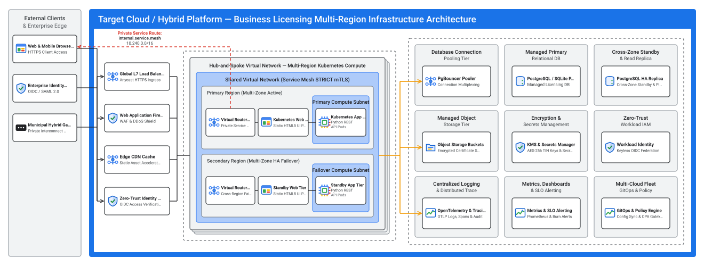

# Infrastructure & Deployment Architecture (`design/infrastructure_architecture.md`)

- **Project:** Business Licensing & Renewal Portal — Legacy MS Access Modernization (`SCENARIO_LEGACY_APP`)
- **Perspective:** **Cloud-Agnostic Multi-Region Infrastructure, Network Topology & Well-Architected Evaluation** (Standalone Perspective Artifact 7 of 7)
- **Visual Renderer:** `design/diagrams/infrastructure_architecture.svg` (`.png`) (`+ design/diagrams/technical_architecture.svg` alias)
- **Architecture Portfolio Index:** [`design/architecture_design.md`](architecture_design.md)

---

## 1. Multi-Region Infrastructure, Network & Deployment Topology

*(Depicts the Business Licensing Portal's **Cloud-Agnostic Target Platform & Infrastructure Architecture** (`specs/target_stack.json` — portable across On-Premises, GCP, AWS, and Azure): Web & Mobile Browsers, Enterprise OIDC Identity Provider, and Municipal Hybrid Gateway on the left; Zero-Trust Edge Security (`Global L7 Load Balancer`, `Web Application Firewall`, `Edge CDN Cache`, `Zero-Trust Identity Proxy`) in Column 1; Multi-Region Shared Virtual Network (`Primary Region` & `Secondary Region` running `Kubernetes` Web and Application tiers with `Service Mesh STRICT mTLS`) in Column 2 with private service routing (`internal.service.mesh 10.240.0.0/16`); and the 3×3 Managed Platform Services Grid (`PgBouncer Pooler`, `PostgreSQL / SQLite Primary`, `Read Replica HA`, `Object Storage Buckets`, `KMS & Secrets Manager`, `Workload Identity`, `OpenTelemetry & Tracing`, `Metrics & SLO Alerting`, `GitOps & OPA Policy Engine`) in Column 3.)*

```mermaid
flowchart LR
    subgraph SG_OnPrem2["External Clients & Enterprise Edge"]
        CLI_WEB["<b>Web &amp; Mobile Browsers</b><br/>HTTPS Client Access"]:::gcpCard
        CLI_IDP["<b>Enterprise Identity Provider</b><br/>OIDC / SAML 2.0"]:::gcpCard
        CLI_GW["<b>Municipal Hybrid Gateway</b><br/>Private Interconnect / VPN"]:::gcpCard
    end

    subgraph SG_TargetPlatform2["Target Cloud / Hybrid Platform — Business Licensing Multi-Region Infrastructure Architecture"]
        subgraph SG_Edge2["Zero-Trust Edge & Ingress Security"]
            E_LB["<b>Global L7 Load Balancer</b><br/>Anycast HTTPS Ingress"]:::gcpCard
            E_WAF["<b>Web Application Firewall</b><br/>WAF &amp; DDoS Shield"]:::gcpCard
            E_CDN["<b>Edge CDN Cache</b><br/>Static Asset Acceleration"]:::gcpCard
            E_IAP["<b>Zero-Trust Identity Proxy</b><br/>OIDC Access Verification"]:::gcpCard
        end

        subgraph SG_HubPerimeter2["Shared Virtual Network Multi-Region Compute Perimeter"]
            subgraph SG_HubProject2["Hub-and-Spoke Virtual Network — Multi-Region Kubernetes Compute"]
                subgraph SG_SharedVPC2["Shared Virtual Network (Service Mesh STRICT mTLS)"]
                    subgraph SG_Region1_2["Primary Region (Multi-Zone Active)"]
                        R1_CR["<b>Virtual Router &amp; NAT</b><br/>Private Service Routing"]:::gcpCard
                        R1_UI["<b>Kubernetes Web Tier</b><br/>Static HTML5 UI Pods"]:::gcpCard
                        subgraph SG_Subnet1_2["Primary Compute Subnet"]
                            R1_API["<b>Kubernetes App Tier</b><br/>Python REST API Pods"]:::focal
                        end
                    end
                    subgraph SG_Region2_2["Secondary Region (Multi-Zone HA Failover)"]
                        R2_CR["<b>Virtual Router &amp; NAT</b><br/>Cross-Region Failover"]:::gcpCard
                        R2_UI["<b>Standby Web Tier</b><br/>Static HTML5 UI Pods"]:::gcpCard
                        subgraph SG_Subnet2_2["Failover Compute Subnet"]
                            R2_API["<b>Standby App Tier</b><br/>Python REST API Pods"]:::focal
                        end
                    end
                end
            end
        end

        subgraph SG_SpokePerimeter2["Managed Platform Services — Persistence, Security & Observability"]
            subgraph SG_ProdRow2["Managed Relational Database & Connection Pooling Tier"]
                DB_POOL["<b>PgBouncer Pooler</b><br/>Connection Multiplexing"]:::gcpCard
                DB_PRI["<b>PostgreSQL / SQLite Primary</b><br/>Managed Licensing DB"]:::gcpCard
                DB_HA["<b>PostgreSQL HA Replica</b><br/>Cross-Zone Standby &amp; PITR"]:::gcpCard
            end
            subgraph SG_NonProdRow2["Object Storage, KMS Encryption & Workload Identity"]
                ST_OBJ["<b>Object Storage Buckets</b><br/>Encrypted Certificate Store"]:::gcpCard
                ST_KMS["<b>KMS &amp; Secrets Manager</b><br/>AES-256 TIN Keys &amp; Secrets"]:::gcpCard
                ST_WI["<b>Workload Identity</b><br/>Keyless OIDC Federation"]:::gcpCard
            end
            subgraph SG_DevRow2["OpenTelemetry Observability & Multi-Cloud GitOps"]
                OPS_LOG["<b>OpenTelemetry &amp; Tracing</b><br/>OTLP Logs, Spans &amp; Audit"]:::gcpCard
                OPS_MON["<b>Metrics &amp; SLO Alerting</b><br/>Prometheus &amp; Burn Alerts"]:::gcpCard
                OPS_GDC["<b>GitOps &amp; Policy Engine</b><br/>Config Sync &amp; OPA Gatekeeper"]:::gcpCard
            end
        end
    end

    CLI_WEB ==>|"HTTPS :443"| E_LB
    CLI_IDP ==>|"OIDC JWT"| E_IAP
    CLI_GW ==>|"Private VLAN"| R1_CR
    E_LB --> E_WAF
    E_WAF --> E_CDN
    E_CDN --> E_IAP
    E_IAP ==>|"Verified Request"| R1_CR
    E_IAP ==>|"Failover Route"| R2_CR
    R1_CR --> R1_UI
    R1_UI ==>|"Service Mesh mTLS"| R1_API
    R2_CR --> R2_UI
    R2_UI ==>|"Service Mesh mTLS"| R2_API
    R1_CR -.->|"Private Service Route: internal.service.mesh 10.240.0.0/16"| CLI_GW
    R1_API ==>|"Private Endpoint"| DB_POOL
    R1_API ==>|"S3 / Object API"| ST_OBJ
    R2_API ==>|"OpenTelemetry OTLP"| OPS_LOG
    DB_POOL --> DB_PRI
    DB_PRI --> DB_HA
    ST_OBJ --> ST_KMS
    ST_KMS --> ST_WI
    OPS_LOG --> OPS_MON
    OPS_MON --> OPS_GDC

    classDef gcpCard fill:#FFFFFF,stroke:#3C4043,stroke-width:1.5px,color:#202124;
    classDef focal fill:#FFFFFF,stroke:#1A73E8,stroke-width:2.5px,color:#202124,font-weight:bold;
    classDef gcpBlue fill:#E8F0FE,stroke:#1967D2,stroke-width:1.5px,color:#202124;
    classDef gcpGreen fill:#E6F4EA,stroke:#1E8E3E,stroke-width:1.5px,color:#202124;
    classDef gcpYellow fill:#FEF7E0,stroke:#B06000,stroke-width:1.5px,color:#202124;
    classDef gcpRed fill:#FCE8E6,stroke:#D93025,stroke-width:1.5px,color:#202124;

    style SG_OnPrem2 fill:#F1F3F4,stroke:#9AA0A6,stroke-width:1.5px,color:#202124
    style SG_TargetPlatform2 fill:#FFFFFF,stroke:#1A73E8,stroke-width:3px,color:#1A73E8
    style SG_Edge2 fill:#FFFFFF,stroke:#DADCE0,stroke-width:1px,color:#3C4043
    style SG_HubPerimeter2 fill:#FFFFFF,stroke:#5F6368,stroke-dasharray: 4 4,stroke-width:1.5px,color:#3C4043
    style SG_HubProject2 fill:#F1F3F4,stroke:#5F6368,stroke-width:1.5px,color:#202124
    style SG_SharedVPC2 fill:#AECBFA,stroke:#4285F4,stroke-width:1.5px,color:#202124
    style SG_Region1_2 fill:#F1F3F4,stroke:#7F868D,stroke-width:1.5px,color:#202124
    style SG_Region2_2 fill:#F1F3F4,stroke:#7F868D,stroke-width:1.5px,color:#202124
    style SG_Subnet1_2 fill:#AECBFA,stroke:#4285F4,stroke-width:1.5px,color:#202124
    style SG_Subnet2_2 fill:#AECBFA,stroke:#4285F4,stroke-width:1.5px,color:#202124
    style SG_SpokePerimeter2 fill:#FFFFFF,stroke:#5F6368,stroke-dasharray: 4 4,stroke-width:1.5px,color:#3C4043
    style SG_ProdRow2 fill:#F1F3F4,stroke:#9AA0A6,stroke-width:1.5px,color:#202124
    style SG_NonProdRow2 fill:#F1F3F4,stroke:#9AA0A6,stroke-width:1.5px,color:#202124
    style SG_DevRow2 fill:#F1F3F4,stroke:#9AA0A6,stroke-width:1.5px,color:#202124
```

---

## 2. Well-Architected Framework Alignment & Anti-Pattern Grilling

### 2.1 6-Pillar (+ Sustainability) Well-Architected Alignment Matrix

| Well-Architected Pillar | Alignment Rating | Cloud-Agnostic Target Architecture Design Decision | Automated Verification & Runtime Guardrail (Stages 4A–8) |
| :-- | :-- | :-- | :-- |
| **1. System Design** | `OPTIMAL` | Modular Business Licensing Capability Services deployed on a Multi-Region Hub-and-Spoke Shared Virtual Network (`Primary` + `Secondary` regions) with 100% stateless `Kubernetes` web/application tiers and a normalised relational database (`solution_design.md §1`) replacing flat MS Access files. | `04/scripts/extract_contracts.py` (7-perspective SVG generation & 3NF DDL), `08/scripts/validate_gdc_packaging.py` (KRM portability). |
| **2. Operational Excellence** | `OPTIMAL` | Declarative KRM GitOps via `Config Sync` and `OPA Policy Controller`; vendor-neutral `OpenTelemetry` (`OTLP`) exporting structured logs, traces, and metrics with 99.9% SLO burn-rate alerts across `on-prem-gdc`, `gcp`, `aws`, and `azure`. | `09/scripts/run_gdc_fleet_deploy_and_verify.py` (GitOps rollout, OTel pipeline, SLO burn-rate alerts, runbook). |
| **3. Security, Privacy & Compliance** | `OPTIMAL` | Private service routing (`internal.service.mesh 10.240.0.0/16`), `WAF` + `Zero-Trust Identity Proxy (OIDC)`, `Service Mesh STRICT mTLS`, keyless `Workload Identity`, `KMS` (`CMEK`) for Tax ID encryption, AI Trust Layer guardrails, and Data Privacy Gateway masking (`***-**-1234`). | `07/scripts/run_closed_loop_eval.py` (`TC-SEC-*`, `TC-UILEAK-*`), `08/scripts/validate_gdc_packaging.py` (OPA non-root, `readOnlyRootFilesystem`, `STRICT` mTLS). |
| **4. Reliability** | `OPTIMAL` | Active-active `Primary Region` and `Secondary Region` `Kubernetes` pipelines inside `Shared Virtual Network`, `HPA` + `PDB`, `PgBouncer` connection pooling, and synchronous cross-zone HA database standby + PITR (eliminating MS Access `.ldb` lock corruption). | `06/scripts/validate_build.py` (healthcheck), `07/scripts/run_closed_loop_eval.py` (`TC-STATE-*`), `08/scripts/validate_gdc_packaging.py` (HPA, PDB, probes). |
| **5. Cost Optimization** | `OPTIMAL` | Shared Hub Virtual Network ingress (`Global L7 Load Balancer`, `Virtual Router`, `Edge CDN`) amortized across business capability services; right-sized Kubernetes CPU/memory requests (`100m`/`128Mi`) and FinOps cost-allocation labels. | `08/scripts/validate_gdc_packaging.py` (resource requests/limits & cost labels across all 4 multi-cloud overlays). |
| **6. Performance Optimization** | `OPTIMAL` | `Edge CDN` static caching, regional L7 load balancing, `PgBouncer` connection multiplexing, relational B-Tree indexes (`solution_design.md §1.2`), and async `OpenTelemetry` batch export. | `04/scripts/extract_contracts.py` (DDL index & constraint validation), `09/scripts/run_gdc_fleet_deploy_and_verify.py` (`p95 <= 300ms` latency SLO gate). |
| **7. Environmental Sustainability** | `OPTIMAL` | High Carbon-Free Energy (`CFE%`) region selection, shared hub network infrastructure, minimal rootless Python 3.11-slim OCI images, and elastic Kubernetes autoscaling. | `08/scripts/validate_gdc_packaging.py` (multi-stage minimal rootless OCI containers). |

### 2.2 First-Principles Failure Mode & Anti-Pattern Grilling Matrix

| Failure Domain / Grilling Vector | Cloud Anti-Pattern Prohibited | Production Failure Mode Prevented | Cloud-Agnostic Target Architecture Remediation |
| :-- | :-- | :-- | :-- |
| **1. Blast Radius & Regional/Zonal SPOF** | Single-region/single-zone workload deployment or shared SMB file-lock database (`.mdb`). | Regional outage or SMB lock contention causes total service blackout (`RTO >> 0`). | Active-active `Primary Region` and `Secondary Region` `Kubernetes` pipelines inside `Shared Virtual Network`, backed by synchronous HA database failover. |
| **2. Ingress Exposure & Public IPs** | Routing internal API traffic or database connections over public IP addresses. | Internet route hijacking, lateral scanning, or Tax ID exfiltration bypassing WAF/IAM. | `Virtual Router` advertises private service routes (`internal.service.mesh 10.240.0.0/16`, `#D93025` red dashed route); `Kubernetes` pods and databases reside in private subnets with zero public IPs. |
| **3. Credential Security & Static Keys** | Embedding static service-account key files or cleartext Tax IDs/passwords in containers. | Leaked long-lived credentials grant persistent unauthorized access across environments. | Keyless `Workload Identity (OIDC)` issues short-lived tokens per service; `KMS` + `Secrets Manager` encrypt Tax IDs at rest and mask `***-**-1234` in responses. |
| **4. Database Connection Starvation** | Autoscaling `Kubernetes` pods opening unpooled direct connections to the database. | Pod surge exhausts `max_connections`, causing cascading `500` connection failures. | All application and migration traffic routes through `PgBouncer` connection pooling with bounded pool sizing and read-replica offloading. |
| **5. Environment Sprawl & Governance Drift** | Manual `kubectl` hotfixes or deploying unverified containers without admission guardrails. | Config drift, privileged container execution, or unencrypted service-to-service traffic. | Declarative GitOps reconciliation via `Config Sync`, admission enforcement via `OPA Policy Controller`, and `Service Mesh STRICT mTLS`. |
