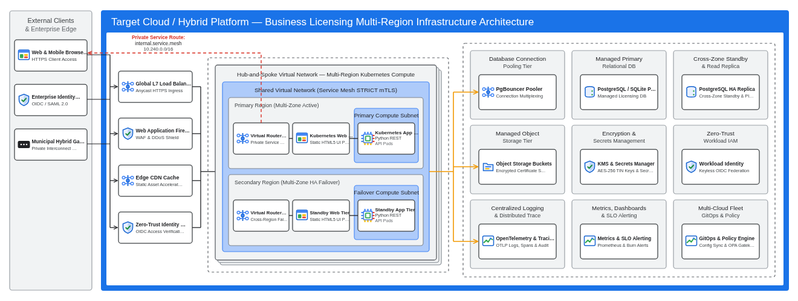

# Infrastructure & Deployment Architecture (`design/infrastructure_architecture.md`)

- **Project:** Business Licensing & Renewal Portal — Legacy MS Access Modernization (Legacy Application Modernization)
- **Perspective:** **Cloud-Agnostic Multi-Region Infrastructure, Network Topology & Well-Architected Evaluation** (Standalone Perspective Artifact 7 of 7)
- **Visual Renderer:** `design/diagrams/infrastructure_architecture.svg` (`.png`) (`+ design/diagrams/technical_architecture.svg` alias)
- **Architecture Portfolio Index:** [`design/architecture_design.md`](architecture_design.md)

---

## 1. Multi-Region Infrastructure, Network & Deployment Topology

*(Depicts the Business Licensing Portal's **Cloud-Agnostic Target Platform & Infrastructure Architecture** (`specs/target_stack.json` — portable across On-Premises, GCP, AWS, and Azure): Web & Mobile Browsers, Enterprise OIDC Identity Provider, and Municipal Hybrid Gateway on the left; Zero-Trust Edge Security (`Global L7 Load Balancer`, `Web Application Firewall`, `Edge CDN Cache`, `Zero-Trust Identity Proxy`) in Column 1; Multi-Region Shared Virtual Network (`Primary Region` & `Secondary Region` running `Kubernetes` Web and Application tiers with `Service Mesh STRICT mTLS`) in Column 2 with private service routing (`internal.service.mesh 10.240.0.0/16`); and the 3×3 Managed Platform Services Grid (`PgBouncer Pooler`, `PostgreSQL / SQLite Primary`, `Read Replica HA`, `Object Storage Buckets`, `KMS & Secrets Manager`, `Workload Identity`, `OpenTelemetry & Tracing`, `Metrics & SLO Alerting`, `GitOps & OPA Policy Engine`) in Column 3.)*

---

## 2. Well-Architected Framework Alignment & Anti-Pattern Grilling

### 2.1 6-Pillar (+ Sustainability) Well-Architected Alignment Matrix

| Well-Architected Pillar | Alignment Rating | Cloud-Agnostic Target Architecture Design Decision | Automated Verification & Runtime Guardrail (Stages 4A–8) |
| :-- | :-- | :-- | :-- |
| **1. System Design** | `OPTIMAL` | Modular Business Licensing Capability Services deployed on a Multi-Region Hub-and-Spoke Shared Virtual Network (`Primary` + `Secondary` regions) with 100% stateless `Kubernetes` web/application tiers and a normalised relational database (`solution_design.md §1`) replacing flat MS Access files. | Contract-first 7-perspective architecture verification, 3NF DDL validation, and KRM multi-cloud portability gates. |
| **2. Operational Excellence** | `OPTIMAL` | Declarative KRM GitOps via `Config Sync` and `OPA Policy Controller`; vendor-neutral `OpenTelemetry` (`OTLP`) exporting structured logs, traces, and metrics with 99.9% SLO burn-rate alerts across `on-prem-gdc`, `gcp`, `aws`, and `azure`. | GitOps wave rollout verification, OpenTelemetry collector pipeline validation, SLO burn-rate alerts, and operational runbook gates. |
| **3. Security, Privacy & Compliance** | `OPTIMAL` | Private service routing (`internal.service.mesh 10.240.0.0/16`), `WAF` + `Zero-Trust Identity Proxy (OIDC)`, `Service Mesh STRICT mTLS`, keyless `Workload Identity`, `KMS` (`CMEK`) for Tax ID encryption, AI Trust Layer guardrails, and Data Privacy Gateway masking (`***-**-1234`). | Closed-loop security (`TC-SEC-*`), zero-leakage (`TC-UI-LEAK-*`), OPA non-root/`readOnlyRootFilesystem`, and `STRICT` mTLS gates. |
| **4. Reliability** | `OPTIMAL` | Active-active `Primary Region` and `Secondary Region` `Kubernetes` pipelines inside `Shared Virtual Network`, `HPA` + `PDB`, `PgBouncer` connection pooling, and synchronous cross-zone HA database standby + PITR (eliminating MS Access `.ldb` lock corruption). | Health-probe readiness, closed-loop workflow state verification (`TC-STATE-*`), and KRM HPA/PDB/probe gates. |
| **5. Cost Optimization** | `OPTIMAL` | Shared Hub Virtual Network ingress (`Global L7 Load Balancer`, `Virtual Router`, `Edge CDN`) amortized across business capability services; right-sized Kubernetes CPU/memory requests (`100m`/`128Mi`) and FinOps cost-allocation labels. | Resource requests/limits and FinOps cost-allocation labels enforced across all 4 multi-cloud Kustomize overlays. |
| **6. Performance Optimization** | `OPTIMAL` | `Edge CDN` static caching, regional L7 load balancing, `PgBouncer` connection multiplexing, relational B-Tree indexes (`solution_design.md §1.2`), and async `OpenTelemetry` batch export. | 3NF DDL index/constraint validation and `p95 <= 300ms` latency SLO burn-rate alert gates. |
| **7. Environmental Sustainability** | `OPTIMAL` | High Carbon-Free Energy (`CFE%`) region selection, shared hub network infrastructure, minimal rootless Python 3.11-slim OCI images, and elastic Kubernetes autoscaling. | Multi-stage minimal rootless OCI container builds and autoscaled compute footprints. |

### 2.2 First-Principles Failure Mode & Anti-Pattern Grilling Matrix

| Failure Domain / Grilling Vector | Cloud Anti-Pattern Prohibited | Production Failure Mode Prevented | Cloud-Agnostic Target Architecture Remediation |
| :-- | :-- | :-- | :-- |
| **1. Blast Radius & Regional/Zonal SPOF** | Single-region/single-zone workload deployment or shared SMB file-lock database (`.mdb`). | Regional outage or SMB lock contention causes total service blackout (`RTO >> 0`). | Active-active `Primary Region` and `Secondary Region` `Kubernetes` pipelines inside `Shared Virtual Network`, backed by synchronous HA database failover. |
| **2. Ingress Exposure & Public IPs** | Routing internal API traffic or database connections over public IP addresses. | Internet route hijacking, lateral scanning, or Tax ID exfiltration bypassing WAF/IAM. | `Virtual Router` advertises private service routes (`internal.service.mesh 10.240.0.0/16`, `#D93025` red dashed route); `Kubernetes` pods and databases reside in private subnets with zero public IPs. |
| **3. Credential Security & Static Keys** | Embedding static service-account key files or cleartext Tax IDs/passwords in containers. | Leaked long-lived credentials grant persistent unauthorized access across environments. | Keyless `Workload Identity (OIDC)` issues short-lived tokens per service; `KMS` + `Secrets Manager` encrypt Tax IDs at rest and mask `***-**-1234` in responses. |
| **4. Database Connection Starvation** | Autoscaling `Kubernetes` pods opening unpooled direct connections to the database. | Pod surge exhausts `max_connections`, causing cascading `500` connection failures. | All application and migration traffic routes through `PgBouncer` connection pooling with bounded pool sizing and read-replica offloading. |
| **5. Environment Sprawl & Governance Drift** | Manual `kubectl` hotfixes or deploying unverified containers without admission guardrails. | Config drift, privileged container execution, or unencrypted service-to-service traffic. | Declarative GitOps reconciliation via `Config Sync`, admission enforcement via `OPA Policy Controller`, and `Service Mesh STRICT mTLS`. |
