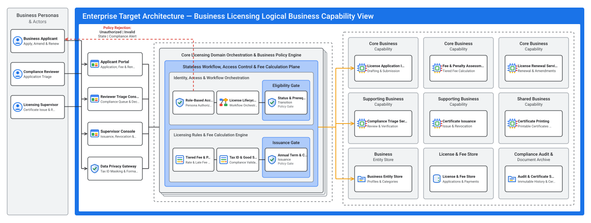

# Logical Solution Architecture (`design/logical_architecture.md`)

- **Project:** Business Licensing & Renewal Portal — Legacy MS Access Modernization (`SCENARIO_LEGACY_APP`)
- **Perspective:** **Logical Business Capability & Functional Domain Architecture** (Standalone Perspective Artifact 3 of 7)
- **Visual Renderer:** `design/diagrams/logical_architecture.svg` (`.png`) — Concentric Multi-Zone Functional Topology
- **Architecture Portfolio Index:** [`design/architecture_design.md`](architecture_design.md)

---

## 1. Logical Solution Architecture (Business Personas, User Experience Channels, Domain Policy Core, Business Capabilities & Domain Data Stores)

*(Depicts the Business Licensing Portal's cloud-agnostic **Business Capability & Functional Domain Architecture**: Business Personas (`Business Applicant`, `Compliance Reviewer`, `Licensing Supervisor`) in the left `#F1F3F4` column, User Experience Channels & Data Privacy Gateway in Column 1, Core Licensing Policy & Fee Calculation Orchestration in Column 2 with red dashed policy-rejection feedback, and the 3×3 grid of Business Capability Services and Logical Domain Data Stores in Column 3.)*

```mermaid
flowchart LR
    subgraph SG_OnPrem["Business Personas & Actors"]
        P_APP["<b>Business Applicant</b><br/>Apply, Amend &amp; Renew"]:::gcpCard
        P_REV["<b>Compliance Reviewer</b><br/>Application Triage"]:::gcpCard
        P_SUP["<b>Licensing Supervisor</b><br/>Certificate Issue &amp; Revoke"]:::gcpCard
    end

    subgraph SG_TargetPlatform["Enterprise Target Architecture — Business Licensing Logical Business Capability View"]
        subgraph SG_Edge["User Experience & Channel Capabilities"]
            UI_APP["<b>Applicant Portal</b><br/>Application, Fee &amp; Renewal"]:::gcpCard
            UI_REV["<b>Reviewer Triage Console</b><br/>Compliance Queue &amp; Decisions"]:::gcpCard
            UI_SUP["<b>Supervisor Console</b><br/>Issuance, Revocation &amp; Print"]:::gcpCard
            UI_DTO["<b>Data Privacy Gateway</b><br/>Tax ID Masking &amp; Formatting"]:::gcpCard
        end

        subgraph SG_HubPerimeter["Core Licensing Domain Orchestration Perimeter"]
            subgraph SG_HubProject["Core Licensing Domain Orchestration & Business Policy Engine"]
                subgraph SG_SharedVPC["Stateless Workflow, Access Control & Fee Calculation Plane"]
                    subgraph SG_Region1["Identity, Access & Workflow Orchestration"]
                        RBAC["<b>Role-Based Access Control</b><br/>Persona Authorization"]:::gcpCard
                        STATE["<b>License Lifecycle Engine</b><br/>Workflow Orchestration"]:::gcpCard
                        subgraph SG_Subnet1["Eligibility Gate"]
                            GUARD1["<b>Status &amp; Prerequisite</b><br/>Transition Policy Gate"]:::focal
                        end
                    end
                    subgraph SG_Region2["Licensing Rules & Fee Calculation Engine"]
                        CALC["<b>Tiered Fee &amp; Penalty</b><br/>Rate &amp; Late Fee Calculator"]:::gcpCard
                        INVAR["<b>Tax ID &amp; Good Standing</b><br/>Compliance Validator"]:::gcpCard
                        subgraph SG_Subnet2["Issuance Gate"]
                            GUARD2["<b>Annual Term &amp; Certificate</b><br/>Issuance Policy Gate"]:::focal
                        end
                    end
                end
            end
        end

        subgraph SG_SpokePerimeter["Business Capability Services & Logical Domain Data Stores"]
            subgraph SG_ProdRow["Core Licensing & Fee Capabilities"]
                CAP_IN["<b>License Application Intake</b><br/>Drafting &amp; Submission"]:::gcpCard
                CAP_FEE["<b>Fee &amp; Penalty Assessment</b><br/>Tiered Fee Calculation"]:::gcpCard
                CAP_REN["<b>License Renewal Service</b><br/>Renewal &amp; Amendments"]:::gcpCard
            end
            subgraph SG_NonProdRow["Compliance, Issuance & Certificate Capabilities"]
                CAP_REV["<b>Compliance Triage Service</b><br/>Review &amp; Verification"]:::gcpCard
                CAP_ISS["<b>Certificate Issuance</b><br/>Issue &amp; Revocation"]:::gcpCard
                CAP_PRT["<b>Certificate Printing</b><br/>Printable Certificates &amp; Notices"]:::gcpCard
            end
            subgraph SG_DevRow["Logical Domain Data Stores"]
                REPO_BIZ["<b>Business Entity Store</b><br/>Profiles &amp; Categories"]:::gcpCard
                REPO_APP["<b>License &amp; Fee Store</b><br/>Applications &amp; Payments"]:::gcpCard
                REPO_AUD["<b>Audit &amp; Certificate Store</b><br/>Immutable History &amp; Certs"]:::gcpCard
            end
        end
    end

    P_APP ==>|"Submit / Renew"| UI_APP
    P_REV ==>|"Review / Approve"| UI_REV
    P_SUP ==>|"Issue / Revoke"| UI_SUP
    UI_APP --> UI_DTO
    UI_REV --> UI_DTO
    UI_SUP --> UI_DTO
    UI_DTO ==>|"Business Command"| RBAC
    UI_DTO ==>|"Fee Calculation"| CALC
    RBAC --> STATE
    STATE ==>|"Verified State"| GUARD1
    CALC --> INVAR
    INVAR ==>|"Verified Fee"| GUARD2
    RBAC -.->|"Policy Rejection: Unauthorized | Invalid State | Compliance Alert"| P_APP
    GUARD1 ==>|"Capability Dispatch"| CAP_IN
    GUARD1 ==>|"Capability Dispatch"| CAP_REV
    GUARD2 ==>|"Domain Persistence"| REPO_BIZ
    CAP_IN --> CAP_FEE
    CAP_FEE --> CAP_REN
    CAP_REV --> CAP_ISS
    CAP_ISS --> CAP_PRT
    REPO_BIZ --> REPO_APP
    REPO_APP --> REPO_AUD

    classDef gcpCard fill:#FFFFFF,stroke:#3C4043,stroke-width:1.5px,color:#202124;
    classDef focal fill:#FFFFFF,stroke:#1A73E8,stroke-width:2.5px,color:#202124,font-weight:bold;
    classDef gcpBlue fill:#E8F0FE,stroke:#1967D2,stroke-width:1.5px,color:#202124;
    classDef gcpGreen fill:#E6F4EA,stroke:#1E8E3E,stroke-width:1.5px,color:#202124;
    classDef gcpYellow fill:#FEF7E0,stroke:#B06000,stroke-width:1.5px,color:#202124;
    classDef gcpRed fill:#FCE8E6,stroke:#D93025,stroke-width:1.5px,color:#202124;

    style SG_OnPrem fill:#F1F3F4,stroke:#9AA0A6,stroke-width:1.5px,color:#202124
    style SG_TargetPlatform fill:#FFFFFF,stroke:#1A73E8,stroke-width:3px,color:#1A73E8
    style SG_Edge fill:#FFFFFF,stroke:#DADCE0,stroke-width:1px,color:#3C4043
    style SG_HubPerimeter fill:#FFFFFF,stroke:#5F6368,stroke-dasharray: 4 4,stroke-width:1.5px,color:#3C4043
    style SG_HubProject fill:#F1F3F4,stroke:#5F6368,stroke-width:1.5px,color:#202124
    style SG_SharedVPC fill:#AECBFA,stroke:#4285F4,stroke-width:1.5px,color:#202124
    style SG_Region1 fill:#F1F3F4,stroke:#7F868D,stroke-width:1.5px,color:#202124
    style SG_Region2 fill:#F1F3F4,stroke:#7F868D,stroke-width:1.5px,color:#202124
    style SG_Subnet1 fill:#AECBFA,stroke:#4285F4,stroke-width:1.5px,color:#202124
    style SG_Subnet2 fill:#AECBFA,stroke:#4285F4,stroke-width:1.5px,color:#202124
    style SG_SpokePerimeter fill:#FFFFFF,stroke:#5F6368,stroke-dasharray: 4 4,stroke-width:1.5px,color:#3C4043
    style SG_ProdRow fill:#F1F3F4,stroke:#9AA0A6,stroke-width:1.5px,color:#202124
    style SG_NonProdRow fill:#F1F3F4,stroke:#9AA0A6,stroke-width:1.5px,color:#202124
    style SG_DevRow fill:#F1F3F4,stroke:#9AA0A6,stroke-width:1.5px,color:#202124
```

---

## 2. Logical Functional Zone & Capability Responsibilities

| Logical Architecture Zone | Logical Components | Functional Responsibility | Domain Policy Enforced |
| :-- | :-- | :-- | :-- |
| **1. Business Personas & Actors** | `Business Applicant`, `Compliance Reviewer`, `Licensing Supervisor` | Initiates license applications, compliance triage, and certificate issuance/revocation | Role-scoped access and separation of duties |
| **2. User Experience & Channel Capabilities** | `Applicant Portal`, `Reviewer Triage Console`, `Supervisor Console`, `Data Privacy Gateway` | Role-tailored workspaces and outbound Tax ID masking (`***-**-1234`) | Zero legacy MS Access object names (`tbl*`, `frm*`, `qry*`, `rpt*`) in UI (`_shared/zero_leak.md`) |
| **3. Core Licensing Domain Orchestration & Policy Engine** | `Role-Based Access Control`, `License Lifecycle Engine`, `Status & Prerequisite Gate`, `Tiered Fee & Penalty Calculator`, `Tax ID & Good Standing Validator`, `Annual Term & Certificate Gate` | Evaluates lifecycle state transitions, surety bond formulas, quarterly fee rates, and buyer/agent good standing | Rejects illegal transitions (`409`), unauthorized roles (`403`), and bond/standing violations (`422`) |
| **4. Business Capability Services & Logical Stores** | `License Application Intake`, `Fee & Penalty Assessment`, `License Renewal Service`, `Compliance Triage Service`, `Certificate Issuance`, `Certificate Printing`, plus 3 Logical Stores | Executes bounded licensing capabilities and persists state changes with append-only audit trails | Transactional consistency across entities, applications, fees, and certificates |
