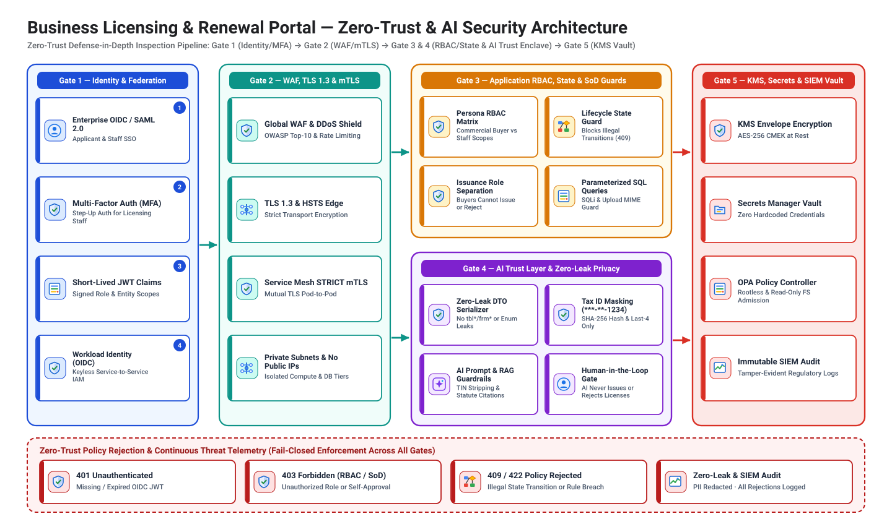

# Security Architecture (`design/security_architecture.md`)

- **Project:** Business Licensing & Renewal Portal — Legacy MS Access Modernization (`SCENARIO_LEGACY_APP`)
- **Perspective:** **Security, Zero-Trust & AI Trust Layer Architecture** (Standalone Perspective Artifact 6 of 7)
- **Visual Renderer:** `design/diagrams/security_architecture.svg` (`.png`) — 5-Layer Defense-in-Depth & AI Trust Layer Stack
- **Architecture Portfolio Index:** [`design/architecture_design.md`](architecture_design.md)

---

## 1. Defense-in-Depth & AI Trust Layer Architecture (5 Security Perimeters)

*(Depicts the concentric 5-layer defense-in-depth security model across **Perimeter 1 (Identity & Federation)**, **Perimeter 2 (Network & Edge)**, **Perimeter 3 (Application RBAC, State-Guard & Separation of Duties)**, **Perimeter 4 (AI Trust Layer & Zero-Leak Tax ID Privacy)**, and **Perimeter 5 (Data Encryption, Secrets & Continuous Compliance)**.)*

```mermaid
flowchart TB
    %% title: Business Licensing & Renewal Portal — Zero-Trust & AI Security Architecture
    %% subtitle: 5-Layer Defense-in-Depth across Identity, Edge, Application RBAC, AI Trust Layer, and Tax ID Encryption
    subgraph SG_Layer1["Perimeter 1 — Identity, Authentication & Access Federation"]
        L1_1["<b>Enterprise OIDC / SAML 2.0</b><br/>Applicant &amp; Staff SSO"]:::secCard
        L1_2["<b>Multi-Factor Auth (MFA)</b><br/>Step-Up Auth for Licensing Staff"]:::secCard
        L1_3["<b>Short-Lived JWT Claims</b><br/>Signed Role &amp; Entity Scopes"]:::secCard
        L1_4["<b>Workload Identity (OIDC)</b><br/>Keyless Service-to-Service IAM"]:::secCard
    end

    subgraph SG_Layer2["Perimeter 2 — Network & Zero-Trust Edge Security"]
        L2_1["<b>Global WAF &amp; DDoS Shield</b><br/>OWASP Top-10 &amp; Rate Limiting"]:::secCard
        L2_2["<b>TLS 1.3 &amp; HSTS Edge</b><br/>Strict Transport Encryption"]:::secCard
        L2_3["<b>Service Mesh STRICT mTLS</b><br/>Mutual TLS Pod-to-Pod"]:::secCard
        L2_4["<b>Private Subnets &amp; No Public IPs</b><br/>Isolated Compute &amp; DB Tiers"]:::secCard
    end

    subgraph SG_Layer3["Perimeter 3 — Application RBAC, State-Guard & Separation of Duties"]
        L3_1["<b>Persona RBAC Matrix</b><br/>Commercial Buyer vs Staff Scopes"]:::secCard
        L3_2["<b>Lifecycle State Guard</b><br/>Blocks Illegal Transitions (409)"]:::secCard
        L3_3["<b>Issuance Role Separation</b><br/>Buyers Cannot Issue or Reject"]:::secCard
        L3_4["<b>Parameterized SQL Queries</b><br/>SQLi &amp; Upload MIME Guard"]:::secCard
    end

    subgraph SG_Layer4["Perimeter 4 — AI Trust Layer & Zero-Leak Tax ID Privacy"]
        L4_1["<b>Zero-Leak DTO Serializer</b><br/>No tbl*/frm* or Enum Leaks"]:::secCard
        L4_2["<b>Tax ID Masking (***-**-1234)</b><br/>SHA-256 Hash &amp; Last-4 Only"]:::secCard
        L4_3["<b>AI Prompt &amp; RAG Guardrails</b><br/>TIN Stripping &amp; Statute Citations"]:::secCard
        L4_4["<b>Human-in-the-Loop Gate</b><br/>AI Never Issues or Rejects Licenses"]:::secCard
    end

    subgraph SG_Layer5["Perimeter 5 — Data Encryption, Secrets Management & Continuous Compliance"]
        L5_1["<b>KMS Envelope Encryption</b><br/>AES-256 CMEK at Rest"]:::secCard
        L5_2["<b>Secrets Manager Vault</b><br/>Zero Hardcoded Credentials"]:::secCard
        L5_3["<b>OPA Policy Controller</b><br/>Rootless &amp; Read-Only FS Admission"]:::secCard
        L5_4["<b>Immutable SIEM Audit</b><br/>Tamper-Evident Regulatory Logs"]:::secCard
    end

    SG_Layer1 ==> SG_Layer2 ==> SG_Layer3 ==> SG_Layer4 ==> SG_Layer5

    classDef secCard fill:#FFFFFF,stroke:#3C4043,stroke-width:1.5px,color:#202124;
```

---

## 2. Role-Based Access Control (RBAC) & Separation-of-Duties Matrix

| Business Persona | Authentication & Scope | Permitted Views | Permitted Workflow Actions | Prohibited Actions & Separation-of-Duties Guards |
| :-- | :-- | :-- | :-- | :-- |
| **Commercial Buyer (`Business Applicant`)** | OIDC SSO + Buyer Entity Scope | Applicant Filing Portal, Bond Calculator, Agent Roster, Quarterly Fee Report, Certificate View | Create/Update Draft Application, Designate Field Agents, Upload Supporting Docs, Submit Application, File Quarterly Fees | Cannot access Staff Compliance Console; cannot Issue or Reject any application (`403 Forbidden`); cannot print agent ID cards before license is `ISSUED` (`409 Conflict`) |
| **Licensing Staff (`Compliance Reviewer` / `Supervisor`)** | Enterprise OIDC + Staff Role + MFA | Staff Compliance Console, Submitted Queue, Audit Trail, Certificate & Agent Card View | Review Submitted Applications, Issue License (generates `LIC-YYYY-NNNN`), Reject Application (mandatory reason), Print Agent ID Cards | Cannot mutate historical `audit_events` rows; cannot issue a license when buyer is suspended, under investigation, or bond is insufficient (`422 Unprocessable Entity`) |

---

## 3. AI Trust Layer & Zero-Leak Privacy Controls

| Control Domain | Threat / Risk Mitigated | Enforcement Mechanism | Verification Gate |
| :-- | :-- | :-- | :-- |
| **Tax ID Cryptographic Protection** | Plaintext SSN/FEIN exposure in database, logs, or UI (legacy MS Access stored raw Tax IDs) | Full Tax ID is hashed (`SHA-256`) on intake; only `tax_id_last4` is stored for display as `***-**-1234` (`tax_id_hash` marked `x-internal: true`) | `TC-UI-LEAK-01..04` & `TC-NEG-*` in Stage 6 (`07/scripts/run_closed_loop_eval.py`) |
| **Zero Legacy Identifier Leakage** | Leaking legacy MS Access table/form/query/report names (`tblBuyers`, `frmLicenseApp`, `qryActiveLicenses`) | Clean 3NF domain model and ViewModel/DTO serializer strip all internal and legacy identifiers | `forbiddenUiTokens` static + runtime browser scan |
| **AI Prompt & Statute RAG Guardrails** | Tax IDs or confidential investigation notes leaking into LLM prompts or hallucinated statutory rules | Pre-prompt PII redaction strips SSN/FEIN patterns; RAG grounds responses strictly in public licensing statutes; AI is read-only | Runtime RBAC & state-transition guard (`403`/`409`) |
