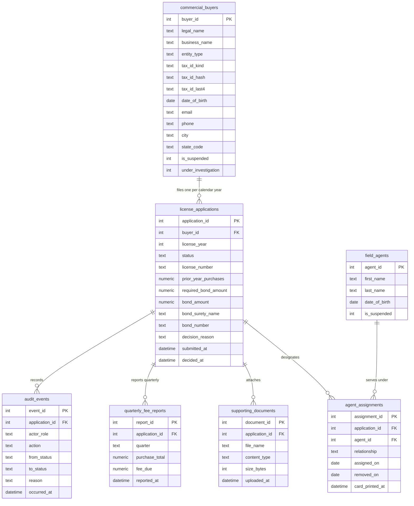

# Solution Design — Business Licensing & Renewal Portal (`design/solution_design.md`)

- **Input Scenario:** `Legacy Application Modernization`
- **Target stack:** frontend `static-html` · backend `python-stdlib-http` · database `sqlite` (from `specs/target_stack.json`)
- **Companion Architecture Document:** `design/architecture_design.md` (Google Cloud Well-Architected Logical & Technical Architecture, Sequence Diagram, Layering Table & 6-Pillar Grilling Matrices)
- **Principles:** clean target (no legacy table/form/report/query names, no desktop-database bridge, no dual run); contract-first (this document is the source of `src/contracts/openapi.yaml` and `src/db/schema.sql`, while `design/architecture_design.md` owns all Logical & Technical Architecture diagrams); **one** state table (spec §3.3) enforced in the UI **and** in the backend; Zero-Leak ViewModel/DTO boundary; Enterprise UX Simplicity Guardrails.
- **Upstream:** `specs/application_spec.md` (REQ-*, §3.3 states `DRAFT`, `SUBMITTED`, `ISSUED`, `REJECTED`; triggers `Submit`, `Issue`, `Reject`; §3.4 BR-01…BR-08; §3.5 roles `Commercial Buyer` (external), `Licensing Staff` (internal)); `backlog/user_stories.json` (17 stories, Sprint 1–2 + backlog).

## 1. Future-State ("To-Be") Domain Model — Normalised 3NF ERD & SQL DDL Schema
*(Business `snake_case` entity names; no technology, ORM or legacy object names. Current-state legacy tables and objects are documented in `specs/discovery_architecture_and_inventory.md §2`.)*



### 2.1 Legacy → Target 3NF Entity Mapping *(Legacy Application Modernization)*
| # | Legacy Object (from Discovery §2.1) | Target Entity | Transformation (normalisation, retired columns, merged/split) | Evidence (file:object/line) |
| :-: | :-- | :-- | :-- | :-- |
| 1 | Applicant table bound to the applicant-selection form (columns: applicant id, last/first name, middle initial, date of birth, SSN, business name, applicant type, FEIN, suspended, under investigation, e-mail, city) | `commercial_buyers` | Plain-text SSN/FEIN replaced by `tax_id_kind` + one-way `tax_id_hash` + `tax_id_last4`; suspended / under-investigation flags kept as booleans; search keys become name, city, e-mail and last-4 only | `Form_frmBusinessLicenseApplicantSelection.txt:31` (list row source), `:93–180` (search variants) |
| 2 | Licence table / licence-application query (licence id = year + applicant id, applicant id, bond and address fields) | `license_applications` | Surrogate key + explicit `license_year`; `status` column drives the lifecycle; licence number becomes a generated, non-parsed display value; bond principal, surety name, bond number and prior-year purchases become typed columns | `Form_frmBusinessLicenseApplicantSelection.txt:237–251` (number composition and year check), `Form_frmBusinessLicenseApplication.txt:44–76` |
| 3 | Agent information table (agent id, names, address, DOB, phone, SSN, relationship, suspended, current licence, card printed) | `field_agents` | Person attributes only; `current licence`, `relationship` and `card printed` move to `agent_assignments`; SSN retired (identity is name + date of birth as the legacy code already uses) | `Form_frmBusinessLicenseApplication.txt:186–242` (add agent), `:251` (list row source) |
| 4 | Licence–agent bridge table + agent assignment history table + agent-removal letter table | `agent_assignments` | One row per assignment with `assigned_on`, `removed_on`, `relationship` (`OWNER` or `AGENT`) and `card_printed_at`; history and removal-letter tables collapse into the same row plus `audit_events` | `Form_frmBusinessLicenseApplication.txt:126–164, 383–451, 590–681`; `Form_frmBusinessLicenseNewApplicationDetail.txt:239–250` |
| 5 | Uploaded-files table (file id, binary file, licence id, name of file, file type, extension, created on) and its select query | `supporting_documents` | Binary content leaves the database (document vault reference); metadata typed (`content_type`, `size_bytes`, `uploaded_at`) | `tblBusinessLicenseFiles.xsd` (elements), `qryBusinessLicenseFiles.sql:1` |
| 6 | Harvest-fee form, fee sub-form and fee-origin sub-sub-form (described, not exported) | `quarterly_fee_reports` | Quarterly report row with computed `fee_due` (4 %) per application | `BusinessLicensingAccessDatabaseOverview.docx` ("Volume Fees" paragraph) |
| 7 | Agent-card label report and the "card printed" update query it runs on close; licence letter / certificate reports | `agent_assignments.card_printed_at` + print actions on the issued licence | Printing becomes an explicit, audited action; no report-close side effects | `Report_rptBusinessLicenseAgentCardLabels.txt:16–20`, `Form_frmBusinessLicenseApplication.txt:475–491, 701–715` |
| 8 | New-applications list form and new-application detail form (review of web-submitted, unissued licences; hard delete button) | `license_applications.status` + `audit_events` | Hard delete replaced by the `Reject` transition with a recorded reason and actor | `Form_frmBusinessLicenseNewApplications.txt:19–27, 33–47`; overview document ("New Applications" paragraph) |

### 2.2 Target 3NF SQL DDL Schema
*(Single authoritative `sql ddl` schema materialized to `src/db/schema.sql`.)*

```sql ddl
-- Business Licensing & Renewal Portal — normalised schema (SQLite dialect, 3NF)
-- Status values are the spec §3.3 state codes; relationship values are the owner / agent kinds of BR-05.

CREATE TABLE commercial_buyers (
    buyer_id            INTEGER PRIMARY KEY AUTOINCREMENT,
    legal_name          TEXT    NOT NULL CHECK (length(legal_name) BETWEEN 1 AND 200),
    business_name       TEXT,
    entity_type         TEXT    NOT NULL CHECK (entity_type IN ('INDIVIDUAL', 'LLC', 'CORPORATION', 'PARTNERSHIP', 'OTHER')),
    tax_id_kind         TEXT    NOT NULL CHECK (tax_id_kind IN ('SSN', 'FEIN')),
    tax_id_hash         TEXT    NOT NULL UNIQUE,
    tax_id_last4        TEXT    NOT NULL CHECK (length(tax_id_last4) = 4),
    date_of_birth       TEXT    NOT NULL,
    email               TEXT,
    phone               TEXT,
    city                TEXT,
    state_code          TEXT,
    is_suspended        INTEGER NOT NULL DEFAULT 0 CHECK (is_suspended IN (0, 1)),
    under_investigation INTEGER NOT NULL DEFAULT 0 CHECK (under_investigation IN (0, 1)),
    created_at          TEXT    NOT NULL,
    updated_at          TEXT    NOT NULL
);

CREATE TABLE license_applications (
    application_id       INTEGER PRIMARY KEY AUTOINCREMENT,
    buyer_id             INTEGER NOT NULL REFERENCES commercial_buyers(buyer_id),
    license_year         INTEGER NOT NULL CHECK (license_year BETWEEN 2000 AND 2100),
    status               TEXT    NOT NULL CHECK (status IN ('DRAFT', 'SUBMITTED', 'ISSUED', 'REJECTED')),
    license_number       TEXT    UNIQUE,
    prior_year_purchases NUMERIC NOT NULL DEFAULT 0 CHECK (prior_year_purchases >= 0),
    required_bond_amount NUMERIC NOT NULL DEFAULT 1000.00,
    bond_amount          NUMERIC NOT NULL DEFAULT 0 CHECK (bond_amount >= 0),
    bond_surety_name     TEXT,
    bond_number          TEXT,
    bond_expiry          TEXT,
    decision_reason      TEXT,
    submitted_at         TEXT,
    decided_at           TEXT,
    created_at           TEXT    NOT NULL,
    updated_at           TEXT    NOT NULL
);
CREATE INDEX idx_license_applications_status ON license_applications(status, submitted_at);
CREATE INDEX idx_license_applications_buyer_year ON license_applications(buyer_id, license_year);

CREATE TABLE field_agents (
    agent_id      INTEGER PRIMARY KEY AUTOINCREMENT,
    first_name    TEXT    NOT NULL CHECK (length(first_name) BETWEEN 1 AND 100),
    last_name     TEXT    NOT NULL CHECK (length(last_name) BETWEEN 1 AND 100),
    date_of_birth TEXT    NOT NULL,
    is_suspended  INTEGER NOT NULL DEFAULT 0 CHECK (is_suspended IN (0, 1)),
    created_at    TEXT    NOT NULL,
    updated_at    TEXT    NOT NULL,
    UNIQUE (last_name, first_name, date_of_birth)
);
CREATE INDEX idx_field_agents_name ON field_agents(last_name, first_name);

CREATE TABLE agent_assignments (
    assignment_id   INTEGER PRIMARY KEY AUTOINCREMENT,
    application_id  INTEGER NOT NULL REFERENCES license_applications(application_id),
    agent_id        INTEGER NOT NULL REFERENCES field_agents(agent_id),
    relationship    TEXT    NOT NULL CHECK (relationship IN ('OWNER', 'AGENT')),
    assigned_on     TEXT    NOT NULL,
    removed_on      TEXT,
    card_printed_at TEXT
);
CREATE INDEX idx_agent_assignments_agent_active ON agent_assignments(agent_id, removed_on);
CREATE INDEX idx_agent_assignments_application ON agent_assignments(application_id, removed_on);

CREATE TABLE supporting_documents (
    document_id    INTEGER PRIMARY KEY AUTOINCREMENT,
    application_id INTEGER NOT NULL REFERENCES license_applications(application_id),
    file_name      TEXT    NOT NULL CHECK (length(file_name) BETWEEN 1 AND 200),
    content_type   TEXT    NOT NULL,
    size_bytes     INTEGER NOT NULL CHECK (size_bytes >= 0),
    vault_reference TEXT,
    uploaded_at    TEXT    NOT NULL
);

CREATE TABLE quarterly_fee_reports (
    report_id      INTEGER PRIMARY KEY AUTOINCREMENT,
    application_id INTEGER NOT NULL REFERENCES license_applications(application_id),
    quarter        TEXT    NOT NULL,
    purchase_total NUMERIC NOT NULL CHECK (purchase_total >= 0),
    fee_due        NUMERIC NOT NULL,
    reported_at    TEXT    NOT NULL,
    UNIQUE (application_id, quarter)
);

CREATE TABLE audit_events (
    event_id       INTEGER PRIMARY KEY AUTOINCREMENT,
    application_id INTEGER REFERENCES license_applications(application_id),
    buyer_id       INTEGER REFERENCES commercial_buyers(buyer_id),
    agent_id       INTEGER REFERENCES field_agents(agent_id),
    actor_role     TEXT    NOT NULL,
    actor_name     TEXT,
    action         TEXT    NOT NULL,
    from_status    TEXT,
    to_status      TEXT,
    reason         TEXT,
    occurred_at    TEXT    NOT NULL
);
CREATE INDEX idx_audit_events_application ON audit_events(application_id, occurred_at);
```

Notes: `required_bond_amount` and `fee_due` are stored snapshots of BR-01 / BR-03 at the time of the record for audit (REQ-ARCH-03); exclusivity (BR-02) is enforced by the workflow service over `agent_assignments` joined to `license_applications.license_year`; the one-application-per-year rule (BR-04) is enforced by the service (a partial unique index is not portable across the stack's databases).

## 3. API Contract (OpenAPI 3.1)
*(Exactly one block tagged `yaml openapi` — extracted to `src/contracts/openapi.yaml`.)*

Conventions: the caller's role is the request header `X-Role` with value `Commercial Buyer` or `Licensing Staff` (in production this is derived from the OIDC token / buyer session, REQ-SEC-01); `X-Actor` carries a display name for the audit trail. Every error body is `{ "message": "<user-readable>", "code": "<machine code, never rendered>" }`. Transition operations return `409` when the (state, trigger) pair is not in the state table and `403` when the role does not own the trigger.

```yaml openapi
openapi: 3.1.0
info:
  title: Business Licensing & Renewal Portal API
  version: 1.0.0
  description: Contract-first API. Transition endpoints validate (fromState, trigger, role) against the spec §3.3 state table.
servers:
  - url: http://127.0.0.1:8767
security:
  - roleHeader: []
paths:
  /health:
    get:
      operationId: getHealth
      summary: Liveness and database connectivity
      security: []
      responses:
        "200":
          description: Service healthy
          content:
            application/json:
              schema:
                $ref: "#/components/schemas/Health"
  /api/applications:
    get:
      operationId: listApplications
      summary: Review queue (Licensing Staff, filter by status) or the caller's own applications (Commercial Buyer, by ids)
      parameters:
        - name: status
          in: query
          schema:
            $ref: "#/components/schemas/StatusCode"
        - name: ids
          in: query
          description: Comma-separated application ids (Commercial Buyer session list)
          schema:
            type: string
      responses:
        "200":
          description: Application summaries (ViewModels)
          content:
            application/json:
              schema:
                type: array
                items:
                  $ref: "#/components/schemas/ApplicationSummary"
        "403":
          $ref: "#/components/responses/Forbidden"
    post:
      operationId: createApplication
      summary: Start a DRAFT application (Commercial Buyer)
      requestBody:
        required: true
        content:
          application/json:
            schema:
              $ref: "#/components/schemas/ApplicationCreate"
      responses:
        "201":
          description: Draft created
          content:
            application/json:
              schema:
                $ref: "#/components/schemas/Application"
        "400":
          $ref: "#/components/responses/BadRequest"
        "403":
          $ref: "#/components/responses/Forbidden"
        "409":
          $ref: "#/components/responses/Conflict"
  /api/applications/{applicationId}:
    parameters:
      - $ref: "#/components/parameters/applicationId"
    get:
      operationId: getApplication
      summary: Application detail with roster, documents, fee reports and history
      responses:
        "200":
          description: Application ViewModel
          content:
            application/json:
              schema:
                $ref: "#/components/schemas/Application"
        "404":
          $ref: "#/components/responses/NotFound"
    put:
      operationId: updateDraftApplication
      summary: Update bond and purchase fields while DRAFT (Commercial Buyer)
      requestBody:
        required: true
        content:
          application/json:
            schema:
              $ref: "#/components/schemas/BondUpdate"
      responses:
        "200":
          description: Updated draft
          content:
            application/json:
              schema:
                $ref: "#/components/schemas/Application"
        "400":
          $ref: "#/components/responses/BadRequest"
        "403":
          $ref: "#/components/responses/Forbidden"
        "409":
          $ref: "#/components/responses/Conflict"
  /api/applications/{applicationId}/submit:
    parameters:
      - $ref: "#/components/parameters/applicationId"
    post:
      operationId: submitApplication
      summary: Trigger Submit (DRAFT -> SUBMITTED, Commercial Buyer)
      responses:
        "200":
          description: Submitted
          content:
            application/json:
              schema:
                $ref: "#/components/schemas/Application"
        "400":
          $ref: "#/components/responses/BadRequest"
        "403":
          $ref: "#/components/responses/Forbidden"
        "409":
          $ref: "#/components/responses/Conflict"
  /api/applications/{applicationId}/issue:
    parameters:
      - $ref: "#/components/parameters/applicationId"
    post:
      operationId: issueLicense
      summary: Trigger Issue (SUBMITTED -> ISSUED, Licensing Staff)
      responses:
        "200":
          description: Licence issued
          content:
            application/json:
              schema:
                $ref: "#/components/schemas/Application"
        "403":
          $ref: "#/components/responses/Forbidden"
        "409":
          $ref: "#/components/responses/Conflict"
  /api/applications/{applicationId}/reject:
    parameters:
      - $ref: "#/components/parameters/applicationId"
    post:
      operationId: rejectApplication
      summary: Trigger Reject (SUBMITTED -> REJECTED, Licensing Staff) with a reason
      requestBody:
        required: true
        content:
          application/json:
            schema:
              $ref: "#/components/schemas/Decision"
      responses:
        "200":
          description: Rejected
          content:
            application/json:
              schema:
                $ref: "#/components/schemas/Application"
        "400":
          $ref: "#/components/responses/BadRequest"
        "403":
          $ref: "#/components/responses/Forbidden"
        "409":
          $ref: "#/components/responses/Conflict"
  /api/applications/{applicationId}/agents:
    parameters:
      - $ref: "#/components/parameters/applicationId"
    post:
      operationId: addAgent
      summary: Add a field agent (BR-02, BR-06, BR-07)
      requestBody:
        required: true
        content:
          application/json:
            schema:
              $ref: "#/components/schemas/AgentInput"
      responses:
        "201":
          description: Agent assigned
          content:
            application/json:
              schema:
                $ref: "#/components/schemas/AgentRoster"
        "200":
          description: Agent already on this roster (re-used)
          content:
            application/json:
              schema:
                $ref: "#/components/schemas/AgentRoster"
        "400":
          $ref: "#/components/responses/BadRequest"
        "403":
          $ref: "#/components/responses/Forbidden"
        "409":
          $ref: "#/components/responses/Conflict"
  /api/applications/{applicationId}/agents/{agentId}:
    parameters:
      - $ref: "#/components/parameters/applicationId"
      - name: agentId
        in: path
        required: true
        schema:
          type: integer
    delete:
      operationId: removeAgent
      summary: Remove a non-owner agent (BR-05)
      responses:
        "200":
          description: Agent removed
          content:
            application/json:
              schema:
                $ref: "#/components/schemas/AgentRoster"
        "403":
          $ref: "#/components/responses/Forbidden"
        "404":
          $ref: "#/components/responses/NotFound"
        "409":
          $ref: "#/components/responses/Conflict"
  /api/applications/{applicationId}/documents:
    parameters:
      - $ref: "#/components/parameters/applicationId"
    post:
      operationId: addDocument
      summary: Attach supporting-document metadata (content goes to the vault)
      requestBody:
        required: true
        content:
          application/json:
            schema:
              $ref: "#/components/schemas/DocumentInput"
      responses:
        "201":
          description: Document attached
          content:
            application/json:
              schema:
                type: array
                items:
                  $ref: "#/components/schemas/Document"
        "400":
          $ref: "#/components/responses/BadRequest"
        "403":
          $ref: "#/components/responses/Forbidden"
  /api/applications/{applicationId}/fee-reports:
    parameters:
      - $ref: "#/components/parameters/applicationId"
    post:
      operationId: addFeeReport
      summary: Record a quarterly volume-fee report on an ISSUED licence (BR-03)
      requestBody:
        required: true
        content:
          application/json:
            schema:
              $ref: "#/components/schemas/FeeReportInput"
      responses:
        "201":
          description: Report recorded
          content:
            application/json:
              schema:
                type: array
                items:
                  $ref: "#/components/schemas/FeeReport"
        "400":
          $ref: "#/components/responses/BadRequest"
        "403":
          $ref: "#/components/responses/Forbidden"
        "409":
          $ref: "#/components/responses/Conflict"
  /api/applications/{applicationId}/prints:
    parameters:
      - $ref: "#/components/parameters/applicationId"
    post:
      operationId: recordPrint
      summary: Print the certificate or the agent cards of an ISSUED licence (Licensing Staff)
      requestBody:
        required: true
        content:
          application/json:
            schema:
              $ref: "#/components/schemas/PrintInput"
      responses:
        "200":
          description: Print recorded
          content:
            application/json:
              schema:
                $ref: "#/components/schemas/Application"
        "403":
          $ref: "#/components/responses/Forbidden"
        "409":
          $ref: "#/components/responses/Conflict"
  /api/buyers:
    get:
      operationId: searchBuyers
      summary: Buyer registry search by name, city or e-mail (Licensing Staff)
      parameters:
        - name: q
          in: query
          schema:
            type: string
      responses:
        "200":
          description: Buyer ViewModels
          content:
            application/json:
              schema:
                type: array
                items:
                  $ref: "#/components/schemas/Buyer"
        "403":
          $ref: "#/components/responses/Forbidden"
  /api/buyers/duplicate-check:
    get:
      operationId: checkBuyerDuplicate
      summary: Possible-duplicate notice for a legal name + date of birth (BR-07)
      parameters:
        - name: legalName
          in: query
          required: true
          schema:
            type: string
        - name: dateOfBirth
          in: query
          required: true
          schema:
            type: string
      responses:
        "200":
          description: Duplicate verdict
          content:
            application/json:
              schema:
                $ref: "#/components/schemas/DuplicateCheck"
        "400":
          $ref: "#/components/responses/BadRequest"
  /api/buyers/{buyerId}/suspension:
    parameters:
      - name: buyerId
        in: path
        required: true
        schema:
          type: integer
    post:
      operationId: setBuyerSuspension
      summary: Suspend or reinstate a buyer (Licensing Staff, audited)
      requestBody:
        required: true
        content:
          application/json:
            schema:
              $ref: "#/components/schemas/SuspensionInput"
      responses:
        "200":
          description: Updated buyer
          content:
            application/json:
              schema:
                $ref: "#/components/schemas/Buyer"
        "403":
          $ref: "#/components/responses/Forbidden"
        "404":
          $ref: "#/components/responses/NotFound"
  /api/agents:
    get:
      operationId: searchAgents
      summary: Agent registry search by name or date of birth (Licensing Staff)
      parameters:
        - name: q
          in: query
          schema:
            type: string
      responses:
        "200":
          description: Agent ViewModels
          content:
            application/json:
              schema:
                type: array
                items:
                  $ref: "#/components/schemas/Agent"
        "403":
          $ref: "#/components/responses/Forbidden"
  /api/agents/{agentId}/suspension:
    parameters:
      - name: agentId
        in: path
        required: true
        schema:
          type: integer
    post:
      operationId: setAgentSuspension
      summary: Suspend or reinstate an agent (Licensing Staff, audited)
      requestBody:
        required: true
        content:
          application/json:
            schema:
              $ref: "#/components/schemas/SuspensionInput"
      responses:
        "200":
          description: Updated agent
          content:
            application/json:
              schema:
                $ref: "#/components/schemas/Agent"
        "403":
          $ref: "#/components/responses/Forbidden"
        "404":
          $ref: "#/components/responses/NotFound"
  /api/calculations/bond:
    post:
      operationId: calculateRequiredBond
      summary: BR-01 required surety bond for a prior-year purchase total
      security: []
      requestBody:
        required: true
        content:
          application/json:
            schema:
              $ref: "#/components/schemas/BondCalculationInput"
      responses:
        "200":
          description: Calculation result
          content:
            application/json:
              schema:
                $ref: "#/components/schemas/BondCalculation"
        "400":
          $ref: "#/components/responses/BadRequest"
  /api/calculations/volume-fee:
    post:
      operationId: calculateHarvestFee
      summary: BR-03 volume fee for a quarterly purchase total
      security: []
      requestBody:
        required: true
        content:
          application/json:
            schema:
              $ref: "#/components/schemas/FeeCalculationInput"
      responses:
        "200":
          description: Calculation result
          content:
            application/json:
              schema:
                $ref: "#/components/schemas/FeeCalculation"
        "400":
          $ref: "#/components/responses/BadRequest"
components:
  securitySchemes:
    roleHeader:
      type: apiKey
      in: header
      name: X-Role
      description: Verified actor role header propagated by the Identity-Aware Proxy / OIDC gateway (Commercial Buyer | Licensing Staff).
  parameters:
    applicationId:
      name: applicationId
      in: path
      required: true
      schema:
        type: integer
  responses:
    BadRequest:
      description: Validation failed — message states what failed and the fix
      content:
        application/json:
          schema:
            $ref: "#/components/schemas/Error"
    Forbidden:
      description: Role may not perform this action
      content:
        application/json:
          schema:
            $ref: "#/components/schemas/Error"
    NotFound:
      description: Record not found
      content:
        application/json:
          schema:
            $ref: "#/components/schemas/Error"
    Conflict:
      description: Transition not allowed from the current status, or a business rule blocks the change
      content:
        application/json:
          schema:
            $ref: "#/components/schemas/Error"
  schemas:
    StatusCode:
      type: string
      enum: [DRAFT, SUBMITTED, ISSUED, REJECTED]
    Trigger:
      type: string
      enum: [SUBMIT, ISSUE, REJECT]
    Role:
      type: string
      enum: ["Commercial Buyer", "Licensing Staff"]
    Error:
      type: object
      required: [message]
      properties:
        message:
          type: string
          description: User-readable; shown verbatim by the UI
        code:
          type: string
          description: Machine code (never rendered)
          x-internal: true
    Health:
      type: object
      properties:
        status:
          type: string
        database:
          type: string
        version:
          type: string
    Status:
      type: object
      properties:
        code:
          $ref: "#/components/schemas/StatusCode"
        label:
          type: string
          description: Visible label from spec §3.3
    ApplicationSummary:
      type: object
      properties:
        applicationId:
          type: integer
        applicationNumber:
          type: string
        licenseYear:
          type: integer
        buyerName:
          type: string
        status:
          $ref: "#/components/schemas/Status"
        licenseNumber:
          type: [string, "null"]
        bondCheck:
          type: string
          description: "Sufficient" or the shortfall sentence
        submittedAt:
          type: [string, "null"]
    Application:
      allOf:
        - $ref: "#/components/schemas/ApplicationSummary"
        - type: object
          properties:
            buyer:
              $ref: "#/components/schemas/Buyer"
            priorYearPurchases:
              type: number
            requiredBondAmount:
              type: number
            bondAmount:
              type: number
            bondShortfall:
              type: number
            bondSuretyName:
              type: string
            bondNumber:
              type: string
            bondExpiry:
              type: [string, "null"]
            decisionReason:
              type: [string, "null"]
            decidedAt:
              type: [string, "null"]
            allowedTriggers:
              type: array
              description: Triggers allowed for (status, caller role) — derived from the state table
              items:
                $ref: "#/components/schemas/Trigger"
            agents:
              $ref: "#/components/schemas/AgentRoster"
            documents:
              type: array
              items:
                $ref: "#/components/schemas/Document"
            feeReports:
              type: array
              items:
                $ref: "#/components/schemas/FeeReport"
            history:
              type: array
              items:
                $ref: "#/components/schemas/HistoryEvent"
    ApplicationCreate:
      type: object
      required: [legalName, entityType, taxIdKind, taxId, dateOfBirth, licenseYear]
      properties:
        legalName:
          type: string
          maxLength: 200
        businessName:
          type: string
          maxLength: 200
        entityType:
          type: string
          enum: [INDIVIDUAL, LLC, CORPORATION, PARTNERSHIP, OTHER]
        taxIdKind:
          type: string
          enum: [SSN, FEIN]
        taxId:
          type: string
          description: Raw identifier, hashed on receipt; never stored or echoed
          x-internal: true
        dateOfBirth:
          type: string
          format: date
        email:
          type: string
        phone:
          type: string
        city:
          type: string
        stateCode:
          type: string
        licenseYear:
          type: integer
        priorYearPurchases:
          type: number
        bondAmount:
          type: number
        bondSuretyName:
          type: string
        bondNumber:
          type: string
        bondExpiry:
          type: string
    BondUpdate:
      type: object
      properties:
        priorYearPurchases:
          type: number
        bondAmount:
          type: number
        bondSuretyName:
          type: string
        bondNumber:
          type: string
        bondExpiry:
          type: string
    Decision:
      type: object
      required: [reason]
      properties:
        reason:
          type: string
          minLength: 10
          maxLength: 500
    Buyer:
      type: object
      properties:
        buyerId:
          type: integer
        legalName:
          type: string
        businessName:
          type: [string, "null"]
        entityType:
          type: string
        maskedTaxId:
          type: string
          description: "***-**-1234 or **-***4567"
        taxIdHash:
          type: string
          x-internal: true
        dateOfBirth:
          type: [string, "null"]
        email:
          type: [string, "null"]
        phone:
          type: [string, "null"]
        city:
          type: [string, "null"]
        stateCode:
          type: [string, "null"]
        suspended:
          type: boolean
        suspensionLabel:
          type: string
          description: "Active" | "Suspended"
        underInvestigation:
          type: boolean
        applicationCount:
          type: integer
    Agent:
      type: object
      properties:
        agentId:
          type: integer
        fullName:
          type: string
        dateOfBirth:
          type: string
        suspended:
          type: boolean
        suspensionLabel:
          type: string
        currentLicenseNumber:
          type: [string, "null"]
        assignmentCount:
          type: integer
    RosterEntry:
      type: object
      properties:
        agentId:
          type: integer
        fullName:
          type: string
        relationshipLabel:
          type: string
          description: "Owner" | "Agent"
        isOwner:
          type: boolean
        cardPrinted:
          type: boolean
        cardPrintedLabel:
          type: string
    AgentRoster:
      type: object
      properties:
        notice:
          type: string
        entries:
          type: array
          items:
            $ref: "#/components/schemas/RosterEntry"
    AgentInput:
      type: object
      required: [firstName, lastName, dateOfBirth]
      properties:
        firstName:
          type: string
          maxLength: 100
        lastName:
          type: string
          maxLength: 100
        dateOfBirth:
          type: string
          format: date
    Document:
      type: object
      properties:
        documentId:
          type: integer
        fileName:
          type: string
        typeLabel:
          type: string
        sizeLabel:
          type: string
        uploadedAt:
          type: string
    DocumentInput:
      type: object
      required: [fileName, contentType, sizeBytes]
      properties:
        fileName:
          type: string
          maxLength: 200
        contentType:
          type: string
        sizeBytes:
          type: integer
    FeeReport:
      type: object
      properties:
        reportId:
          type: integer
        quarter:
          type: string
        purchaseTotal:
          type: number
        feeDue:
          type: number
        summary:
          type: string
    FeeReportInput:
      type: object
      required: [quarter, purchaseTotal]
      properties:
        quarter:
          type: string
        purchaseTotal:
          type: number
    PrintInput:
      type: object
      required: [kind]
      properties:
        kind:
          type: string
          enum: [certificate, agent-cards]
    SuspensionInput:
      type: object
      required: [suspended]
      properties:
        suspended:
          type: boolean
        reason:
          type: string
    DuplicateCheck:
      type: object
      properties:
        possibleDuplicate:
          type: boolean
        notice:
          type: string
    HistoryEvent:
      type: object
      properties:
        actionLabel:
          type: string
        actorRole:
          type: string
        fromStatusLabel:
          type: [string, "null"]
        toStatusLabel:
          type: [string, "null"]
        reason:
          type: [string, "null"]
        occurredAt:
          type: string
    BondCalculationInput:
      type: object
      required: [priorYearPurchases]
      properties:
        priorYearPurchases:
          type: number
        bondAmount:
          type: number
    BondCalculation:
      type: object
      properties:
        requiredBondAmount:
          type: number
        shortfall:
          type: number
        message:
          type: string
    FeeCalculationInput:
      type: object
      required: [purchaseTotal]
      properties:
        purchaseTotal:
          type: number
    FeeCalculation:
      type: object
      properties:
        feeDue:
          type: number
```

## 4. ViewModel / DTO Boundary & Label Mapping
Persistence rows never leave the repository layer; every handler returns the ViewModels above. The same dictionary is used by the backend (`LABELS`) and the UI (rendered from `status.label`), so the UI has no code → label logic of its own.

| Internal field / code | Exposed as | Visible label / masked format |
| :-- | :-- | :-- |
| `DRAFT` | `status.code` + `status.label` | Draft — not yet submitted |
| `SUBMITTED` | `status.code` + `status.label` | Submitted — awaiting review |
| `ISSUED` | `status.code` + `status.label` | Licence issued |
| `REJECTED` | `status.code` + `status.label` | Rejected |
| trigger `SUBMIT` / `ISSUE` / `REJECT` | `allowedTriggers[]` | control labels "Submit application" / "Issue licence" / "Reject application" |
| `relationship` `OWNER` / `AGENT` | `relationshipLabel`, `isOwner` | Owner / Agent |
| `is_suspended` (buyer, agent) | `suspended`, `suspensionLabel` | Active / Suspended |
| `card_printed_at` | `cardPrinted`, `cardPrintedLabel` | Card printed / Card not printed |
| audit `action` codes (`CREATED`, `SUBMITTED`, `ISSUED`, `REJECTED`, `AGENT_ASSIGNED`, `AGENT_REMOVED`, `CERTIFICATE_PRINTED`, `AGENT_CARDS_PRINTED`, `SUSPENDED`, `REINSTATED`, `PERMISSION_DENIED`, `DOCUMENT_ADDED`, `FEE_REPORT_ADDED`) | `history[].actionLabel` | Application created · Submitted · Licence issued · Rejected · Agent assigned · Agent removed · Certificate printed · Agent cards printed · Suspended · Reinstated · Permission denied · Document attached · Fee report recorded |
| `tax_id_hash`, raw `taxId` | *not exposed* (`x-internal`) | — |
| `tax_id_kind` + `tax_id_last4` | `maskedTaxId` | `***-**-1234` (SSN) / `**-***4567` (FEIN) |
| `application_id` | `applicationId` (routing) + `applicationNumber` | `APP-2026-000001` (display) |
| `license_number` | `licenseNumber` | `TB-2026-00003` |
| `required_bond_amount`, `bond_amount` | `requiredBondAmount`, `bondAmount`, `bondShortfall`, `bondCheck` | `$2,500.00`; "Sufficient" or VAL-04 sentence |
| `fee_due` | `feeDue`, `summary` | `Q1 2026 — purchases $12,500.00 — fee due $500.00` |
| error `code` | `message` only is rendered | VAL-01 … VAL-12 sentences (spec §1.3); 409 "This application is <label>; <Trigger> is not possible from this status."; 403 "You do not have permission to <action>." |
| `created_at`, `updated_at`, `event_id`, `assignment_id`, `vault_reference` | *not exposed* | — |

## 5. Workflow & Authorization Enforcement
- **Transition table source:** spec §3.3 → `STATE_TABLE` in `src/backend/server.py` (a list of `(from, trigger, to, roles)` tuples) and the identical constant `STATE_TABLE` in `src/ui/app.js`. Both are generated from the same rows; a `--self-test` assertion compares the backend table with the spec index.
- **Backend guard:** `workflow.transition(app, trigger, role)` checks, in order: (1) role owns the trigger (else `403` + `PERMISSION_DENIED` audit event), (2) `(app.status, trigger)` is in the table (else `409` "This application is <label>; <Trigger> is not possible from this status."), (3) the trigger's guard (BR-01, BR-04 for Submit; buyer suspension, BR-01, BR-02, BR-06 for Issue; reason length for Reject) else `409`/`400` with the VAL sentence. Only then the status, timestamps and audit event are written in one transaction.
- **UI derivation:** `allowedTriggers` from the API plus the local `STATE_TABLE` decide which transition controls are rendered; the buyer view never contains Issue/Reject/Print/registry elements (they live only in the staff view template); the staff view renders decision controls only when `status.code == 'SUBMITTED'` and print controls only when `ISSUED`.
- **RBAC matrix:** spec §2.1 → `PERMISSIONS` dictionary (`role → set of actions`) checked by `authorize(action, role)` in every handler before any repository call; `Commercial Buyer` may read only applications whose ids it holds (session list / lookup) and may mutate only `DRAFT` ones; `Licensing Staff` may read all.
- **Initial role:** the UI starts as `Commercial Buyer` (external role first, REQ-UX-01); the role switcher is a `<select data-testid="role-switcher">`.

## 6. Frontend Design Tokens & Components
- **Design references applied:** none in `resources/design_references/` → Enterprise UX Simplicity Guardrail defaults + tokens from `resources/shared_services/ui_style_guide_enterprise.md`; stamped as `<body data-design-references="ux-guardrails-default; shared_services/ui_style_guide_enterprise.md">`.
- **Tokens:** `--color-brand: #002855`, `--color-action: #1A73E8`, `--color-success: #1E8E3E`, `--color-warning: #F9AB00` (used with dark text), `--color-error: #D93025`, `--color-text: #1f2933`, `--color-muted: #52606d`, `--color-surface: #ffffff`, `--color-page: #f4f6f8`, `--focus-ring: 3px solid #1A73E8`; spacing `--space-1…5` = 4/8/12/16/24 px; type scale title 1.5 rem / section 1.2 rem / body 1 rem / caption 0.85 rem; `main { max-width: 800px }`.
- **Components:** header with role switcher; skip link; `role=tablist` task tabs (≤ 3 per role); stepper (`[data-step]`, one primary button each, ≤ 5 visible inputs, `<details>` for optional fields); status badge (`role=status`, icon glyph + label); banner (`role=alert`); live calculation chips (`role=status`); roster list; queue table (`<th scope="col">`); review panel; registry search panels; document and fee-report lists with empty-state sentences.
- **`data-testid` convention (contract-first, declared in `test/test_cases.json`):** kebab-case `<entity>-<field>` for inputs (`buyer-legal-name`, `bond-amount`, `agent-last-name`), `<action>-btn` for controls (`save-draft-btn`, `submit-application-btn`, `issue-licence-btn`, `reject-application-btn`, `add-agent-btn`, `remove-agent-btn`), `<entity>-status` / `<scope>-status` for status displays (`application-status`, `review-status`), `view-<role-slug>` for role views, `tab-<name>` for tabs, `role-switcher` for the role select, `banner` for the alert region.

## 7. Cross-Cutting Concerns (Target-State Production Architecture)
- **Validation:** server-side on every write (types, ranges, lengths ≤ 200/100/500, SSN/FEIN format by kind, ISO dates); the UI mirrors the same VAL messages for instant feedback and renders whatever `message` the API returns.
- **Error handling:** every error is JSON `{message, code}`; unknown paths `404`; malformed JSON `400`; unexpected exceptions `500` with a generic message and a server-side log line — never a stack trace in the body.
- **Audit / logging:** `audit_events` append-only (no update/delete statements exist); structured JSON request log (`severity`, `httpRequest`, `trace`, `actorRole`, `capabilityGroup`) streamed to `Cloud Logging`, `Cloud Trace`, and `OpenTelemetry Collector` (`OTEL_EXPORTER_OTLP_ENDPOINT`).
- **Configuration & Target Database:** `PORT`, `DATABASE_URL` (connecting via `PgBouncer` connection pooling to `AlloyDB for PostgreSQL` / `Cloud SQL`), `OTEL_EXPORTER_OTLP_ENDPOINT`, and `APP_TAX_ID_SALT` (injected from `Secret Manager` / `Cloud KMS`).
- **Observability:** `GET /health` → `{status: "ok", database: "ok", version}` after a `SELECT 1` readiness probe.
- **Security controls (spec §2):** Enterprise OIDC / Google Cloud `IAP` authentication and role guard on every handler; tax identifier hashed with a salt at capture, last four kept; identifiers never searchable; parameterised SQL; `Content-Type` enforced on JSON bodies; CMEK encryption at rest (`Cloud KMS`) and `STRICT` mTLS in transit (`Cloud Service Mesh`).
- **Accessibility obligations per component (spec §3):** labels bound by `for`/`id`; tabs with `role=tab`/`aria-selected` and arrow-key handling; banner `role=alert`; status and live calculations `role=status`; focus moved to view headings on tab change and to the banner on error; `aria-invalid` + `aria-describedby` on invalid fields; skip link; single `h1`; `lang="en"`.

## 8. Target-State Build, Packaging & Runtime Specification
| Target-State Concern | Specification (per `specs/target_stack.json` & `design/architecture_design.md`) |
| :-- | :-- |
| **Frontend Packaging** | Static web assets (`src/ui/`) packaged into rootless OCI web tier container (`deploy/containers/Dockerfile.ui`) behind `Cloud CDN` & `Cloud Load Balancing` |
| **Backend Runtime** | Stateless HTTP/REST application tier (`src/backend/`) packaged into rootless OCI app container (`deploy/containers/Dockerfile.backend`, `USER 65532:65532`) |
| **Database Schema & Migration** | `src/db/schema.sql` applied via idempotent `db-schema-migration` Kubernetes `Job` (`deploy/gdc/base/workloads.yaml`) |
| **Health & Readiness Probes** | `GET /health` (`livenessProbe` & `readinessProbe` verifying relational database connectivity) |
| **Target Deployment Plane** | Multi-cloud / hybrid GDC Fleet (`on-prem-gdc`, `gcp`, `aws`, `azure`) managed by `GDC Config Sync`, `Policy Controller`, and `Cloud Service Mesh` |

## 9. Migration Reference *(Legacy Application Modernization)*
See `design/data_migration_and_cutover.md` — legacy → target column mapping, cleansing, reconciliation, cutover and rollback; the legacy desktop database and the previous web application are retired after cutover (no bridge, no dual run).
