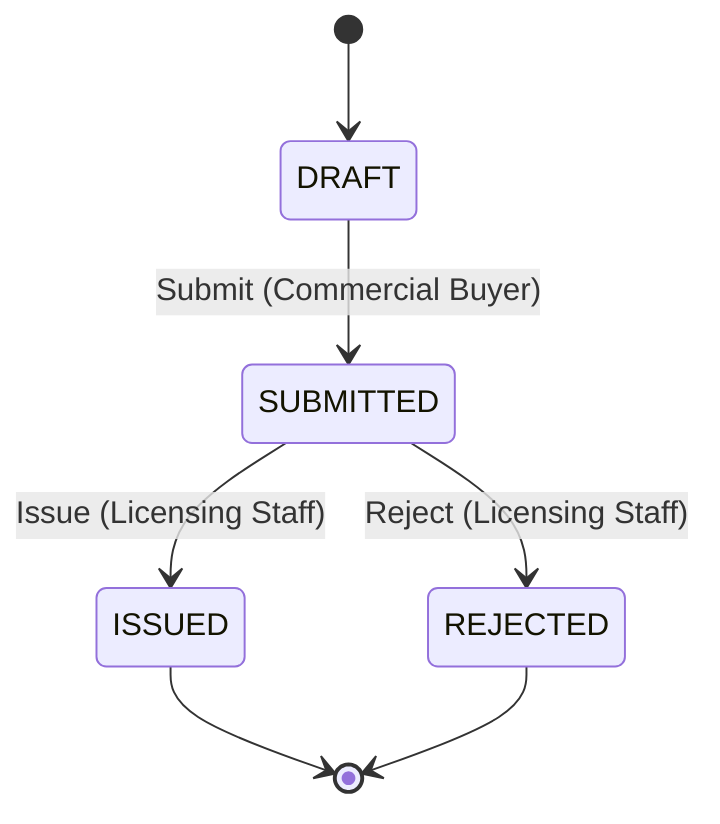

# Business Licensing & Renewal Portal — Application Specification

- **Input Scenario:** `SCENARIO_LEGACY_APP` (legacy desktop-database estate; modernization enhancements included in §1.4)
- **Domain Slug:** `business-licensing-portal`
- **Accessibility Standard(s):** `WCAG 2.1 AA` (baseline; the shared style guide's tokens are applied as the same criteria)
- **Regulations / Policies in Scope:** Commercial Business Licensing Policy (CBL-101) — section 4 (surety bond), section 6 (agent exclusivity), section 9a (4 % volume fee), as provided in `resources/policies_and_policies/`
- **Assumptions (autonomous answers to the open workflow questions in discovery §3.1 — most restrictive reading):**
  - `ASSUMPTION-01` — Removal of an unissued application is modelled as the terminal `REJECTED` decision by Licensing Staff with a mandatory reason; the record is retained for audit (no hard delete).
  - `ASSUMPTION-02` — Only the Commercial Buyer triggers `Submit`; Licensing Staff review, issue and reject. Staff-entered applications on behalf of a buyer are out of scope for Release 1.
  - `ASSUMPTION-03` — There is no return-for-correction transition and no in-place renewal; a new application is filed for each calendar year.
  - `ASSUMPTION-04` — Suspension remains an attribute of the buyer or agent; it blocks `Issue` (suspended buyer) and agent assignment (suspended agent) but adds no licence state.
  - `ASSUMPTION-05` — Only the surety-bond amount is validated; the bond expiry date is captured for information.
- **Shared rules by reference:** `_shared/ux_guardrails.md`, `_shared/zero_leak.md`, `_shared/workflow_chain_of_custody.md`
- **Upstream:** `specs/discovery_architecture_and_inventory.md` (capabilities CAP-01…CAP-08, business rules, evidence). Capability coverage is complete: all 8 discovered capabilities map to at least one `REQ-FUNC` row below (coverage table in `specs/traceability_matrix.md`).

---

## 1 Pillar 1 — Functionality & Business Rules

### 1.1 Functional Requirements (`REQ-FUNC-NN`)
| ID | Requirement (testable statement) | Actors | Capability ref | Source |
| :-- | :-- | :-- | :-- | :-- |
| `REQ-FUNC-01` | A Commercial Buyer can start a licence application for a calendar year by entering buyer details (legal name, business name, entity type, tax identifier kind and number, date of birth, e-mail, phone, city, state); the application is created in state `DRAFT` with a generated application number shown to the buyer. The tax identifier is stored only as a one-way hash plus its last four digits. | Commercial Buyer | CAP-02 | Legacy licence form record source; overview document |
| `REQ-FUNC-02` | While the application is `DRAFT`, the buyer records prior-year purchases and the surety bond (amount, surety company, bond number, expiry); the system computes the required bond with `BR-01` on every input change and shows the shortfall when the bond amount is lower. | Commercial Buyer | CAP-02 | Act section 4 |
| `REQ-FUNC-03` | The buyer can add field agents (first name, last name, date of birth) to a `DRAFT` application and remove non-owner agents; the buyer is automatically the owner agent (`BR-05`); adding an agent already assigned under another application of the same licence year is blocked with the message "This person is already an agent for another licensed buyer in <year>. One licensed buyer per calendar year is allowed." (`BR-02`); adding a suspended agent is blocked (`BR-06`); a same-last-name-and-date-of-birth match re-uses the existing agent record and shows a duplicate notice (`BR-07`). | Commercial Buyer, Licensing Staff | CAP-04 | Legacy assign/remove handlers; Act section 6 |
| `REQ-FUNC-04` | The buyer submits a `DRAFT` application (`Submit`); submission is blocked with a user-readable reason when the bond amount is below the required bond (`BR-01`), when a required field is empty, when an agent on the roster conflicts with another submitted or issued licence of the year (`BR-02`), or when another non-rejected application exists for the same buyer and year (`BR-04`). On success the state becomes `SUBMITTED`, the submission time is recorded and the buyer sees the status "Submitted — awaiting review". | Commercial Buyer | CAP-02, CAP-03 | Overview document (web submission); legacy year check |
| `REQ-FUNC-05` | Licensing Staff see a review queue of applications filterable by status (default: submitted) showing application number, buyer, licence year, bond check and submission date; opening an application shows buyer details with the tax identifier masked, bond check, agent roster, documents and the audit history. | Licensing Staff | CAP-03 | Legacy new-applications list and detail forms |
| `REQ-FUNC-06` | Licensing Staff issue a `SUBMITTED` application (`Issue`): the system assigns a licence number, records the decision time and actor, and the state becomes `ISSUED`. Issue is blocked with a reason when the buyer is suspended, when the bond is insufficient (`BR-01`), or when any agent violates exclusivity (`BR-02`) or is suspended (`BR-06`). | Licensing Staff | CAP-03, CAP-05 | Overview document ("issued by Licensing Compliance staff"); legacy certificate button |
| `REQ-FUNC-07` | Licensing Staff reject a `SUBMITTED` application (`Reject`) with a mandatory reason of at least 10 characters; the state becomes `REJECTED`, the reason is visible to the buyer, and the record is never deleted (`ASSUMPTION-01`). | Licensing Staff | CAP-03 | Legacy hard-delete handler (replaced) |
| `REQ-FUNC-08` | On an `ISSUED` licence Licensing Staff can print the licence certificate and the agent identification cards; each print is recorded (who, when) and the card-printed time is stored per agent assignment; the staff view shows "Card printed" per agent afterwards. | Licensing Staff | CAP-05 | Legacy card-label report and card-printed update query |
| `REQ-FUNC-09` | Licensing Staff can manage the agent roster of a `SUBMITTED` or `ISSUED` application (add / remove agents) under the same rules as `REQ-FUNC-03`; the owner agent cannot be removed (`BR-05`); every assignment and removal is written to the audit history with the actor. | Licensing Staff | CAP-04, CAP-08 | Legacy assign/remove/history handlers |
| `REQ-FUNC-10` | Licensing Staff search the buyer registry by name, city or e-mail and the agent registry by name or date of birth; results show masked identifiers, suspension and under-investigation flags and the current licence; staff can suspend or reinstate a buyer or agent (audited). Deletion of a buyer with applications or an agent with assignment history is not offered (`BR-08`). | Licensing Staff | CAP-01, CAP-06 | Legacy search and delete handlers |
| `REQ-FUNC-11` | The buyer can attach supporting documents (file name, content type, size) to a `DRAFT` application and both roles can list them per application; binary content is held by the document vault, never in the application database. | Commercial Buyer, Licensing Staff | CAP-02 | Legacy uploaded-files table and query |
| `REQ-FUNC-12` | The buyer sees a status timeline per application (every transition with time, actor role and reason) and the current status label; Licensing Staff see the same history in the review view. | Commercial Buyer, Licensing Staff | CAP-08 | Legacy assignment-history table (extended) |
| `REQ-FUNC-13` | For an `ISSUED` licence the buyer records a quarterly volume-fee report (quarter, purchase total); the fee due is computed with `BR-03` live while typing and stored with the report; staff see the reports in the review view. | Commercial Buyer, Licensing Staff | CAP-07 | Act section 9a; overview document |

### 1.2 Journeys & Steps
*(Derived from the capability inventory and the §3.3 states; step counts are not templated.)*

**Commercial Buyer — "Apply for this year's licence" (`DRAFT` → `SUBMITTED`)**
1. Open the portal (external role is the initial role); choose **New application**.
2. Step 1 *Buyer details*: legal name, business name, entity type, tax identifier (kind + number), date of birth → **Continue** (client validation; duplicate notice if last name + date of birth match an existing buyer, `BR-07`).
3. Step 2 *Bond & purchases*: prior-year purchases, bond amount, surety company, bond number → the required bond (`BR-01`) and shortfall recompute on every keystroke → **Save draft** creates the application (`DRAFT`) and shows its number.
4. Step 3 *Field agents*: the owner agent is listed automatically; add agents (exclusivity, suspension and duplicate rules apply as typed) → **Continue**.
5. Step 4 *Review & submit*: summary (bond check, agents, documents) → **Submit application** → status "Submitted — awaiting review"; the application appears under **My applications** with its timeline.

**Commercial Buyer — "Track and report" (`ISSUED`)**
1. **My applications** → open an issued licence → status "Licence issued", licence number, decision time.
2. **Fee calculator** → enter quarterly purchase total → fee due (`BR-03`) shown live → **Record report** on the issued licence.

**Licensing Staff — "Review and decide" (`SUBMITTED` → `ISSUED` | `REJECTED`)**
1. Switch to the internal role → **Review queue** (default filter: submitted).
2. **Open** an application → buyer card (masked identifier, suspension flag), bond check (required vs provided), agent roster with exclusivity status, documents, history.
3. Optionally adjust the roster (add / remove non-owner agents) — each change audited.
4. **Issue licence** (enabled only when all guards pass) → licence number assigned, status "Licence issued"; or **Reject** with a reason (≥ 10 characters) → status "Rejected".
5. On an issued licence → **Print certificate** / **Print agent cards** → "Card printed" shown per agent.

**Licensing Staff — "Maintain registries"**
1. **Buyers** tab → search → suspend / reinstate; 2. **Agents** tab → search → suspend / reinstate (a suspended agent can no longer be assigned, `BR-06`).

### 1.3 Validation Rules
| ID | Field / Action | Rule | User-readable message (what failed + the fix) |
| :-- | :-- | :-- | :-- |
| VAL-01 | Legal name, entity type, tax identifier, date of birth | required before Step 1 can continue | "Enter the legal name, entity type, tax identifier and date of birth to continue." |
| VAL-02 | Tax identifier | Social-security number format `NNN-NN-NNNN` or employer identification number format `NN-NNNNNNN` according to the chosen kind | "Enter the tax identifier as NNN-NN-NNNN (Social-security number) or NN-NNNNNNN (employer identification number)." |
| VAL-03 | Prior-year purchases, bond amount | numeric, ≥ 0, two decimals | "Enter amounts in dollars, for example 25000.00." |
| VAL-04 | Bond amount vs required bond (`BR-01`) | bond amount ≥ required bond to save as ready / to submit | "Bond amount is below the required bond of $<required>. Increase the bond by $<shortfall> before submitting." |
| VAL-05 | Agent first name, last name, date of birth | required to add an agent | "Enter the agent's first name, last name and date of birth." |
| VAL-06 | Add agent (`BR-02`) | no active assignment for the same person in the same licence year | "This person is already an agent for another licensed buyer in <year>. One licensed buyer per calendar year is allowed." |
| VAL-07 | Add agent (`BR-06`) | agent not suspended | "This agent is suspended and cannot be assigned. Contact licensing staff to review the suspension." |
| VAL-08 | Remove agent (`BR-05`) | not the owner assignment | "The licence holder is the owner agent and cannot be removed." |
| VAL-09 | Submit (`BR-04`) | no other non-rejected application for buyer + year | "An application for <year> already exists for this buyer (<status>). Open it instead of starting a new one." |
| VAL-10 | Reject reason | ≥ 10 characters | "Enter a rejection reason of at least 10 characters so the buyer knows what to correct." |
| VAL-11 | Issue (`BR-01`, `BR-02`, `BR-06`, suspension) | all guards pass | "The licence cannot be issued: <first failing guard>. Resolve it and try again." |
| VAL-12 | Quarterly purchase total (`BR-03`) | numeric ≥ 0 | "Enter the quarter's total purchase price in dollars." |

### 1.4 Modernization Enhancements (`REQ-ENH-NN`) *(SCENARIO_LEGACY_APP — chosen from the pain points in discovery §5)*
| ID | Enhancement | Pain point addressed (discovery §5 ref) | Acceptance signal |
| :-- | :-- | :-- | :-- |
| `REQ-ENH-01` | Unified self-service application journey: the record the buyer completes is the same record staff review and issue; no re-keying, no second system. | §5 #1 — two disconnected systems | A buyer-created `DRAFT` appears in the staff queue the moment it is `SUBMITTED`, with identical data |
| `REQ-ENH-02` | Live surety-bond requirement calculator (`BR-01`) with shortfall coaching while the buyer types, before any submit. | §5 #2 — bond computed by hand | Typing a prior-year purchase figure updates the required bond and shortfall text without clicking a button |
| `REQ-ENH-03` | Real-time agent-exclusivity guardrail (`BR-02`) at the moment an agent is added, naming the conflict year in plain language; duplicate-person guardrail (`BR-07`) in the same step. | §5 #3 and #5 — conflicts found late by staff; duplicate records | Adding a conflicting agent shows VAL-06 and leaves the roster unchanged |
| `REQ-ENH-04` | Proactive status timeline for buyers: every transition and decision reason is visible on the application; rejections replace deletions. | §5 #4 — no visibility, hard deletes | After `Reject`, the buyer's timeline shows "Rejected" with the reason |
| `REQ-ENH-05` | Quarterly volume-fee calculator (`BR-03`) and report capture on the issued licence, feeding next year's prior-year purchase figure. | §5 #6 — fee computed outside the system | Typing a purchase total shows the 4 % fee due live; recording stores the report on the licence |

---

## 2 Pillar 2 — Security, RBAC, PII & Audit (`REQ-SEC-NN`)
| ID | Requirement | Applies to |
| :-- | :-- | :-- |
| `REQ-SEC-01` | Authentication: Licensing Staff authenticate through the enterprise OpenID Connect identity service (shared service `shared-auth-oidc`) with a 60-minute inactivity session timeout after which the next action redirects to sign-in; Commercial Buyers authenticate with an account (e-mail + verified link); anonymous access is limited to the sign-in page and the public status of the service (`/health`). In the Release 1 pretotype both identities are simulated by a role switcher and sent as a role header, and every server-side guard is evaluated against that role exactly as it will be against the token claims. | both roles |
| `REQ-SEC-02` | Authorization: every transition and capability is allowed or denied per the RBAC matrix in §2.1; a denied attempt returns HTTP 403 with the message "You do not have permission to <action>." and writes an audit event; internal-role controls are never rendered on external views. | both roles |
| `REQ-SEC-03` | PII protection: the tax identifier is never stored, logged or transmitted in clear text after capture — only a salted SHA-256 hash (for duplicate detection) and the last four digits are kept, and the UI displays the masked form from §2.2 only. Date of birth, phone and e-mail are shown to Licensing Staff only; the buyer sees their own values. | both roles |
| `REQ-SEC-04` | Encryption: all transport is HTTPS/TLS 1.2+ behind the enterprise gateway; the database file and the document vault are encrypted at rest with keys owned by the shared key-management service (`shared-kms-crypto`); no secret or key is committed to source; configuration comes from environment variables. | platform |
| `REQ-SEC-05` | Immutable audit trail: every state transition, agent assignment or removal, suspension change, print action and denied attempt appends an event with actor role, actor identifier, action, from-state, to-state, reason and UTC time; events are append-only and readable by Licensing Staff (full) and by the owning buyer (their own application's transitions). | both roles |
| `REQ-SEC-06` | Input hardening: all API input is validated server-side (types, lengths ≤ 200 characters for names, amounts ≥ 0), SQL is parameterised, uploaded document metadata is sanitised, and error responses never include stack traces or SQL. | platform |

### 2.1 RBAC Matrix *(every §3.5 role × every §3.3 trigger and capability; "denied" = HTTP 403 + audit event + no control rendered)*
| Capability / Transition | Commercial Buyer | Licensing Staff |
| :-- | :-: | :-: |
| Create / edit own `DRAFT` application (REQ-FUNC-01, 02, 11) | allowed | denied |
| `Submit` (DRAFT → SUBMITTED) | allowed (own application) | denied |
| View review queue, open any application (REQ-FUNC-05) | denied (sees own applications only) | allowed |
| `Issue` (SUBMITTED → ISSUED) | denied | allowed |
| `Reject` (SUBMITTED → REJECTED) | denied | allowed |
| Add / remove agents | allowed on own `DRAFT` only | allowed on `SUBMITTED` / `ISSUED` |
| Print certificate / agent cards (REQ-FUNC-08) | denied | allowed on `ISSUED` |
| Buyer & agent registry search, suspend / reinstate (REQ-FUNC-10) | denied | allowed |
| Record quarterly volume-fee report (REQ-FUNC-13) | allowed on own `ISSUED` licence | allowed (view) |
| View status timeline / audit history (REQ-FUNC-12) | own applications | all |

### 2.2 PII Fields & Masking *(source of `piiPatterns` for leakage tests)*
| Field | Classification | Masked display format | Storage protection |
| :-- | :-- | :-- | :-- |
| Social-security number (tax identifier kind SSN; raw pattern `\d{3}-\d{2}-\d{4}`) | Sensitive personal identifier | `***-**-1234` (last four only), on every view and in every API response | not stored raw: salted SHA-256 hash + last four digits |
| Federal employer identification number (tax identifier kind FEIN; raw pattern `\b\d{2}-\d{7}\b`) | Sensitive business identifier | `**-***4567` (last four only) | not stored raw: salted SHA-256 hash + last four digits |
| Date of birth (buyer, agent) | Personal data | full date to Licensing Staff and to the owning buyer; never in lists visible to other buyers | encrypted at rest (database) |
| E-mail, phone, street address | Contact data | shown to Licensing Staff and the owning buyer only | encrypted at rest (database) |
| Rejection reason, suspension reason | Case data | shown to the owning buyer and staff | encrypted at rest; retained 7 years with the application |

### 2.3 Audit Events
| Event | Recorded fields | Retention |
| :-- | :-- | :-- |
| Application created / submitted / issued / rejected | application id, actor role, actor id, from-state, to-state, reason, UTC time | 7 years after the licence year |
| Agent assigned / removed; buyer or agent suspended / reinstated | application id (if any), agent or buyer id, actor role, actor id, action, reason, UTC time | 7 years |
| Certificate / card printed | application id, agent assignment id, actor id, UTC time | 7 years |
| Permission denied / guard rejected | attempted action, role, application id, reason, UTC time | 2 years |

---

## 3 Pillar 3 — Accessibility (`REQ-A11Y-NN`) and Lifecycle Tables
| ID | Requirement (measurable) | Standard clause |
| :-- | :-- | :-- |
| `REQ-A11Y-01` | Text contrast ≥ 4.5:1 and large text / UI component contrast ≥ 3:1 using the style-guide tokens (navy `#002855`, action blue `#1A73E8`, green `#1E8E3E`, amber `#F9AB00`, red `#D93025` on white); every status (draft, submitted, issued, rejected, suspended, shortfall) is conveyed by a text label and an icon glyph, never by colour alone. | WCAG 1.4.3, 1.4.11, 1.4.1 |
| `REQ-A11Y-02` | Full keyboard operability: every control is reachable in DOM order with Tab/Shift+Tab and operable with Enter/Space; tabs use the arrow keys; dialogs close with Escape; a "Skip to main content" link is the first focusable element; no keyboard trap and no positive `tabindex`. | WCAG 2.1.1, 2.1.2, 2.4.1, 2.4.3 |
| `REQ-A11Y-03` | Focus management: a visible 3 px focus ring (`#1A73E8`, offset 2 px) on every control; opening a dialog moves focus to its heading and returns focus to the trigger on close; after a submit the focus moves to the first invalid field or to the confirmation banner; a view change moves focus to the new view heading. | WCAG 2.4.7, 2.4.3, 3.2.2 |
| `REQ-A11Y-04` | Programmatic names and roles: every input has a visible `<label for>`; icon-only buttons carry `aria-label`; landmarks `header`, `nav`, `main` exist exactly once; exactly one `h1` with a logical `h2`/`h3` hierarchy; data tables use `<th scope>`; the document has `lang="en"`. | WCAG 1.3.1, 4.1.2, 2.4.6 |
| `REQ-A11Y-05` | Live regions: the validation banner uses `role="alert"` (assertive); the status badge, the live bond calculation and the fee calculation use `role="status"` / `aria-live="polite"`; announcements are deliberate — one region per view. | WCAG 4.1.3 |
| `REQ-A11Y-06` | Error identification: each validation error names the field, describes the problem in plain language and states the concrete fix (messages VAL-01…VAL-12); the field receives `aria-invalid="true"` and `aria-describedby` pointing at the message; a summary appears at the top of the step. | WCAG 3.3.1, 3.3.3 |

### 3.3 Lifecycle State Machine *(frozen; parsed by scripts — table mirrors the diagram; evidence in discovery §3)*

| From | To | Trigger | Actor Role | Guard |
| :-- | :-- | :-- | :-- | :-- |
| DRAFT | SUBMITTED | Submit | Commercial Buyer | required fields present; bond amount ≥ required bond (BR-01); every agent satisfies exclusivity (BR-02); no other non-rejected application for the same buyer and licence year (BR-04); evidence: discovery §3 row 1 |
| SUBMITTED | ISSUED | Issue | Licensing Staff | buyer not suspended; bond amount ≥ required bond (BR-01); every active agent satisfies exclusivity (BR-02) and is not suspended (BR-06); evidence: discovery §3 row 2 |
| SUBMITTED | REJECTED | Reject | Licensing Staff | decision reason of at least 10 characters recorded; evidence: discovery §3 row 3 and ASSUMPTION-01 |

Initial state: `DRAFT`. Terminal states: `ISSUED`, `REJECTED` (no outgoing transitions; `ASSUMPTION-03`). Any (state, trigger) pair not listed is illegal: the control is not rendered and the API answers HTTP 409 with "This application is <label>; <trigger> is not possible from this status."

**State labels shown to users** *(the UI never shows the code)*:
| State code | Visible label |
| :-- | :-- |
| DRAFT | Draft — not yet submitted |
| SUBMITTED | Submitted — awaiting review |
| ISSUED | Licence issued |
| REJECTED | Rejected |

Trigger controls are labelled "Submit application", "Issue licence" and "Reject application".

### 3.4 Business Rules & Formulas *(parsed; thresholds are numbers)*
| Rule ID | Formula / Rule | Inputs | Source |
| :-- | :-- | :-- | :-- |
| BR-01 | `required_bond_amount = max(1000.00, round_half_up(0.10 × prior_year_purchases, 2))`; shortfall = `max(0, required_bond_amount − bond_amount)`; examples: 0 → 1000.00; 9,999.99 → 1000.00; 10,000.00 → 1000.00; 10,000.10 → 1000.01; 25,000.00 → 2500.00; 250,000.00 → 25000.00 | prior_year_purchases (USD, ≥ 0), bond_amount (USD) | Act section 4 (`resources/policies_and_policies`) |
| BR-02 | A field agent may hold at most one active assignment (removed_on is null) across all applications of the same license_year whose status is SUBMITTED or ISSUED (a draft is not yet a licensed buyer; a rejected application never is); adding the agent to a second such application is rejected (VAL-06) and a draft carrying a conflicting agent cannot be submitted | agent identity (last name + date of birth), license_year, active assignments, application status | Act section 6; legacy assign-agent handler |
| BR-03 | `fee_due = round_half_up(0.04 × purchase_total, 2)` per quarterly report; examples: 0 → 0.00; 12,500.00 → 500.00; 0.10 → 0.00 (0.004 rounds down); 0.13 → 0.01 (0.0052 rounds up) | purchase_total (USD, ≥ 0) | Act section 9a; overview document |
| BR-04 | At most one application per buyer per license_year whose status is not REJECTED; a second Submit attempt is rejected (VAL-09) | buyer, license_year, existing applications | Legacy applicant-selection form (one licence per year) |
| BR-05 | The buyer is the owner agent of their own application (relationship = OWNER) created automatically with the application; the owner assignment cannot be removed (VAL-08) and is not counted as a conflict for BR-02 on the buyer's own application | application, owner assignment | Legacy add-agent / remove-agent handlers |
| BR-06 | An agent with is_suspended = true cannot be assigned (VAL-07); Issue is blocked while any active agent or the buyer is suspended (VAL-11) | suspension flags | Legacy assign-agent handler |
| BR-07 | A new buyer or agent whose last name and date of birth equal an existing record is treated as a possible duplicate: the existing record is re-used for agents, and a notice "A record with the same last name and date of birth already exists" is shown for buyers | last_name, date_of_birth | Legacy duplication check |
| BR-08 | A buyer with ≥ 1 application and an agent with ≥ 1 assignment cannot be deleted; deletion is not offered in the UI and the API has no delete operation for them | applications, assignments | Legacy delete handlers |

### 3.5 Roles *(parsed; Kind is `external` or `internal` — no other values)*
| Role | Kind | Views | Allowed Transitions |
| :-- | :-- | :-- | :-- |
| Commercial Buyer | external | New application (4 steps), My applications (status timeline, documents, fee reports), Fee calculator | Submit |
| Licensing Staff | internal | Review queue, Application review (decision, roster, documents, history, printing), Buyers registry, Agents registry | Issue, Reject |

---

## 4 Pillar 4 — User Experience & Zero Internal Data Leakage (`REQ-UX-NN`)
| ID | Requirement | Derived from |
| :-- | :-- | :-- |
| `REQ-UX-01` | Role-separated views: the Commercial Buyer portal and the Licensing Staff workspace are separate views selected by a role switcher (the external role is the initial view); staff controls (Issue licence, Reject application, Print, suspend / reinstate, registry search) are never rendered in the buyer view, and transition controls render only for the (state, role) pairs in §3.3. | §3.3, §3.5, `_shared/ux_guardrails.md` #2 |
| `REQ-UX-02` | The UX guardrails in `_shared/ux_guardrails.md` are adopted as defaults: one primary action per screen, ≤ 3 top-level tabs per role, ≤ 5 visible fields per step (extra fields behind progressive disclosure), single-column layout with a main container between 720 px and 840 px wide, recognition over recall (entity-type and quarter selects, example amounts), live calculation on input for BR-01 and BR-03, actionable error recovery (VAL messages), 4-level typography and 3 semantic status tokens. No guardrail is overridden (§4.1). | `_shared/ux_guardrails.md` |
| `REQ-UX-03` | Design reference: no user-provided design reference exists (`resources/design_references/` is empty), so the default design system is the UX-guardrail defaults with the shared style-guide tokens from `resources/shared_services/ui_style_guide_enterprise.md` (brand navy `#002855`, action blue `#1A73E8`, success green `#1E8E3E`, warning amber `#F9AB00`, error red `#D93025`); the applied set is stamped in `<body data-design-references>`. | Gate 1 default |
| `REQ-UX-04` | Zero internal data leakage per `_shared/zero_leak.md`: visible text never contains database table or column identifiers, raw state / trigger / error codes, internal keys or hashes, legacy object or file names, engineering notes, SQL or API paths, or unmasked identifiers; all codes pass through the label dictionary in §3.3 and the ViewModel boundary in `REQ-ARCH-05`. | `_shared/zero_leak.md` |
| `REQ-UX-05` | Every control has defined behaviour and visible effect (no dead buttons): lists and detail views bind to live data; empty lists show an explanatory sentence instead of an empty table; each step has exactly one primary button; success and error banners state the next action. | `_shared/ux_guardrails.md` #1, #8, #10 |

### 4.1 UX Guardrail Overrides *(none)*
| Guardrail # | Override | Justification / reference |
| :-- | :-- | :-- |
| — | none — all ten guardrails apply as written | no design reference or Gate 1 instruction overrides them |

### 4.2 View & Component Topology
| View ID | Navigation Tab / Route | UI Pattern | Bound Role(s) | Primary CTA & Lifecycle Trigger |
| :-- | :-- | :-- | :-- | :-- |
| new-application | New application | Multi-Step Wizard | Commercial Buyer | Submit application (`Submit`) |
| my-applications | My applications | Status & Lookup Console | Commercial Buyer | Open application |
| fee-calculator | Fee calculator | Live Rule Calculator | Commercial Buyer | Calculate fee |
| review-queue | Review queue | Triage Queue Table | Licensing Staff | Issue licence (`Issue`) |
| buyers | Buyers | Searchable Registry | Licensing Staff | Search buyers |
| agents | Agents | Searchable Registry | Licensing Staff | Search agents |

### 4.3 Zero-Leakage Obligations
`_shared/zero_leak.md` applies in full. The presentation boundary is the ViewModel layer described in `REQ-ARCH-05`: it maps the state codes of §3.3 to the visible labels table, maps error codes to the VAL messages, masks the tax identifier (§2.2) and omits internal keys, hashes and audit columns. Domain-specific tokens added to the forbidden list: the legacy object names in `specs/input_inventory.json` and the words "parity" and "legacy" in visible text.

---

## 5 Pillar 5 — Target Architecture & Engineering Guidelines (`REQ-ARCH-NN`)
| ID | Requirement | Stack element (`specs/target_stack.json`) |
| :-- | :-- | :-- |
| `REQ-ARCH-01` | Target stack: a static HTML/JavaScript single-page frontend (`frontend.kind = static-html`), a Python standard-library HTTP backend (`backend.kind = python-stdlib-http`) that serves the UI and the JSON API on one port (8767) with `GET /health`, and a SQLite database (`database.kind = sqlite`) created from `src/db/schema.sql`; zero third-party dependencies; `python3 src/backend/server.py` starts everything. | frontend, backend, database, commands |
| `REQ-ARCH-02` | Layering: UI → HTTP handlers → domain services (workflow, rules, registry) → repositories → SQLite; business rules BR-01…BR-08 live in one domain module and are unit-tested by `commands.test`; handlers never contain SQL. | backend |
| `REQ-ARCH-03` | Normalised 3NF schema: tables in business `snake_case` with surrogate primary keys, foreign keys, unique constraints (`license_number`, buyer + year), `CHECK` constraints restricting `status` to the §3.3 codes and `relationship` to OWNER / AGENT, audit columns, and indexes for the queue and registry queries; no derived columns except the stored `required_bond_amount` and `fee_due` snapshots required for audit. | database |
| `REQ-ARCH-04` | Contract-first API: `design/solution_design.md` contains an OpenAPI 3.1 document with one operation per §3.3 trigger (`submit`, `issue`, `reject`), read operations for queue, application, agents, documents, reports and history, and calculation endpoints for BR-01 and BR-03; enums equal the §3.3 state codes; every 4xx response carries a `message` the UI can show verbatim; transition operations validate (fromState, trigger, role) server-side and return 409 (illegal state) or 403 (role) — the UI is never the only guard. | backend |
| `REQ-ARCH-05` | ViewModel / DTO boundary: API responses expose display models only — state label and code pair, masked identifier, formatted amounts — and never persistence rows; internal keys other than the application number, hashes and audit columns are marked `x-internal` and excluded; templates bind only to ViewModels. | backend, frontend |
| `REQ-ARCH-06` | Testability contract: every interactive control and status display carries a stable kebab-case `data-testid` declared first in `test/test_cases.json` (contract-first) and named by role, entity, action or transition (for example `submit-application-btn`, `issue-licence-btn`, `application-status`); the role switcher is `data-testid="role-switcher"`. | frontend |
| `REQ-ARCH-07` | Clean migration, no legacy carry-over: no legacy table, form, report, query or control identifier appears in target code, schema or UI; no desktop-database bridge, dual-run adapter or compatibility view is built; data moves once through the ETL described in `design/data_migration_and_cutover.md`, after which the legacy database and the old web application are retired. Observability: structured request logs with role, path, status and duration; `/health` reports database connectivity. | all |

---

## 6 Traceability
See `specs/traceability_matrix.md` — every `REQ-*` above maps to capability → business rules → planned story → test category; the traceability matrix is maintained with this specification and audited by the Stage 2 lint and the Stage 3 backlog audit.
