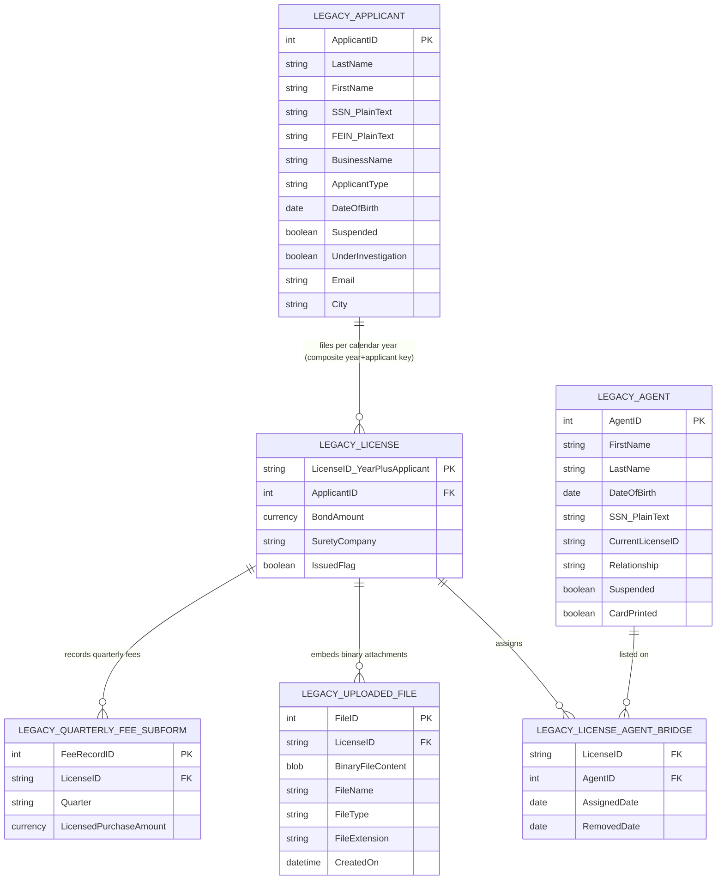
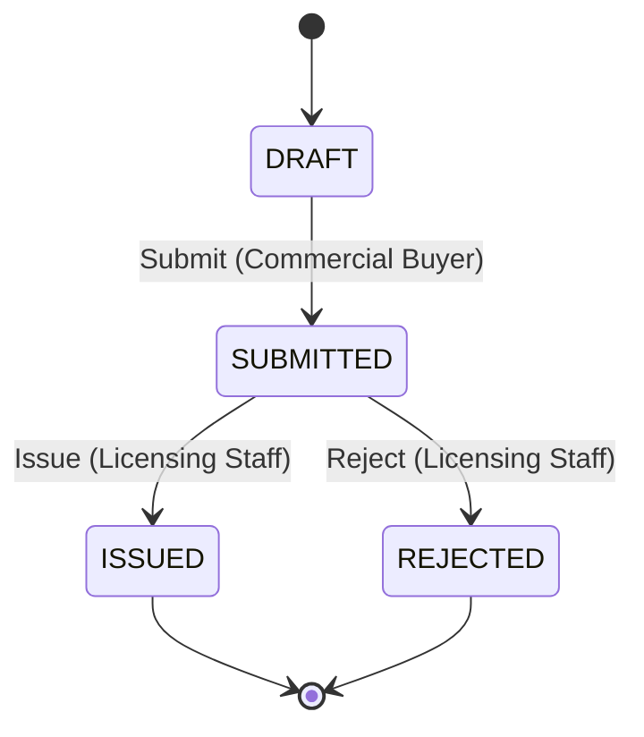

# Business Licensing & Renewal Portal

- **Project Name:** `Business Licensing & Renewal Portal`
- **Input Scenario Mode:** `SCENARIO_LEGACY_APP` (from `specs/input_inventory.json`; confidence: `HIGH` — 7 legacy artefacts weighing 15 vs 1 narrative overview document weighing 3)
- **Domain Slug:** `business-licensing-portal`
- **Include Modernization Enhancements in Spec:** `true` (legacy only)
- **Discovery Scope:** **Current State ("As-Is") only** — Future-State ("To-Be") 3NF ERDs, target SQL DDL, future-state architecture flow diagrams, and Legacy-to-Target entity mappings belong strictly in Stage 4A (`design/solution_design.md` and `design/data_migration_and_cutover.md`).

---

## 1. Executive Summary
*(Narrative only — files are itemised in §2.1 and §6.)*

### 1.1 Business Context & Mission
A commercial licensing organization licenses commercial commercial buyers for each calendar year. A buyer applies for a licence, posts a surety bond whose principal depends on the previous year's payments to commercial suppliers, designates the field "field agents" who execute commercial purchases on the buyer's behalf, and afterwards reports commercial purchases and remits a volume fee every quarter. Licensing compliance staff review each application, issue the licence certificate and the agents' identification cards, keep the registry of buyers and agents up to date, and record suspensions. The mission of the modernised system is to let buyers apply and track their licence themselves, to let staff review and issue licences from the same record without re-keying, and to make the regulatory rules (bond amount, agent exclusivity, volume fee) calculate and enforce themselves.

### 1.2 Current-State Assessment (legacy)
The current estate is a desktop database with code-behind forms that staff use to *review* data buyers typed into a separate, older web application. The overview document states the forms' layout "is not necessary to mirror" and that functionality, not layout, must be preserved. Observed pain points:

- **Two disconnected systems.** Buyers enter applications in one web application; staff review them in the desktop database's "new applications" list and re-key or correct data there. There is no shared record, status or notification: a buyer cannot see whether an application was issued.
- **Hard deletes instead of decisions.** An unissued application is removed with an unconditional record delete behind a confirmation prompt; nothing records who removed it or why.
- **Rules enforced by message boxes.** Agent exclusivity per calendar year, "owner cannot be removed", "suspended agent cannot be assigned", duplicate-person detection (same last name and date of birth) and the one-licence-per-buyer-per-year rule all live in form button handlers and are discovered only when staff click. The surety-bond formula and the volume-fee percentage are not calculated by the system at all.
- **Unmasked personal identifiers.** Social-security numbers and federal employer identification numbers are stored in plain text, listed in search results, and used as search keys.
- **Embedded binary attachments.** Uploaded files are stored as binary objects inside the database table with no content type, size or owner metadata.
- **Printing drives data.** Agent identification cards are marked "printed" by a query that runs when a report window closes; certificate printing is a side effect of a form button.
- **Identifier-encoded business keys.** The licence number embeds the calendar year and the applicant number, and code parses substrings of it to find the licence year.

### 1.3 Governing Rules, Policies & Constraints
Declared in `resources/policies_and_policies/` (regulatory policy reference provided by the user):

- **Surety bond principal** — 10 % of the total amount paid to commercial suppliers during the preceding year, with a minimum of $1,000.00 (Act, section 4).
- **Field-agent exclusivity** — no person may act as agent for more than one licensed commercial buyer at the same time in a calendar licence year (section 6).
- **Volume fee** — 4 % of the purchase price of licensed commercial purchases, remitted quarterly (section 9a; also described in the overview document).

Shared enterprise services declared in `resources/shared_services/`: enterprise identity (OIDC) and role guard, document vault, field-level encryption key service, immutable audit trail; the enterprise design-system tokens (brand navy, action blue, semantic status colours, WCAG 2.1 AA contrast and focus requirements). No user-provided design reference exists in `resources/design_references/` (`hasUserProvidedDesignReferences = false`).

---

## 2. Current-State ("As-Is") Legacy Data Model & Entity Diagram
*(Documents the existing MS Access tables, forms, queries and relationships as they exist today in the legacy estate. Future-state 3NF design and Legacy-to-Target entity mapping are deferred to Stage 4A `design/solution_design.md`.)*

### 2.1 Current-State Legacy Object Inventory *(SCENARIO_LEGACY_APP)*
| # | Legacy Object (table / form / query / report) | Object Type | Current-State Role & Key Fields | Observed Limitations / Risks | Evidence (file:object/line) |
| :-: | :-- | :-- | :-- | :-- | :-- |
| 1 | Applicant selection form & bound applicant table (`Form_frmBusinessLicenseApplicantSelection`) | Form + Table | Staff search/select applicants by name, SSN, FEIN, city, e-mail; create new licence records; delete applicants (`ApplicantID`, `LastName`, `FirstName`, `SSN`, `FEIN`, `BusinessName`, `Suspended`, `UnderInvestigation`) | Plain-text SSN/FEIN stored and used as search keys; UI event handlers embed SQL queries directly | `Form_frmBusinessLicenseApplicantSelection.txt:31` (list row source), `:93–180` (search variants), `:350–364` (delete check) |
| 2 | Licence application form & licence table (`Form_frmBusinessLicenseApplication`) | Form + Table | Staff edit licence bond details, applicant type, agent roster, and trigger certificate/card reports (`LicenseID` = year + applicant id, `ApplicantID`, bond fields) | Composite business key parsed by substring to extract calendar year; surety bond 10 % compliance formula is not computed automatically | `Form_frmBusinessLicenseApplicantSelection.txt:237–251` (number composition and year check), `Form_frmBusinessLicenseApplication.txt:44–76` |
| 3 | Agent information table & roster handlers (`Form_frmBusinessLicenseApplication` agent controls) | Table + VBA Handlers | Stores field agent person fields plus `CurrentLicense`, `Relationship`, `Suspended`, and `CardPrinted` directly on the agent record | Denormalised: mixes person attributes with current-year assignment state and card-print flag; stores plain-text SSN | `Form_frmBusinessLicenseApplication.txt:186–242` (add agent), `:251` (list row source) |
| 4 | Licence–agent bridge, assignment history & removal-letter tables | Tables + VBA Handlers | Tracks active and historical agent assignments (`OWNER` vs `AGENT`) and queues removal letters when an agent is removed | Split across three overlapping tables maintained manually inside button click handlers (`cmdAssignAgent_Click`, `cmdRemoveAgent_Click`) | `Form_frmBusinessLicenseApplication.txt:126–164, 383–451, 590–681`; `Form_frmBusinessLicenseNewApplicationDetail.txt:239–250` |
| 5 | Uploaded-files schema & select query (`tblBusinessLicenseFiles`, `qryBusinessLicenseFiles`) | Table XSD + SQL Query | Stores uploaded supporting documents (`FileID`, `BinaryFile`, `LicenseID`, `NameOfFile`, `FileType`, `Extension`, `CreatedOn`) | Binary blobs stored directly inside the desktop database table with no size limit or external vault reference | `tblBusinessLicenseFiles.xsd` (elements), `qryBusinessLicenseFiles.sql:1` |
| 6 | Harvest-fee form, fee sub-form & fee-origin sub-sub-form | Form Family | Records quarterly commercial purchases and 4 % volume fee remittances per licence | Described in overview document (not exported); 4 % regulatory fee is calculated manually outside the database | `BusinessLicensingAccessDatabaseOverview.docx` ("Volume Fees" paragraph) |
| 7 | Agent-card label report & certificate reports (`Report_rptBusinessLicenseAgentCardLabels`) | Report + Update Query | Prints agent ID card labels and licence certificates; closing the report runs an update query marking cards printed | Report window `OnClose` event mutates database state (`CardPrinted`) without an audit trail | `Report_rptBusinessLicenseAgentCardLabels.txt:16–20`, `Form_frmBusinessLicenseApplication.txt:475–491, 701–715` |
| 8 | New-applications review list & detail forms (`Form_frmBusinessLicenseNewApplications`, `Form_frmBusinessLicenseNewApplicationDetail`) | Forms | Lists web-submitted unissued applications for staff review and provides an unconditional record-delete button (`Command163_Click`) | Unissued applications are permanently hard-deleted with no recorded rejection reason, status, or actor audit | `Form_frmBusinessLicenseNewApplications.txt:19–27, 33–47`; overview document ("New Applications" paragraph) |

---

## 3. Current-State ("As-Is") Workflow & Lifecycle State Machine *(extracted from the legacy forms and the overview document — see `_shared/workflow_chain_of_custody.md`)*

The lifecycle entity is the **licence application** for one buyer and one calendar year.

| From | To | Trigger | Actor Role | Guard | Evidence |
| :-- | :-- | :-- | :-- | :-- | :-- |
| DRAFT | SUBMITTED | Submit | Commercial Buyer | all required buyer, bond and agent data present; bond amount ≥ required bond (BR-01); no other application for the same buyer and calendar year (BR-04) | Overview document: applications "have been submitted using an existing web application" before staff review; `Form_frmBusinessLicenseApplicantSelection.txt:240–251` (one licence per buyer per year) |
| SUBMITTED | ISSUED | Issue | Licensing Staff | buyer not suspended; bond amount ≥ required bond (BR-01); every assigned agent satisfies exclusivity (BR-02) and is not suspended (BR-06) | Overview document: submitted applications "can be reviewed before they are issued by Licensing Compliance staff"; `Form_frmBusinessLicenseApplication.txt:475–483` (certificate printed from the licence form); `:613–620` (suspended / owner checks) |
| SUBMITTED | REJECTED | Reject | Licensing Staff | a decision reason is recorded | `Form_frmBusinessLicenseNewApplications.txt:33–47` (unissued licence removed after confirmation) — modelled as a terminal decision instead of a hard delete (ASSUMPTION-01) |

Terminal states: `ISSUED`, `REJECTED`. Initial state: `DRAFT` (an application starts when a buyer begins the online form).

### 3.1 Open Workflow Questions *(autonomous mode: answered with the most restrictive reading, recorded as `ASSUMPTION-NN` in the spec)*
| # | Question | Why the inputs do not settle it | Proposed restrictive default |
| :-: | :-- | :-- | :-- |
| 1 | Is removal of an unissued application a rejection (terminal, retained for audit) or a withdrawal that the buyer may redo? | The legacy form hard-deletes the record; no status or reason is stored | `ASSUMPTION-01`: it is a terminal `REJECTED` decision by Licensing Staff with a mandatory reason; the buyer may file a new application for the same year only if none is pending or issued |
| 2 | May staff submit an application on a buyer's behalf (paper or walk-in applicants)? | The applicant-selection form lets staff create a licence directly, but the overview document says applications come from the web application | `ASSUMPTION-02`: only the Commercial Buyer triggers `Submit`; staff review, issue and reject. Staff-entered applications are out of scope for Release 1 |
| 3 | Can a rejected application be returned to an editable state or an issued licence be reopened/renewed in place? | No legacy state exists for returns or renewals; licences are created per calendar year | `ASSUMPTION-03`: no return and no in-place renewal — a new application is filed for each calendar year |
| 4 | Does a buyer or agent suspension change the licence status? | Suspension and under-investigation are flags on the buyer and agent records, not on the licence | `ASSUMPTION-04`: suspension stays an attribute of the buyer/agent; it blocks `Issue` (buyer) and agent assignment (agent) but does not add a licence state |
| 5 | Must the surety bond expire on or after 31 December of the licence year? | The policy extract gives the amount formula only | `ASSUMPTION-05`: only the amount is validated in Release 1; expiry is captured for information |

### 3.2 Roles *(Kind is `external` or `internal`)*
| Role | Kind | Responsibilities | Evidence |
| :-- | :-- | :-- | :-- |
| Commercial Buyer | external | Completes the licence application (buyer details, surety bond, field agents, supporting documents), submits it, tracks its status, calculates and reports quarterly volume fees | Overview document: buyers enter applications and fee reports "into an existing web application" |
| Licensing Staff | internal | Reviews submitted applications, issues or rejects them, maintains the buyer and agent registries (search, suspension), manages agent assignments on submitted/issued licences, prints certificates and agent cards | Overview document: "reviewed before they are issued by Licensing Compliance staff"; all exported form handlers |

### 3.3 Business Rules & Formulas (candidates for spec §3.4)
| Rule ID | Rule / Formula | Inputs | Source (file / document section / policy) |
| :-- | :-- | :-- | :-- |
| BR-01 | `required_bond_amount = max(1000.00, round(0.10 × prior_year_purchases, 2))` | prior-year total paid to commercial suppliers (USD) | Act section 4 (`resources/policies_and_policies`) |
| BR-02 | A field agent may hold at most one active assignment (`removed_on` is null) across all submitted or issued applications of the same `license_year` | agent, licence year, existing assignments, application status | Act section 6; `Form_frmBusinessLicenseApplication.txt:622–671` |
| BR-03 | `fee_due = round(0.04 × purchase_total, 2)` per quarterly report | quarterly purchase total (USD) | Act section 9a; overview document ("Volume Fees") |
| BR-04 | At most one application per buyer per calendar year that is not `REJECTED` | buyer, licence year | `Form_frmBusinessLicenseApplicantSelection.txt:240–251, 270–292` |
| BR-05 | The buyer is automatically the first agent of their own application (`relationship = OWNER`) and the owner assignment cannot be removed or re-assigned to another licence | application, owner assignment | `Form_frmBusinessLicenseApplication.txt:136–164, 417–418, 617–619` |
| BR-06 | An agent flagged suspended cannot be assigned to an application | agent suspension flag | `Form_frmBusinessLicenseApplication.txt:613–616` |
| BR-07 | A person with the same last name and date of birth as an existing buyer or agent is flagged as a possible duplicate before a new record is created | last name, date of birth | `Form_frmBusinessLicenseApplication.txt:88–103` |
| BR-08 | A buyer record cannot be deleted once it has any application; an agent record cannot be deleted once it has any assignment history | applications, assignments | `Form_frmBusinessLicenseApplicantSelection.txt:350–364`; `Form_frmBusinessLicenseApplication.txt:550–573` |

---

## 4. Non-Functional Requirements Discovered
| Area | Requirement | Source |
| :-- | :-- | :-- |
| Privacy | SSN and FEIN must never be displayed, searched or stored in clear text; only a one-way hash and the last four digits are kept | Legacy plain-text SSN/FEIN columns and search keys (`Form_frmBusinessLicenseApplicantSelection.txt:129–143`); shared field-level encryption service |
| Security | Internal staff authenticate through the enterprise identity service; external buyers through an account; every transition is authorised by role | `resources/shared_services/catalog_manifest.json` (identity & role guard) |
| Audit | Every assignment, removal, issuance, rejection and print is recorded with actor, timestamp and reason | Legacy history / removal-letter tables; shared audit-trail service |
| Accessibility | WCAG 2.1 AA: ≥ 4.5:1 contrast, keyboard tab order, visible focus rings, polite live regions on validation banners | `resources/shared_services/ui_style_guide_enterprise.md` |
| Usability | Layout of the legacy forms need not be mirrored; functionality must be preserved | Overview document (introduction) |
| Documents | Attachments (PDF, JPEG, …) must be viewable per application with name and type | Overview document ("uploaded files" tab); `tblBusinessLicenseFiles.xsd` |
| Integrity | Agent exclusivity and one-application-per-year must be enforced at the service layer, not only in the UI | Legacy rules enforced solely by form code |

---

## 5. Current-State Pain Points & Technical Debt Inventory *(SCENARIO_LEGACY_APP)*
| # | Pain point / gap observed in current state | Business / operational impact | Evidence (file:object/line) |
| :-: | :-- | :-- | :-- |
| 1 | Two disconnected systems: buyers type into an older web application while staff review and re-key in the desktop database | Duplicate manual data entry, transcription errors, and no single source of truth | `BusinessLicensingAccessDatabaseOverview.docx` (introduction & "New Applications") |
| 2 | Surety bond requirement (10 % of prior-year commercial purchases, minimum $1,000) is calculated by hand | Under-bonded applications can be submitted and are caught only during manual clerical review | Act section 4 (`resources/policies_and_policies`); no bond formula in `Form_frmBusinessLicenseApplication.txt` |
| 3 | Field-agent exclusivity across the calendar year is checked only inside a desktop form button click handler (`cmdAssignAgent_Click`) | Conflicts are discovered late via modal message boxes rather than at intake | `Form_frmBusinessLicenseApplication.txt:622–671` |
| 4 | Unissued applications are removed via an unconditional hard delete (`Command163_Click`) with no status history | Buyers have zero visibility into review progress and organization has no audit trail of rejected applications | `Form_frmBusinessLicenseNewApplications.txt:33–47` |
| 5 | Duplicate person detection (same last name + date of birth) relies on a manual confirmation prompt (`Agent Duplication Check`) | Duplicate buyer/agent records are created when staff click through the prompt, undermining exclusivity checks | `Form_frmBusinessLicenseApplication.txt:88–103` |
| 6 | Quarterly 4 % volume fee is computed outside the system; staff only record figures after the fact | Arithmetic errors in fee remittances and disconnected purchase totals for next year's bond calculation | Act section 9a; `BusinessLicensingAccessDatabaseOverview.docx` ("Volume Fees") |

---

## 6. Capability Inventory
| Capability ID | Capability | Actors | Legacy Artefacts Replaced (legacy) / Source Section (requirements doc) | Notes |
| :-- | :-- | :-- | :-- | :-- |
| CAP-01 | Buyer registry: search buyers by name, city or e-mail; view suspension / under-investigation flags; prevent deletion when applications exist | Licensing Staff | `Form_frmBusinessLicenseApplicantSelection.txt` (search handlers, delete handler); applicant-information form (referenced) | SSN/FEIN search keys retired (privacy) |
| CAP-02 | Licence application capture: buyer details, surety bond, prior-year purchases, supporting documents | Commercial Buyer | `Form_frmBusinessLicenseApplication.txt` (record source, applicant-type handling), `tblBusinessLicenseFiles.xsd`, `qryBusinessLicenseFiles.sql` | Becomes self-service (enhancement 1) |
| CAP-03 | Review queue of submitted applications with issue / reject decision | Licensing Staff | `Form_frmBusinessLicenseNewApplications.txt`, `Form_frmBusinessLicenseNewApplicationDetail.txt` | Hard delete replaced by `Reject` with reason |
| CAP-04 | Field-agent roster: add, assign, remove agents with exclusivity, owner and suspension rules; assignment history | Commercial Buyer (own draft), Licensing Staff | `Form_frmBusinessLicenseApplication.txt` (add/assign/remove/delete agent handlers), `Form_frmBusinessLicenseNewApplicationDetail.txt` (same handlers + removal letter) | Rules BR-02, BR-05, BR-06, BR-08 |
| CAP-05 | Issue licence: certificate and agent identification cards with printed-on tracking | Licensing Staff | `Report_rptBusinessLicenseAgentCardLabels.txt`, certificate / letter reports and card-printed update query (referenced in `Form_frmBusinessLicenseApplication.txt:475–491, 701–715`) | Printing is an explicit audited action |
| CAP-06 | Agent registry: search agents by name or date of birth; view current licence and suspension; suspend / reinstate | Licensing Staff | `Form_frmBusinessLicenseApplication.txt:292–327` (agent search / reset), agent-information form (referenced) | |
| CAP-07 | Quarterly volume-fee reporting (4 % of purchases) per issued licence | Commercial Buyer, Licensing Staff | Harvest-fee form family described in `BusinessLicensingAccessDatabaseOverview.docx` (not exported) | Calculator + report capture (enhancement 6) |
| CAP-08 | Application status tracking and audit history | Commercial Buyer, Licensing Staff | Agent assignment history / removal-letter tables (`Form_frmBusinessLicenseNewApplicationDetail.txt:223–250`) | Extended to every lifecycle transition (enhancement 4) |

### 6.1 Business Capability Groupings *(by Business Functionality or Business Unit / Department, with Shared Prerequisites)*
| Group ID | Group Name | Grouping Dimension | Capabilities | Prerequisite Groups / Shared | Legacy Artefacts / Source Scope | Notes |
| :-- | :-- | :-- | :-- | :-- | :-- | :-- |
| GRP-01 | Buyer Self-Service Intake & Surety Bond Portal | `functional` | `CAP-02, CAP-04, CAP-08` | `Shared Foundation (pre-req for all)` | `Form_frmBusinessLicenseApplication.txt`, `tblBusinessLicenseFiles.xsd`, `qryBusinessLicenseFiles.sql` | Core buyer/application intake & shared status history |
| GRP-02 | Licensing Operations Adjudication, Registry & Card Issuance | `business-unit` | `CAP-01, CAP-03, CAP-05, CAP-06` | `GRP-01` | `Form_frmBusinessLicenseNewApplications.txt`, `Form_frmBusinessLicenseNewApplicationDetail.txt`, `Form_frmBusinessLicenseApplicantSelection.txt`, `Report_rptBusinessLicenseAgentCardLabels.txt` | Internal Licensing Compliance staff review, issuance & registry management (depends on GRP-01 intake) |
| GRP-03 | Quarterly Volume Fee Reporting & Compliance | `functional` | `CAP-07` | `GRP-01, GRP-02` | Harvest-fee form family (`BusinessLicensingAccessDatabaseOverview.docx`) | Quarterly 4 % purchase fee calculation & reporting on issued licences |

---

## 7. Gate 1 — Context Confirmation Checklist *(autonomous mode — defaults applied, nothing paused)*
1. **Regulations / policies:** declared — Enterprise Commercial Buyers Licensing Act, sections 4, 6, 9a (`resources/policies_and_policies/`). No further policies were named by the user.
2. **Security, privacy & PII fields to mask:** enterprise defaults — OIDC for internal staff, account sign-in for buyers, RBAC per §3.2; mask SSN (`***-**-1234`) and FEIN (`**-***4567`); store hash + last four only; date of birth, phone and e-mail visible to internal staff only; audit log on every transition.
3. **Accessibility standard(s) & design references:** baseline `WCAG 2.1 AA` (the shared style guide also cites a state accessibility act; it is applied as the same WCAG 2.1 AA criteria plus the guide's tokens). Design references present: `no` — Gate 1 would ask; autonomous mode proceeds with `_shared/ux_guardrails.md` defaults and the colour tokens from `resources/shared_services/ui_style_guide_enterprise.md`.
4. **Target stack & coding guidelines:** `static-html` frontend + `python-stdlib-http` backend serving UI and API on port 8767 with `/health` + `sqlite` database → `specs/target_stack.json` (default zero-dependency stack; `decidedBy: autonomous-default`).
5. **ALM platform:** `none` (no `JIRA_URL` / `ADO_ORG_URL` in the environment) — CSV export only.
6. **Business capability grouping & selected group(s):** `selectedCapabilityGroups: ["ALL"]` (`GRP-01`, `GRP-02`, `GRP-03` all taken forward in autonomous mode).
