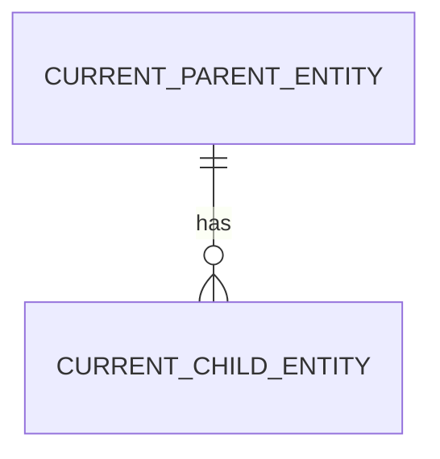

# <Project Name — business/domain name only, no technology stack>

- **Project Name:** `<same business/domain name — parsed by validate_discovery_blueprint.py>`
- **Input Scenario:** `SCENARIO_LEGACY_APP` | `SCENARIO_REQUIREMENTS_DOC` (from `specs/input_inventory.json`; confidence: `HIGH|LOW`)
- **Domain Slug:** `<domainSlug>`
- **Include Modernization Enhancements in Spec:** `true` (legacy only) | `false`
- **Discovery Scope:** **Current State ("As-Is") only** — Future-State ("To-Be") 3NF ERDs, target SQL DDL, future-state architecture flow diagrams, and Legacy-to-Target entity mappings belong strictly in Stage 4A (`design/solution_design.md` and `design/data_migration_and_cutover.md`).

---

## 1. Executive Summary & Current-State Assessment
*(Narrative only — never a list of input filenames; files are itemised in §2.1 / §6.)*

### 1.1 Business Context & Mission
### 1.2 Current-State Assessment (legacy) / Current-State Problem Statement (requirements document)
### 1.3 Governing Rules, Policies & Constraints
*(Only what the inputs or Gate 1 declare; otherwise state "none declared".)*

---

## 2. Current-State ("As-Is") Data Model & Entity Diagram
*(Document the current-state / legacy tables, entities and relationships as they exist today in the legacy estate, or the current-state conceptual entities described in the requirements document. Do NOT place future-state 3NF schemas or target entity mappings here.)*

### 2.1 Current-State Legacy Object Inventory *(SCENARIO_LEGACY_APP only — omit otherwise)*
| # | Legacy Object (table / form / query / report / module) | Object Type | Current-State Role & Key Fields | Observed Limitations / Risks | Evidence (file:object/line) |
| :-: | :-- | :-- | :-- | :-- | :-- |

---

## 3. Current-State ("As-Is") Workflow & Lifecycle State Machine *(extracted, never invented — see `_shared/workflow_chain_of_custody.md`)*

| From | To | Trigger | Actor Role | Guard | Evidence |
| :-- | :-- | :-- | :-- | :-- | :-- |

### 3.1 Open Workflow Questions *(ask at Gate 1; in autonomous mode answer with the most restrictive reading as `ASSUMPTION-NN`)*
| # | Question | Why the inputs do not settle it | Proposed restrictive default |
| :-: | :-- | :-- | :-- |

### 3.2 Current-State Roles *(Kind is `external` or `internal`)*
| Role | Kind | Responsibilities | Evidence |
| :-- | :-- | :-- | :-- |

### 3.3 Current-State Business Rules & Formulas (candidates for spec §3.4)
| Rule ID | Rule / Formula | Inputs | Source (file / document section / policy) |
| :-- | :-- | :-- | :-- |

---

## 4. Non-Functional Requirements & Constraints Discovered
| Area | Requirement | Source |
| :-- | :-- | :-- |
*(Security/privacy, accessibility, performance, availability, retention, integrations.)*

---

## 5. Current-State Pain Points & Technical Debt Inventory *(SCENARIO_LEGACY_APP only — omit otherwise)*
| # | Pain point / gap observed in current state | Business / operational impact | Evidence (file:object/line) |
| :-: | :-- | :-- | :-- |

---

## 6. Current-State Capability Inventory
| Capability ID | Capability | Capability Group | Actors | Legacy Artefacts (legacy) / Source Section (requirements doc) | Notes |
| :-- | :-- | :-- | :-- | :-- | :-- |

### 6.1 Business Capability Groupings *(by Business Functionality or Business Unit / Department, with Shared Prerequisites)*
*(Group discovered capabilities (`CAP-*`) either by Business Functionality (`functional`) or by the Business Unit / Department (`business-unit`) the application supports. Place shared domain/platform capabilities that multiple groups depend on into `GRP-01` (`Shared Foundation` / prerequisite) and list prerequisite group IDs (`GRP-01`, …) in `Prerequisite Groups / Shared` so selecting any downstream group automatically pulls in its prerequisites in Sprint 1.)*
| Group ID | Group Name | Grouping Dimension (`functional` \| `business-unit` \| `shared-foundation`) | Capabilities (`CAP-*`) | Prerequisite Groups / Shared (`None (Shared Foundation)` \| `GRP-01, …`) | Legacy Artefacts / Source Scope | Notes |
| :-- | :-- | :-- | :-- | :-- | :-- | :-- |

---

## 7. Gate 1 — Context Confirmation Checklist
1. **Regulations / policies:** `<declared | none>`
2. **Security, privacy & PII fields to mask:** `<…>`
3. **Accessibility standard(s) & design references:** baseline `WCAG 2.1 AA`; design references present: `yes|no (asked)`
4. **Target stack & coding guidelines:** `<frontend / backend / database / commands>` → `specs/target_stack.json`
5. **ALM platform:** `jira | ado | none`
6. **Business capability grouping & selected group(s) to take forward:** dimension: `functional | business-unit`; selected: `GRP-01, … | ALL` → `specs/target_stack.json#selectedCapabilityGroups`
