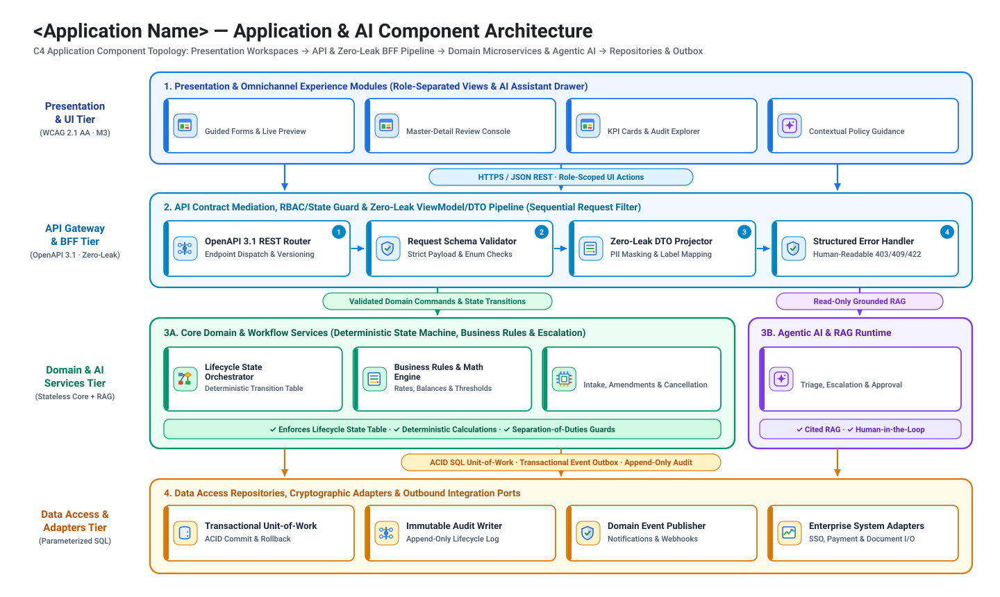
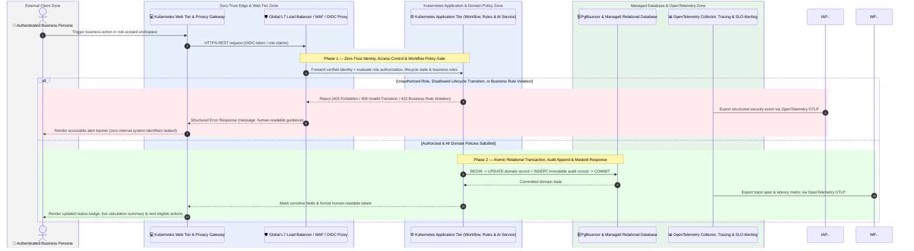

# Application Architecture (`design/application_architecture.md`)

- **Perspective:** **Application & AI Service Architecture (C4 Component Topology, API/BFF Layer, Domain & Agentic Services, and Request Execution Sequence)**
- **Visual Archetype:** 4-Tier Application Component Topology (`diagrams/application_architecture.svg`) + End-to-End `sequenceDiagram`
- **Architecture Portfolio Index:** [`design/architecture_design.md`](architecture_design.md)

---

## 1. Multi-Tier Application & AI Component Architecture

```mermaid
flowchart TB
    %% title: <Application Name> — Application & AI Component Architecture
    subgraph SG_Presentation["1. Presentation &amp; Omnichannel Experience Tier (Frontend UI Modules)"]
        UI_MOD1["<b>&lt;Self-Service Workspace&gt;</b><br/>Guided Forms &amp; Live Preview"]
        UI_MOD2["<b>&lt;Operations Review Queue&gt;</b><br/>Master-Detail Review Console"]
        UI_MOD3["<b>&lt;Executive Analytics View&gt;</b><br/>KPI Cards &amp; Audit Explorer"]
        UI_MOD4["<b>&lt;AI Copilot Assistant Panel&gt;</b><br/>Contextual Policy Guidance"]
        UI_MOD5["<b>&lt;Design System &amp; A11y Core&gt;</b><br/>M3 Tokens &amp; WCAG 2.1 AA"]
    end

    subgraph SG_APIGateway["2. API Gateway, BFF &amp; Contract Mediation Tier (OpenAPI 3.1)"]
        API_RTR["<b>OpenAPI 3.1 REST Router</b><br/>Endpoint Dispatch &amp; Versioning"]
        API_VAL["<b>Request Schema Validator</b><br/>Strict Payload &amp; Enum Checks"]
        API_DTO["<b>Zero-Leak DTO Projector</b><br/>PII Masking &amp; Label Mapping"]
        API_ERR["<b>Structured Error Handler</b><br/>Human-Readable 403/409/422"]
    end

    subgraph SG_AppServices["3. Core Domain Application &amp; AI Agent Services Tier"]
        SVC_WF["<b>Lifecycle State Orchestrator</b><br/>Deterministic Transition Table"]
        SVC_RULE["<b>Business Rules &amp; Math Engine</b><br/>Rates, Balances &amp; Thresholds"]
        SVC_DOM1["<b>&lt;Primary Domain Service&gt;</b><br/>Intake, Amendments &amp; Cancellation"]
        SVC_DOM2["<b>&lt;Review &amp; Issuance Service&gt;</b><br/>Triage, Escalation &amp; Approval"]
        SVC_AI["<b>AI Agent &amp; Policy RAG Service</b><br/>Grounded Recommendations"]
    end

    subgraph SG_IntegrationData["4. Data Access, Event Bus &amp; Enterprise Integration Tier"]
        DAL_UOW["<b>Transactional Unit-of-Work</b><br/>ACID Commit &amp; Rollback"]
        DAL_AUD["<b>Immutable Audit Writer</b><br/>Append-Only Lifecycle Log"]
        DAL_EVT["<b>Domain Event Publisher</b><br/>Notifications &amp; Webhooks"]
        DAL_EXT["<b>Enterprise System Adapters</b><br/>SSO, Payment &amp; Document I/O"]
    end

    SG_Presentation ==> SG_APIGateway
    SG_APIGateway ==> SG_AppServices
    SG_AppServices ==> SG_IntegrationData

    style SG_Presentation fill:#E8F0FE,stroke:#1A73E8,stroke-width:2px,color:#174EA6
    style SG_APIGateway fill:#E0F2FE,stroke:#0284C7,stroke-width:2px,color:#0369A1
    style SG_AppServices fill:#F0FDF4,stroke:#16A34A,stroke-width:2px,color:#15803D
    style SG_IntegrationData fill:#FEF3C7,stroke:#D97706,stroke-width:2px,color:#B45309
```

---

## 2. End-to-End Request & Workflow Execution Sequence

---

## 3. Application Layering & Component Responsibilities

| Application Layer | Component / Module | Target Runtime (`target_stack.json`) | Interaction Pattern | Key Responsibilities & Guardrails |
| :-- | :-- | :-- | :-- | :-- |
| **1. Presentation & UX Tier** | Self-Service Workspace, Review Queue, Executive Analytics, AI Copilot Panel | `<frontend.kind>` | HTTPS / JSON REST | Renders role-separated views, live calculation previews, and accessible states |
| **2. API Gateway & BFF Tier** | OpenAPI 3.1 Router, Schema Validator, Zero-Leak DTO Projector | `<backend.kind>` | Synchronous REST | Enforces OpenAPI schema contracts and strips `x-internal` / raw PII fields |
| **3. Domain & AI Services Tier** | Lifecycle State Orchestrator, Business Rules Engine, Domain Services, AI RAG Service | `<backend.kind>` | In-Process / Service Mesh mTLS | Enforces state transition guards, deterministic calculations, and grounded AI assistance |
| **4. Data Access & Integration Tier** | Transactional Unit-of-Work, Immutable Audit Writer, Event Publisher | `<backend.kind>` + `<database.kind>` | ACID SQL Transactions & Async Events | Guarantees atomic state + audit commits and publishes domain notifications |
