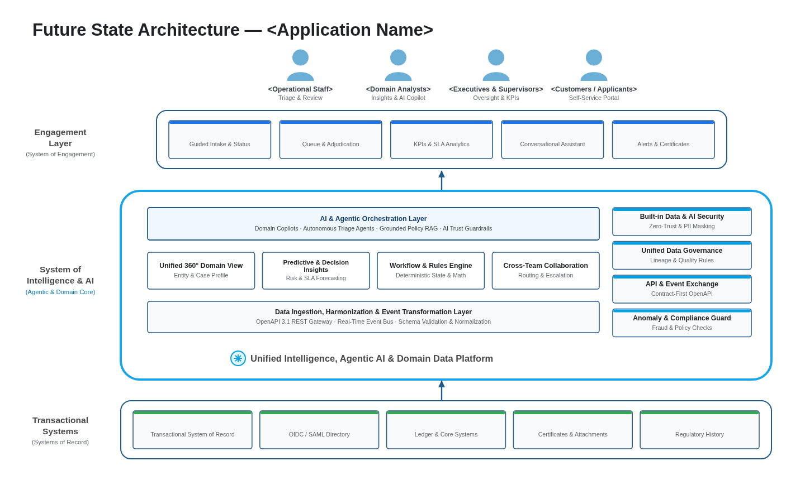
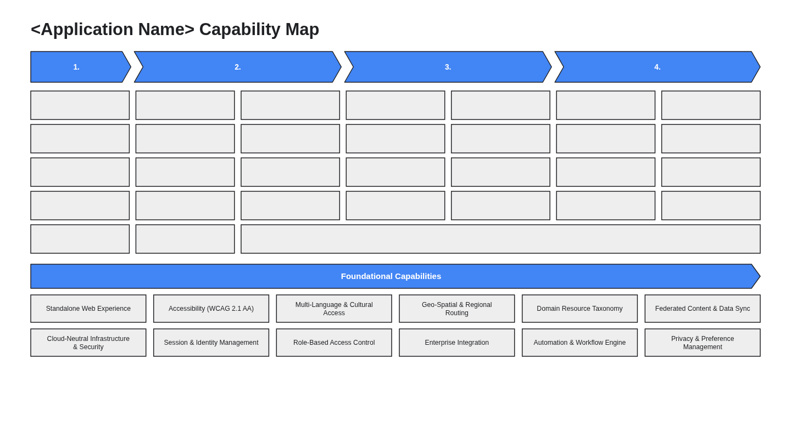
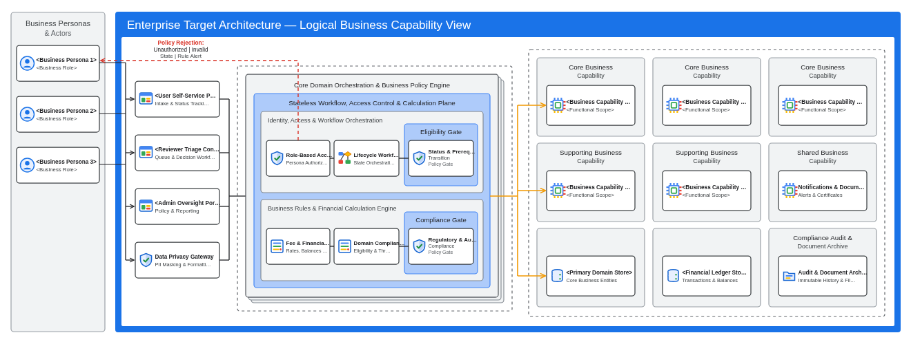
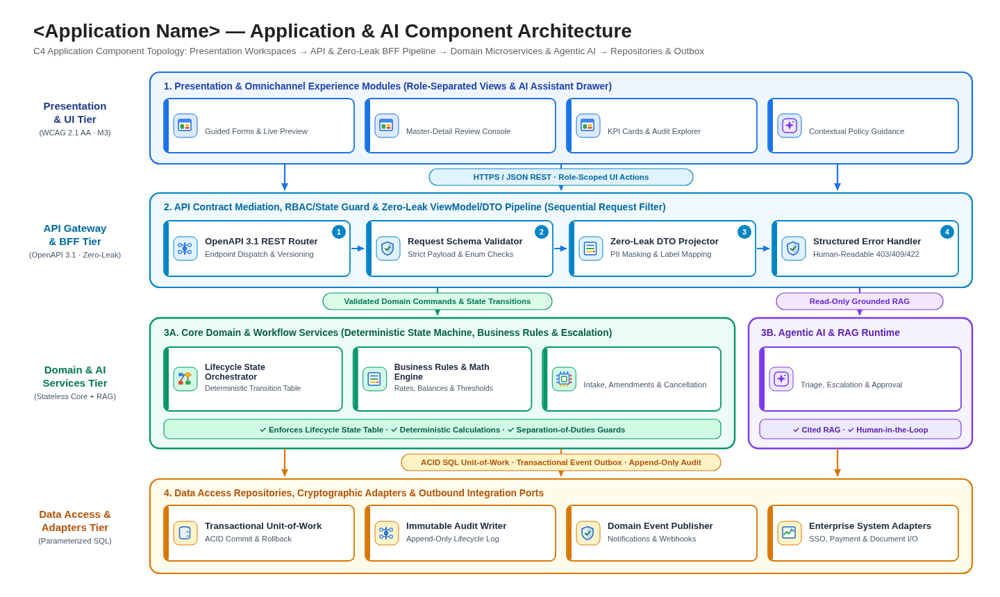
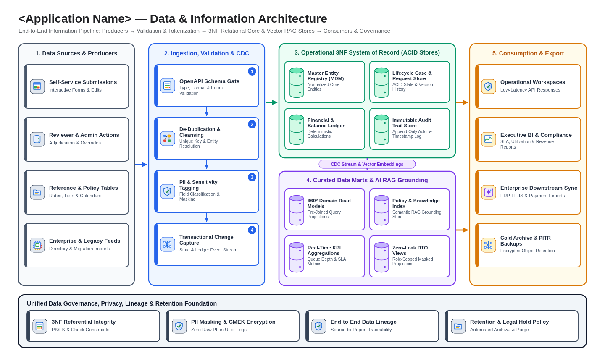
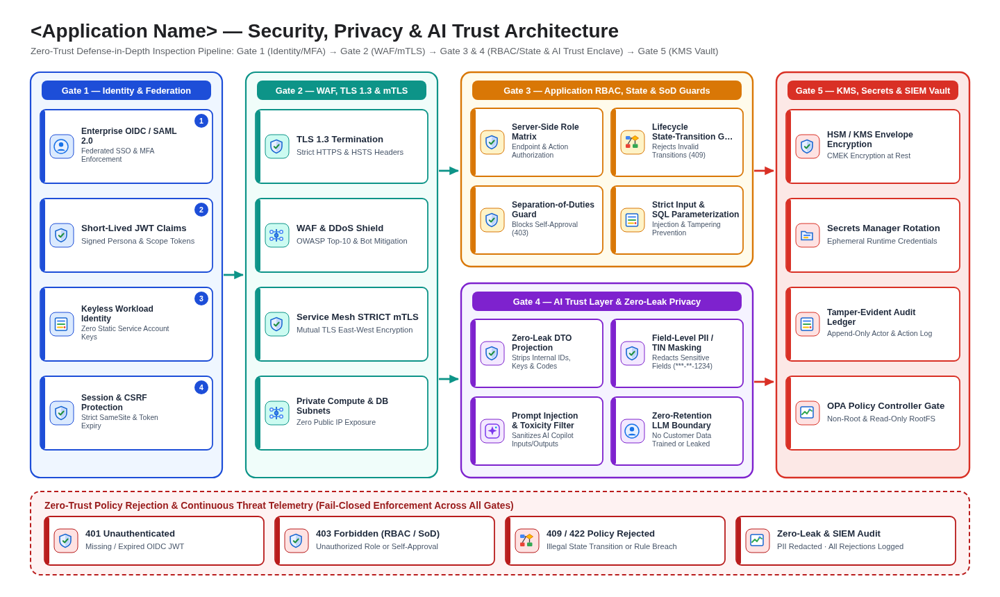
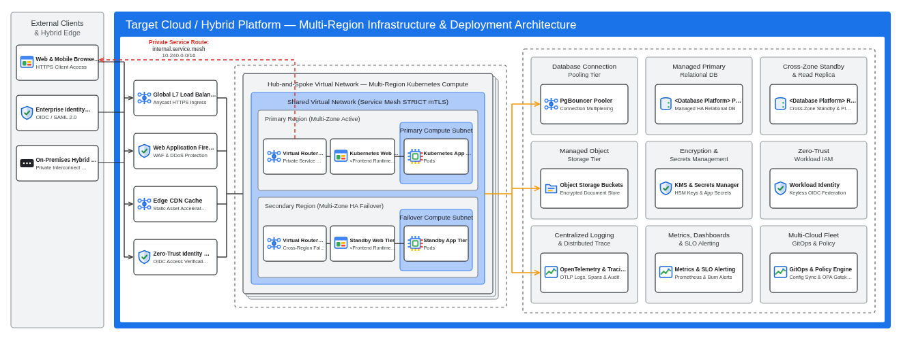

# Architecture Design Portfolio (`design/architecture_design.md`)

- **Input Scenario:** `<SCENARIO_LEGACY_APP | SCENARIO_REQUIREMENTS_DOC>`
- **Confirmed Future-State Tech Stack (`specs/target_stack.json`):** frontend `<frontend.kind>` · backend `<backend.kind>` · database `<database.kind>` · deployment `<gdc-fleet>` (`decidedBy: "<user | autonomous-default>"`)
- **Multi-Perspective Enterprise Architecture Standard:** **Well-Architected Framework (6 Core Pillars + Sustainability)**, **Value-Led Enterprise Architecture**, and **Cloud-Agnostic Multi-Perspective Diagramming** (`_shared/well_architected_and_diagram_standards.md`)

---

## 1. Multi-Perspective Architecture Artifact Catalog

To make the target architecture easy to consume for executives, product owners, application engineers, data architects, security auditors, and platform SREs, **each architectural perspective is authored as a dedicated, standalone artifact under `design/` with its own purpose-built diagram layout**:

| # | Architecture Perspective | Standalone Artifact | Rendered Diagram (`.png` / `.svg`) | Primary Audience & Purpose |
| :-: | :-- | :-- | :-- | :-- |
| **1** | **Business Architecture & Capability Map** | [`design/business_architecture.md`](business_architecture.md) | [`diagrams/business_capability_map.png`](diagrams/business_capability_map.png) | **Executives & Business Owners:** Value Streams (`1..4`), Level-2 Core Business Capabilities, Cross-Cutting Outcomes, and Foundational Capabilities |
| **2** | **High-Level Solution Architecture** | [`design/high_level_solution_architecture.md`](high_level_solution_architecture.md) | [`diagrams/high_level_solution_architecture.png`](diagrams/high_level_solution_architecture.png) | **Executive & Digital Strategy ("North Star"):** Personas, System of Engagement, System of Intelligence & AI (Agentic Layer + Domain Intelligence + Governance Sidebar), and Transactional Systems of Record |
| **3** | **Logical Architecture** | [`design/logical_architecture.md`](logical_architecture.md) | [`diagrams/logical_architecture.png`](diagrams/logical_architecture.png) | **Enterprise & Domain Architects:** Technology-agnostic functional channels, domain orchestration/policy core, bounded capability services, and logical stores |
| **4** | **Application & AI Architecture** | [`design/application_architecture.md`](application_architecture.md) | [`diagrams/application_architecture.png`](diagrams/application_architecture.png) | **Software & AI Engineers:** Multi-tier C4 component topology (UI Modules, OpenAPI 3.1 Gateway/BFF, Domain & AI Agent Services, Data/Event Adapters) + End-to-End `sequenceDiagram` |
| **5** | **Data & Information Architecture** | [`design/data_architecture.md`](data_architecture.md) | [`diagrams/data_architecture.png`](diagrams/data_architecture.png) | **Data Architects & DBAs:** 5-Stage Data Lifecycle (Sources → Ingestion/Validation → 3NF System of Record & MDM → AI Grounding/RAG → Analytics & Retention) + 3NF `erDiagram` |
| **6** | **Security, Privacy & AI Trust Architecture** | [`design/security_architecture.md`](security_architecture.md) | [`diagrams/security_architecture.png`](diagrams/security_architecture.png) | **CISO, Security & Privacy Auditors:** 5-Layer Defense-in-Depth (OIDC Federation, Edge WAF/mTLS, RBAC/State Guards, AI Trust & Zero-Leak PII Masking, KMS & Audit) |
| **7** | **Infrastructure & Deployment Architecture** | [`design/infrastructure_architecture.md`](infrastructure_architecture.md) | [`diagrams/infrastructure_architecture.png`](diagrams/infrastructure_architecture.png) | **Platform Ops & SREs:** Cloud-agnostic multi-region HA Kubernetes topology, PgBouncer + PostgreSQL HA failover, OpenTelemetry, GitOps & Well-Architected Matrices |
| **8** | **Solution Design & Contracts** | [`design/solution_design.md`](solution_design.md) | `src/db/schema.sql` & `src/contracts/openapi.yaml` | **Build & Test Automation:** Machine-extractable 3NF SQL DDL, OpenAPI 3.1 specification, ViewModel/DTO mapping, and RBAC/state guards |

---

## 2. Executive Visual Summary Across Perspectives

### 2.1 High-Level Solution Architecture (Engagement, Intelligence/AI & Systems of Record)
See full perspective artifact: [`design/high_level_solution_architecture.md`](high_level_solution_architecture.md)

### 2.2 Business Architecture & Capability Map
See full perspective artifact: [`design/business_architecture.md`](business_architecture.md)

### 2.3 Logical Solution Architecture
See full perspective artifact: [`design/logical_architecture.md`](logical_architecture.md)

### 2.4 Application & AI Component Architecture
See full perspective artifact: [`design/application_architecture.md`](application_architecture.md)

### 2.5 Data & Information Architecture
See full perspective artifact: [`design/data_architecture.md`](data_architecture.md)

### 2.6 Security, Privacy & AI Trust Architecture
See full perspective artifact: [`design/security_architecture.md`](security_architecture.md)

### 2.7 Infrastructure & Deployment Architecture
See full perspective artifact: [`design/infrastructure_architecture.md`](infrastructure_architecture.md)

