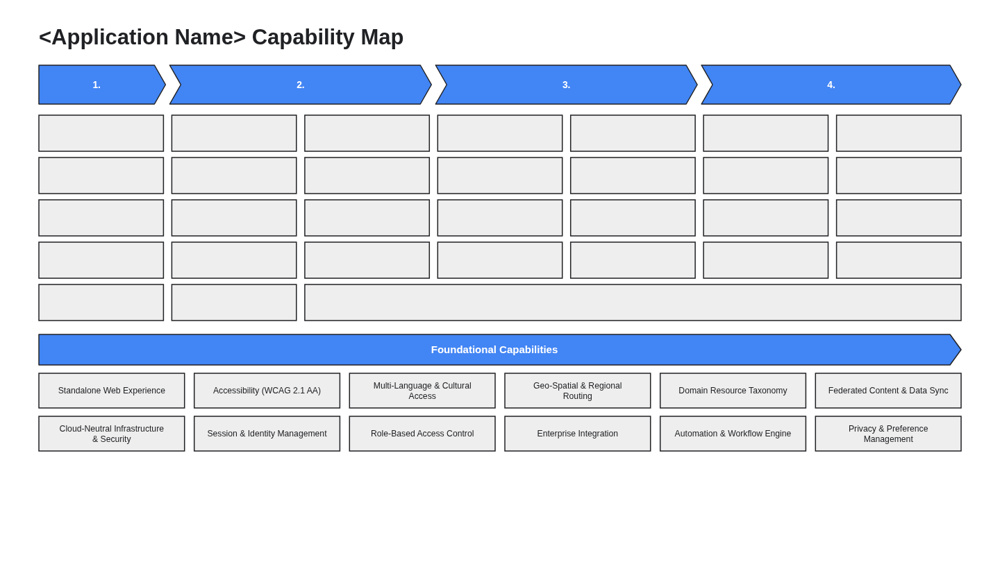

# Business Architecture & Capability Map (`design/business_architecture.md`)

- **Perspective:** **Business Architecture ("Why & What" — Value Streams, Core Business Capabilities & Foundational Capabilities)**
- **Input Scenario:** `<SCENARIO_LEGACY_APP | SCENARIO_REQUIREMENTS_DOC>`
- **Visual Archetype:** Executive Value-Stream Chevron Ribbon (`1..4`) + Multi-Column Level-2 Capability Grid + Cross-Cutting Outcome Bar + Foundational Capabilities Grid (`diagrams/business_capability_map.png`)
- **Architecture Portfolio Index:** [`design/architecture_design.md`](architecture_design.md)

---

## 1. Executive Business Capability Map



<details>
<summary>Architecture Diagram Specification (parsed by 04/scripts/extract_contracts.py into diagrams/business_capability_map.png)</summary>

```diagram-dsl
flowchart TB
    %% title: <Application Name> Capability Map
    subgraph VS1["1. &lt;Value Stream 1: Outreach, Intake &amp; Onboarding&gt;"]
        C1_1["&lt;Core Capability 1.1&gt;"]:::capCard
        C1_2["&lt;Core Capability 1.2&gt;"]:::capCard
        C1_3["&lt;Core Capability 1.3&gt;"]:::capCard
        C1_4["&lt;Core Capability 1.4&gt;"]:::capCard
        C1_5["&lt;Core Capability 1.5&gt;"]:::capCard
    end

    subgraph VS2["2. &lt;Value Stream 2: Eligibility, Directory &amp; Validation&gt;"]
        subgraph VS2_A["&lt;Column 2A&gt;"]
            C2_1["&lt;Core Capability 2A.1&gt;"]:::capCard
            C2_2["&lt;Core Capability 2A.2&gt;"]:::capCard
            C2_3["&lt;Core Capability 2A.3&gt;"]:::capCard
            C2_4["&lt;Core Capability 2A.4&gt;"]:::capCard
            C2_5["&lt;Core Capability 2A.5&gt;"]:::capCard
        end
        subgraph VS2_B["&lt;Column 2B&gt;"]
            C2_6["&lt;Core Capability 2B.1&gt;"]:::capCard
            C2_7["&lt;Core Capability 2B.2&gt;"]:::capCard
            C2_8["&lt;Core Capability 2B.3&gt;"]:::capCard
            C2_9["&lt;Core Capability 2B.4&gt;"]:::capCard
        end
    end

    subgraph VS3["3. &lt;Value Stream 3: Case Review, Calculation &amp; Routing&gt;"]
        subgraph VS3_A["&lt;Column 3A&gt;"]
            C3_1["&lt;Core Capability 3A.1&gt;"]:::capCard
            C3_2["&lt;Core Capability 3A.2&gt;"]:::capCard
            C3_3["&lt;Core Capability 3A.3&gt;"]:::capCard
            C3_4["&lt;Core Capability 3A.4&gt;"]:::capCard
        end
        subgraph VS3_B["&lt;Column 3B&gt;"]
            C3_5["&lt;Core Capability 3B.1&gt;"]:::capCard
            C3_6["&lt;Core Capability 3B.2&gt;"]:::capCard
            C3_7["&lt;Core Capability 3B.3&gt;"]:::capCard
            C3_8["&lt;Core Capability 3B.4&gt;"]:::capCard
        end
    end

    subgraph VS4["4. &lt;Value Stream 4: Issuance, Compliance &amp; Oversight&gt;"]
        subgraph VS4_A["&lt;Column 4A&gt;"]
            C4_1["&lt;Core Capability 4A.1&gt;"]:::capCard
            C4_2["&lt;Core Capability 4A.2&gt;"]:::capCard
            C4_3["&lt;Core Capability 4A.3&gt;"]:::capCard
            C4_4["&lt;Core Capability 4A.4&gt;"]:::capCard
        end
        subgraph VS4_B["&lt;Column 4B&gt;"]
            C4_5["&lt;Core Capability 4B.1&gt;"]:::capCard
            C4_6["&lt;Core Capability 4B.2&gt;"]:::capCard
            C4_7["&lt;Core Capability 4B.3&gt;"]:::capCard
            C4_8["&lt;Core Capability 4B.4&gt;"]:::capCard
        end
    end

    subgraph SPAN_OUTCOME["Cross-Cutting Program &amp; Outcome Management"]
        SPAN1["&lt;Cross-Program Case, Financial &amp; Outcome Management&gt;"]:::capSpan
    end

    subgraph FOUND["Foundational Capabilities"]
        F1["Standalone Web Experience"]:::capCard
        F2["Accessibility (WCAG 2.1 AA)"]:::capCard
        F3["Multi-Language &amp; Cultural Access"]:::capCard
        F4["Geo-Spatial &amp; Regional Routing"]:::capCard
        F5["Domain Resource Taxonomy"]:::capCard
        F6["Federated Content &amp; Data Sync"]:::capCard
        F7["Cloud-Neutral Infrastructure &amp; Security"]:::capCard
        F8["Session &amp; Identity Management"]:::capCard
        F9["Role-Based Access Control"]:::capCard
        F10["Enterprise Integration"]:::capCard
        F11["Automation &amp; Workflow Engine"]:::capCard
        F12["Privacy &amp; Preference Management"]:::capCard
    end

    VS1 --> VS2 --> VS3 --> VS4
    VS3 --> SPAN_OUTCOME
    VS4 --> SPAN_OUTCOME
    SPAN_OUTCOME --> FOUND

    classDef capCard fill:#EEEEEE,stroke:#202124,stroke-width:1.5px,color:#202124;
    classDef capSpan fill:#EEEEEE,stroke:#202124,stroke-width:1.5px,color:#202124;

    style VS1 fill:#4285F4,stroke:#202124,stroke-width:1.5px,color:#FFFFFF
    style VS2 fill:#4285F4,stroke:#202124,stroke-width:1.5px,color:#FFFFFF
    style VS2_A fill:#FFFFFF,stroke:#DADCE0,stroke-width:1px,color:#202124
    style VS2_B fill:#FFFFFF,stroke:#DADCE0,stroke-width:1px,color:#202124
    style VS3 fill:#4285F4,stroke:#202124,stroke-width:1.5px,color:#FFFFFF
    style VS3_A fill:#FFFFFF,stroke:#DADCE0,stroke-width:1px,color:#202124
    style VS3_B fill:#FFFFFF,stroke:#DADCE0,stroke-width:1px,color:#202124
    style VS4 fill:#4285F4,stroke:#202124,stroke-width:1.5px,color:#FFFFFF
    style VS4_A fill:#FFFFFF,stroke:#DADCE0,stroke-width:1px,color:#202124
    style VS4_B fill:#FFFFFF,stroke:#DADCE0,stroke-width:1px,color:#202124
    style SPAN_OUTCOME fill:#F8F9FA,stroke:#202124,stroke-width:1.5px,color:#202124
    style FOUND fill:#4285F4,stroke:#202124,stroke-width:1.5px,color:#FFFFFF
```

</details>

---

## 2. Value-Stream & Business Capability Alignment Matrix

| Value-Stream Pillar / Tier | Level-2 Business Capabilities | Primary Personas | Delivery Scope | Strategic Business Outcome & KPIs |
| :-- | :-- | :-- | :-- | :-- |
| **1. `<Value Stream 1>`** | `<Core Capabilities 1.1 – 1.5>` | `<Persona 1>` | `Phase 1 MVP` + `Full Scope` | Streamlines guided intake, onboarding, and self-service submission |
| **2. `<Value Stream 2>`** | `<Core Capabilities 2A.1 – 2B.4>` | `<Persona 1, Persona 2>` | `Phase 1 MVP` + `Full Scope` | Centralizes eligibility verification, directory lookup, and validation |
| **3. `<Value Stream 3>`** | `<Core Capabilities 3A.1 – 3B.4>` | `<Persona 2>` | `Phase 1 MVP` + `Full Scope` | Automates deterministic policy calculation, review routing, and adjudication |
| **4. `<Value Stream 4>`** | `<Core Capabilities 4A.1 – 4B.4>` | `<Persona 2, Persona 3>` | `Phase 1 MVP` + `Full Scope` | Enforces issuance, compliance monitoring, and executive oversight |
| **Foundational Capabilities** | `Standalone Web Experience`, `Accessibility (WCAG 2.1 AA)`, `Cloud-Neutral Infrastructure & Security`, `Session & Identity Management`, `Role-Based Access Control`, `Automation & Workflow Engine`, `Privacy & Preference Management` | All Personas | `Phase 1 MVP` Foundation | Provides zero-trust security, accessibility, auditability, and cloud-neutral operations |
