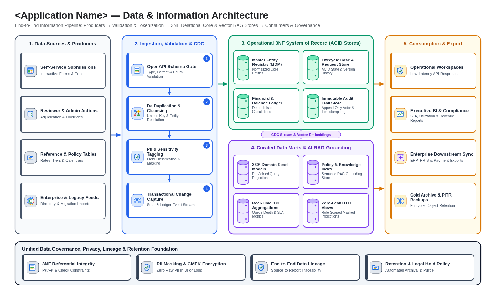
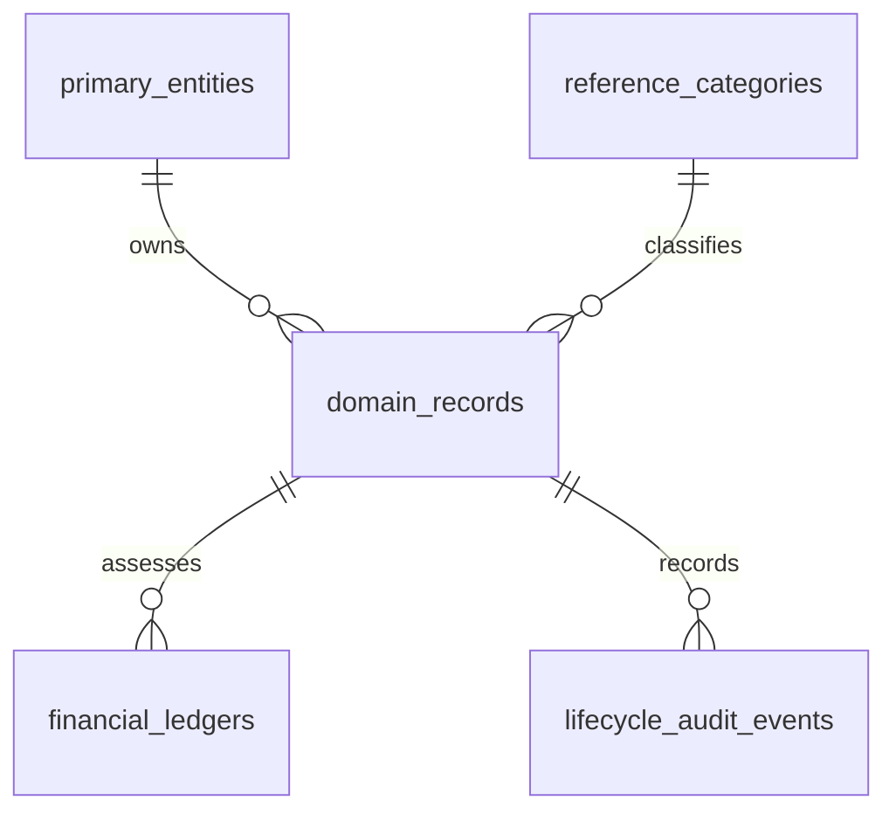

# Data & Information Architecture (`design/data_architecture.md`)

- **Perspective:** **Data & Information Architecture (End-to-End Data Lifecycle, 3NF System of Record, Master Data Management, AI Grounding & Retention)**
- **Visual Archetype:** 5-Stage Data Pipeline & Governance Foundation (`diagrams/data_architecture.png`) + Normalised 3NF `erDiagram`
- **Architecture Portfolio Index:** [`design/architecture_design.md`](architecture_design.md) · **Machine-Readable SQL DDL:** [`design/solution_design.md`](solution_design.md) (`src/db/schema.sql`)

---

## 1. End-to-End Data & Information Architecture Diagram



<details>
<summary>Architecture Diagram Specification (parsed by 04/scripts/extract_contracts.py into diagrams/data_architecture.png)</summary>

```diagram-dsl
flowchart LR
    %% title: <Application Name> — Data & Information Architecture
    subgraph SG_DataSources["1. Data Sources &amp; Producers"]
        DS1["<b>Self-Service Submissions</b><br/>Interactive Forms &amp; Edits"]
        DS2["<b>Reviewer &amp; Admin Actions</b><br/>Adjudication &amp; Overrides"]
        DS3["<b>Reference &amp; Policy Tables</b><br/>Rates, Tiers &amp; Calendars"]
        DS4["<b>Enterprise &amp; Legacy Feeds</b><br/>Directory &amp; Migration Imports"]
    end

    subgraph SG_Ingestion["2. Ingestion, Validation &amp; CDC"]
        IN1["<b>OpenAPI Schema Gate</b><br/>Type, Format &amp; Enum Validation"]
        IN2["<b>De-Duplication &amp; Cleansing</b><br/>Unique Key &amp; Entity Resolution"]
        IN3["<b>PII &amp; Sensitivity Tagging</b><br/>Field Classification &amp; Masking"]
        IN4["<b>Transactional Change Capture</b><br/>State &amp; Ledger Event Stream"]
    end

    subgraph SG_SystemOfRecord["3. Operational 3NF System of Record"]
        SOR1["<b>Master Entity Registry (MDM)</b><br/>Normalized Core Entities"]
        SOR2["<b>Lifecycle Case &amp; Request Store</b><br/>ACID State &amp; Version History"]
        SOR3["<b>Financial &amp; Balance Ledger</b><br/>Deterministic Calculations"]
        SOR4["<b>Immutable Audit Trail Store</b><br/>Append-Only Actor &amp; Timestamp Log"]
    end

    subgraph SG_AIGrounding["4. Unified Data &amp; AI Grounding"]
        RAG1["<b>360° Domain Read Models</b><br/>Pre-Joined Query Projections"]
        RAG2["<b>Policy &amp; Knowledge Index</b><br/>Semantic RAG Grounding Store"]
        RAG3["<b>Real-Time KPI Aggregations</b><br/>Queue Depth &amp; SLA Metrics"]
        RAG4["<b>Zero-Leak DTO Views</b><br/>Role-Scoped Masked Projections"]
    end

    subgraph SG_Consumption["5. Consumption, Analytics &amp; Archival"]
        CON1["<b>Operational Workspaces</b><br/>Low-Latency API Responses"]
        CON2["<b>Executive BI &amp; Compliance</b><br/>SLA, Utilization &amp; Revenue Reports"]
        CON3["<b>Enterprise Downstream Sync</b><br/>ERP, HRIS &amp; Payment Exports"]
        CON4["<b>Cold Archive &amp; PITR Backups</b><br/>Encrypted Object Retention"]
    end

    subgraph SG_DataGovernance["Unified Data Governance, Privacy, Lineage &amp; Retention Foundation"]
        GOV1["<b>3NF Referential Integrity</b><br/>PK/FK &amp; Check Constraints"]
        GOV2["<b>PII Masking &amp; CMEK Encryption</b><br/>Zero Raw PII in UI or Logs"]
        GOV3["<b>End-to-End Data Lineage</b><br/>Source-to-Report Traceability"]
        GOV4["<b>Retention &amp; Legal Hold Policy</b><br/>Automated Archival &amp; Purge"]
    end

    SG_DataSources ==> SG_Ingestion ==> SG_SystemOfRecord ==> SG_AIGrounding ==> SG_Consumption
    SG_SystemOfRecord -.-> SG_DataGovernance

    style SG_DataSources fill:#F8FAFC,stroke:#475569,stroke-width:2px,color:#1E293B
    style SG_Ingestion fill:#EFF6FF,stroke:#2563EB,stroke-width:2px,color:#1D4ED8
    style SG_SystemOfRecord fill:#ECFDF5,stroke:#059669,stroke-width:2px,color:#047857
    style SG_AIGrounding fill:#F5F3FF,stroke:#7C3AED,stroke-width:2px,color:#6D28D9
    style SG_Consumption fill:#FFFBEB,stroke:#D97706,stroke-width:2px,color:#B45309
    style SG_DataGovernance fill:#F1F5F9,stroke:#0F172A,stroke-width:2px,color:#0F172A
```

</details>

---

## 2. Normalised 3NF Conceptual & Physical Domain Model (`erDiagram`)

*(See [`design/solution_design.md`](solution_design.md) for the machine-extractable `sql ddl` schema and Legacy→Target 3NF mapping.)*



---

## 3. Data Governance, Master Data Management (MDM) & Retention Matrix

| Data Domain / Entity Group | System of Record Table(s) | Sensitivity & PII Classification | Masking & Encryption Rule | Retention & Archival Policy |
| :-- | :-- | :-- | :-- | :-- |
| **Master Entity & Profile Data** | `<master tables>` | `CONFIDENTIAL / PII` | Envelope encryption at rest (`CMEK`); masked in UI (`***-**-1234`) | Active lifecycle + 7 years regulatory retention |
| **Operational Case / Request Records** | `<request/case tables>` | `INTERNAL / OPERATIONAL` | Role-scoped access (`§3.5`); constrained to `§3.3` states | Active lifecycle + 7 years |
| **Financial / Balance Ledger** | `<ledger/balance tables>` | `RESTRICTED / FINANCIAL` | ACID transactional writes; `tabular-nums` display | 7 years statutory financial audit retention |
| **Immutable Lifecycle Audit Trail** | `<audit tables>` | `COMPLIANCE / TAMPER-EVIDENT` | Append-only (`INSERT` only; no `UPDATE`/`DELETE`) | 10 years immutable compliance archive |
