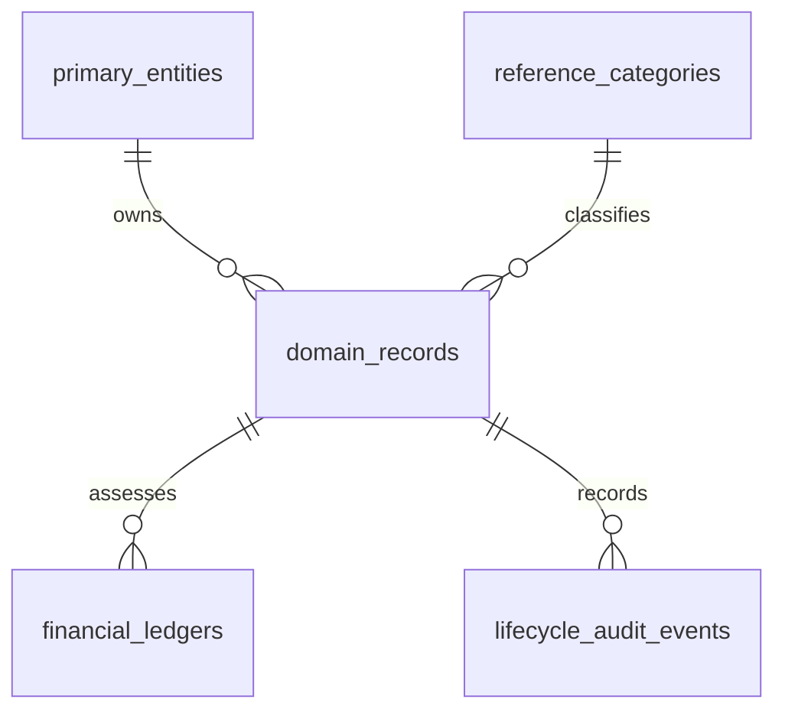

# Data & Information Architecture (`design/data_architecture.md`)

- **Perspective:** **Data & Information Architecture (End-to-End Data Lifecycle, 3NF System of Record, Master Data Management, AI Grounding & Retention)**
- **Visual Archetype:** 5-Stage Data Pipeline & Governance Foundation (`diagrams/data_architecture.png`) + Normalised 3NF `erDiagram`
- **Architecture Portfolio Index:** [`design/architecture_design.md`](architecture_design.md) · **Machine-Readable SQL DDL:** [`design/solution_design.md`](solution_design.md) (`src/db/schema.sql`)

---

## 1. End-to-End Data & Information Architecture Diagram

---

## 2. Normalised 3NF Conceptual & Physical Domain Model (`erDiagram`)

*(See [`design/solution_design.md`](solution_design.md) for the machine-extractable `sql ddl` schema and Legacy→Target 3NF mapping.)*

---

## 3. Data Governance, Master Data Management (MDM) & Retention Matrix

| Data Domain / Entity Group | System of Record Table(s) | Sensitivity & PII Classification | Masking & Encryption Rule | Retention & Archival Policy |
| :-- | :-- | :-- | :-- | :-- |
| **Master Entity & Profile Data** | `<master tables>` | `CONFIDENTIAL / PII` | Envelope encryption at rest (`CMEK`); masked in UI (`***-**-1234`) | Active lifecycle + 7 years regulatory retention |
| **Operational Case / Request Records** | `<request/case tables>` | `INTERNAL / OPERATIONAL` | Role-scoped access (`§3.5`); constrained to `§3.3` states | Active lifecycle + 7 years |
| **Financial / Balance Ledger** | `<ledger/balance tables>` | `RESTRICTED / FINANCIAL` | ACID transactional writes; `tabular-nums` display | 7 years statutory financial audit retention |
| **Immutable Lifecycle Audit Trail** | `<audit tables>` | `COMPLIANCE / TAMPER-EVIDENT` | Append-only (`INSERT` only; no `UPDATE`/`DELETE`) | 10 years immutable compliance archive |
