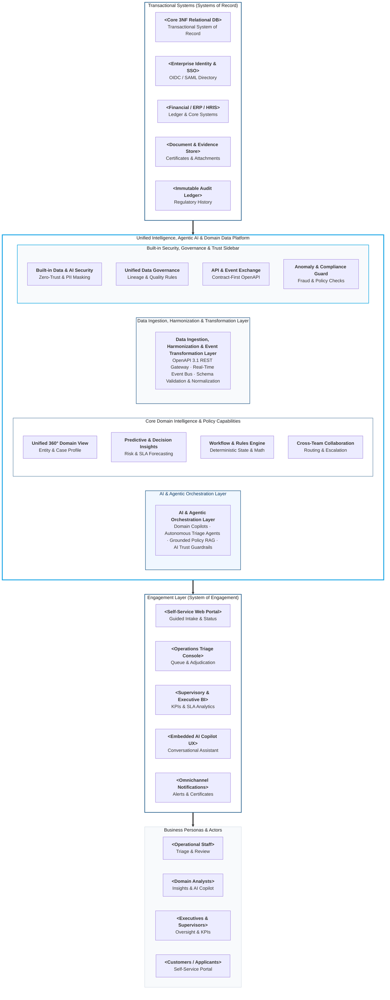

# High-Level Solution Architecture (`design/high_level_solution_architecture.md`)

- **Perspective:** **High-Level Solution Architecture ("North Star" Pace-Layered View — System of Engagement, System of Intelligence & AI, and Systems of Record)**
- **Visual Archetype:** Executive Layered Architecture (`resources/reference_high_level_solution_architecture.png` + AI-Era Agentic Layer + Value-Led Enterprise Architecture; `diagrams/high_level_solution_architecture.svg`)
- **Architecture Portfolio Index:** [`design/architecture_design.md`](architecture_design.md)

---

## 1. Future State High-Level Solution Architecture Diagram

*(Modeled on `resources/reference_high_level_solution_architecture.png` and the enterprise pace-layered digital strategy framework, unifying **Business Personas**, the **Engagement Layer (System of Engagement)**, the **System of Intelligence & AI (AI & Agentic Orchestration Layer, Core Domain Intelligence, Data Ingestion & Harmonization, and Built-in Governance/Trust Sidebar)**, and **Transactional Systems (Systems of Record)**.)*

---

## 2. Pace-Layered Architecture & System of AI Breakdown

| Architectural Tier | Role in Digital Strategy | Core Components | Key Value Delivered |
| :-- | :-- | :-- | :-- |
| **1. Business Personas & Actors** | Role-scoped human and automated consumers | `<Personas from Spec §3.5>` | Role-tailored productivity with zero cognitive overload |
| **2. System of Engagement (`Engagement Layer`)** | Omnichannel user experiences, portals, and analytics | Self-Service Portal, Reviewer Console, Executive BI, Embedded AI Copilot UX | Accessible (WCAG 2.1 AA), responsive workspaces decoupled from backend storage |
| **3. System of Intelligence & AI (`Agentic & Domain Core`)** | AI/Agentic reasoning + deterministic domain policy orchestration | `AI & Agentic Orchestration Layer` (RAG, Triage Agents, Guardrails), `Unified 360° View`, `Workflow & Rules Engine`, `Data Ingestion & Transformation`, `Governance & Trust Sidebar` | Combines generative/agentic AI assistance with 100% deterministic state and financial rule enforcement |
| **4. Systems of Record (`Transactional Systems`)** | Authoritative ACID persistence and enterprise system integration | Normalised 3NF Relational Database, Enterprise OIDC IdP, ERP/HRIS/Payment Systems, Document & Audit Store | Single source of truth with referential integrity and tamper-evident audit history |
