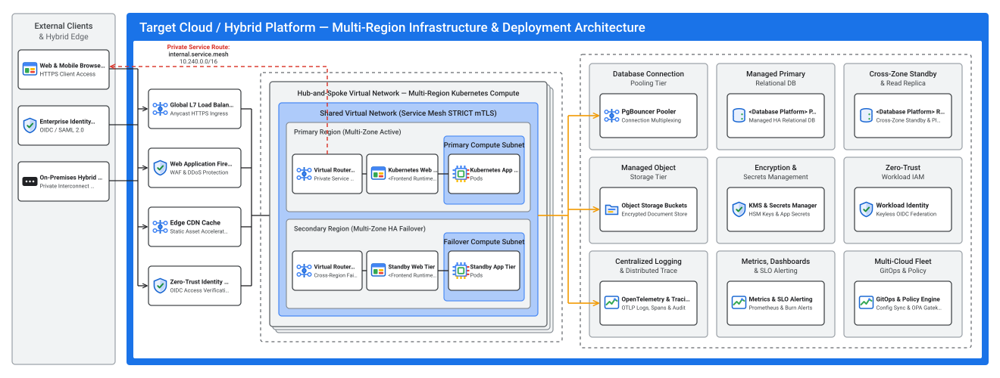

# Infrastructure & Deployment Architecture (`design/infrastructure_architecture.md`)

- **Perspective:** **Infrastructure & Deployment Architecture (Cloud-Agnostic Multi-Region Topology, Kubernetes Compute, Managed Database HA, OpenTelemetry & Multi-Cloud GitOps)**
- **Visual Archetype:** Concentric Multi-Region Deployment & Network Topology (`./diagrams/infrastructure_architecture.svg`)
- **Architecture Portfolio Index:** [`design/architecture_design.md`](architecture_design.md)

---

## 1. Cloud-Agnostic Multi-Region Infrastructure & Deployment Diagram

---

## 2. Well-Architected Framework Alignment & Anti-Pattern Grilling

### 2.1 6-Pillar (+ Sustainability) Well-Architected Alignment Matrix

| Well-Architected Pillar | Alignment Rating | Cloud-Agnostic Target Architecture Design Decision | Automated Verification & Runtime Guardrail |
| :-- | :-- | :-- | :-- |
| **1. System Design** | `OPTIMAL` | Modular Business Capability Services deployed on a Multi-Region Hub-and-Spoke Shared Virtual Network (`Primary` + `Secondary` regions) with 100% stateless `Kubernetes` web/application tiers and a normalised relational database. | Contract-first OpenAPI 3.1 / 3NF DDL validation & KRM multi-cloud portability checks. |
| **2. Operational Excellence** | `OPTIMAL` | Declarative KRM GitOps via `Config Sync` and `OPA Policy Controller`; vendor-neutral `OpenTelemetry` (`OTLP`) exporting structured logs, traces, and metrics with 99.9% SLO burn-rate alerts across `on-prem-gdc`, `gcp`, `aws`, and `azure`. | GitOps wave rollout verification, OpenTelemetry collector pipeline validation, SLO burn-rate alerts, and operational runbook checks. |
| **3. Security, Privacy & Compliance** | `OPTIMAL` | Private service routing (`internal.service.mesh 10.240.0.0/16`), `WAF` + `Zero-Trust Identity Proxy (OIDC)`, `Service Mesh STRICT mTLS`, keyless `Workload Identity`, `KMS` (`CMEK`), and Data Privacy Gateway masking. | Closed-loop runtime security (`TC-SEC-*`), zero-leakage (`TC-UI-LEAK-*`), and OPA Policy Controller admission verification. |
| **4. Reliability** | `OPTIMAL` | Active-active `Primary Region` and `Secondary Region` `Kubernetes` pipelines inside `Shared Virtual Network`, `HPA` + `PDB`, `PgBouncer` connection pooling, and synchronous cross-zone HA `<database.kind>` standby + PITR. | Build & health-probe readiness checks, closed-loop functional/API verification, and KRM HA PodDisruptionBudget/HPA checks. |
| **5. Cost Optimization** | `OPTIMAL` | Shared Hub Virtual Network ingress (`Global L7 Load Balancer`, `Virtual Router`, `Edge CDN`) amortized across business capability services; right-sized Kubernetes CPU/memory requests and FinOps cost-allocation labels. | Kubernetes resource requests/limits & FinOps cost-allocation labels enforced across all multi-cloud overlays. |
| **6. Performance Optimization** | `OPTIMAL` | `Edge CDN` static asset caching, regional L7 load balancing, `PgBouncer` connection multiplexing in front of `<database.kind>`, relational B-Tree indexes, and async `OpenTelemetry` batch export. | 3NF DDL B-Tree index verification and p95 latency SLO burn-rate alert thresholds. |
| **7. Environmental Sustainability** | `OPTIMAL` | High Carbon-Free Energy (`CFE%`) region selection, shared hub network infrastructure, minimal rootless OCI container images, and elastic Kubernetes autoscaling. | Multi-stage minimal rootless OCI container builds and autoscaled compute footprints. |

### 2.2 First-Principles Failure Mode & Anti-Pattern Grilling Matrix

| Failure Domain / Grilling Vector | Cloud Anti-Pattern Prohibited | Production Failure Mode Prevented | Cloud-Agnostic Target Architecture Remediation |
| :-- | :-- | :-- | :-- |
| **1. Blast Radius & Regional/Zonal SPOF** | Single-region/single-zone workload deployment or local-disk session state. | Regional or zonal outage causes total service blackout (`RTO >> 0`). | Active-active `Primary Region` and `Secondary Region` `Kubernetes` pipelines inside `Shared Virtual Network`, backed by synchronous HA `<database.kind>` failover. |
| **2. Ingress Exposure & Public IPs** | Routing internal API traffic or database connections over public IP addresses. | Internet route hijacking, lateral scanning, or data exfiltration bypassing WAF/IAM. | `Virtual Router` advertises private service routes (`internal.service.mesh 10.240.0.0/16`, `#D93025` red dashed route); `Kubernetes` pods and `<database.kind>` instances reside in private subnets with zero public IPs. |
| **3. Credential Security & Static Keys** | Embedding static service-account key files or static DB passwords in containers. | Leaked long-lived credentials grant persistent unauthorized access across environments. | Keyless `Workload Identity (OIDC)` issues short-lived tokens per service; `KMS` + `Secrets Manager` inject ephemeral secrets at runtime. |
| **4. Database Connection Starvation** | Autoscaling `Kubernetes` pods opening unpooled direct connections to `<database.kind>`. | Pod surge exhausts `max_connections`, causing cascading `500` connection failures. | All application and migration traffic routes through `PgBouncer` connection pooling with bounded pool sizing and read-replica offloading. |
| **5. Environment Sprawl & Governance Drift** | Manual `kubectl` hotfixes or deploying unverified containers without admission guardrails. | Config drift, privileged container execution, or unencrypted service-to-service traffic. | Declarative GitOps reconciliation via `Config Sync`, admission enforcement via `OPA Policy Controller`, and `Service Mesh STRICT mTLS`. |

---

## 3. FinOps Workload Sizing & Multi-Cloud TCO Estimate

| Architecture Tier | Baseline Resource Envelope (Prod HA) | Scaling & FinOps Optimization Lever | Est. Monthly On-Demand Range (USD) | Est. 3-Yr Committed Range (USD) |
| :-- | :-- | :-- | --: | --: |
| **Edge, WAF & Global L7 Ingress** | Shared Hub Load Balancer, Edge CDN Cache, OIDC Proxy | Shared across capability services inside Hub Virtual Network | \$180 – \$320 | \$140 – \$250 |
| **Stateless Web & Application Compute** | `2–6` Kubernetes pods (`1 vCPU`, `2 GiB RAM` request per pod across 2 regions) | HPA CPU/RPS autoscaling + spot/preemptible non-prod pools | \$240 – \$680 | \$150 – \$420 |
| **Relational Persistence (`<database.kind>` HA)** | Primary + Synchronous Standby (`2–4 vCPU`, `8–16 GiB RAM`, `100 GiB SSD`, `PgBouncer`) | Connection pooling caps instance tier; automated storage tiering | \$310 – \$790 | \$200 – \$510 |
| **Object Storage, KMS & Observability** | Encrypted buckets, KMS key rotation, OpenTelemetry sampled traces & SLO metrics | Tail-based trace sampling (10% steady, 100% error) & 30-day hot log lifecycle | \$90 – \$210 | \$75 – \$175 |
| **Estimated Total Target Run-Rate** | **Multi-Region Active-Active Production Footprint** | **FinOps cost-allocation labels (`env`, `service`, `wave`)** | **\$820 – \$2,000 / mo** | **\$565 – \$1,355 / mo** |
