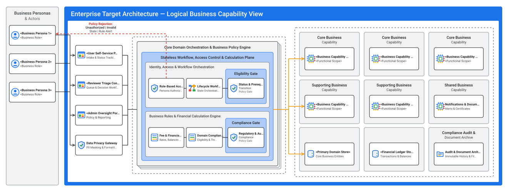

# Logical Architecture (`design/logical_architecture.md`)

- **Perspective:** **Logical Architecture (Technology-Agnostic Domain Capabilities, Policy Orchestration & Logical Information Stores)**
- **Visual Archetype:** Concentric Multi-Zone Functional Topology (`./diagrams/logical_architecture.svg`)
- **Architecture Portfolio Index:** [`design/architecture_design.md`](architecture_design.md)

---

## 1. Logical Solution Architecture Diagram

---

## 2. Logical Domain Boundary & Functional Decomposition

| Logical Zone | Bounded Functional Components | Domain Responsibility |
| :-- | :-- | :-- |
| **User Experience & Channel Zone** | Self-Service Portal, Reviewer Triage Console, Admin Oversight Portal, Data Privacy Gateway | Presents role-scoped views and masks sensitive internal identifiers |
| **Core Domain Orchestration & Policy Zone** | Role-Based Access Control, Lifecycle Workflow Engine, Financial/Business Rules Engine, Eligibility & Compliance Gates | Enforces state-machine transitions and deterministic business calculations before persistence |
| **Business Capability Services Zone** | Core & Supporting Domain Capability Services | Implements bounded functional operations for each business value stream |
| **Logical Domain Data Stores Zone** | Primary Domain Store, Financial Ledger Store, Audit & Document Archive | Maintains domain entities, financial records, and immutable history |
