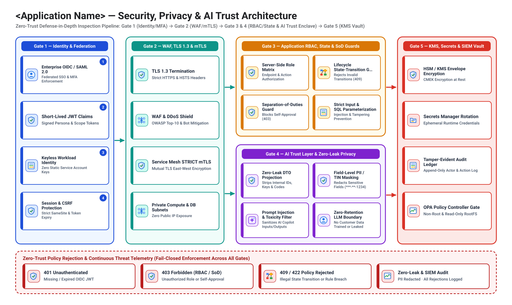

# Security, Privacy & AI Trust Architecture (`design/security_architecture.md`)

- **Perspective:** **Security, Privacy, Compliance & AI Trust Architecture (Defense-in-Depth Zero-Trust Perimeters & AI Guardrails)**
- **Visual Archetype:** 5-Layer Defense-in-Depth Security & AI Trust Stack (`diagrams/security_architecture.svg`)
- **Architecture Portfolio Index:** [`design/architecture_design.md`](architecture_design.md)

---

## 1. Defense-in-Depth & AI Trust Security Architecture Diagram

```mermaid
flowchart TB
    %% title: <Application Name> — Security, Privacy & AI Trust Architecture
    subgraph SG_SecIdentity["1. Identity, Federation &amp; Access Perimeter (Zero-Trust IAM)"]
        SEC_ID1["<b>Enterprise OIDC / SAML 2.0</b><br/>Federated SSO &amp; MFA Enforcement"]
        SEC_ID2["<b>Short-Lived JWT Claims</b><br/>Signed Persona &amp; Scope Tokens"]
        SEC_ID3["<b>Keyless Workload Identity</b><br/>Zero Static Service Account Keys"]
        SEC_ID4["<b>Session &amp; CSRF Protection</b><br/>Strict SameSite &amp; Token Expiry"]
    end

    subgraph SG_SecEdge["2. Network &amp; Edge Security Perimeter"]
        SEC_NET1["<b>TLS 1.3 Termination</b><br/>Strict HTTPS &amp; HSTS Headers"]
        SEC_NET2["<b>WAF &amp; DDoS Shield</b><br/>OWASP Top-10 &amp; Bot Mitigation"]
        SEC_NET3["<b>Service Mesh STRICT mTLS</b><br/>Mutual TLS East-West Encryption"]
        SEC_NET4["<b>Private Compute &amp; DB Subnets</b><br/>Zero Public IP Exposure"]
    end

    subgraph SG_SecApp["3. Application RBAC, Workflow State-Guard &amp; Separation-of-Duties Perimeter"]
        SEC_APP1["<b>Server-Side Role Matrix</b><br/>Endpoint &amp; Action Authorization"]
        SEC_APP2["<b>Lifecycle State-Transition Gate</b><br/>Rejects Invalid Transitions (409)"]
        SEC_APP3["<b>Separation-of-Duties Guard</b><br/>Blocks Self-Approval (403)"]
        SEC_APP4["<b>Strict Input &amp; SQL Parameterization</b><br/>Injection &amp; Tampering Prevention"]
    end

    subgraph SG_SecAITrust["4. AI Trust Layer &amp; Zero-Leak Data Privacy Perimeter"]
        SEC_AI1["<b>Zero-Leak DTO Projection</b><br/>Strips Internal IDs, Keys &amp; Codes"]
        SEC_AI2["<b>Field-Level PII / TIN Masking</b><br/>Redacts Sensitive Fields (***-**-1234)"]
        SEC_AI3["<b>Prompt Injection &amp; Toxicity Filter</b><br/>Sanitizes AI Copilot Inputs/Outputs"]
        SEC_AI4["<b>Zero-Retention LLM Boundary</b><br/>No Customer Data Trained or Leaked"]
    end

    subgraph SG_SecData["5. Data Encryption, Secrets &amp; Continuous Compliance Perimeter"]
        SEC_DAT1["<b>HSM / KMS Envelope Encryption</b><br/>CMEK Encryption at Rest"]
        SEC_DAT2["<b>Secrets Manager Rotation</b><br/>Ephemeral Runtime Credentials"]
        SEC_DAT3["<b>Tamper-Evident Audit Ledger</b><br/>Append-Only Actor &amp; Action Log"]
        SEC_DAT4["<b>OPA Policy Controller Gate</b><br/>Non-Root &amp; Read-Only RootFS"]
    end

    SG_SecIdentity ==> SG_SecEdge ==> SG_SecApp ==> SG_SecAITrust ==> SG_SecData

    style SG_SecIdentity fill:#EFF6FF,stroke:#1D4ED8,stroke-width:2px,color:#1E40AF
    style SG_SecEdge fill:#F0FDFA,stroke:#0D9488,stroke-width:2px,color:#0F766E
    style SG_SecApp fill:#FEF3C7,stroke:#D97706,stroke-width:2px,color:#B45309
    style SG_SecAITrust fill:#F3E8FF,stroke:#7E22CE,stroke-width:2px,color:#6B21A8
    style SG_SecData fill:#FCE8E6,stroke:#D93025,stroke-width:2px,color:#B31412
```

---

## 2. Threat Model, Security Controls & AI Trust Matrix

| Security Perimeter | Threat Vector Mitigated | Mandatory Control Implemented | Automated Verification Gate |
| :-- | :-- | :-- | :-- |
| **1. Identity & Federation** | Stolen static credentials or unauthenticated access | OIDC/SAML 2.0 federation + keyless `Workload Identity` | `TC-SEC-*` & `08/scripts/validate_gdc_packaging.py` |
| **2. Network & Edge** | Man-in-the-middle, DDoS, lateral network scanning | TLS 1.3, WAF, `Service Mesh STRICT mTLS`, private subnets | `deploy/gdc/service-mesh/` PeerAuthentication (`STRICT`) |
| **3. Application RBAC & State Guards** | Privilege escalation, self-approval, out-of-order state mutation | Server-side `(fromState, trigger, actorRole)` gate (`403`/`409`/`422`) | `TC-STATE-*`, `TC-NEG-*` in `07/scripts/run_closed_loop_eval.py` |
| **4. AI Trust & Privacy Boundary** | Raw PII/TIN leakage or internal column/enum exposure in UI/AI | Zero-Leak DTO projection (`_shared/zero_leak.md`) + PII masking (`***-**-1234`) + AI prompt guardrails | `TC-UI-LEAK-*` in `07/scripts/run_closed_loop_eval.py` |
| **5. Data Encryption & Compliance** | Disk theft, container root breakout, audit log tampering | KMS CMEK encryption, append-only audit log, OPA non-root admission | `08/scripts/validate_gdc_packaging.py` (OPA Gatekeeper constraints) |
