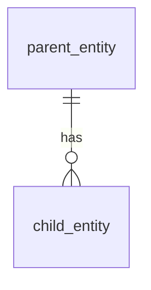

# Solution Design (`design/solution_design.md`)

- **Input Scenario:** `Legacy Application Modernization` | `Greenfield Requirements Specification`
- **Target stack:** frontend `<kind>` · backend `<kind>` · database `<kind>` · deployment `<target>` (from `specs/target_stack.json`)
- **Companion Architecture Document:** Well-Architected Logical Solution Architecture, Technical & GDC Multi-Zone Deployment Architecture, End-to-End Sequence Diagram, Architectural Layering, and 6-Pillar + Sustainability / Anti-Pattern Grilling Matrices are maintained in the standalone [`design/architecture_design.md`](architecture_design.md).
- **Principles:** Future-State ("To-Be") clean target design (no legacy internals carried over; current-state discovery lives in `specs/discovery_architecture_and_inventory.md`); contract-first (`src/db/schema.sql` and `src/contracts/openapi.yaml` are materialized directly from this document); one state table enforced in UI **and** backend; Zero-Leak ViewModel/DTO boundary.

---

## 1. Future-State ("To-Be") Domain Model — Normalised 3NF ERD & SQL DDL Schema
*(Business `snake_case` entity names; zero technology, ORM or legacy object names.)*



### 1.1 Legacy → Target 3NF Entity Mapping *(Legacy Application Modernization only — omit otherwise)*
| # | Legacy Object (from Discovery §2.1) | Target 3NF Entity | Transformation (normalisation, retired columns, merged/split) | Evidence (file:object/line) |
| :-: | :-- | :-- | :-- | :-- |

### 1.2 Target 3NF SQL DDL Schema
*(Single authoritative `sql ddl` schema materialized to `src/db/schema.sql`.)*
```sql ddl
-- tables in business snake_case; status columns constrained to spec §3.3 states; audit columns; indexes
```

---

## 2. API Contract (OpenAPI 3.1)
*(Exactly one block tagged `yaml openapi` — extracted to `src/contracts/openapi.yaml`.)*
```yaml openapi
openapi: 3.1.0
info: {title: <Project Name> API, version: 1.0.0}
paths: {}          # one operation per capability and per §3.3 trigger
components:
  schemas: {}      # enums = §3.3 states/triggers; x-internal: true on fields never shown in the UI; Error {message}
  securitySchemes: {}
```

---

## 3. ViewModel / DTO Boundary & Label Mapping
| Internal field / code | Exposed as | Visible label / masked format |
| :-- | :-- | :-- |
| `<STATE_CODE>` | `status` | `<Visible label from spec §3.3>` |
| `<pii_field>` | `<masked_field>` | `<masked format from spec §2.2>` |
| `<internal id / hash / audit column>` | *not exposed* | — |

---

## 4. Workflow & Authorization Enforcement
- Transition table source: spec §3.3 → `<module/const name>` shared by UI and backend.
- Backend guard: `(fromState, trigger, role)` validated in `<component>`; 4xx + human-readable `message` otherwise.
- UI derivation: control visibility/enablement from `(currentState, currentRole)`; external roles see no internal-transition controls.
- RBAC matrix: spec §2.1 → `<enforcement point>`.

---

## 5. Frontend Design Tokens, Surface Mode & Google Cloud UI Design Components
- Design references applied: `<paths in resources/design_references/ | none — Enterprise Material 3 / Cloud Console UI Design & UX Simplicity Guardrails>`
- Surface Mode (`Operate` | `Read` | `Persuade` | `Express`) & Reference Layout Archetype (`Admin/FinOps Dashboard`, `Master-Detail Split-Screen Operations Queue`, `Full-Viewport GIS Map & Telemetry Stage`, `50/50 Split-View Document & Compliance Auditor`, `Enterprise Solution Landing Page`, or `2-Zone Gemini Enterprise Agent & HITL Workspace`).
- Google Material 3 / Cloud Console `--g-*` CSS token table (`:root` Light + `.dark` Dark: `--g-bg`, `--g-surface`, `--g-ink`, `--g-border`, `--g-blue`, `--g-green`, `--g-amber`, `--g-amber-text`, `--g-red`, `--g-purple`), `defaultTheme="system"` with `System | Light | Dark` toggle, Unified Surface (`divide-x`/`divide-y` + `<dl>`) structure, ShadCN UI / Radix component mappings, `tabular-nums` alignment, 4-state coverage (`Skeleton`, `Empty`, `Error`, `Populated`), and `data-testid` naming convention.

---

## 6. Cross-Cutting Concerns (Target-State Production Architecture)
- **Server-Side Validation & Error Handling:** Strict request schema and business-rule (`BR-*`) validation on every write; structured error responses with human-readable `message` (never raw internal codes or stack traces).
- **Identity, Authentication & Authorization (Spec §2):** Enterprise OIDC / Google Cloud Identity-Aware Proxy (`IAP`) authentication at the edge, JWT claim extraction, `Workload Identity` for service-to-service calls, and fine-grained RBAC enforcement per `Spec §3.5`.
- **Database Connectivity, Transactions & Data Protection:** Managed target relational database (`AlloyDB for PostgreSQL` / `Cloud SQL` / target DB from `specs/target_stack.json`) accessed via `PgBouncer` / connection pooling (`DATABASE_URL`), atomic ACID transactions around state transitions + audit writes, field-level PII masking/hashing (`Spec §2.2`), and CMEK encryption at rest (`Cloud KMS`) and in transit (`TLS 1.3` / `Cloud Service Mesh` `STRICT` mTLS).
- **Immutable Audit Trail & Observability:** Append-only domain audit table for every state transition and permission-denied attempt; structured JSON logs (`severity`, `httpRequest`, `trace`, `actorRole`, `capabilityGroup`) streamed to `Cloud Logging`, distributed traces to `Cloud Trace`, and metrics/SLOs to `Cloud Monitoring` via `OpenTelemetry Collector` (`OTEL_EXPORTER_OTLP_ENDPOINT`).
- **Accessibility Obligations per Component (Spec §3):** WCAG 2.1 AA compliance (`aria-live` status regions, labelled controls, keyboard navigation, focus management, contrast tokens, and non-colour status indicators).

---

## 7. Target-State Build, Packaging & Runtime Specification
*(Specifies the target-state build, artifact packaging, and runtime contract for the confirmed `specs/target_stack.json` stack. Do NOT include local-testing mock modes in this design document.)*

| Target-State Concern | Specification (per `specs/target_stack.json` & `design/architecture_design.md`) |
| :-- | :-- |
| **Frontend Build & Packaging** | `<Target frontend framework (e.g., React / Angular / Vue / Next.js) build pipeline, bundle output, and OCI web tier image>` |
| **Backend Build & Runtime** | `<Target backend framework (e.g., Java Spring Boot / Python FastAPI / Node Express / Go / .NET) build pipeline, artifact, and OCI app tier image>` |
| **Database Schema & Migration** | `src/db/schema.sql` applied via idempotent schema migration job against the target managed database (`AlloyDB` / `Cloud SQL` / `PostgreSQL`) |
| **Health & Readiness Probes** | `GET /health` (`livenessProbe` & `readinessProbe` verifying relational database pool connectivity) |
| **Target Deployment Plane** | Containerized workloads deployed via `GDC Config Sync`, `Policy Controller`, and `Cloud Service Mesh` across `<targetEnvironments>` |

---

## 8. Migration Reference *(Legacy Application Modernization only)*
See `design/data_migration_and_cutover.md` — legacy→target column mapping, cleansing, reconciliation, cutover and rollback.
