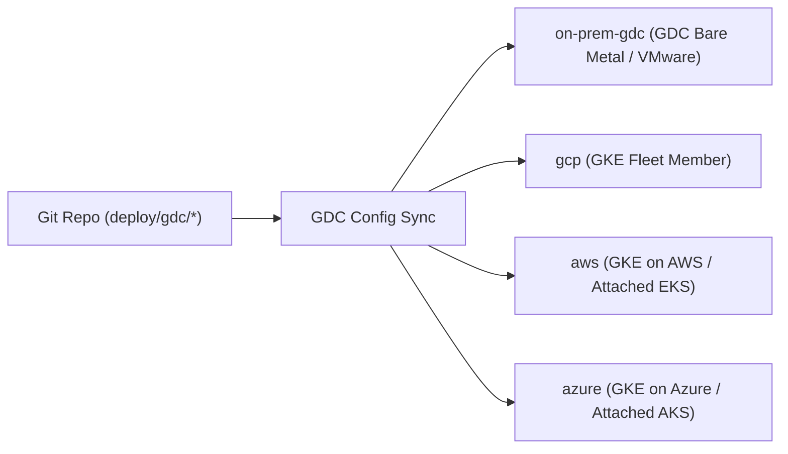

# GDC Multi-Cloud & On-Prem Deployment Runbook (`deploy/deployment_and_runbook.md`)

- **Project Name:** `<Project Name>`
- **Input Scenario:** `Legacy Application Modernization` | `Greenfield Requirements Specification`
- **Abstraction Control Plane:** `Google Distributed Cloud (GDC) / GKE Enterprise Fleet`
- **Connectivity Mode:** `gdc-connected` | `gdc-air-gapped`
- **Target Environments:** `on-prem-gdc` · `gcp` · `aws` · `azure`

---

## 1. GDC Multi-Cloud & On-Premises Fleet Topology

| Environment | GDC Cluster Selector | Kustomize Overlay | Database Portability Mode | Ingress / Mesh Exposure |
| :-- | :-- | :-- | :-- | :-- |
| `on-prem-gdc` | `selector-on-prem-gdc` | `deploy/gdc/overlays/on-prem-gdc` | AlloyDB Omni / CloudNativePG | GDC Cloud Service Mesh (`MultiClusterService`) |
| `gcp` | `selector-gcp` | `deploy/gdc/overlays/gcp` | AlloyDB Omni / CloudNativePG | GDC Cloud Service Mesh (`MultiClusterService`) |
| `aws` | `selector-aws` | `deploy/gdc/overlays/aws` | AlloyDB Omni / CloudNativePG | GDC Cloud Service Mesh (`MultiClusterService`) |
| `azure` | `selector-azure` | `deploy/gdc/overlays/azure` | AlloyDB Omni / CloudNativePG | GDC Cloud Service Mesh (`MultiClusterService`) |

---

## 2. Capability-Group GitOps Rollout Waves (`GDC Config Sync`)
| Wave | Capability Group | Group Name | Prerequisite Groups | Target Environments | Verification Gate |
| :-: | :-- | :-- | :-- | :-- | :-- |
| 1 | `GRP-01` | `<Shared Foundation>` | `None (Shared Foundation)` | `on-prem-gdc, gcp, aws, azure` | `/health` + schema migration Job `Complete` |
| 2 | `GRP-02..N` | `<Downstream Group>` | `GRP-01` | `on-prem-gdc, gcp, aws, azure` | Smoke probes + SLO burn rate == 0 |

---

## 3. Portable Database Initialization & Data Migration Cutover
- **Schema Initialization:** KRM `Job` `db-schema-migration` applies `src/db/schema.sql` before application pods pass readiness.
- **Legacy Cutover (Legacy Application Modernization only):** One-time ETL `Job` `legacy-data-cutover` executes the mapping and reconciliation checksums in `design/data_migration_and_cutover.md`.

---

## 4. Unified Multi-Cloud & On-Prem Observability, SLOs & Alerting
- **Telemetry Pipeline (`deploy/observability/otel-collector.yaml`):** OpenTelemetry Collector tags all metrics, traces, and Spec `§2.3` audit events with `gdc.cluster.provider`, `gdc.cluster.name`, and `dlc.capability_group`.
- **SLOs & Alerts (`deploy/observability/slo_and_alerts.yaml`):** Availability and latency SLOs + multi-window burn-rate alerts derived from `specs/application_spec.md`.
- **Single-Pane-of-Glass Dashboard (`deploy/observability/fleet_dashboard.json`):** Unified visibility across On-Premises, GCP, AWS, and Azure.

---

## 5. Cross-Cloud / On-Prem Disaster Recovery Failover & Rollback Procedure
- **Active-Active / Active-Passive Failover:** GDC Cloud Service Mesh `MultiClusterService` automatically shifts traffic across healthy fleet clusters (`on-prem-gdc` ↔ `gcp` ↔ `aws` ↔ `azure`) if any regional or on-prem healthcheck fails.
- **GitOps Rollback:** Revert the commit SHA in `deploy/gdc/config-sync/rootsync.yaml` (or pin previous OCI image digest); GDC Config Sync reconciles all clusters within 60 seconds.
