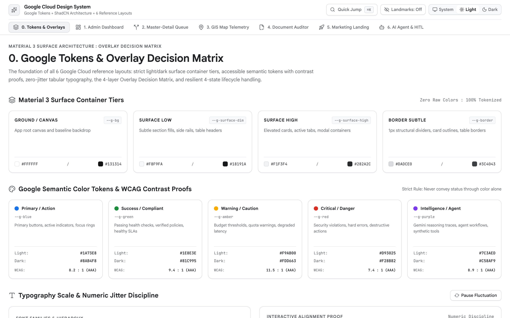
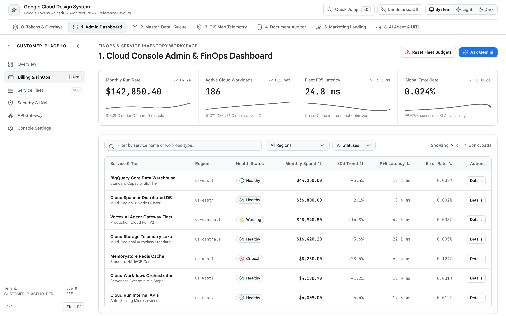
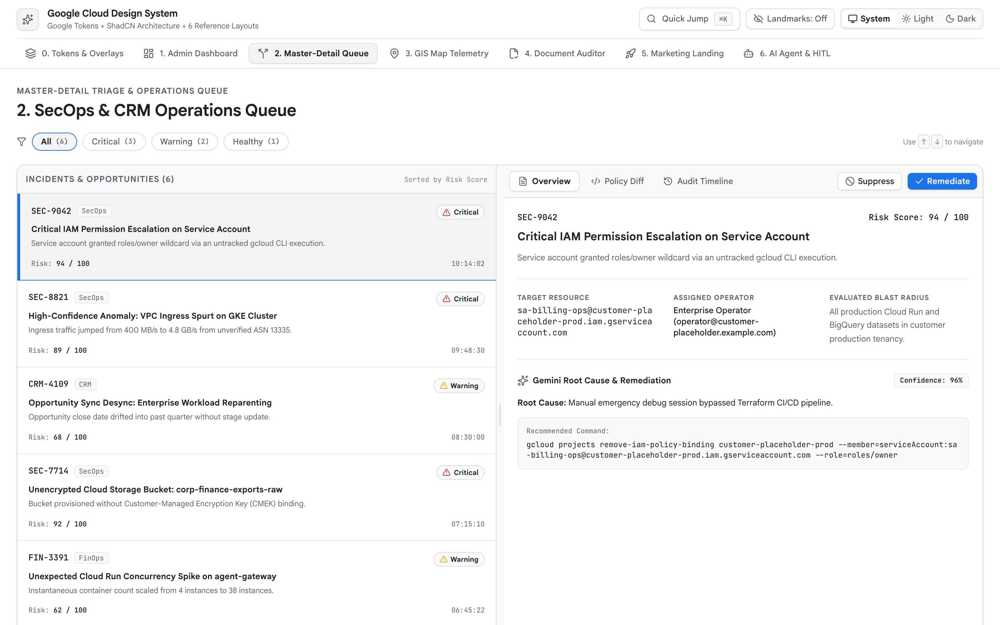
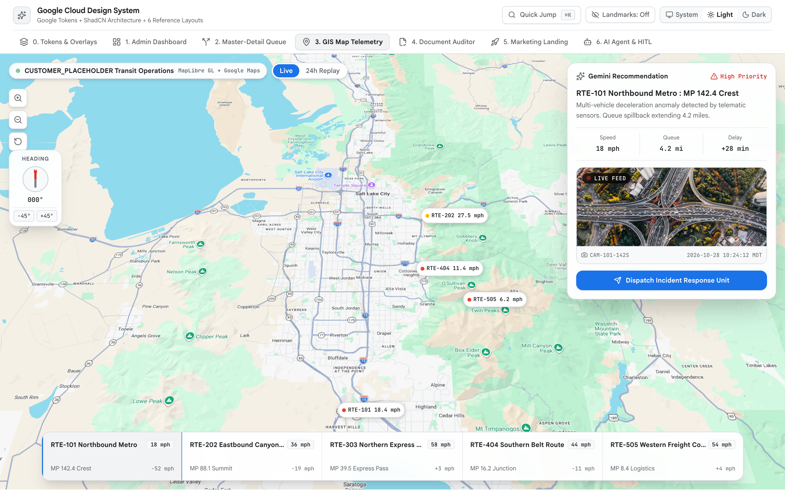
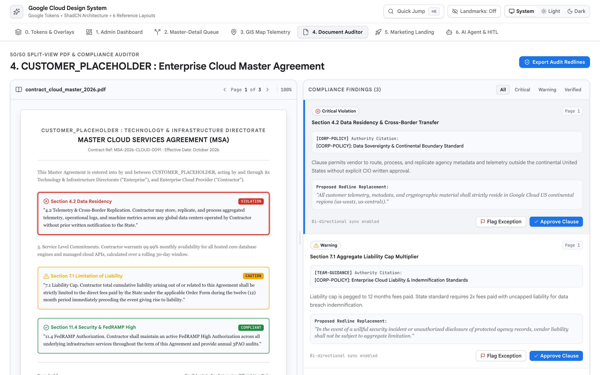
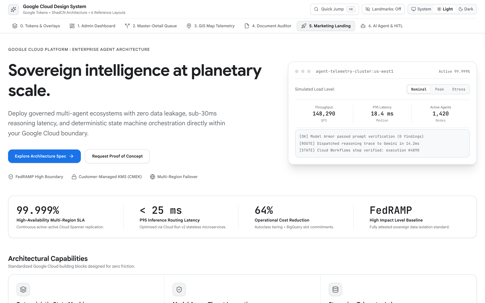
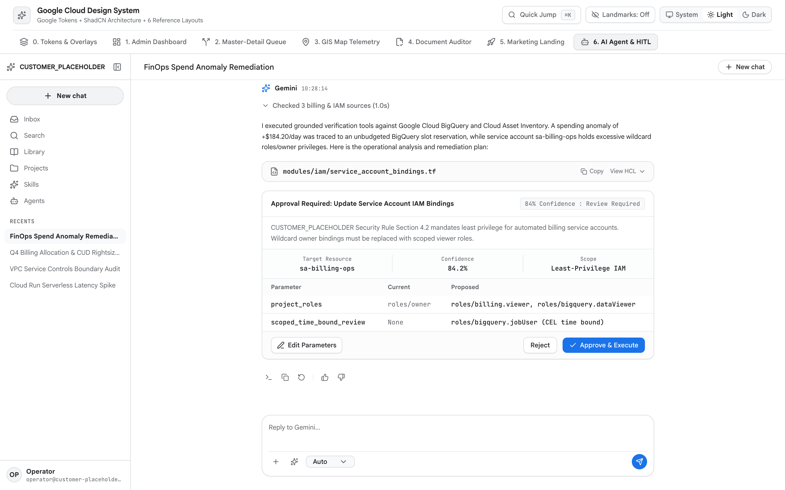

# Google Cloud UI Design & Frontend Architecture

This skill defines the visual design system, ShadCN UI component mappings,
spatial grid rules, overlay decision matrix, and WCAG 2.3 accessibility
standards for web applications, enterprise consoles, and AI workspaces.



## 1. Design Philosophy & Mode Selection (`impeccable` Framework)

Before writing CSS or JSX, declare the primary **Surface Mode** based on what
user success looks like on the active route:

Mode           | Primary User Goal                                                         | Representative Surfaces                                                                      | Background & Tonal Strategy                                                                                                                                           | Information Density                                                                         | Motion Budget                                                                                                  | Typography Strategy
:------------- | :------------------------------------------------------------------------ | :------------------------------------------------------------------------------------------- | :-------------------------------------------------------------------------------------------------------------------------------------------------------------------- | :------------------------------------------------------------------------------------------ | :------------------------------------------------------------------------------------------------------------- | :------------------
**`Operate`**  | Complete a task rapidly and accurately without visual friction            | Cloud Console dashboards, FinOps tables, operations queues, GIS telemetry, HITL review           | Restrained 60-30-10 neutral canvas (`var(--g-bg)`); color reserved strictly for status exceptions, selection, and primary actions                                     | High (`12px-14px` UI copy, compact `32px-36px` controls, multi-column data grids)           | `150ms-250ms` cubic-bezier state/overlay transitions + `sonner` physics; zero decorative entrance choreography | Fixed `rem` scale (`1.125-1.2` ratio); `Google Sans Text` / `Inter` + mandatory `tabular-nums`
**`Read`**     | Comprehend structured prose, legal clauses, or audit evidence             | Technical documentation, 50/50 PDF compliance auditors, architecture scorecards, postmortems | High-contrast paper canvas (`var(--g-surface)`) with subtle secondary surface gutters (`var(--g-surface-dim)`)                                                        | Moderate; strict `60ch-75ch` prose line measure with generous vertical rhythm               | `180ms` tab/view fade-settle; zero distracting motion near reading column                                      | `16px` (`1rem`) minimum body copy, `1.6` line-height, clear `Google Sans` heading steps
**`Persuade`** | Evaluate value, build trust, and trigger a commercial or workflow CTA     | Product landing pages, interactive solution showcases, executive briefing portals            | Intentional brand atmosphere built strictly on semantic surface tokens (`var(--g-bg)`, `var(--g-surface)`, `var(--g-surface-dim)`); never hardcoded light/dark colors | Low to moderate; generous whitespace (`48px-96px` section padding) and focused focal points | One authored hero moment (`250ms-400ms` exponential ease-out); never repeat identical scroll reveals           | Fluid `clamp()` display typography (`Google Sans` `600-700`), high scale contrast
**`Express`**  | Explore a spatial canvas, topology graph, or live media artifact directly | Architecture diagram canvases, 3D/WebGL digital twins, interactive agent flow builders       | Canvas-first; floating HUD chrome recedes into translucent or compact docked panels                                                                                   | Chrome is minimal (`<= 15%` of viewport area); the interactive artifact owns the viewport   | Direct manipulation (`60fps` pan/zoom/drag) with keyboard and single-click step fallbacks                      | Compact `12px-13px` HUD labels (`Google Sans Text`) and monospace coordinate readouts

### Anti-Slop Craft Floor (Mandatory Bans)

1.  **No AI Gradient Slop**: Never use purple-to-blue or magenta-to-cyan linear
    gradients on buttons, backgrounds, cards, or headings. Never use
    `background-clip: text` gradient text.
2.  **No Glowing Neon Dark-Mode Cards**: Never apply zero-offset colored halos
    (`box-shadow: 0 0 20px rgba(138, 180, 248, 0.3)`). In dark mode, communicate
    elevation through lighter surface steps (`#131314` -> `#1E1F20` ->
    `#282A2C`) and `1px solid` hairline borders (`#3C4043`).
3.  **No Decorative Glassmorphism on Work Surfaces**: Never apply
    `backdrop-filter: blur()` to data tables, form containers, or standard
    cards. Reserve `backdrop-blur-md` strictly for floating map HUD controls or
    sticky top headers.
4.  **No "Card Soup" or Nested Scrollbars**:
    *   **Ban Card Soup**: Never wrap individual metadata attributes
        (`Target Resource`, `Assigned Operator`, `Blast Radius`), KPI strip
        items, or inspector sub-sections in separate bordered boxes
        (`rounded-xl border`) inside a panel or section. Render a **single
        unified surface**
        (`rounded-xl border border-[var(--g-border)] bg-[var(--g-surface)]`) and
        separate items using whitespace (`p-5`, `gap-6`),
        `1px solid var(--g-border-subtle)` hairline dividers (`divide-y`,
        `divide-x`, `<Separator />`), and multi-column `<dl>` description lists.
    *   **Ban Nested Scrollbars**: Each pane in a layout owns at most one
        vertical scroll container (`overflow-y-auto`).
5.  **No Decorative Eyebrows, Section Numbers, or Badge Clutter**: Do not place
    uppercase kicker labels, `<Badge>` pills, or arbitrary `01 / 02 / 03`
    numbers above headings unless the sequence carries real workflow order.
6.  **No Rainbow Metric/Icon Coloring**: Never assign rotating colors (`blue`,
    `green`, `purple`, `amber`) to adjacent KPI metrics, proof-strip numbers, or
    feature icons. Keep metrics and icons strictly monochrome (`var(--g-ink)`
    and `var(--g-ink-secondary)`).
7.  **No Un-Animated Custom Toasts or Abrupt Overlay Unmounts**: Always use
    `sonner` (`<Toaster />`) for toasts and symmetric entrance/exit transitions
    for overlays.
8.  **No Raw JSON or Internal Telemetry in UI**: Never render unformatted JSON
    blobs, database column slugs (`created_at_utc`), internal tool names
    (`_inject_geo_filter`), or raw stack traces to end users.

## 2. Component Architecture: ShadCN UI + Google Tokens + Lucide Icons

All interactive UI primitives must be built on **ShadCN UI** (`@radix-ui/*`) and
styled with Tailwind CSS v4. Do **not** install `@material/web` (`md-*` custom
elements) inside React applications.

### Canonical UI Element to ShadCN Component Mapping (Zero Hand-Rolling Rule)

> **Zero Hand-Rolling Rule**: Whenever an interface requires any of the UI
> elements below, agents **must** install and import the mapped ShadCN component
> (`@/components/ui/<component>`). Hand-rolling custom replacements with raw
> `<div>`, `<button>`, `<select>`, `<input>`, or custom React state arrays (such
> as custom toast arrays, custom modal portals, custom slide-over drawers, or
> custom `mousemove` split-pane drag handlers) is strictly banned.

Run this **One-Shot Bootstrap Command** at project initialization to install the
core ShadCN component suite:

```bash
bunx --bun shadcn@latest add alert alert-dialog accordion avatar badge breadcrumb button calendar card chart checkbox collapsible command context-menu dialog drawer dropdown-menu form hover-card input label pagination popover progress radio-group resizable scroll-area select separator sheet sidebar skeleton slider sonner switch table tabs textarea toggle-group tooltip
```

#### Category 1: Feedback, Notifications & Status

UI Element / Need                        | ShadCN Component | Canonical Primitives                            | Banned Hand-Rolled Pattern
:--------------------------------------- | :--------------- | :---------------------------------------------- | :-------------------------
**Toast / Action Notification**          | `sonner`         | `<Toaster />`, `toast.success()`, `toast()`     | Custom `useState` toast arrays or `window.alert()`
**Inline Callout / System Banner**       | `alert`          | `<Alert>`, `<AlertTitle>`, `<AlertDescription>` | Ad-hoc colored `<div>` boxes without `role="alert"`
**Loading Placeholder / Shimmer**        | `skeleton`       | `<Skeleton className="..." />`                  | Full-screen blocking spinners or custom pulse `<div>`
**Determinate Progress / Quota Bar**     | `progress`       | `<Progress value={68} />`                       | Raw `<progress>` or nested width `<div>` without ARIA
**Status / Severity Pill (Tables Only)** | `badge`          | `<Badge variant="outline">`                     | Raw `<span>` pills scattered across headers or tabs

#### Category 2: Overlays, Modals, Drawers & Menus

UI Element / Need                               | ShadCN Component | Canonical Primitives                                            | Banned Hand-Rolled Pattern
:---------------------------------------------- | :--------------- | :-------------------------------------------------------------- | :-------------------------
**Destructive Confirmation Modal**              | `alert-dialog`   | `<AlertDialog>`, `<AlertDialogContent>`, `<AlertDialogAction>`  | `window.confirm()` or custom `fixed inset-0` modal `<div>`
**Short Form / Security Gate Modal**            | `dialog`         | `<Dialog>`, `<DialogContent>`, `<DialogHeader>`                 | Un-trapped `isOpen && <div className="fixed inset-0">`
**Right Slide-Over Inspector / `"Ask Gemini"`** | `sheet`          | `<Sheet>`, `<SheetContent side="right">`, `<SheetHeader>`       | Custom `fixed right-0` drawers that unmount without exit
**Mobile Bottom Tray**                          | `drawer`         | `<Drawer>`, `<DrawerContent>`, `<DrawerHeader>`                 | Hand-rolled bottom sheets without gesture/Escape dismissal
**Global Command Palette (`⌘K`)**               | `command`        | `<CommandDialog>`, `<CommandInput>`, `<CommandList>`            | Custom `<input>` + `<ul>` modal without `cmdk` navigation
**Floating Filter / Date / Config Panel**       | `popover`        | `<Popover>`, `<PopoverTrigger>`, `<PopoverContent>`             | `absolute` dropdown `<div>` that clips in `overflow-hidden`
**Action Menu (`...`) / Profile Menu**          | `dropdown-menu`  | `<DropdownMenu>`, `<DropdownMenuContent>`, `<DropdownMenuItem>` | Custom click-outside menus without arrow-key roving focus
**Right-Click Row / Canvas Menu**               | `context-menu`   | `<ContextMenu>`, `<ContextMenuContent>`, `<ContextMenuItem>`    | Custom `onContextMenu` coordinate-positioned `<div>`
**Truncated Text / Icon Button Hint**           | `tooltip`        | `<TooltipProvider>`, `<Tooltip>`, `<TooltipContent>`            | Native `title="..."` attribute alone or CSS hover `<div>`
**Rich Entity Preview on Hover**                | `hover-card`     | `<HoverCard>`, `<HoverCardTrigger>`, `<HoverCardContent>`       | Custom `onMouseEnter` / `onMouseLeave` preview cards

#### Category 3: Layout, Navigation & Structural Containers

UI Element / Need                         | ShadCN Component            | Canonical Primitives                                                          | Banned Hand-Rolled Pattern
:---------------------------------------- | :-------------------------- | :---------------------------------------------------------------------------- | :-------------------------
**Left Collapsible App Navigation Rail**  | `sidebar`                   | `<SidebarProvider>`, `<Sidebar>`, `<SidebarMenu>`, `<SidebarTrigger>`         | Manual sidebar width `<div>` without mobile sheet fallback
**Master-Detail / 50-50 Split Workspace** | `resizable`                 | `<ResizablePanelGroup>`, `<ResizablePanel>`, `<ResizableHandle withHandle />` | Custom `mousemove` drag handlers or rigid static columns
**View / Section Switcher**               | `tabs`                      | `<Tabs>`, `<TabsList>`, `<TabsTrigger>`, `<TabsContent>`                      | `<button>` loops lacking `role="tablist"` & arrow keys
**Expandable Diagnostic / Trace Section** | `accordion` / `collapsible` | `<Accordion>`, `<AccordionItem>`, `<AccordionTrigger>`, `<Collapsible>`       | Unstyled `<div onClick>` toggles without `aria-expanded`
**`1px` Structural Hairline Divider**     | `separator`                 | `<Separator orientation="horizontal" \| "vertical" />`                        | Empty `<div className="h-px">` without `role="separator"`
**Custom-Scrollbar Overflow Container**   | `scroll-area`               | `<ScrollArea>`, `<ScrollBar orientation="horizontal" />`                      | Unstyled native scrollbars inside dense sidebars/panes
**Hierarchy / Path Wayfinding Bar**       | `breadcrumb`                | `<Breadcrumb>`, `<BreadcrumbList>`, `<BreadcrumbItem>`                        | Raw `<span>Home / ...</span>` without `<nav>` landmark
**Unified Panel / Surface Container**     | `card`                      | `<Card>`, `<CardHeader>`, `<CardTitle>`, `<CardContent>`                      | Nested bordered `<div>` boxes ("card soup")

#### Category 4: Forms, Inputs, Toggles & Selection Controls

UI Element / Need                                 | ShadCN Component       | Canonical Primitives                                             | Banned Hand-Rolled Pattern
:------------------------------------------------ | :--------------------- | :--------------------------------------------------------------- | :-------------------------
**Action Trigger / CTA Button**                   | `button`               | `<Button variant="default" \| "outline" \| "destructive">`       | Raw `<button>` with inconsistent heights or `<div onClick>`
**Single-Value Option Picker**                    | `select`               | `<Select>`, `<SelectTrigger>`, `<SelectContent>`, `<SelectItem>` | Unstyled native `<select>` breaking dark mode or padding
**Searchable Multi-Option / Combobox Picker**     | `popover` + `command`  | `<Popover>` wrapping `<Command>`, `<CommandInput>`               | Native `<datalist>` or unsearchable `<select multiple>`
**Single-Line Text / Search / Numeric Field**     | `input`                | `<Input type="text" \| "search" \| "number" />`                  | Raw `<input>` without `--g-blue` focus ring & border contrast
**Multi-Line Text / Prompt / Note Field**         | `textarea`             | `<Textarea rows={4} />`                                          | Raw `<textarea>` or `contenteditable` `<div>`
**Validated Form Field & Accessible Label**       | `form` + `label`       | `<Form>`, `<FormField>`, `<FormItem>`, `<Label htmlFor>`         | Placeholder-only inputs without `<Label>` or `aria-describedby`
**Binary On/Off Setting Toggle**                  | `switch`               | `<Switch checked={...} onCheckedChange={...} />`                 | Custom pill `<button>` without `role="switch"`
**Segmented Control (`System \| Light \| Dark`)** | `toggle-group`         | `<ToggleGroup type="single">`, `<ToggleGroupItem>`               | Ad-hoc `<button>` groups without `aria-pressed` / radio state
**Multi-Select Check / Row Selection**            | `checkbox`             | `<Checkbox checked={...} onCheckedChange={...} />`               | Raw `<input type="checkbox">` with default browser styling
**Mutually Exclusive Option List**                | `radio-group`          | `<RadioGroup>`, `<RadioGroupItem value="..." />`                 | Raw `<input type="radio">` without roving keyboard focus
**Continuous / Stepped Range Control**            | `slider`               | `<Slider value={[val]} onValueChange={...} />`                   | Raw `<input type="range">` with unstyled track/thumb
**Date / Date-Range Picker**                      | `calendar` + `popover` | `<Popover>` wrapping `<Calendar mode="single" \| "range" />`     | Native `<input type="date">` with inconsistent OS popups

#### Category 5: Data Display, Tables, Charts & Identity

UI Element / Need                          | ShadCN Component       | Canonical Primitives                                     | Banned Hand-Rolled Pattern
:----------------------------------------- | :--------------------- | :------------------------------------------------------- | :-------------------------
**Data Grid & Pagination Controls**        | `table` + `pagination` | `<Table>`, `<TableHeader>`, `<TableRow>`, `<Pagination>` | Flexbox/Grid `<div>` pseudo-tables without `<table>` semantics
**Telemetry, Time-Series & FinOps Charts** | `chart`                | `<ChartContainer>`, `<ChartTooltip>` wrapping `recharts` | Raw SVG `<polyline>` hacks or un-themed Recharts tooltips
**Operator / Agent / User Identity Badge** | `avatar`               | `<Avatar>`, `<AvatarImage>`, `<AvatarFallback>`          | Raw `` tags that break on 404 without fallback initials

### Button, `<Badge>`, Icon (`lucide-react`), Motion & Navigation Rail Rules

*   **Button Variant Discipline**:
    *   **Primary CTA (`variant="default"`)**: At most **one** primary filled
        CTA (`bg-[var(--g-blue)]`) per section or card.
    *   **Secondary Actions (`variant="outline"`)**: All secondary buttons
        (`"Export CSV"`, `"Filter"`, `"Configure"`, `"Cancel"`) **must** use
        `variant="outline"` (`border border-[var(--g-border)]
        bg-[var(--g-surface)] text-[var(--g-ink)]
        hover:bg-[var(--g-surface-high)] transition-all duration-150 ease-out
        active:scale-[0.98] cursor-pointer`). Never use solid black or
        dark-slate secondary buttons.
*   **Drastic `<Badge>` Restraint**:
    *   **BANNED**: Never place `<Badge>` inside navigation tabs, top headers,
        sidebar nav items, hero eyebrows, KPI headers, or section titles.
    *   **PERMITTED**: Reserve `<Badge>` strictly for (a) a single **Status**
        column in a data table or (b) a single **Severity** state on an
        incident/finding card (prefer `variant="outline"` with a `6px` semantic
        dot).
*   **Iconography (`lucide-react`)**: Use `size={16}` (`w-4 h-4`) for
    controls/tables, `size={18}` for navigation/headers, `strokeWidth={1.75}`,
    and monochrome ink (`text-[var(--g-ink-secondary)]`). Use inline SVG only
    for official Google Cloud and **Gemini Sparkle** brand marks.
*   **Motion & `sonner` Toasts**: Mount `<Toaster />` from `sonner` for
    spring-physics notifications. Slide-over `Sheet` (`240ms` open / `200ms`
    close `translate-x-full <-> translate-x-0`) and `Dialog` (`180ms`
    `scale-[0.96] <-> scale-100`) overlays must animate symmetrically on both
    open and close.
*   **Navigation Rail Header Standard (`CUSTOMER_PLACEHOLDER` + Left Icon +
    Flush-Right Collapse Button)**:
    *   Every collapsible left navigation rail (`256px` / `240px` expanded,
        `56px` collapsed) must render a top header row (`flex items-center
        justify-between w-full px-3 h-12 border-b
        border-[var(--g-border-subtle)]`):
    *   Left group (`flex items-center gap-2.5 min-w-0`): `16px`/`18px` brand
        icon aligned on the vertical axis of the nav item icons below it +
        **`CUSTOMER_PLACEHOLDER`**
        (`truncate text-sm font-semibold text-[var(--g-ink)]`).
    *   Right control (`ml-auto shrink-0`): Collapse button (`PanelLeftClose`,
        `size={16}`) flush-aligned with the right edge of the rail items.
*   **Runtime & Packages**: Bun (`bun` / `bunx`), Vite, React 19, TypeScript,
    Tailwind CSS v4, `@tanstack/react-table`, `react-resizable-panels`,
    `recharts`, `maplibre-gl` (with Google Maps raster tiles
    `https://mt1.google.com/vt/lyrs=m&x={x}&y={y}&z={z}` and `.dark`
    invert/hue-rotate filter), `cmdk`, and `sonner`. Bind a random port
    (`3100-8999`) in `package.json`
    (`"demo": "bunx --bun vite --port <PORT> --host"`) and record it in
    `README.md`.

## 3. Color Tokens, Typography, Spatial Grid & WCAG 2.3 Accessibility

> **Complete CSS Stylesheet, `useTheme()` Hook & Accessibility Reference**: Read
> **[references/tokens-and-accessibility.md](references/tokens-and-accessibility.md)**
> for the full copy-pasteable `src/index.css` file (`:root`, `.dark`,
> `@theme inline`, `@layer base` cursor-pointer and symmetrical `12px`
> `<select>` caret SVG rules), the `useTheme()` React hook, complete Light/Dark
> token tables, typography scale, APCA contrast benchmarks, and the 14-row
> Semantic HTML5 Element Mandate table.

### Core Token, Spatial & Accessibility Mandates

*   **Default to `"system"` Theme & Ban Hardcoded Colors**: Theme state must
    default to `"system"` using
    `window.matchMedia("(prefers-color-scheme: dark)")` with a live `change`
    listener and a 3-way `System | Light | Dark` header toggle. Never write
    hardcoded hex literals (`#FFFFFF`, `#F8F9FA`, `#131314`, `#202124`) or raw
    Tailwind neutral/status classes (`bg-white`, `bg-black`, `bg-slate-*`,
    `bg-red-500`) in JSX. Always reference `--g-bg` (`#F8F9FA` / `#131314`),
    `--g-surface` (`#FFFFFF` / `#1E1F20`), `--g-surface-dim` (`#F1F3F4` /
    `#18191A`), `--g-surface-high` (`#E8EAED` / `#282A2C`), `--g-ink` (`#202124`
    / `#E8EAED`), `--g-ink-secondary` (`#5F6368` / `#9AA0A6`), `--g-border`
    (`#DADCE0` / `#3C4043`), and `--g-border-subtle` (`#E8EAED` / `#282A2C`).
*   **60-30-10 Tonal Balance & Amber Contrast Guard**: 60% neutral canvas
    (`--g-bg` / `--g-surface`), 30% elevated structure (`--g-surface-dim` +
    `1px` borders), `<= 10%` semantic accents (`--g-blue`, `--g-red`,
    `--g-green`, `--g-amber`, `--g-purple`). In Light Mode, always use
    `--g-amber-text` (`#B06000`, `4.7:1` contrast) for warning text rather than
    `#F9AB00`.
*   **Typography & Mandatory `tabular-nums`**: Load `Google Sans`,
    `Google Sans Text` (or `Inter`), and `JetBrains Mono`. Constrain prose to
    `60ch-75ch`. Apply `tabular-nums` to all KPIs, currency, percentages,
    latencies, timestamps, and numeric table columns. Left-align text/IDs/status
    and right-align numbers (`text-right font-mono tabular-nums`), matching
    `<th scope="col">` to `<td>`.
*   **Unified Surfaces (Ban "Card Soup")**: Group related fields, `<dl>`
    metadata lists, and 4-cell KPI strips onto a **single unified surface**
    (`rounded-xl border border-[var(--g-border)] bg-[var(--g-surface)]`)
    separated by `divide-x` / `divide-y divide-[var(--g-border-subtle)]`
    hairlines and `p-5` padding rather than separate bordered boxes.
*   **WCAG 2.3 & Semantic HTML5**:
    *   **Contrast & Target Size**: Body text `>= 4.5:1` (`Lc >= 75`); UI
        borders/focus rings `>= 3:1`. Controls `>= 24x24px` (`32px`/`36px`
        desktop, `44x44px` touch), with `>= 8px` (`gap-2`) separation next to
        destructive buttons.
    *   **Pointer & Select Caret Affordance**: Include the `@layer base` rule in
        `src/index.css` so all enabled interactive controls display
        `cursor: pointer` and `<select>` dropdowns have symmetrical `12px`
        (`0.75rem`) left text and right caret padding.
    *   **Keyboard, Skip Link & Movable 50/50 Divider**: Render
        `<a href="#main-content">Skip to main content</a>` first in `<body>`;
        show `2px solid var(--g-blue)` `:focus-visible` rings; use movable 50/50
        divider (`ResizableHandle withHandle`, `col-resize` cursor, double-click
        reset to 50/50, zero ratio buttons in top bar) on
        `references/master-detail-workspace.md` and
        `references/document-auditor.md` and North `0°` compass reset buttons on
        GIS maps.
    *   **Top App Bar Density & Nav Rail Footer**: Fixed `56px` (`h-14`) top bar
        capped to brand identity, optional context selector, search `⌘K`, theme
        toggle, and 1-2 primary CTA buttons. Move interface language (`EN | ES`),
        settings, and reset controls to nav rail footer; NEVER top bar.
    *   **Semantic Landmarks**: Use `<header>`, `<nav aria-label="...">`,
        `<main id="main-content">`, `<section>`, `<aside>`, `<dl>`, `<footer>`,
        `<button type="button">`, and `<table>`. Zero `<div onClick>` soup.

## 4. Overlay & Container Decision Matrix

Pattern / ShadCN Primitive                          | Primary Use Case                                                                                                                                            | Width & Geometry                                                                                                                                                                                                                            | Motion & Focus Behavior                                                                                                                                         | Hard Prohibitions (When NOT to Use)
:-------------------------------------------------- | :---------------------------------------------------------------------------------------------------------------------------------------------------------- | :------------------------------------------------------------------------------------------------------------------------------------------------------------------------------------------------------------------------------------------ | :-------------------------------------------------------------------------------------------------------------------------------------------------------------- | :----------------------------------
**Centered Modal (`Dialog` / `AlertDialog`)**       | Destructive confirmations (`Delete Cluster`, `Revoke Key`), blocking security gates, or short 2-3 field creation prompts (`Create Folder`)                  | `max-w-md` (`448px`) to `max-w-lg` (`512px`); centered in viewport                                                                                                                                                                          | Symmetric `180ms` `scale-[0.96] opacity-0 <-> scale-100 opacity-100` transition; traps focus; `Escape` closes                                                   | **NEVER** put data tables, multi-step wizards, log viewers, PDF previews, or AI chat threads inside a centered Modal. **NEVER** exceed `560px` width.
**Slide-Over Drawer (`Sheet`)**                     | Secondary entity inspection (clicking a table row to inspect metadata/audit history), `"Ask Gemini"` contextual assistant, or complex 5-10 field edit forms | Right-docked (`side="right"`), `w-[420px]` to `w-[560px]` (`max-w-[90vw]`), full viewport height (`h-dvh`)                                                                                                                                  | Symmetric `240ms` `translate-x-full <-> translate-x-0` slide on open AND close + `180ms` backdrop fade; sticky header + scrollable unified body + sticky footer | **NEVER** abruptly unmount on close without running the slide-out animation. **NEVER** use a `Sheet` when the user must continuously compare two surfaces side-by-side without occlusion (use `ResizablePanelGroup`).
**Resizable Split Pane (`ResizablePanelGroup`)**    | Simultaneous side-by-side comparison: Master-Detail operations queues, 50/50 PDF + Compliance Auditor, or SQL editor + results grid                             | 2 persistent columns initializing at 50/50 (`defaultSize={50}`) with `minSize={25}` constraints and movable divider (`ResizableHandle withHandle`, `col-resize` cursor, double-click reset to 50/50; NEVER render ratio buttons in top bar) | No focus trap; both panes remain simultaneously interactive and independently scrollable                                                                        | **NEVER** use a right-hand split pane on standalone AI chat workspaces (`references/ai-agent-workspace.md`). **NEVER** collapse into a horizontal split below `1024px` (`lg:`); switch to `Tabs` or `Sheet` on mobile.
**Command Palette (`CommandDialog` `⌘K`)**          | Global keyboard-first navigation, instant resource search, theme switching, and quick action dispatch                                                       | `max-w-xl` (`576px`), anchored `16%-20%` from top of viewport                                                                                                                                                                               | Symmetric `180ms` scale/fade transition; traps focus on open; instant filter-as-you-type; arrow keys navigate items                                             | **NEVER** require `⌘K` as the *only* way to reach a feature; every command must also have a visible button or navigation link for mouse/touch users.
**Popover / Dropdown (`Popover` / `DropdownMenu`)** | Row action menus (`...`), date-range pickers, multi-select facet filters, column visibility toggles                                                         | `w-48` (`192px`) to `w-80` (`320px`), anchored via Radix Collision Portal                                                                                                                                                                   | Returns focus to trigger on `Escape` or selection; rendered in `<Portal>` so `overflow-hidden` ancestors never clip it                                          | **NEVER** place scrollable text paragraphs, forms with more than 3 inputs, or nested sub-dialogs inside a `Popover`.
**Inline Accordion / Tabs (`Accordion` / `Tabs`)**  | Switching between peer views of the same entity (`Overview`, `Metrics`, `Logs`, `IAM Policy`) or expanding optional diagnostic details (`<details>`)        | Flows inline within parent container (`w-full`)                                                                                                                                                                                             | `.animate-g-fade-in` (`180ms` fade + `4px` settle) on tab panel switch; arrow keys move between `<TabsTrigger>` elements                                        | **NEVER** nest horizontal `Tabs` inside another set of horizontal `Tabs`.
**Toast (`sonner` `<Toaster />`)**                  | Non-blocking confirmation of background or routine actions (`"Copied project ID"`, `"Export queued"`, `"Rule saved"`) with optional `"Undo"` button         | Bottom-right (`w-[356px]`), spring-animated stack via `sonner`, auto-dismisses after `4000ms-5000ms`                                                                                                                                        | Announces via `aria-live="polite"`; never steals keyboard focus from the active control                                                                         | **NEVER** hand-roll static custom toast `<div>` elements. **NEVER** use a disappearing Toast as the sole indicator for critical form validation errors or P0 system failures.

## 5. Complete State Coverage, UX Copy & AI Hygiene Guardrails

*   **Complete 4-State Coverage**: Every data view must implement:
    1.  **Loading (`Skeleton`)**: Geometry-matched `<Skeleton />` placeholders
        (`CLS = 0.00`); never block the app shell with a full-screen spinner.
    2.  **Empty**: `40px` icon badge + 1-sentence explanation distinguishing
        first-run vs. zero filter matches + `<Button variant="outline">`
        recovery CTA (`"Clear 2 Filters"`).
    3.  **Error**: Plain explanation of what failed, why, and how to recover +
        inline `"Retry"` button + collapsible `<details>` for `HTTP 503` /
        correlation ID.
    4.  **Populated & Extreme Data**: `.truncate` with `min-w-0` + `<Tooltip>` +
        copy button; paginate or virtualize (`@tanstack/react-virtual`) beyond
        100 rows.
*   **Action-Oriented UX Copy**: Use `[Verb] + [Object]` button labels
    (`"Export Billing CSV"`, `"Approve Exception"`), never vague `"Submit"` or
    `"OK"`. Destructive `AlertDialog` titles and buttons must name the exact
    resource (`"Delete bucket 'customer-placeholder-staging'?"`).
*   **AI, Data & `CUSTOMER_PLACEHOLDER` Hygiene Guardrails**:
    1.  **Zero Raw Payload Leakage**: Never render raw JSON tool calls, internal
        function names (`_inject_geo_filter`), or raw bounding-box arrays
        (`[245, 112, 410, 880]`). Translate tool executions into human-readable
        steps (`"Filtered map to Sector North-04"`).
    2.  **Model Naming Guardrail**: Never expose model version numbers or SKU
        strings (`"Gemini 2.5 Pro"`, `"gemini-2.5-flash"`) in user-facing UI
        chrome. Label AI surfaces **`"Gemini"`**, **`"Ask Gemini"`**, or
        **`"Gemini Recommendation"`**.
    3.  **Mandatory Source Citations**: Every AI claim, risk score, or
        compliance flag must render an interactive **Source Citation Button /
        Link** (`[RFP Section 4.2, p. 14]`) that scrolls to and highlights the
        verifiable source record.
    4.  **Zero Customer-Specific Names (`CUSTOMER_PLACEHOLDER` Rule)**: Never
        hardcode specific customer, organization, or personal names in templates or
        reference code. Always use **`CUSTOMER_PLACEHOLDER`** for tenant headers
        and generic resource slugs (`customer-placeholder-prod`,
        `operator@customer-placeholder.example.com`).

## 6. Reference Layout Library (`references/*.md`)

Before scaffolding a new application or route, read the matching architectural
blueprint in `references/`:

Blueprint File                                                                     | Layout Archetype                             | Surface Mode       | Target Use Cases & Key Structural Mechanics
:--------------------------------------------------------------------------------- | :------------------------------------------- | :----------------- | :------------------------------------------
**[references/admin-dashboard.md](references/admin-dashboard.md)**                 | Cloud Console Admin & FinOps Dashboard       | `Operate`          | Left collapsible nav (`256px` / `56px` with `CUSTOMER_PLACEHOLDER` header) + sticky filter bar + unified 4-cell monochrome KPI strip (`divide-x`) + 2-column `Recharts` telemetry + full-width `@tanstack/react-table` with animated `Sheet` drill-down.
**[references/master-detail-workspace.md](references/master-detail-workspace.md)** | Master-Detail Triage & Operations Queue      | `Operate`          | Zero-page-scroll `h-dvh overflow-hidden` app shell + `ResizablePanelGroup` (movable 50/50 divider with `ResizableHandle withHandle`, `col-resize` cursor, double-click 50/50 reset; filterable queue list + unified single-surface detail inspector with `divide-y` sections) + `j`/`k` keyboard triage + sticky bottom HITL bar.
**[references/gis-map-telemetry.md](references/gis-map-telemetry.md)**             | Full-Viewport GIS Map & Live Telemetry Stage | `Operate`          | `100vw x 100dvh` `maplibre-gl` canvas using Google Maps raster tiles (`https://mt1.google.com/vt/lyrs=m&x={x}&y={y}&z={z}`) with `.dark` CSS invert/hue-rotate filter + floating top-left HUD + bottom-right camera controls + animated right entity `Sheet`.
**[references/document-auditor.md](references/document-auditor.md)**               | 50/50 Split-View PDF & Compliance Auditor    | `Operate` / `Read` | Synchronized `ResizablePanelGroup` (movable 50/50 divider with `ResizableHandle withHandle`, `col-resize` cursor, double-click 50/50 reset): Left pane renders document page canvas with semantic bounding-box highlights; Right pane renders unified `divide-y` clause checklist, source citations, and HITL approval actions.
**[references/marketing-landing.md](references/marketing-landing.md)**             | Enterprise Product & Solution Landing Page   | `Persuade`         | Sticky header with `CUSTOMER_PLACEHOLDER` identity & 3-way theme toggle + split hero with unified telemetry preview frame + monochrome proof strip + unified `divide-x divide-y` capability grid + concrete customer ROI proof table.
**[references/ai-agent-workspace.md](references/ai-agent-workspace.md)**           | Gemini Enterprise Agent & HITL Workspace     | `Operate` / `Read` | Clean, spacious **2-Zone Modern AI Chat Interface** (Gemini Enterprise + Claude pattern) with **no right-hand split pane**: (1) Collapsible Left Conversation Sidebar (`240px`/`56px`) with `CUSTOMER_PLACEHOLDER` header, `+ New chat` pill, workspace links (`Inbox`, `Search`, `Library`, `Projects`, `Skills`, `Agents`), and `Recents` list; (2) Full-Width Centered Chat Stage (`max-w-3xl mx-auto`) where user prompts use compact right-aligned pills and Gemini responses flow **unboxed on the canvas** with inline collapsible reasoning traces, inline collapsible code/artifact blocks, a monochrome-first HITL Governance Approval block, and a bottom action bar.
**[references/gemini-enterprise-a2ui.md](references/gemini-enterprise-a2ui.md)**   | Declarative `A2UI v0.9` Generative Agent UI  | `Operate` / `Read` | Typed `createSurface` / `updateComponents` / `updateDataModel` JSON envelopes mapped strictly to pre-registered ShadCN + `--g-*` M3 catalog widgets (`frontend.kind == "gemini-enterprise-a2ui"`), with zero raw HTML/eval injection, Zero-Leak data-model binding, and server-revalidated HITL action dispatch.

### Reference Layout Visual Previews

1.  **Cloud Console Admin & FinOps Dashboard**
    ([references/admin-dashboard.md](references/admin-dashboard.md)):
    

2.  **Master-Detail Triage & Operations Queue**
    ([references/master-detail-workspace.md](references/master-detail-workspace.md)):
    

3.  **Full-Viewport GIS Map & Live Telemetry Stage**
    ([references/gis-map-telemetry.md](references/gis-map-telemetry.md)):
    

4.  **50/50 Split-View PDF & Compliance Auditor**
    ([references/document-auditor.md](references/document-auditor.md)):
    

5.  **Enterprise Product & Solution Landing Page**
    ([references/marketing-landing.md](references/marketing-landing.md)):
    

6.  **Gemini Enterprise Agent & HITL Workspace**
    ([references/ai-agent-workspace.md](references/ai-agent-workspace.md)):
    

## 7. Pre-Ship Verification Checklist

-   [ ] **Theme & Tokens**: Defaults to `"system"` via
    `window.matchMedia("(prefers-color-scheme: dark)")` with a 3-way
    `System | Light | Dark` toggle; zero hardcoded hex values or raw Tailwind
    colors (`bg-white`, `bg-slate-*`) in JSX; full `:root` and `.dark` `--g-*`
    tokens in `src/index.css`.
-   [ ] **Zero Hand-Rolling & Unified Surfaces**: Uses mapped ShadCN components
    from Section 2 (`sonner`, `dialog`, `alert-dialog`, `sheet`, `command`,
    `dropdown-menu`, `popover`, `tabs`, `select`, `switch`, `toggle-group`,
    `slider`, `resizable`, `sidebar`, `skeleton`, `table`, `chart`); zero "card
    soup" (uses single unified surfaces with `divide-x`/`divide-y` hairlines and
    `<dl>` lists).
-   [ ] **Restraint & Choreography**: Monochrome KPI metrics and icons
    (`var(--g-ink)`); `<Badge>` restricted strictly to table status column or
    finding severity; at most one primary filled button per section with
    `variant="outline"` on secondary actions; symmetric entrance/exit animations
    on `Sheet`/`Dialog` and `sonner` `<Toaster />` mounted.
-   [ ] **Layout, Nav Rail & Movable Split**: Collapsible nav rail header uses
    `CUSTOMER_PLACEHOLDER` + left icon + flush-right collapse button
    (`ml-auto shrink-0`) with language toggle (`EN | ES`) and settings in rail
    footer; split panes (`master-detail-workspace`, `document-auditor`)
    initialize at 50/50 with draggable `ResizableHandle` and double-click 50/50
    reset, NEVER top-bar ratio buttons; standalone AI chat
    (`ai-agent-workspace`) uses a 2-zone layout with no right-hand split pane;
    GIS maps use `maplibre-gl` with Google Maps raster tiles.
-   [ ] **States, Hygiene & WCAG 2.3**: Implements all 4 states (`Skeleton`,
    Empty, Error, Populated); `[Verb] + [Object]` button labels;
    `CUSTOMER_PLACEHOLDER` scrubbing; `"Gemini"` naming with source citations;
    `cursor: pointer` and symmetrical `12px` `<select>` caret padding in
    `@layer base`; `tabular-nums` on all numbers; `>= 4.5:1` text contrast; skip
    link + `:focus-visible` ring + semantic HTML5 landmarks with zero
    `<div onClick>`.

## Contributions

To contribute or modify this skill or its references, follow the
