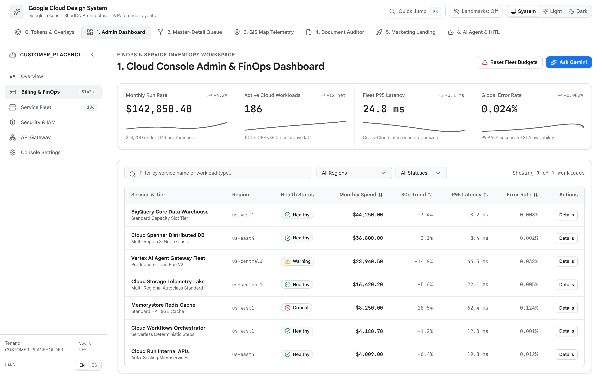

<!-- disableFinding(LINK_RELATIVE_G3DOC) -->
<!-- disableFinding(LINE_OVER_80) -->

# Cloud Console Admin & FinOps Dashboard (`Operate` Mode)



*   **Impeccable Mode**: `Operate` (`operate.md`, `layout.md`, `craft-floor.md`)
*   **Primary Reference**:
    [tokens-and-accessibility.md](tokens-and-accessibility.md)
*   **Target Archetype**: Cloud resource inventory, FinOps cost governance, IAM
    administration, quota monitoring, and fleet health telemetry.

--------------------------------------------------------------------------------

## 1. Executive Overview

The Cloud Console Admin & FinOps Dashboard is the canonical authenticated shell
for resource administration, spend optimization, and fleet governance. It
follows Google Cloud Console spatial standards: a 64px global top header with
project context (`customer-placeholder-prod`), `⌘K` omnibar search, and a
`System | Light | Dark` theme switcher (defaulting to `"system"`), a collapsible
left navigation rail (`240px` expanded, `56px` collapsed) headed by
`CUSTOMER_PLACEHOLDER`, a unified 4-metric KPI strip divided by 1px hairlines,
and a dense, filterable inventory table.

Contextual resource inspection and AI cost diagnostics (`Ask Gemini`) open in a
non-blocking 480px right-hand `<Sheet>` drawer structured as a single unified
surface with `1px` section dividers (`divide-y`) and semantic `<dl>` metadata
grids (never nested "card soup"). Centered modals are reserved strictly for
atomic, destructive confirmations (`<AlertDialog>`).

--------------------------------------------------------------------------------

## 2. When to Use vs. When NOT to Use

| Scenario /     | Use        | Alternative                                              | Reason          |
: Task           : Blueprint? :                                                          :                 :
| :------------- | :--------- | :------------------------------------------------------- | :-------------- |
| Cloud resource | **Yes**    | -                                                        | Scanning 50+    |
: inventory,     :            :                                                          : rows of metrics :
: FinOps cost    :            :                                                          : with top KPI    :
: tables         :            :                                                          : rollups.        :
| Sequential     | **No**     | [master-detail-workspace.md](master-detail-workspace.md) | Queue workflows |
: HITL triage,   :            :                                                          : need persistent :
: SecOps alert   :            :                                                          : 50/50 split     :
: queues         :            :                                                          : panes.          :
| Real-time GIS  | **No**     | [gis-map-telemetry.md](gis-map-telemetry.md)             | Spatial ops     |
: vehicle        :            :                                                          : need            :
: tracking,      :            :                                                          : full-viewport   :
: heatmaps       :            :                                                          : (`100vw x       :
:                :            :                                                          : 100dvh`) map    :
:                :            :                                                          : canvas.         :
| Side-by-side   | **No**     | [document-auditor.md](document-auditor.md)               | Document        |
: PDF compliance :            :                                                          : auditing        :
: auditing       :            :                                                          : requires 50/50  :
:                :            :                                                          : split canvas    :
:                :            :                                                          : with bounding   :
:                :            :                                                          : boxes.          :
| Public         | **No**     | [marketing-landing.md](marketing-landing.md)             | Unauthenticated |
: marketing      :            :                                                          : surfaces        :
: landing page,  :            :                                                          : require         :
: ROI hero       :            :                                                          : editorial bento :
:                :            :                                                          : grids.          :
| Multi-turn     | **No**     | [ai-agent-workspace.md](ai-agent-workspace.md)           | Conversational  |
: conversational :            :                                                          : workflows       :
: agent          :            :                                                          : require a       :
: workspace      :            :                                                          : 2-zone chat     :
:                :            :                                                          : stage.          :

--------------------------------------------------------------------------------

## 3. Spatial Architecture & Landmarks

```text
+------------------------------------------------------------------------------------+
| [Skip Link] <header> 64px [Project: customer-placeholder-prod] [⌘K] [Theme: Sys/L/D]|
+-------------------+----------------------------------------------------------------+
| <nav> 240px / 56px| <main id="main-content"> flex-1 overflow-y-auto p-6            |
| CUSTOMER_         |   <section aria-label="KPIs"> 4-Metric Strip (1px divide-x)    |
| PLACEHOLDER  [<]  |   <section aria-label="Filters"> Search + Select Controls      |
| - Overview        |   <section aria-label="Inventory"> Table (max 1 Badge/row)     |
| - Compute & GKE   +----------------------------------------------------------------+
| - Databases & SQL | <Sheet> 480px Slide-Over Drawer (<dl> Metadata + divide-y)     |
+-------------------+----------------------------------------------------------------+
```

```text
<body>
  ├── <header> Global App Bar (64px, z-40, Project Dropdown, Theme Switcher)
  └── <div className="flex h-[calc(100vh-64px)]">
      ├── <nav aria-label="Primary"> Collapsible Rail (240px/56px, CUSTOMER_PLACEHOLDER)
      └── <main id="main-content" tabIndex={-1}> Main Scroll Canvas
          ├── <section aria-label="Executive KPIs"> Unified 4-Cell Strip
          ├── <section aria-label="Filter Controls"> Filter Toolbar (px-3 Selects)
          ├── <section aria-label="Inventory"> Table (max 1 status Badge/row)
          ├── <Sheet> Slide-Over Resource Inspector (divide-y, <dl> grids)
          └── <AlertDialog> Destructive Resource Teardown Confirmation
```

--------------------------------------------------------------------------------

## 4. Required ShadCN Primitives & Package Installation

```bash
bun add lucide-react sonner
bunx --bun shadcn@latest add button badge input select table sheet alert-dialog command dialog checkbox
```

| UI Control           | ShadCN Primitive | Architectural Justification       |
| :------------------- | :--------------- | :-------------------------------- |
| Slide-Over Inspector | `Sheet`          | Contextual drill-down without     |
:                      :                  : losing table scroll.              :
| Destructive Action   | `AlertDialog`    | Separates destructive button by   |
:                      :                  : 8px.                              :
| Command Omnibar      | `CommandDialog`  | Accessible `⌘K` global search and |
:                      :                  : quick filters.                    :
| Filter Dropdowns     | `Select`         | Symmetrical 12px padding on text  |
:                      :                  : and caret (`px-3`).               :

--------------------------------------------------------------------------------

## 5. Key UX, Unified Surface & WCAG 2.3 Rules

1.  **Left Nav Header (`CUSTOMER_PLACEHOLDER` + Flush Toggle)**: Heading row has
    `flex h-12 w-full items-center justify-between border-b px-3`. Left side
    renders icon + `CUSTOMER_PLACEHOLDER` (`truncate text-xs font-semibold`).
    Right side renders collapse button with `ml-auto shrink-0`.
2.  **Unified 4-Metric KPI Strip (Ban "Card Soup")**: Render 4 metrics in a
    single container (`rounded-xl border border-[var(--g-border)]
    bg-[var(--g-surface)] grid grid-cols-1 sm:grid-cols-2 xl:grid-cols-4
    divide-y sm:divide-y-0 sm:divide-x divide-[var(--g-border-subtle)]`).
    Metrics use neutral primary ink (`text-[var(--g-ink)]`) and `tabular-nums`.
3.  **Slide-Over Inspector (`Sheet`)**: Organize inspector with
    `divide-y divide-[var(--g-border-subtle)]` and
    `<dl className="grid grid-cols-2 gap-4">`. Never nest bordered cards inside
    drawers.
4.  **Symmetrical Select Padding & Cursor**: All `<SelectTrigger>` controls use
    `px-3` (`12px` caret inset). Interactive elements require `cursor-pointer`.
5.  **Badge Discipline & Toast Engine**: Limit to 1 status `<Badge>` per row.
    Mount `<Toaster />` from `sonner`.
6.  **Nav Rail Footer Rule**: Place interface language (`EN | ES`), workspace
    settings, and reset actions in the nav rail footer; NEVER the top bar.

--------------------------------------------------------------------------------

## 6. CSS Integration (`src/index.css`)

```css
@import "tailwindcss";
@import "./tokens.css"; /* References tokens-and-accessibility.md */
```

--------------------------------------------------------------------------------

## 7. Complete Reference Implementation

```tsx
import React, { useState, useEffect, useMemo } from "react";
import {
  Activity, AlertTriangle, Building2, Cloud, Cpu, Database,
  Download, LayoutDashboard, Moon, PanelLeftClose, PanelLeftOpen,
  RefreshCw, Search, Settings, Sparkles, Sun, Trash2, X
} from "lucide-react";
import { Toaster, toast } from "sonner";
import { Button } from "@/components/ui/button";
import { Badge } from "@/components/ui/badge";
import { Input } from "@/components/ui/input";
import { Select, SelectContent, SelectItem, SelectTrigger, SelectValue } from "@/components/ui/select";
import { Table, TableBody, TableCell, TableHead, TableHeader, TableRow } from "@/components/ui/table";
import { Sheet, SheetContent, SheetDescription, SheetFooter, SheetHeader, SheetTitle } from "@/components/ui/sheet";
import { AlertDialog, AlertDialogAction, AlertDialogCancel, AlertDialogContent, AlertDialogDescription, AlertDialogFooter, AlertDialogHeader, AlertDialogTitle } from "@/components/ui/alert-dialog";
import { CommandDialog, CommandEmpty, CommandGroup, CommandInput, CommandItem, CommandList } from "@/components/ui/command";

interface CloudResource {
  id: string; name: string; service: "BigQuery" | "GKE" | "Cloud Run" | "Cloud SQL";
  projectId: string; region: string; status: "active" | "idle_waste" | "quota_risk";
  monthlySpendUsd: number; monthlySavingsUsd: number;
}

const INITIAL_RESOURCES: CloudResource[] = [
  { id: "res-1", name: "analytics-warehouse-prod", service: "BigQuery", projectId: "customer-placeholder-prod", region: "us-central1", status: "active", monthlySpendUsd: 14250.0, monthlySavingsUsd: 0 },
  { id: "res-2", name: "k8s-inference-cluster", service: "GKE", projectId: "customer-placeholder-prod", region: "us-west1", status: "idle_waste", monthlySpendUsd: 6840.0, monthlySavingsUsd: 2450.0 },
  { id: "res-3", name: "payment-gateway-service", service: "Cloud Run", projectId: "customer-placeholder-prod", region: "us-east4", status: "active", monthlySpendUsd: 1890.0, monthlySavingsUsd: 0 },
  { id: "res-4", name: "legacy-billing-postgres", service: "Cloud SQL", projectId: "customer-placeholder-prod", region: "us-central1", status: "quota_risk", monthlySpendUsd: 3120.0, monthlySavingsUsd: 480.0 },
];

export function AdminFinOpsDashboard() {
  const [theme, setTheme] = useState<"system" | "light" | "dark">("system");
  const [isNavCollapsed, setIsNavCollapsed] = useState(false);
  const [resources, setResources] = useState<CloudResource[]>(INITIAL_RESOURCES);
  const [searchQuery, setSearchQuery] = useState("");
  const [serviceFilter, setServiceFilter] = useState("all");
  const [statusFilter, setStatusFilter] = useState("all");
  const [inspectedResource, setInspectedResource] = useState<CloudResource | null>(null);
  const [resourceToDelete, setResourceToDelete] = useState<CloudResource | null>(null);
  const [isCommandOpen, setIsCommandOpen] = useState(false);

  useEffect(() => {
    const root = document.documentElement;
    const media = window.matchMedia("(prefers-color-scheme: dark)");
    const apply = () => root.classList.toggle("dark", theme === "dark" || (theme === "system" && media.matches));
    apply();
    if (theme === "system") { media.addEventListener("change", apply); return () => media.removeEventListener("change", apply); }
  }, [theme]);

  useEffect(() => {
    const handleKeyDown = (e: KeyboardEvent) => {
      if ((e.metaKey || e.ctrlKey) && e.key.toLowerCase() === "k") {
        e.preventDefault();
        setIsCommandOpen((prev) => !prev);
      }
    };
    window.addEventListener("keydown", handleKeyDown);
    return () => window.removeEventListener("keydown", handleKeyDown);
  }, []);

  const filtered = useMemo(() => resources.filter((r) => {
    const matchesSearch = r.name.toLowerCase().includes(searchQuery.toLowerCase()) || r.id.toLowerCase().includes(searchQuery.toLowerCase());
    const matchesService = serviceFilter === "all" || r.service === serviceFilter;
    const matchesStatus = statusFilter === "all" || r.status === statusFilter;
    return matchesSearch && matchesService && matchesStatus;
  }), [resources, searchQuery, serviceFilter, statusFilter]);

  const totalSpend = useMemo(() => resources.reduce((acc, r) => acc + r.monthlySpendUsd, 0), [resources]);
  const totalSavings = useMemo(() => resources.reduce((acc, r) => acc + r.monthlySavingsUsd, 0), [resources]);
  const formatUsd = (val: number) => new Intl.NumberFormat("en-US", { style: "currency", currency: "USD", maximumFractionDigits: 0 }).format(val);

  return (
    <div className="flex h-screen w-screen flex-col overflow-hidden bg-[var(--g-bg)] text-[var(--g-ink)]">
      <Toaster position="bottom-right" />
      <a href="#main-content" className="sr-only focus:not-sr-only focus:fixed focus:top-3 focus:left-3 focus:z-50 focus:rounded-md focus:bg-[var(--g-blue)] focus:px-4 focus:py-2 focus:text-white">Skip to content</a>

      <header className="flex h-16 w-full shrink-0 items-center justify-between border-b border-[var(--g-border)] bg-[var(--g-surface)] px-4 z-40">
        <div className="flex items-center gap-3">
          <Cloud size={20} className="text-[var(--g-blue)]" aria-hidden="true" />
          <span className="font-semibold text-sm">customer-placeholder-prod</span>
        </div>
        <div className="flex items-center gap-2">
          <Button variant="outline" size="sm" onClick={() => setIsCommandOpen(true)} className="gap-2 text-[var(--g-ink-secondary)] text-xs h-8">
            <Search size={14} /> Search resources... <kbd className="font-mono text-[10px] bg-[var(--g-surface-dim)] px-1 rounded">⌘K</kbd>
          </Button>
          <div className="flex items-center rounded-md border border-[var(--g-border)] bg-[var(--g-surface-dim)] p-0.5">
            {(["system", "light", "dark"] as const).map((mode) => (
              <button key={mode} onClick={() => setTheme(mode)} className={`px-2 py-1 text-xs rounded capitalize ${theme === mode ? "bg-[var(--g-surface)] font-medium shadow-xs" : "text-[var(--g-ink-secondary)]"}`}>{mode}</button>
            ))}
          </div>
        </div>
      </header>

      <div className="flex flex-1 overflow-hidden">
        <nav aria-label="Primary navigation" className={`flex flex-col border-r border-[var(--g-border)] bg-[var(--g-surface-dim)] transition-[width] duration-200 ${isNavCollapsed ? "w-14" : "w-60"}`}>
          <div className="flex h-12 w-full items-center justify-between border-b border-[var(--g-border-subtle)] px-3">
            {!isNavCollapsed && (
              <div className="flex items-center gap-2 min-w-0">
                <Building2 size={16} className="text-[var(--g-ink)] shrink-0" aria-hidden="true" />
                <span className="truncate text-xs font-semibold text-[var(--g-ink)]">CUSTOMER_PLACEHOLDER</span>
              </div>
            )}
            <button type="button" onClick={() => setIsNavCollapsed(!isNavCollapsed)} aria-label={isNavCollapsed ? "Expand rail" : "Collapse rail"} className={`h-8 w-8 inline-flex items-center justify-center rounded-md text-[var(--g-ink-secondary)] hover:bg-[var(--g-surface-high)] ${isNavCollapsed ? "mx-auto" : "ml-auto shrink-0"}`}>
              {isNavCollapsed ? <PanelLeftOpen size={16} /> : <PanelLeftClose size={16} />}
            </button>
          </div>
          <div className="flex flex-col gap-1 p-2">
            {[
              { label: "Overview", icon: LayoutDashboard, active: true },
              { label: "Compute", icon: Cpu, active: false },
              { label: "Databases", icon: Database, active: false },
              { label: "Settings", icon: Settings, active: false },
            ].map((item) => (
              <button key={item.label} className={`flex h-9 items-center gap-3 rounded-md px-2.5 text-xs font-medium cursor-pointer ${item.active ? "bg-[var(--g-surface-high)] text-[var(--g-ink)]" : "text-[var(--g-ink-secondary)] hover:bg-[var(--g-surface)]"}`}>
                <item.icon size={16} className="shrink-0" />
                {!isNavCollapsed && <span>{item.label}</span>}
              </button>
            ))}
          </div>
        </nav>

        <main id="main-content" tabIndex={-1} className="flex-1 overflow-y-auto p-6 space-y-6">
          <div className="flex items-center justify-between">
            <div>
              <h1 className="text-xl font-semibold text-[var(--g-ink)] font-[var(--font-display)]">FinOps Fleet Governance</h1>
              <p className="text-xs text-[var(--g-ink-secondary)] mt-0.5">Real-time spend tracking and idle capacity remediation.</p>
            </div>
            <Button variant="outline" size="sm" onClick={() => toast.success("Export started", { description: "CSV download queued." })} className="gap-2 text-xs h-8">
              <Download size={14} /> Export CSV
            </Button>
          </div>

          <section aria-label="Key performance indicators" className="rounded-xl border border-[var(--g-border)] bg-[var(--g-surface)] grid grid-cols-1 sm:grid-cols-2 xl:grid-cols-4 divide-y sm:divide-y-0 sm:divide-x divide-[var(--g-border-subtle)]">
            <div className="p-4">
              <span className="text-xs font-medium text-[var(--g-ink-secondary)]">Monthly Cloud Spend</span>
              <p className="mt-1 text-2xl font-semibold tracking-tight text-[var(--g-ink)] font-mono tabular-nums">{formatUsd(totalSpend)}</p>
            </div>
            <div className="p-4">
              <span className="text-xs font-medium text-[var(--g-ink-secondary)]">Identified Waste</span>
              <p className="mt-1 text-2xl font-semibold tracking-tight text-[var(--g-ink)] font-mono tabular-nums">{formatUsd(totalSavings)}</p>
            </div>
            <div className="p-4">
              <span className="text-xs font-medium text-[var(--g-ink-secondary)]">Active Workloads</span>
              <p className="mt-1 text-2xl font-semibold tracking-tight text-[var(--g-ink)] font-mono tabular-nums">{resources.length}</p>
            </div>
            <div className="p-4">
              <span className="text-xs font-medium text-[var(--g-ink-secondary)]">Target Efficiency</span>
              <p className="mt-1 text-2xl font-semibold tracking-tight text-[var(--g-ink)] font-mono tabular-nums">94.2%</p>
            </div>
          </section>

          <section aria-label="Table filters" className="flex flex-wrap items-center gap-3">
            <div className="relative w-64">
              <Search size={14} className="absolute left-3 top-2.5 text-[var(--g-ink-secondary)]" />
              <Input placeholder="Filter by resource or ID..." value={searchQuery} onChange={(e) => setSearchQuery(e.target.value)} className="h-8 pl-8 text-xs bg-[var(--g-surface)]" />
            </div>
            <Select value={serviceFilter} onValueChange={setServiceFilter}>
              <SelectTrigger className="h-8 w-36 px-3 text-xs bg-[var(--g-surface)]"><SelectValue placeholder="Service" /></SelectTrigger>
              <SelectContent>
                <SelectItem value="all">All Services</SelectItem>
                <SelectItem value="BigQuery">BigQuery</SelectItem>
                <SelectItem value="GKE">GKE</SelectItem>
                <SelectItem value="Cloud Run">Cloud Run</SelectItem>
                <SelectItem value="Cloud SQL">Cloud SQL</SelectItem>
              </SelectContent>
            </Select>
            <Select value={statusFilter} onValueChange={setStatusFilter}>
              <SelectTrigger className="h-8 w-36 px-3 text-xs bg-[var(--g-surface)]"><SelectValue placeholder="Status" /></SelectTrigger>
              <SelectContent>
                <SelectItem value="all">All Statuses</SelectItem>
                <SelectItem value="active">Active</SelectItem>
                <SelectItem value="idle_waste">Idle Waste</SelectItem>
                <SelectItem value="quota_risk">Quota Risk</SelectItem>
              </SelectContent>
            </Select>
            {(searchQuery || serviceFilter !== "all" || statusFilter !== "all") && (
              <Button variant="ghost" size="sm" onClick={() => { setSearchQuery(""); setServiceFilter("all"); setStatusFilter("all"); }} className="h-8 text-xs gap-1 text-[var(--g-ink-secondary)]">
                <X size={14} /> Clear
              </Button>
            )}
          </section>

          <div className="rounded-xl border border-[var(--g-border)] bg-[var(--g-surface)] overflow-hidden">
            <Table>
              <TableHeader className="bg-[var(--g-surface-dim)]">
                <TableRow className="border-b border-[var(--g-border)]">
                  <TableHead className="text-xs font-semibold text-[var(--g-ink)]">Resource</TableHead>
                  <TableHead className="text-xs font-semibold text-[var(--g-ink)]">Service</TableHead>
                  <TableHead className="text-xs font-semibold text-[var(--g-ink)]">Region</TableHead>
                  <TableHead className="text-xs font-semibold text-[var(--g-ink)]">Status</TableHead>
                  <TableHead className="text-right text-xs font-semibold text-[var(--g-ink)]">Monthly Spend</TableHead>
                  <TableHead className="text-right text-xs font-semibold text-[var(--g-ink)]">Action</TableHead>
                </TableRow>
              </TableHeader>
              <TableBody>
                {filtered.map((item) => (
                  <TableRow key={item.id} className="cursor-pointer hover:bg-[var(--g-surface-high)] border-b border-[var(--g-border-subtle)]" onClick={() => setInspectedResource(item)}>
                    <TableCell className="text-xs font-medium text-[var(--g-ink)]">
                      <div>{item.name}</div>
                      <div className="font-mono text-[11px] text-[var(--g-ink-secondary)]">{item.id}</div>
                    </TableCell>
                    <TableCell className="text-xs text-[var(--g-ink-secondary)]">{item.service}</TableCell>
                    <TableCell className="text-xs text-[var(--g-ink-secondary)] font-mono">{item.region}</TableCell>
                    <TableCell>
                      {item.status === "active" && <Badge variant="outline" className="border-[var(--g-green-border)] bg-[var(--g-green-soft)] text-[var(--g-green-text)] text-[11px]">Active</Badge>}
                      {item.status === "idle_waste" && <Badge variant="outline" className="border-[var(--g-amber-border)] bg-[var(--g-amber-soft)] text-[var(--g-amber-text)] text-[11px]">Idle Waste</Badge>}
                      {item.status === "quota_risk" && <Badge variant="outline" className="border-[var(--g-red-border)] bg-[var(--g-red-soft)] text-[var(--g-red-text)] text-[11px]">Quota Risk</Badge>}
                    </TableCell>
                    <TableCell className="text-right font-mono text-xs tabular-nums text-[var(--g-ink)]">{formatUsd(item.monthlySpendUsd)}</TableCell>
                    <TableCell className="text-right" onClick={(e) => e.stopPropagation()}>
                      <Button variant="ghost" size="sm" onClick={() => setResourceToDelete(item)} className="h-7 w-7 p-0 text-[var(--g-ink-secondary)] hover:text-[var(--g-red)]">
                        <Trash2 size={14} />
                      </Button>
                    </TableCell>
                  </TableRow>
                ))}
              </TableBody>
            </Table>
          </div>
        </main>
      </div>

      <Sheet open={!!inspectedResource} onOpenChange={(open) => !open && setInspectedResource(null)}>
        <SheetContent className="w-full sm:max-w-md bg-[var(--g-surface)] border-l border-[var(--g-border)] p-0 flex flex-col">
          <SheetHeader className="p-5 border-b border-[var(--g-border-subtle)]">
            <SheetTitle className="text-base text-[var(--g-ink)] font-semibold">{inspectedResource?.name}</SheetTitle>
            <SheetDescription className="font-mono text-xs text-[var(--g-ink-secondary)]">{inspectedResource?.id}</SheetDescription>
          </SheetHeader>
          <div className="flex-1 overflow-y-auto p-5 divide-y divide-[var(--g-border-subtle)] space-y-4">
            <dl className="grid grid-cols-2 gap-4 pb-4">
              <div>
                <dt className="text-xs text-[var(--g-ink-secondary)]">Service</dt>
                <dd className="text-sm font-medium text-[var(--g-ink)]">{inspectedResource?.service}</dd>
              </div>
              <div>
                <dt className="text-xs text-[var(--g-ink-secondary)]">Region</dt>
                <dd className="text-sm font-mono text-[var(--g-ink)]">{inspectedResource?.region}</dd>
              </div>
              <div>
                <dt className="text-xs text-[var(--g-ink-secondary)]">Monthly Spend</dt>
                <dd className="text-sm font-mono tabular-nums text-[var(--g-ink)]">{inspectedResource && formatUsd(inspectedResource.monthlySpendUsd)}</dd>
              </div>
              <div>
                <dt className="text-xs text-[var(--g-ink-secondary)]">Remediation Potential</dt>
                <dd className="text-sm font-mono tabular-nums text-[var(--g-green-text)]">{inspectedResource && formatUsd(inspectedResource.monthlySavingsUsd)}/mo</dd>
              </div>
            </dl>
            <div className="pt-4">
              <h3 className="text-xs font-semibold uppercase tracking-wider text-[var(--g-ink-secondary)] mb-2 flex items-center gap-1.5">
                <Sparkles size={14} className="text-[var(--g-purple)]" /> Ask Gemini Cost Diagnosis
              </h3>
              <p className="text-xs leading-relaxed text-[var(--g-ink-secondary)]">
                Resource shows 0 active client connections over trailing 14 days. Recommending downsizing or snapshot-and-terminate workflow.
              </p>
            </div>
          </div>
          <SheetFooter className="p-4 border-t border-[var(--g-border-subtle)] bg-[var(--g-surface-dim)] flex items-center justify-between">
            <Button variant="outline" size="sm" onClick={() => setInspectedResource(null)} className="h-8 text-xs">Close</Button>
            <Button size="sm" onClick={() => { toast.success("Remediation queued", { description: "Terraform PR generated." }); setInspectedResource(null); }} className="h-8 text-xs bg-[var(--g-blue)] text-white hover:bg-[var(--g-blue-hover)]">
              Stage Remediation
            </Button>
          </SheetFooter>
        </SheetContent>
      </Sheet>

      <AlertDialog open={!!resourceToDelete} onOpenChange={(open) => !open && setResourceToDelete(null)}>
        <AlertDialogContent className="bg-[var(--g-surface)] border border-[var(--g-border)]">
          <AlertDialogHeader>
            <AlertDialogTitle className="text-base text-[var(--g-ink)]">Decommission Resource?</AlertDialogTitle>
            <AlertDialogDescription className="text-xs text-[var(--g-ink-secondary)]">
              This will permanently delete <span className="font-semibold text-[var(--g-ink)]">{resourceToDelete?.name}</span> and release associated storage. This action cannot be undone.
            </AlertDialogDescription>
          </AlertDialogHeader>
          <AlertDialogFooter className="gap-2">
            <AlertDialogCancel className="h-8 text-xs">Cancel</AlertDialogCancel>
            <AlertDialogAction onClick={() => {
              if (resourceToDelete) {
                setResources((prev) => prev.filter((r) => r.id !== resourceToDelete.id));
                toast.success("Resource decommissioned", { description: `${resourceToDelete.name} was removed.` });
              }
            }} className="h-8 text-xs bg-[var(--g-red)] text-white hover:opacity-90">
              Confirm Teardown
            </AlertDialogAction>
          </AlertDialogFooter>
        </AlertDialogContent>
      </AlertDialog>

      <CommandDialog open={isCommandOpen} onOpenChange={setIsCommandOpen}>
        <CommandInput placeholder="Search resources or actions..." />
        <CommandList>
          <CommandEmpty>No matching resources found.</CommandEmpty>
          <CommandGroup heading="Resources">
            {resources.map((res) => (
              <CommandItem key={res.id} onSelect={() => { setInspectedResource(res); setIsCommandOpen(false); }}>
                <span>{res.name}</span>
                <span className="ml-auto font-mono text-xs tabular-nums text-[var(--g-ink-secondary)]">{formatUsd(res.monthlySpendUsd)}</span>
              </CommandItem>
            ))}
          </CommandGroup>
        </CommandList>
      </CommandDialog>
    </div>
  );
}

export default AdminFinOpsDashboard;
```

--------------------------------------------------------------------------------

## 8. Verification & Accessibility Checklist

-   [ ] Nav rail header has `CUSTOMER_PLACEHOLDER` with flush toggle
    (`ml-auto shrink-0`); footer has `EN | ES` toggle.
-   [ ] Unified 4-metric strip uses internal `divide-x` hairlines and monochrome
    values (`text-[var(--g-ink)]`).
-   [ ] Table restricts status indicators to at most one `<Badge>` per row.
-   [ ] Contextual inspector uses ShadCN `Sheet` with `<dl>` list and `divide-y`
    hairlines.
-   [ ] Destructive actions use `<AlertDialog>` with minimum 8px gap.
-   [ ] Select elements maintain symmetrical 12px padding on text and caret.
-   [ ] WCAG 2.3 keyboard verified (`⌘K` dialog, skip link, focus rings).
