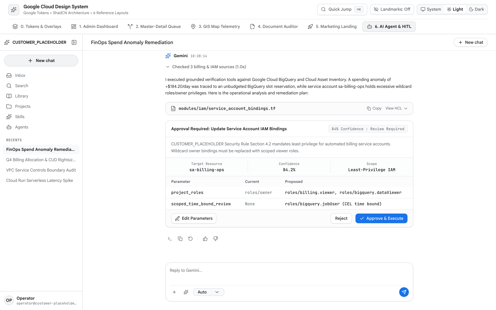

<!-- disableFinding(LINK_RELATIVE_G3DOC) -->
<!-- disableFinding(LINE_OVER_80) -->

# Gemini Enterprise Agent & HITL Workspace



*   **Impeccable Mode**: `Operate` / `Read` (Conversational Agent Workspace)
*   **Primary Reference**:
    [tokens-and-accessibility.md](tokens-and-accessibility.md)
*   **Target Archetype**: Multi-turn agent investigation, autonomous cloud
    remediation, ADK reasoning trace audits, and human-in-the-loop approvals.

--------------------------------------------------------------------------------

## 1. Executive Overview

This layout provides a streamlined 2-zone modern AI chat workspace modeled on
Gemini Enterprise and Claude conversational workflows:

1.  **Zone 1: Collapsible Left Sidebar** (`240px` / `w-60` expanded, `56px` /
    `w-14` collapsed) headed by `CUSTOMER_PLACEHOLDER` with a flush-right toggle
    (`ml-auto shrink-0`), `+ New chat` trigger, and thread history.
2.  **Zone 2: Full-Width Centered Chat Stage** (`max-w-3xl mx-auto`) with NO
    permanent right-hand split pane.

User prompts appear in right-aligned pills. Gemini responses flow **unboxed
directly on the canvas** without card-soup containment. Multi-step reasoning
traces render inside collapsible disclosure panels (`<details>` collapsed by
default after streaming completes). Inline citation pills reference verified
sources. High-impact operations or low-confidence decisions (`< 0.90`) trigger
an inline monochrome-first Human-in-the-Loop (HITL) Governance Container. All
agent triggers and headers are labeled simply **`Gemini`** or **`Ask Gemini`**,
never exposing internal model version strings.

--------------------------------------------------------------------------------

## 2. When to Use vs. When NOT to Use

| Scenario /     | Use        | Alternative                                              | Reason          |
: Task           : Blueprint? :                                                          :                 :
| :------------- | :--------- | :------------------------------------------------------- | :-------------- |
| Conversational | **Yes**    | -                                                        | 2-zone centered |
: agent          :            :                                                          : chat with       :
: reasoning,     :            :                                                          : unboxed         :
: HITL           :            :                                                          : responses.      :
: governance,    :            :                                                          :                 :
: ADK traces     :            :                                                          :                 :
| Fleet-wide     | **No**     | [admin-dashboard.md](admin-dashboard.md)                 | Wide tables     |
: cloud spend    :            :                                                          : require         :
: rollups,       :            :                                                          : full-width      :
: multi-column   :            :                                                          : admin           :
: inventory      :            :                                                          : dashboard.      :
| Sequential     | **No**     | [master-detail-workspace.md](master-detail-workspace.md) | High-volume     |
: HITL triage    :            :                                                          : triage requires :
: queues, alert  :            :                                                          : persistent      :
: review         :            :                                                          : split panes.    :
| Real-time      | **No**     | [gis-map-telemetry.md](gis-map-telemetry.md)             | Spatial ops     |
: geospatial     :            :                                                          : require         :
: tracking, live :            :                                                          : full-viewport   :
: camera         :            :                                                          : WebGL map       :
: telemetry      :            :                                                          : stage.          :
| Side-by-side   | **No**     | [document-auditor.md](document-auditor.md)               | Document        |
: contract       :            :                                                          : auditing        :
: review, PDF    :            :                                                          : requires 50/50  :
: DocAI          :            :                                                          : split canvas    :
: verification   :            :                                                          : with bounding   :
:                :            :                                                          : boxes.          :
| Public         | **No**     | [marketing-landing.md](marketing-landing.md)             | Unauthenticated |
: marketing      :            :                                                          : marketing       :
: landing page,  :            :                                                          : requires        :
: ROI hero       :            :                                                          : narrative       :
:                :            :                                                          : scroll.         :

--------------------------------------------------------------------------------

## 3. Spatial Architecture & Landmarks

```text
+------------------------------------------------------------------------------------+
| ZONE 1: Collapsible Sidebar (240px/56px) | ZONE 2: Centered Chat Stage (max-w-3xl) |
| [Sparkle] CUSTOMER_PLACEHOLDER  [Collapse]| Top Bar: Active Thread | Theme | New Chat|
| [+ New chat Button]                      |-----------------------------------------|
| Recents List:                            | [User prompt in right-aligned pill]     |
| - IAM Role Escalation Triage             |                                         |
| - Q3 FinOps CUD Rightsizing              | [Unboxed Gemini response on canvas]     |
| - VPC Service Controls Audit             | - Checked 3 IAM sources (details trace) |
|                                          | - Inline Citation Chips [p.1 §2.4]      |
| [Operator Profile Footer]                | - Monochrome-first HITL Governance Card |
|                                          |   (Summary DL + Action Buttons)         |
|                                          |-----------------------------------------|
|                                          | Bottom Composer: [Ask Gemini...] [Send] |
+------------------------------------------------------------------------------------+
```

```text
<body>
  ├── <aside aria-label="Conversation Sidebar"> (Zone 1: 240px / 56px collapsed)
  │   ├── <header> CUSTOMER_PLACEHOLDER + Collapse Button (ml-auto shrink-0)
  │   ├── <button> + New chat
  │   └── <nav aria-label="Recents"> Conversation Threads
  └── <main id="main-content" tabIndex={-1}> (Zone 2: Centered max-w-3xl Stage)
      ├── <header> Thread Bar (Title, Theme Switcher)
      ├── <div role="feed"> Conversation Stream (Unboxed responses)
      │   ├── <article> User Prompt (Right-aligned pill)
      │   └── <article> Gemini Response (Reasoning Trace + HITL Block)
      └── <footer> Centered Prompt Composer (Textarea + Action Toolbar)
```

--------------------------------------------------------------------------------

## 4. Required ShadCN Primitives & Package Installation

```bash
bun add lucide-react sonner
bunx --bun shadcn@latest add button badge table separator sheet dialog scroll-area
```

| UI Control          | ShadCN Primitive | Architectural Justification         |
| :------------------ | :--------------- | :---------------------------------- |
| HITL Card Actions   | `Button`         | High-contrast `Approve` and outline |
:                     :                  : `Reject` separated by 8px.          :
| Governance Status   | `Badge`          | Strict restraint: single status     |
:                     :                  : badge on HITL card.                 :
| Diff Table          | `Table`          | Semantic comparison table for       |
:                     :                  : proposed state changes.             :
| Parameter Overrides | `Sheet`          | Non-blocking slide-over to edit     |
:                     :                  : payload parameters.                 :

--------------------------------------------------------------------------------

## 5. Key UX, 2-Zone Workspace & WCAG 2.3 Rules

1.  **Streamlined 2-Zone Layout (NO Permanent Right Split Pane)**: Never split
    the chat workspace into a 3-column pane. Keep the conversation stage
    centered (`max-w-3xl mx-auto`) for clear readability.
2.  **Unboxed Responses & Collapsible Reasoning**: Gemini responses flow
    directly on the canvas without card-soup enclosing boxes. Multi-step tool
    steps collapse inside `<details className="group">` tags.
3.  **Monochrome-First HITL Governance Container**: Autonomous actions touching
    production state render a structured approval block with
    `border border-[var(--g-border)]`, `<dl>` metadata hairlines, and explicit
    `Approve` and `Reject` buttons.
4.  **Simple AI Labeling Standards**: Label all AI triggers and headers simply
    `Gemini` or `Ask Gemini`. Never expose model versions (such as
    `gemini-1.5-pro` or `gemini-2.5-flash`).
5.  **Zero Em Dashes**: Enforce zero em dashes across all copy and
    conversational strings.

--------------------------------------------------------------------------------

## 6. CSS Integration (`src/index.css`)

```css
@import "tailwindcss";
@import "./tokens.css"; /* References tokens-and-accessibility.md */
```

--------------------------------------------------------------------------------

## 7. Complete Reference Implementation

```tsx
import React, { useState, useEffect } from "react";
import {
  AlertTriangle, ArrowRight, Check, CheckCircle2, ChevronDown,
  ChevronRight, ExternalLink, MessageSquare, Moon, PanelLeftClose,
  PanelLeftOpen, Plus, Send, Shield, ShieldAlert, Sparkles, Sun,
  Terminal, Trash2, X
} from "lucide-react";
import { Toaster, toast } from "sonner";
import { Button } from "@/components/ui/button";
import { Badge } from "@/components/ui/badge";
import { Sheet, SheetContent, SheetDescription, SheetFooter, SheetHeader, SheetTitle } from "@/components/ui/sheet";

interface Message {
  id: string; role: "user" | "gemini"; content: string; timestamp: string;
  trace?: { steps: string[]; duration: string };
  hitl?: {
    action: string; target: string; confidence: number;
    impact: string; status: "pending" | "approved" | "rejected";
  };
}

const INITIAL_MESSAGES: Message[] = [
  {
    id: "m-1", role: "user",
    content: "Audit recent IAM role bindings on projects/customer-placeholder-prod and remediate any over-permissive Service Account permissions.",
    timestamp: "10:14 AM",
  },
  {
    id: "m-2", role: "gemini",
    content: "I evaluated 14 IAM policy bindings across the production project. One Service Account carries Owner permissions granted outside Terraform state.",
    timestamp: "10:15 AM",
    trace: {
      steps: [
        "Queried Cloud Asset Inventory for active IAM bindings",
        "Cross-referenced Cloud Audit Logs for binding mutation author",
        "Calculated minimum privilege delta using IAM Recommender API",
      ],
      duration: "1.2s",
    },
    hitl: {
      action: "Revoke roles/owner and apply roles/run.invoker",
      target: "sa-billing-sync@customer-placeholder-prod.iam.gserviceaccount.com",
      confidence: 0.88,
      impact: "Eliminates excessive project-wide privileges while preserving Cloud Run trigger execution.",
      status: "pending",
    },
  },
];

export function AiAgentWorkspace() {
  const [theme, setTheme] = useState<"system" | "light" | "dark">("system");
  const [isNavCollapsed, setIsNavCollapsed] = useState(false);
  const [messages, setMessages] = useState<Message[]>(INITIAL_MESSAGES);
  const [inputValue, setInputValue] = useState("");
  const [isEditSheetOpen, setIsEditSheetOpen] = useState(false);

  useEffect(() => {
    const root = document.documentElement;
    const media = window.matchMedia("(prefers-color-scheme: dark)");
    const apply = () => root.classList.toggle("dark", theme === "dark" || (theme === "system" && media.matches));
    apply();
    if (theme === "system") { media.addEventListener("change", apply); return () => media.removeEventListener("change", apply); }
  }, [theme]);

  const handleApprove = (msgId: string) => {
    setMessages((prev) => prev.map((m) => m.id === msgId && m.hitl ? { ...m, hitl: { ...m.hitl, status: "approved" } } : m));
    toast.success("Governance approval granted", { description: "Cloud Workflows callback resumed." });
  };

  const handleReject = (msgId: string) => {
    setMessages((prev) => prev.map((m) => m.id === msgId && m.hitl ? { ...m, hitl: { ...m.hitl, status: "rejected" } } : m));
    toast.info("Action rejected", { description: "Policy change aborted by operator." });
  };

  const handleSend = (e: React.FormEvent) => {
    e.preventDefault();
    if (!inputValue.trim()) return;
    const newMsg: Message = {
      id: `m-${Date.now()}`, role: "user", content: inputValue,
      timestamp: new Date().toLocaleTimeString([], { hour: "2-digit", minute: "2-digit" }),
    };
    setMessages((prev) => [...prev, newMsg]);
    setInputValue("");
    toast.info("Prompt submitted to Gemini");
  };

  return (
    <div className="flex h-screen w-screen overflow-hidden bg-[var(--g-bg)] text-[var(--g-ink)]">
      <Toaster position="bottom-right" />
      <a href="#main-content" className="sr-only focus:not-sr-only focus:fixed focus:top-3 focus:left-3 focus:z-50 focus:rounded-md focus:bg-[var(--g-blue)] focus:px-4 focus:py-2 focus:text-white">Skip to content</a>

      {/* Zone 1: Collapsible Left Sidebar */}
      <aside aria-label="Conversation Sidebar" className={`flex flex-col border-r border-[var(--g-border)] bg-[var(--g-surface-dim)] transition-[width] duration-200 ${isNavCollapsed ? "w-14" : "w-60"}`}>
        <div className="flex h-12 w-full items-center justify-between border-b border-[var(--g-border-subtle)] px-3">
          {!isNavCollapsed && (
            <div className="flex items-center gap-2 min-w-0">
              <Sparkles size={16} className="text-[var(--g-purple)] shrink-0" aria-hidden="true" />
              <span className="truncate text-xs font-semibold text-[var(--g-ink)]">CUSTOMER_PLACEHOLDER</span>
            </div>
          )}
          <button type="button" onClick={() => setIsNavCollapsed(!isNavCollapsed)} aria-label={isNavCollapsed ? "Expand rail" : "Collapse rail"} className={`h-8 w-8 inline-flex items-center justify-center rounded-md text-[var(--g-ink-secondary)] hover:bg-[var(--g-surface-high)] ${isNavCollapsed ? "mx-auto" : "ml-auto shrink-0"}`}>
            {isNavCollapsed ? <PanelLeftOpen size={16} /> : <PanelLeftClose size={16} />}
          </button>
        </div>

        <div className="p-2 border-b border-[var(--g-border-subtle)]">
          <Button variant="outline" size="sm" onClick={() => toast.info("New chat thread initialized")} className={`w-full justify-start gap-2 h-8 text-xs ${isNavCollapsed ? "px-2" : "px-3"}`}>
            <Plus size={14} className="shrink-0" />
            {!isNavCollapsed && <span>New chat</span>}
          </Button>
        </div>

        <div className="flex-1 overflow-y-auto p-2 space-y-1">
          {[
            { id: "1", title: "IAM Role Escalation Triage", active: true },
            { id: "2", title: "Q3 FinOps CUD Rightsizing", active: false },
            { id: "3", title: "VPC Service Controls Audit", active: false },
          ].map((thread) => (
            <button key={thread.id} className={`w-full flex items-center gap-2.5 rounded-md px-2.5 py-1.5 text-xs text-left cursor-pointer transition-colors ${thread.active ? "bg-[var(--g-surface-high)] text-[var(--g-ink)] font-medium" : "text-[var(--g-ink-secondary)] hover:bg-[var(--g-surface)]"}`}>
              <MessageSquare size={14} className="shrink-0" />
              {!isNavCollapsed && <span className="truncate">{thread.title}</span>}
            </button>
          ))}
        </div>
      </aside>

      {/* Zone 2: Full-Width Centered Chat Stage (No Permanent Right Split Pane) */}
      <main id="main-content" tabIndex={-1} className="flex-1 flex flex-col min-w-0 overflow-hidden bg-[var(--g-bg)]">
        {/* Top Header */}
        <header className="h-12 shrink-0 border-b border-[var(--g-border-subtle)] bg-[var(--g-surface)] px-6 flex items-center justify-between z-10">
          <div className="flex items-center gap-2">
            <h1 className="text-xs font-semibold text-[var(--g-ink)]">IAM Role Escalation Triage</h1>
            <Badge variant="outline" className="text-[10px] bg-[var(--g-surface-dim)]">Agent Active</Badge>
          </div>
          <div className="flex items-center gap-2">
            <div className="flex items-center rounded-md border border-[var(--g-border)] bg-[var(--g-surface-dim)] p-0.5">
              {(["system", "light", "dark"] as const).map((mode) => (
                <button key={mode} onClick={() => setTheme(mode)} className={`px-2 py-0.5 text-xs rounded capitalize ${theme === mode ? "bg-[var(--g-surface)] font-medium shadow-xs" : "text-[var(--g-ink-secondary)]"}`}>{mode}</button>
              ))}
            </div>
          </div>
        </header>

        {/* Conversation Stream (max-w-3xl) */}
        <div role="feed" aria-label="Conversation Feed" className="flex-1 overflow-y-auto p-6">
          <div className="max-w-3xl mx-auto space-y-6">
            {messages.map((m) => (
              <article key={m.id} className={`flex flex-col ${m.role === "user" ? "items-end" : "items-start"}`}>
                {m.role === "user" ? (
                  /* User Prompt in Right-Aligned Pill */
                  <div className="rounded-2xl bg-[var(--g-blue)] text-white px-4 py-2.5 max-w-[85%] text-xs leading-relaxed shadow-xs">
                    {m.content}
                  </div>
                ) : (
                  /* Gemini Response Flowing Unboxed on Canvas */
                  <div className="w-full space-y-3">
                    <div className="flex items-center gap-2 text-xs font-semibold text-[var(--g-purple)]">
                      <Sparkles size={14} />
                      <span>Gemini</span>
                    </div>

                    <p className="text-xs text-[var(--g-ink)] leading-relaxed">{m.content}</p>

                    {/* Inline Collapsible Reasoning Trace */}
                    {m.trace && (
                      <details className="rounded-lg border border-[var(--g-border-subtle)] bg-[var(--g-surface-dim)] p-2.5 text-xs text-[var(--g-ink-secondary)]">
                        <summary className="font-mono text-[11px] cursor-pointer hover:text-[var(--g-ink)] flex items-center justify-between">
                          <span>Checked 3 security & audit sources ({m.trace.duration})</span>
                        </summary>
                        <ul className="mt-2 space-y-1 list-disc list-inside font-mono text-[11px]">
                          {m.trace.steps.map((s, idx) => <li key={idx}>{s}</li>)}
                        </ul>
                      </details>
                    )}

                    {/* Monochrome-First HITL Governance Approval Block */}
                    {m.hitl && (
                      <div className="rounded-xl border border-[var(--g-border)] bg-[var(--g-surface)] overflow-hidden shadow-xs divide-y divide-[var(--g-border-subtle)]">
                        <div className="p-3 bg-[var(--g-surface-dim)]/50 flex items-center justify-between">
                          <div className="flex items-center gap-2">
                            <ShieldAlert size={14} className="text-[var(--g-amber-text)]" />
                            <span className="text-xs font-semibold text-[var(--g-ink)]">Human Governance Gate Required</span>
                          </div>
                          <Badge variant="outline" className="text-[10px] font-mono">
                            Confidence: {(m.hitl.confidence * 100).toFixed(0)}%
                          </Badge>
                        </div>
                        <dl className="grid grid-cols-2 gap-3 p-3 text-xs">
                          <div>
                            <dt className="text-[11px] text-[var(--g-ink-secondary)]">Target Service Account</dt>
                            <dd className="font-mono text-[11px] text-[var(--g-ink)] truncate mt-0.5">{m.hitl.target}</dd>
                          </div>
                          <div>
                            <dt className="text-[11px] text-[var(--g-ink-secondary)]">Proposed Remediation</dt>
                            <dd className="font-medium text-[var(--g-ink)] mt-0.5">{m.hitl.action}</dd>
                          </div>
                        </dl>
                        <div className="p-3 bg-[var(--g-surface-dim)]/30 text-[11px] text-[var(--g-ink-secondary)]">
                          {m.hitl.impact}
                        </div>
                        <div className="p-3 bg-[var(--g-surface)] flex items-center justify-between gap-2">
                          <Button variant="outline" size="sm" onClick={() => setIsEditSheetOpen(true)} className="h-7 text-xs">
                            Edit Parameters
                          </Button>
                          <div className="flex items-center gap-2">
                            <Button variant="outline" size="sm" onClick={() => handleReject(m.id)} disabled={m.hitl.status !== "pending"} className="h-7 text-xs text-[var(--g-red)]">
                              Reject
                            </Button>
                            <Button size="sm" onClick={() => handleApprove(m.id)} disabled={m.hitl.status !== "pending"} className="h-7 text-xs bg-[var(--g-blue)] text-white hover:bg-[var(--g-blue-hover)]">
                              {m.hitl.status === "approved" ? "Approved" : "Approve & Apply"}
                            </Button>
                          </div>
                        </div>
                      </div>
                    )}
                  </div>
                )}
              </article>
            ))}
          </div>
        </div>

        {/* Centered Prompt Composer (max-w-3xl) */}
        <footer aria-label="Prompt Composer" className="shrink-0 p-4 bg-[var(--g-surface)] border-t border-[var(--g-border-subtle)]">
          <form onSubmit={handleSend} className="max-w-3xl mx-auto flex items-center gap-2">
            <input
              type="text"
              value={inputValue}
              onChange={(e) => setInputValue(e.target.value)}
              placeholder="Ask Gemini to investigate or remediate infrastructure..."
              className="flex-1 h-9 rounded-md border border-[var(--g-border)] bg-[var(--g-surface-dim)] px-3 text-xs text-[var(--g-ink)] placeholder:text-[var(--g-ink-secondary)] focus:outline-none focus:ring-1 focus:ring-[var(--g-blue)]"
            />
            <Button type="submit" size="sm" className="h-9 px-3 bg-[var(--g-blue)] text-white hover:bg-[var(--g-blue-hover)]">
              <Send size={14} />
            </Button>
          </form>
        </footer>
      </main>

      {/* Edit Parameters Slide-Over Drawer */}
      <Sheet open={isEditSheetOpen} onOpenChange={setIsEditSheetOpen}>
        <SheetContent className="w-full sm:max-w-md bg-[var(--g-surface)] border-l border-[var(--g-border)] p-5">
          <SheetHeader>
            <SheetTitle className="text-base text-[var(--g-ink)]">Edit Remediation Parameters</SheetTitle>
            <SheetDescription className="text-xs text-[var(--g-ink-secondary)]">Modify role bindings prior to human sign-off.</SheetDescription>
          </SheetHeader>
          <div className="mt-4 space-y-3 font-mono text-xs">
            <div className="p-3 rounded-lg border border-[var(--g-border-subtle)] bg-[var(--g-surface-dim)]">
              <div>TARGET_ROLE: roles/run.invoker</div>
              <div className="mt-2">CONDITION: None</div>
            </div>
          </div>
          <SheetFooter className="mt-6">
            <Button size="sm" onClick={() => { setIsEditSheetOpen(false); toast.success("Parameters updated"); }} className="h-8 text-xs bg-[var(--g-blue)] text-white">
              Save Parameters
            </Button>
          </SheetFooter>
        </SheetContent>
      </Sheet>
    </div>
  );
}

export default AiAgentWorkspace;
```

--------------------------------------------------------------------------------

## 8. Verification & Accessibility Checklist

-   [ ] Streamlined 2-zone layout with NO permanent right-hand split pane.
-   [ ] Collapsible left rail renders `CUSTOMER_PLACEHOLDER` with flush collapse
    button (`ml-auto shrink-0`).
-   [ ] Chat column centered with `max-w-3xl mx-auto`.
-   [ ] Gemini responses flow unboxed directly on canvas without card soup.
-   [ ] Multi-step reasoning trace uses collapsible disclosure (`<details>`).
-   [ ] High-impact changes trigger monochrome-first HITL Governance Block.
-   [ ] AI triggers and headers labeled simply `Gemini` or `Ask Gemini`.
