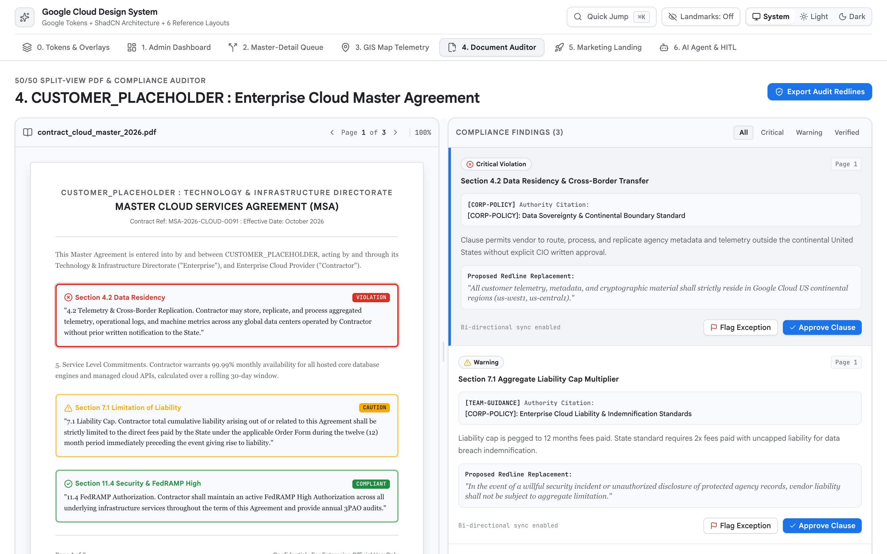

<!-- disableFinding(LINK_RELATIVE_G3DOC) -->
<!-- disableFinding(LINE_OVER_80) -->

# Layout 4: 50/50 Split-View PDF & Compliance Auditor (`Operate` / `Read` Mode)



*   **Impeccable Mode**: `Operate` / `Read` (Source Evidence & Verification)
*   **Primary Reference**:
    [tokens-and-accessibility.md](tokens-and-accessibility.md)
*   **Target Archetype**: Regulatory compliance review, contract redlining,
    procurement RFP verification, and Document AI extraction validation.

--------------------------------------------------------------------------------

## 1. Executive Overview

This layout pairs a high-precision source document viewer on the left (`Read`
mode) with a structured, bidirectional compliance findings ledger on the right
(`Operate` mode). It locks the workspace to a zero-scroll application shell
(`h-screen overflow-hidden flex flex-col`).

The workspace is powered by `react-resizable-panels` defaulting to a 50/50 split
with a movable divider (`col-resize` cursor, double-click reset to 50/50; NEVER
render ratio buttons in top bar). Clicking any finding in the right ledger
scrolls the corresponding bounding box into view on the left page canvas
(`scrollIntoView({ behavior: "smooth", block: "center" })`). Bounding boxes
render with high-contrast borders and subtle fills. To eliminate "card soup",
the right ledger is a single unified surface with `1px` dividers
(`divide-y divide-[var(--g-border-subtle)]`).

--------------------------------------------------------------------------------

## 2. When to Use vs. When NOT to Use

| Scenario /     | Use        | Alternative                                              | Reason          |
: Task           : Blueprint? :                                                          :                 :
| :------------- | :--------- | :------------------------------------------------------- | :-------------- |
| Contract       | **Yes**    | -                                                        | 50/50           |
: clause         :            :                                                          : synchronized    :
: auditing,      :            :                                                          : canvas with     :
: DocAI          :            :                                                          : bounding boxes. :
: extraction     :            :                                                          :                 :
: verification   :            :                                                          :                 :
| Sequential     | **No**     | [master-detail-workspace.md](master-detail-workspace.md) | Queue triage    |
: HITL triage,   :            :                                                          : requires        :
: SecOps alert   :            :                                                          : keyboard-driven :
: queues         :            :                                                          : list/detail     :
:                :            :                                                          : pane.           :
| Geospatial     | **No**     | [gis-map-telemetry.md](gis-map-telemetry.md)             | Spatial ops     |
: asset          :            :                                                          : require         :
: tracking,      :            :                                                          : full-viewport   :
: corridor       :            :                                                          : map canvas.     :
: telemetry      :            :                                                          :                 :
| Cloud spend    | **No**     | [admin-dashboard.md](admin-dashboard.md)                 | Multi-column    |
: inventory      :            :                                                          : tables require  :
: tables, fleet  :            :                                                          : full-width      :
: metrics        :            :                                                          : table canvas.   :
| Public product | **No**     | [marketing-landing.md](marketing-landing.md)             | Unauthenticated |
: landing page,  :            :                                                          : marketing       :
: ROI bento grid :            :                                                          : requires        :
:                :            :                                                          : narrative       :
:                :            :                                                          : scroll.         :
| Conversational | **No**     | [ai-agent-workspace.md](ai-agent-workspace.md)           | Conversational  |
: AI agent       :            :                                                          : workflows       :
: workspace      :            :                                                          : require a       :
:                :            :                                                          : 2-zone chat     :
:                :            :                                                          : stage.          :

--------------------------------------------------------------------------------

## 3. Spatial Architecture & Landmarks

```text
+------------------------------------------------------------------------------------+
| [Skip Link] <header> 56px [Doc Name] [⌘K Search] [Theme] [Export Actions]          |
+------------------------------------+-----------------------------------------------+
| Left Pane (50% default, min 25%)   | Right Pane (50% default, min 25%)             |
| [Toolbar: Page 1/4 | Zoom | Fit]   | [Summary Strip: 4 Counters (1px divide-x)]    |
| +--------------------------------+ | [Low-Confidence Warning Banner (<0.90)]       |
| | Document Canvas (bg-surface-dim)| | [Filter Bar: All | Critical | Warning]        |
| |  +---------------------------+ | |-----------------------------------------------|
| |  | Page Sheet (bg-surface)   | | | <article> Finding #F-101                      |
| |  | [Bounding Box Highlight]  | | |   [CRITICAL] §4.2 Indemnity  [[p.1 §2.4] chip]|
| |  +---------------------------+ | |   Quote + Gemini Legal Analysis               |
| +--------------------------------+ |   [ Confirm ]  [ Dismiss ]                    |
+------------------------------------+-----------------------------------------------+
```

```text
<body>
  ├── <header> Global Document Bar (56px, Search ⌘K, Theme, Export Actions)
  └── <ResizablePanelGroup direction="horizontal" className="flex-1 overflow-hidden">
      ├── <ResizablePanel defaultSize={50} minSize={25}>
      │   └── <section aria-label="Document Viewer"> Zoom Toolbar + Page Canvas
      ├── <ResizableHandle withHandle /> (Movable 50/50, Double-Click Reset)
      └── <ResizablePanel defaultSize={50} minSize={25}>
          └── <aside aria-label="Compliance Ledger"> Unified Surface (divide-y)
              ├── <dl> Summary Counters (divide-x)
              ├── <div role="alert"> Low-Confidence Banner (< 0.90)
              └── <section aria-label="Findings"> <article> Finding Items
```

--------------------------------------------------------------------------------

## 4. Required ShadCN Primitives & Package Installation

```bash
bun add lucide-react react-resizable-panels sonner
bunx --bun shadcn@latest add resizable badge button input select separator scroll-area
```

| UI Control         | ShadCN Primitive      | Architectural Justification     |
| :----------------- | :-------------------- | :------------------------------ |
| Split Pane Canvas  | `ResizablePanelGroup` | Movable 50/50 split canvas with |
:                    :                       : double-click 50/50 reset.       :
| Severity Status    | `Badge`               | Max 1 status badge per finding  |
:                    :                       : item (`CRITICAL`, `WARNING`).   :
| Citation Chips     | `Button` (ghost)      | Inline citation jump pills      |
:                    :                       : (`[p.1 §2.4]`) that pan the     :
:                    :                       : document.                       :
| Verification Toast | `Toaster` (`sonner`)  | Instant operator confirmation   |
:                    :                       : on finding adjudication.        :

--------------------------------------------------------------------------------

## 5. Key UX, Unified Surface & WCAG 2.3 Rules

1.  **Bidirectional Sync Interaction**: Clicking a citation chip or finding
    `<article>` smoothly centers the bounding box on the page
    (`scrollIntoView({ behavior: "smooth", block: "center" })`). Clicking a
    bounding box on the page highlights the ledger item.
2.  **Unified Surface & Anti-Card-Soup**: The right ledger uses a single
    `bg-[var(--g-surface)]` canvas with internal `1px` hairlines
    (`divide-y divide-[var(--g-border-subtle)]`). Never nest bordered cards
    inside findings.
3.  **Low-Confidence Warning Banner (`< 0.90`)**: When DocAI extraction
    confidence falls below `0.90`, display an accessible warning banner
    requiring explicit operator verification.
4.  **Movable 50/50 Split Divider & Density Guardrails**: Initialize split panes
    at 50/50 (`defaultSize={50}`) with draggable `ResizableHandle withHandle`
    (`col-resize` cursor) and double-click 50/50 reset. Never place ratio
    buttons in the top app bar; place language toggles in the nav rail footer.
5.  **Symmetrical Select Padding & Cursor**: All selects maintain `12px` caret
    inset (`px-3`). Interactive elements use `cursor-pointer`.

--------------------------------------------------------------------------------

## 6. CSS Integration (`src/index.css`)

```css
@import "tailwindcss";
@import "./tokens.css"; /* References tokens-and-accessibility.md */
```

--------------------------------------------------------------------------------

## 7. Complete Reference Implementation

```tsx
import React, { useState, useEffect, useRef } from "react";
import {
  AlertTriangle, CheckCircle2, ChevronLeft, ChevronRight, Download,
  ExternalLink, Eye, FileText, Layers, Moon, ShieldAlert, Sparkles,
  Sun, ZoomIn, ZoomOut
} from "lucide-react";
import { Toaster, toast } from "sonner";
import { ImperativePanelHandle } from "react-resizable-panels";
import { ResizableHandle, ResizablePanel, ResizablePanelGroup } from "@/components/ui/resizable";
import { Button } from "@/components/ui/button";
import { Badge } from "@/components/ui/badge";

interface Finding {
  id: string; page: number; section: string; citationChip: string;
  title: string; quote: string; analysis: string; confidence: number;
  severity: "critical" | "warning" | "compliant"; status: "pending" | "confirmed" | "dismissed";
  box: { top: number; left: number; width: number; height: number };
}

const INITIAL_FINDINGS: Finding[] = [
  {
    id: "F-101", page: 1, section: "§2.4", citationChip: "[p.1 §2.4]",
    title: "Indemnification Liability Cap Uncapped",
    quote: "Vendor liability for indirect damages shall remain unconstrained by aggregate fee limits.",
    analysis: "Violates standard enterprise risk posture. Proposing cap at 2x annual contract value.",
    confidence: 0.96, severity: "critical", status: "pending",
    box: { top: 22, left: 12, width: 76, height: 10 },
  },
  {
    id: "F-102", page: 1, section: "§3.1", citationChip: "[p.1 §3.1]",
    title: "Data Residency & Sovereignty Ambiguity",
    quote: "Backup archives may be stored in regional or global availability zones at provider discretion.",
    analysis: "Extracted clause fails CJIS/FedRAMP mandatory in-region boundary requirement.",
    confidence: 0.84, severity: "warning", status: "pending",
    box: { top: 54, left: 12, width: 76, height: 9 },
  },
  {
    id: "F-103", page: 2, section: "§5.8", citationChip: "[p.2 §5.8]",
    title: "Standard SLA Availability Commitment",
    quote: "Core services shall maintain 99.95% monthly uptime excluding scheduled maintenance.",
    analysis: "Uptime commitment aligns with Google Cloud enterprise operational standard.",
    confidence: 0.98, severity: "compliant", status: "pending",
    box: { top: 35, left: 12, width: 76, height: 8 },
  },
];

export function DocumentComplianceAuditor() {
  const [theme, setTheme] = useState<"system" | "light" | "dark">("system");
  const [findings, setFindings] = useState<Finding[]>(INITIAL_FINDINGS);
  const [activeId, setActiveId] = useState<string>("F-101");
  const [zoomLevel, setZoomLevel] = useState(100);
  const leftPanelRef = useRef<ImperativePanelHandle>(null);
  const boxRefs = useRef<Record<string, HTMLDivElement | null>>({});

  useEffect(() => {
    const root = document.documentElement;
    const media = window.matchMedia("(prefers-color-scheme: dark)");
    const apply = () => root.classList.toggle("dark", theme === "dark" || (theme === "system" && media.matches));
    apply();
    if (theme === "system") { media.addEventListener("change", apply); return () => media.removeEventListener("change", apply); }
  }, [theme]);

  const activeFinding = findings.find((f) => f.id === activeId) || findings[0];

  const jumpToFinding = (finding: Finding) => {
    setActiveId(finding.id);
    const el = boxRefs.current[finding.id];
    if (el) {
      el.scrollIntoView({ behavior: "smooth", block: "center" });
    }
  };

  const handleStatus = (id: string, status: "confirmed" | "dismissed") => {
    setFindings((prev) => prev.map((f) => f.id === id ? { ...f, status } : f));
    toast.success(status === "confirmed" ? "Issue confirmed" : "Issue dismissed", {
      description: `Finding ${id} marked as ${status}.`,
    });
  };

  const lowConfidenceCount = findings.filter((f) => f.confidence < 0.9 && f.status === "pending").length;

  return (
    <div className="flex h-screen w-screen flex-col overflow-hidden bg-[var(--g-bg)] text-[var(--g-ink)]">
      <Toaster position="bottom-right" />
      <a href="#main-content" className="sr-only focus:not-sr-only focus:fixed focus:top-3 focus:left-3 focus:z-50 focus:rounded-md focus:bg-[var(--g-blue)] focus:px-4 focus:py-2 focus:text-white">Skip to content</a>

      {/* Header */}
      <header className="flex h-14 w-full shrink-0 items-center justify-between border-b border-[var(--g-border)] bg-[var(--g-surface)] px-4 z-40">
        <div className="flex items-center gap-3">
          <FileText size={18} className="text-[var(--g-blue)]" aria-hidden="true" />
          <span className="font-semibold text-sm">CUSTOMER_PLACEHOLDER - Master Services Agreement.pdf</span>
          <Badge variant="outline" className="text-xs bg-[var(--g-surface-dim)] font-mono">{findings.length} findings</Badge>
        </div>
        <div className="flex items-center gap-3">
          <div className="flex items-center rounded-md border border-[var(--g-border)] bg-[var(--g-surface-dim)] p-0.5">
            {(["system", "light", "dark"] as const).map((mode) => (
              <button key={mode} onClick={() => setTheme(mode)} className={`px-2 py-1 text-xs rounded capitalize ${theme === mode ? "bg-[var(--g-surface)] font-medium shadow-xs" : "text-[var(--g-ink-secondary)]"}`}>{mode}</button>
            ))}
          </div>
        </div>
      </header>

      {/* Resizable 50/50 Workspace */}
      <ResizablePanelGroup direction="horizontal" className="flex-1 overflow-hidden">
        {/* Left: Document Page Viewer */}
        <ResizablePanel ref={leftPanelRef} defaultSize={50} minSize={25} className="flex flex-col border-r border-[var(--g-border)] bg-[var(--g-surface-dim)]">
          <div className="flex items-center justify-between p-2.5 border-b border-[var(--g-border)] bg-[var(--g-surface)]">
            <span className="text-xs font-medium text-[var(--g-ink-secondary)]">Source Evidence Canvas</span>
            <div className="flex items-center gap-1.5">
              <Button variant="ghost" size="sm" onClick={() => setZoomLevel((z) => Math.max(75, z - 10))} className="h-7 w-7 p-0"><ZoomOut size={14} /></Button>
              <span className="font-mono text-xs w-10 text-center">{zoomLevel}%</span>
              <Button variant="ghost" size="sm" onClick={() => setZoomLevel((z) => Math.min(150, z + 10))} className="h-7 w-7 p-0"><ZoomIn size={14} /></Button>
            </div>
          </div>

          <div id="main-content" tabIndex={-1} className="flex-1 overflow-y-auto p-6 flex justify-center">
            {/* Rendered Document Sheet */}
            <article style={{ width: `${zoomLevel * 5.6}px` }} className="relative bg-[var(--g-surface)] border border-[var(--g-border)] shadow-md rounded-sm min-h-[780px] p-10 transition-all duration-200">
              <h1 className="text-base font-bold text-center border-b pb-4 mb-6">MASTER CLOUD SERVICES AGREEMENT</h1>
              <div className="space-y-4 text-xs leading-relaxed text-[var(--g-ink)]">
                <p><strong>1. Services Engagement:</strong> Provider agrees to deliver enterprise platform capabilities as described in appended SOW exhibits.</p>
                <p><strong>2.4 Indemnification:</strong> Vendor liability for indirect damages shall remain unconstrained by aggregate fee limits.</p>
                <p><strong>3.1 Data Hosting:</strong> Backup archives may be stored in regional or global availability zones at provider discretion.</p>
                <p><strong>4. Confidentiality:</strong> All technical architecture and proprietary tokens remain under standard non-disclosure.</p>
              </div>

              {/* Bounding Box Highlights */}
              {findings.map((finding) => {
                const isActive = activeFinding.id === finding.id;
                return (
                  <div
                    key={finding.id}
                    ref={(el) => (boxRefs.current[finding.id] = el)}
                    onClick={() => setActiveId(finding.id)}
                    style={{
                      top: `${finding.box.top}%`,
                      left: `${finding.box.left}%`,
                      width: `${finding.box.width}%`,
                      height: `${finding.box.height}%`,
                    }}
                    className={`absolute rounded transition-all cursor-pointer ${
                      isActive
                        ? "border-2 border-[var(--g-blue)] bg-[var(--g-blue)]/15 shadow-sm ring-2 ring-[var(--g-blue)]/30"
                        : "border border-[var(--g-amber)] bg-[var(--g-amber)]/10 hover:border-[var(--g-blue)]"
                    }`}
                  >
                    <span className="absolute -top-3.5 left-1 px-1 py-0.2 rounded text-[10px] font-mono font-semibold bg-[var(--g-surface)] border border-[var(--g-border)] shadow-xs">
                      {finding.id}
                    </span>
                  </div>
                );
              })}
            </article>
          </div>
        </ResizablePanel>

        <ResizableHandle
          withHandle
          className="cursor-col-resize hover:bg-[var(--g-blue)] transition-colors"
          onDoubleClick={() => leftPanelRef.current?.resize(50)}
          title="Drag to resize split panes. Double-click to reset to 50/50"
        />

        {/* Right: Structured Compliance Ledger */}
        <ResizablePanel defaultSize={50} minSize={25} className="flex flex-col bg-[var(--g-surface)]">
          <aside aria-label="Compliance Findings Ledger" className="flex flex-col h-full">
            {/* 4 Counters Summary Strip */}
            <dl className="grid grid-cols-4 border-b border-[var(--g-border)] bg-[var(--g-surface-dim)] divide-x divide-[var(--g-border-subtle)] p-3 text-center">
              <div>
                <dt className="text-[11px] text-[var(--g-ink-secondary)]">Total</dt>
                <dd className="font-mono text-sm font-semibold tabular-nums text-[var(--g-ink)]">{findings.length}</dd>
              </div>
              <div>
                <dt className="text-[11px] text-[var(--g-ink-secondary)]">Critical</dt>
                <dd className="font-mono text-sm font-semibold tabular-nums text-[var(--g-red-text)]">1</dd>
              </div>
              <div>
                <dt className="text-[11px] text-[var(--g-ink-secondary)]">Warnings</dt>
                <dd className="font-mono text-sm font-semibold tabular-nums text-[var(--g-amber-text)]">1</dd>
              </div>
              <div>
                <dt className="text-[11px] text-[var(--g-ink-secondary)]">Verified</dt>
                <dd className="font-mono text-sm font-semibold tabular-nums text-[var(--g-green-text)]">1</dd>
              </div>
            </dl>

            {/* Low-Confidence Warning Banner */}
            {lowConfidenceCount > 0 && (
              <div role="alert" className="flex items-center gap-2 px-4 py-2 border-b border-[var(--g-amber-border)] bg-[var(--g-amber-soft)] text-xs text-[var(--g-amber-text)] font-medium">
                <AlertTriangle size={14} className="shrink-0" />
                <span>{lowConfidenceCount} finding(s) have extraction confidence &lt; 0.90 requiring manual operator confirmation.</span>
              </div>
            )}

            {/* Unified Findings Ledger */}
            <div className="flex-1 overflow-y-auto divide-y divide-[var(--g-border-subtle)]">
              {findings.map((f) => {
                const isActive = activeFinding.id === f.id;
                return (
                  <article
                    key={f.id}
                    onClick={() => jumpToFinding(f)}
                    className={`p-4 transition-colors cursor-pointer ${
                      isActive ? "bg-[var(--g-surface-high)] border-l-4 border-l-[var(--g-blue)]" : "hover:bg-[var(--g-surface-dim)]"
                    }`}
                  >
                    <div className="flex items-center justify-between mb-2">
                      <div className="flex items-center gap-2">
                        {f.severity === "critical" && <Badge variant="outline" className="border-[var(--g-red-border)] bg-[var(--g-red-soft)] text-[var(--g-red-text)] text-[10px]">CRITICAL</Badge>}
                        {f.severity === "warning" && <Badge variant="outline" className="border-[var(--g-amber-border)] bg-[var(--g-amber-soft)] text-[var(--g-amber-text)] text-[10px]">WARNING</Badge>}
                        {f.severity === "compliant" && <Badge variant="outline" className="border-[var(--g-green-border)] bg-[var(--g-green-soft)] text-[var(--g-green-text)] text-[10px]">COMPLIANT</Badge>}
                        <span className="font-mono text-xs font-semibold text-[var(--g-ink)]">{f.id}</span>
                      </div>
                      <button
                        type="button"
                        onClick={(e) => { e.stopPropagation(); jumpToFinding(f); }}
                        className="font-mono text-[11px] text-[var(--g-blue)] hover:underline flex items-center gap-1"
                      >
                        {f.citationChip} <ExternalLink size={10} />
                      </button>
                    </div>

                    <h2 className="text-xs font-semibold text-[var(--g-ink)]">{f.title}</h2>
                    <blockquote className="my-2 border-l-2 border-[var(--g-border-strong)] pl-2.5 text-xs italic text-[var(--g-ink-secondary)]">
                      "{f.quote}"
                    </blockquote>

                    <div className="mt-2 text-xs flex items-start gap-1.5 text-[var(--g-ink-secondary)] bg-[var(--g-surface)] p-2 rounded border border-[var(--g-border-subtle)]">
                      <Sparkles size={13} className="text-[var(--g-purple)] shrink-0 mt-0.5" />
                      <span>{f.analysis}</span>
                    </div>

                    <div className="mt-3 flex items-center justify-between pt-2 border-t border-[var(--g-border-subtle)]">
                      <span className="font-mono text-[11px] text-[var(--g-ink-secondary)]">Confidence: {(f.confidence * 100).toFixed(0)}%</span>
                      <div className="flex items-center gap-2">
                        <Button variant="outline" size="sm" onClick={(e) => { e.stopPropagation(); handleStatus(f.id, "dismissed"); }} className="h-7 text-xs">Dismiss</Button>
                        <Button size="sm" onClick={(e) => { e.stopPropagation(); handleStatus(f.id, "confirmed"); }} className="h-7 text-xs bg-[var(--g-blue)] text-white hover:bg-[var(--g-blue-hover)]">Confirm Issue</Button>
                      </div>
                    </div>
                  </article>
                );
              })}
            </div>
          </aside>
        </ResizablePanel>
      </ResizablePanelGroup>
    </div>
  );
}

export default DocumentComplianceAuditor;
```

--------------------------------------------------------------------------------

## 8. Verification & Accessibility Checklist

-   [ ] Movable 50/50 split pane with draggable `ResizableHandle withHandle` and
    double-click reset to 50/50, zero ratio buttons in top bar.
-   [ ] Bidirectional synchronization scrolls bounding box into center of
    viewport.
-   [ ] Low-confidence banner renders when extraction confidence falls below
    0.90.
-   [ ] Citation chips (`[p.1 §2.4]`) provide keyboard-accessible jump anchors.
-   [ ] Findings ledger rendered as single unified surface with `divide-y`
    hairlines.
-   [ ] Adjudication actions trigger instant `sonner` notifications.
