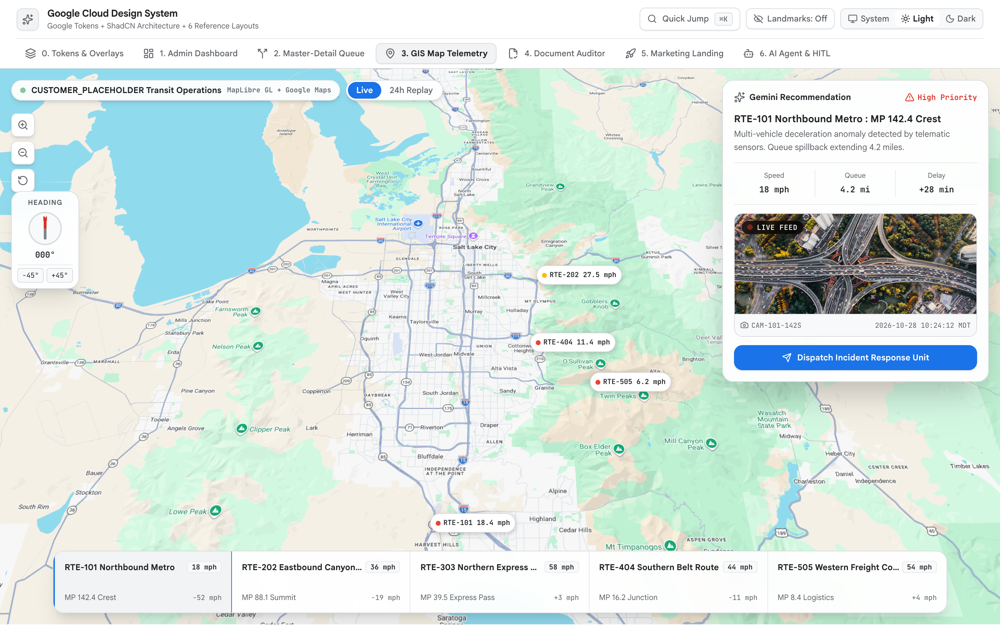

<!-- disableFinding(LINK_RELATIVE_G3DOC) -->
<!-- disableFinding(LINE_OVER_80) -->

# Layout 3: Full-Viewport GIS Map & Live Telemetry Stage



*   **Impeccable Mode**: `Operate` (Spatial Command Center & Live Telemetry HUD)
*   **Primary Reference**:
    [tokens-and-accessibility.md](tokens-and-accessibility.md)
*   **Target Archetype**: Real-time transit operations, corridor traffic /
    weather monitoring, fleet telematics, emergency dispatch, and utility outage
    grids.

--------------------------------------------------------------------------------

## 1. Executive Overview

This layout serves real-time geospatial operations for transit, corridor
telemetry, and fleet dispatch. It locks the viewport to a zero-scroll stage
(`100dvh x 100vw overflow-hidden`).

The interactive **MapLibre GL + Google Maps raster tile** canvas occupies the
full viewport (`relative isolate z-[1]`). Operational controls, active incident
triage with a live traffic camera photograph, Gemini dispatch recommendations,
and corridor selector docks float above the map at `z-10` inside at most 3 HUD
regions (`pointer-events-none` container with `pointer-events-auto` children,
`bg-[var(--g-surface)]/95 backdrop-blur-md`). To prevent "card soup", each HUD
pod is a single unified surface structured by `1px` hairlines (`divide-y` and
`divide-x`). Navigation controls anchor to the bottom-right.

--------------------------------------------------------------------------------

## 2. When to Use vs. When NOT to Use

| Scenario /     | Use        | Alternative                                              | Reason         |
: Task           : Blueprint? :                                                          :                :
| :------------- | :--------- | :------------------------------------------------------- | :------------- |
| Live corridor  | **Yes**    | -                                                        | 80%+ spatial   |
: traffic,       :            :                                                          : awareness on   :
: hard-braking   :            :                                                          : Google Maps    :
: alerts,        :            :                                                          : raster tiles.  :
: dispatch       :            :                                                          :                :
| Fleet          | **Yes**    | -                                                        | Pairs live GPS |
: tracking,      :            :                                                          : vectors with   :
: snowplow       :            :                                                          : timeline       :
: telemetry,     :            :                                                          : scrubber.      :
: sensor         :            :                                                          :                :
: scrubbers      :            :                                                          :                :
| Tabular case   | **No**     | [master-detail-workspace.md](master-detail-workspace.md) | Tabular queues |
: queues, SecOps :            :                                                          : require        :
: triage, claims :            :                                                          : persistent     :
: review         :            :                                                          : split panes.   :
| Cloud spend    | **No**     | [admin-dashboard.md](admin-dashboard.md)                 | Multi-column   |
: governance,    :            :                                                          : tables need    :
: 4-metric       :            :                                                          : full-width     :
: rollups        :            :                                                          : table real     :
:                :            :                                                          : estate.        :
| Side-by-side   | **No**     | [document-auditor.md](document-auditor.md)               | Document       |
: PDF compliance :            :                                                          : auditing       :
: auditing       :            :                                                          : requires 50/50 :
:                :            :                                                          : split canvas   :
:                :            :                                                          : with bounding  :
:                :            :                                                          : boxes.         :
| Conversational | **No**     | [ai-agent-workspace.md](ai-agent-workspace.md)           | Conversational |
: AI agent       :            :                                                          : workflows      :
: workspace      :            :                                                          : require a      :
:                :            :                                                          : 2-zone chat    :
:                :            :                                                          : stage.         :

--------------------------------------------------------------------------------

## 3. Spatial Architecture & Landmarks

```text
+------------------------------------------------------------------------------------+
| [Skip Link] <header> 56px [CUSTOMER_PLACEHOLDER Operations] [Status] [Sys/Light/Dark] |
+------------------------------------------------------------------------------------+
| <main id="main-content" className="relative flex-1 overflow-hidden">               |
|                                                                                    |
|  [HUD 1: Top-Left Spatial Dock]                 [HUD 2: Top-Right Incident Pod]    |
|  - North 0° Reset | Zoom +/-                     - Live Camera Feed ()        |
|  - Layer toggles (Roads, Radar)                  - <dl> Metric Grid (divide-x)     |
|                                                  - Gemini Dispatch + Action Button |
|                                                                                    |
|                           [HUD 3: Bottom Dock Bar]          [Bottom-Right Nav]     |
|                           - Corridor Selector + Replay      - MapLibre Controls    |
|                                                                                    |
|  <section aria-label="Map Canvas" className="absolute inset-0 z-0">                |
|    MapLibre GL + Google Maps Raster Tiles (mt0.google.com/vt/lyrs=m / lyrs=y)       |
|  </section>                                                                        |
+------------------------------------------------------------------------------------+
```

```text
<body>
  ├── <header> Global Command Bar (56px, z-20, System|Light|Dark switcher)
  └── <main id="main-content" tabIndex={-1}>
      ├── <section aria-label="Map Canvas"> MapLibre GL Tile Canvas (z-0)
      └── <div className="pointer-events-none absolute inset-0 z-10">
          ├── <nav aria-label="Spatial Controls"> Top-Left Floating Pod (pointer-events-auto)
          ├── <aside aria-label="Active Incident"> Top-Right Telemetry Pod (pointer-events-auto)
          └── <section aria-label="Corridor Dock"> Bottom-Center Dock (pointer-events-auto)
```

--------------------------------------------------------------------------------

## 4. Required ShadCN Primitives & Package Installation

```bash
bun add maplibre-gl lucide-react sonner
bunx --bun shadcn@latest add badge button sheet slider separator scroll-area
```

| UI Control        | ShadCN Primitive     | Architectural Justification      |
| :---------------- | :------------------- | :------------------------------- |
| Incident Severity | `Badge`              | Max 1 status badge in floating   |
:                   :                      : incident pod.                    :
| Telemetry Drawer  | `Sheet`              | Deep sensor logs and 24h metrics |
:                   :                      : without losing map view.         :
| Timeline Scrubber | `Slider`             | Smooth scrubbing across 24h      |
:                   :                      : historical telemetry window.     :
| Notifications     | `Toaster` (`sonner`) | Action feedback for VMS dispatch |
:                   :                      : and emergency alerts.            :

--------------------------------------------------------------------------------

## 5. Key UX, Spatial & WCAG 2.3 Rules

1.  **Google Maps Tiles + MapLibre GL Architecture**: Use raster tile endpoints
    (`mt0.google.com/vt/lyrs=m` or `lyrs=y`). In dark mode, apply the CSS
    filter: `filter: invert(92%) hue-rotate(180deg) brightness(94%)
    contrast(92%) saturate(85%)`.
2.  **Max 3 Floating HUD Regions (Ban "Card Soup")**: Wrap floating HUD elements
    inside a `pointer-events-none` container with `pointer-events-auto` pods
    (`backdrop-blur-md bg-[var(--g-surface)]/95 border border-[var(--g-border)]
    rounded-xl`). Use internal `1px` hairlines (`divide-y` / `divide-x`).
3.  **Live Camera Photo Feed & Telemetry**: Right telemetry drawer renders an
    `` live feed with timestamp badge and `Refresh Feed` button, followed
    by a `<dl>` grid and Gemini recommendation.
4.  **Bottom-Right Navigation Controls**: Place standard `NavigationControl` in
    the bottom-right corner.
5.  **Toast Notifications & Dispatch Actions**: Trigger `sonner` toasts on
    dispatch actions (`VMS Message Staged`, `Tow Unit Dispatched`).

--------------------------------------------------------------------------------

## 6. CSS Integration (`src/index.css`)

```css
@import "tailwindcss";
@import "maplibre-gl/dist/maplibre-gl.css";
@import "./tokens.css";

.dark .google-maps-raster-tile {
  filter: invert(92%) hue-rotate(180deg) brightness(94%) contrast(92%) saturate(85%);
}
```

--------------------------------------------------------------------------------

## 7. Complete Reference Implementation

```tsx
import React, { useState, useEffect, useRef } from "react";
import maplibregl from "maplibre-gl";
import {
  AlertTriangle, Camera, CheckCircle2, ChevronRight, Compass,
  Layers, Maximize2, Moon, Navigation, Play, Radio, RefreshCw,
  Send, ShieldAlert, Sparkles, Sun, Video, Volume2, X
} from "lucide-react";
import { Toaster, toast } from "sonner";
import { Button } from "@/components/ui/button";
import { Badge } from "@/components/ui/badge";
import { Slider } from "@/components/ui/slider";
import { Sheet, SheetContent, SheetDescription, SheetHeader, SheetTitle } from "@/components/ui/sheet";

interface Incident {
  id: string; title: string; milepost: string; severity: "critical" | "warning";
  speedMph: number; normalSpeedMph: number; cameraUrl: string;
  cameraName: string; timestamp: string; recommendation: string;
}

const ACTIVE_INCIDENT: Incident = {
  id: "INC-8821",
  title: "Multi-Vehicle Stoppage & Hard-Braking Wave",
  milepost: "I-15 NB MP 142.4",
  severity: "critical",
  speedMph: 12,
  normalSpeedMph: 65,
  cameraUrl: "https://images.unsplash.com/photo-1544620347-c4fd4a3d5957?auto=format&fit=crop&w=600&q=80",
  cameraName: "CCTV-142N (I-15 @ 4500 S)",
  timestamp: "Just now",
  recommendation: "Activate VMS Sign #14: 'CAUTION: STOPPED TRAFFIC AHEAD - REDUCE SPEED TO 25 MPH' and alert Incident Response Unit #3.",
};

const CORRIDORS = [
  { id: "c1", name: "I-15 Central Corridor", status: "degraded", delayMin: 18 },
  { id: "c2", name: "I-80 Parleys Canyon", status: "normal", delayMin: 2 },
  { id: "c3", name: "I-215 Belt Route", status: "normal", delayMin: 4 },
];

export function GisMapTelemetryStage() {
  const [theme, setTheme] = useState<"system" | "light" | "dark">("system");
  const [activeIncident, setActiveIncident] = useState<Incident | null>(ACTIVE_INCIDENT);
  const [isLogSheetOpen, setIsLogSheetOpen] = useState(false);
  const [selectedCorridor, setSelectedCorridor] = useState("c1");
  const [timelineHour, setTimelineHour] = useState([24]);
  const [cameraTimestamp, setCameraTimestamp] = useState("14:02:15 UTC");
  const mapContainerRef = useRef<HTMLDivElement>(null);
  const mapRef = useRef<maplibregl.Map | null>(null);

  useEffect(() => {
    const root = document.documentElement;
    const media = window.matchMedia("(prefers-color-scheme: dark)");
    const apply = () => root.classList.toggle("dark", theme === "dark" || (theme === "system" && media.matches));
    apply();
    if (theme === "system") { media.addEventListener("change", apply); return () => media.removeEventListener("change", apply); }
  }, [theme]);

  useEffect(() => {
    if (!mapContainerRef.current || mapRef.current) return;

    const map = new maplibregl.Map({
      container: mapContainerRef.current,
      style: {
        version: 8,
        sources: {
          "google-raster-tiles": {
            type: "raster",
            tiles: ["https://mt0.google.com/vt/lyrs=m&hl=en&x={x}&y={y}&z={z}"],
            tileSize: 256,
          },
        },
        layers: [
          {
            id: "google-tiles-layer",
            type: "raster",
            source: "google-raster-tiles",
            minzoom: 0,
            maxzoom: 20,
          },
        ],
      },
      center: [-111.891, 40.7608],
      zoom: 12,
      attributionControl: false,
    });

    map.addControl(new maplibregl.NavigationControl({ showCompass: true }), "bottom-right");
    mapRef.current = map;

    return () => { map.remove(); mapRef.current = null; };
  }, []);

  const handleResetNorth = () => {
    if (!mapRef.current) return;
    mapRef.current.resetNorthPitch({ duration: 500 });
    toast.info("Map orientation reset to North (0°)");
  };

  const handleDispatch = () => {
    toast.success("Dispatch action executed", { description: "VMS Sign #14 updated and TOC operator notified." });
  };

  return (
    <div className="flex h-screen w-screen flex-col overflow-hidden bg-[var(--g-bg)] text-[var(--g-ink)]">
      <Toaster position="bottom-right" />
      <a href="#main-content" className="sr-only focus:not-sr-only focus:fixed focus:top-3 focus:left-3 focus:z-50 focus:rounded-md focus:bg-[var(--g-blue)] focus:px-4 focus:py-2 focus:text-white">Skip to content</a>

      {/* Global Command Bar */}
      <header className="flex h-14 w-full shrink-0 items-center justify-between border-b border-[var(--g-border)] bg-[var(--g-surface)] px-4 z-20">
        <div className="flex items-center gap-3">
          <Navigation size={18} className="text-[var(--g-blue)]" aria-hidden="true" />
          <span className="font-semibold text-sm">CUSTOMER_PLACEHOLDER Transit Operations</span>
          <Badge variant="outline" className="text-[11px] bg-[var(--g-surface-dim)] border-[var(--g-border)]">32/32 Corridors Live</Badge>
        </div>
        <div className="flex items-center gap-2">
          <Button variant="outline" size="sm" onClick={() => setIsLogSheetOpen(true)} className="h-8 text-xs">Sensor Logs</Button>
          <div className="flex items-center rounded-md border border-[var(--g-border)] bg-[var(--g-surface-dim)] p-0.5">
            {(["system", "light", "dark"] as const).map((mode) => (
              <button key={mode} onClick={() => setTheme(mode)} className={`px-2 py-1 text-xs rounded capitalize ${theme === mode ? "bg-[var(--g-surface)] font-medium shadow-xs" : "text-[var(--g-ink-secondary)]"}`}>{mode}</button>
            ))}
          </div>
        </div>
      </header>

      {/* Full-Viewport Map Stage & Overlay HUD */}
      <main id="main-content" tabIndex={-1} className="relative flex-1 overflow-hidden">
        {/* MapLibre Canvas */}
        <section aria-label="Geospatial Telemetry Map" className="absolute inset-0 z-0">
          <div ref={mapContainerRef} className="google-maps-raster-tile h-full w-full" />
        </section>

        {/* Floating HUD Layer (Max 3 Regions) */}
        <div className="pointer-events-none absolute inset-0 z-10 p-4 flex flex-col justify-between">
          <div className="flex items-start justify-between">
            {/* HUD 1: Top-Left Spatial Controls */}
            <nav aria-label="Map Controls" className="pointer-events-auto rounded-xl border border-[var(--g-border)] bg-[var(--g-surface)]/95 backdrop-blur-md p-1.5 shadow-md flex flex-col gap-1">
              <button type="button" onClick={handleResetNorth} title="Reset North (0°)" aria-label="Reset orientation to North" className="h-8 w-8 flex items-center justify-center rounded-lg hover:bg-[var(--g-surface-high)] cursor-pointer text-[var(--g-ink)]">
                <Compass size={16} />
              </button>
              <button type="button" onClick={() => mapRef.current?.zoomIn()} title="Zoom In" aria-label="Zoom in" className="h-8 w-8 flex items-center justify-center rounded-lg hover:bg-[var(--g-surface-high)] cursor-pointer text-[var(--g-ink)]">
                +
              </button>
              <button type="button" onClick={() => mapRef.current?.zoomOut()} title="Zoom Out" aria-label="Zoom out" className="h-8 w-8 flex items-center justify-center rounded-lg hover:bg-[var(--g-surface-high)] cursor-pointer text-[var(--g-ink)]">
                -
              </button>
            </nav>

            {/* HUD 2: Top-Right Incident Pod */}
            {activeIncident && (
              <aside aria-label="Active Incident Pod" className="pointer-events-auto w-96 rounded-xl border border-[var(--g-border)] bg-[var(--g-surface)]/95 backdrop-blur-md shadow-lg divide-y divide-[var(--g-border-subtle)] overflow-hidden">
                <div className="p-3 flex items-center justify-between">
                  <div className="flex items-center gap-2">
                    <Badge variant="outline" className="border-[var(--g-red-border)] bg-[var(--g-red-soft)] text-[var(--g-red-text)] text-[11px] font-semibold">
                      CRITICAL P1
                    </Badge>
                    <span className="text-xs font-mono font-medium text-[var(--g-ink-secondary)]">{activeIncident.milepost}</span>
                  </div>
                  <button type="button" onClick={() => setActiveIncident(null)} aria-label="Dismiss incident card" className="text-[var(--g-ink-secondary)] hover:text-[var(--g-ink)] cursor-pointer">
                    <X size={14} />
                  </button>
                </div>

                {/* Live Camera Photo Feed */}
                <div className="relative">
                  
                  <div className="absolute bottom-2 left-2 flex items-center gap-1.5 bg-black/75 px-2 py-0.5 rounded text-[10px] text-white font-mono backdrop-blur-xs">
                    <span className="h-2 w-2 rounded-full bg-[var(--g-red)] animate-pulse" />
                    LIVE | {cameraTimestamp}
                  </div>
                  <button type="button" onClick={() => setCameraTimestamp(new Date().toTimeString().split(" ")[0] + " UTC")} className="absolute top-2 right-2 bg-black/60 hover:bg-black/80 text-white rounded p-1 text-[10px] flex items-center gap-1 cursor-pointer">
                    <RefreshCw size={11} /> Refresh Feed
                  </button>
                </div>

                {/* Telemetry Metric Strip */}
                <dl className="grid grid-cols-2 divide-x divide-[var(--g-border-subtle)] p-3 text-center">
                  <div>
                    <dt className="text-[11px] text-[var(--g-ink-secondary)]">Current Speed</dt>
                    <dd className="mt-0.5 font-mono text-base font-semibold tabular-nums text-[var(--g-red-text)]">{activeIncident.speedMph} mph</dd>
                  </div>
                  <div>
                    <dt className="text-[11px] text-[var(--g-ink-secondary)]">Baseline Flow</dt>
                    <dd className="mt-0.5 font-mono text-base font-semibold tabular-nums text-[var(--g-ink)]">{activeIncident.normalSpeedMph} mph</dd>
                  </div>
                </dl>

                {/* Gemini Recommendation */}
                <div className="p-3 bg-[var(--g-surface-dim)]/50">
                  <div className="flex items-center gap-1.5 text-xs font-semibold text-[var(--g-purple)] mb-1">
                    <Sparkles size={13} /> Gemini Dispatch Protocol
                  </div>
                  <p className="text-xs leading-relaxed text-[var(--g-ink-secondary)]">{activeIncident.recommendation}</p>
                </div>

                {/* Footer Action */}
                <div className="p-3 bg-[var(--g-surface)] flex justify-end gap-2">
                  <Button size="sm" onClick={handleDispatch} className="h-8 text-xs bg-[var(--g-blue)] text-white hover:bg-[var(--g-blue-hover)] w-full gap-1.5">
                    <Send size={13} /> Execute Dispatch Action
                  </Button>
                </div>
              </aside>
            )}
          </div>

          {/* HUD 3: Bottom Corridor Selector & Timeline Scrubber */}
          <div className="pointer-events-auto mx-auto w-full max-w-xl rounded-xl border border-[var(--g-border)] bg-[var(--g-surface)]/95 backdrop-blur-md p-3 shadow-lg flex flex-col gap-2.5">
            <div className="flex items-center justify-between">
              <span className="text-xs font-medium text-[var(--g-ink)]">Corridor Status Dock</span>
              <span className="font-mono text-[11px] text-[var(--g-ink-secondary)]">{timelineHour[0] === 24 ? "Live Real-Time Telemetry" : `-${24 - timelineHour[0]}h Replay`}</span>
            </div>
            <div className="grid grid-cols-3 gap-2">
              {CORRIDORS.map((c) => (
                <button key={c.id} onClick={() => setSelectedCorridor(c.id)} className={`flex items-center justify-between rounded-lg border p-2 text-xs cursor-pointer transition-colors ${selectedCorridor === c.id ? "border-[var(--g-blue)] bg-[var(--g-blue-soft)] text-[var(--g-blue-text)] font-medium" : "border-[var(--g-border)] hover:bg-[var(--g-surface-high)]"}`}>
                  <span className="truncate">{c.name}</span>
                  <span className="font-mono text-[11px] tabular-nums">+{c.delayMin}m</span>
                </button>
              ))}
            </div>
            <div className="flex items-center gap-3 pt-1 border-t border-[var(--g-border-subtle)]">
              <span className="text-[11px] text-[var(--g-ink-secondary)] shrink-0">-24h</span>
              <Slider value={timelineHour} min={0} max={24} step={1} onValueChange={setTimelineHour} className="flex-1" />
              <span className="text-[11px] font-semibold text-[var(--g-blue)] shrink-0">Now</span>
            </div>
          </div>
        </div>
      </main>

      {/* Sensor Logs Sheet */}
      <Sheet open={isLogSheetOpen} onOpenChange={setIsLogSheetOpen}>
        <SheetContent className="w-full sm:max-w-md bg-[var(--g-surface)] border-l border-[var(--g-border)] p-5">
          <SheetHeader>
            <SheetTitle className="text-base text-[var(--g-ink)]">Corridor Sensor Inventory</SheetTitle>
            <SheetDescription className="text-xs text-[var(--g-ink-secondary)]">Live feed status for inductive loops and CCTV cameras.</SheetDescription>
          </SheetHeader>
          <div className="mt-4 space-y-3 font-mono text-xs">
            <div className="p-3 rounded-lg border border-[var(--g-border-subtle)] bg-[var(--g-surface-dim)]">
              <div className="font-semibold text-[var(--g-ink)]">Loop Detector #4012</div>
              <div className="text-[var(--g-ink-secondary)] mt-1">Occupancy: 88.4% | Health: Nominal</div>
            </div>
            <div className="p-3 rounded-lg border border-[var(--g-border-subtle)] bg-[var(--g-surface-dim)]">
              <div className="font-semibold text-[var(--g-ink)]">Weather Sensor (RWIS) #12</div>
              <div className="text-[var(--g-ink-secondary)] mt-1">Surface Temp: 31°F | Friction: 0.42 (Ice Alert)</div>
            </div>
          </div>
        </SheetContent>
      </Sheet>
    </div>
  );
}

export default GisMapTelemetryStage;
```

--------------------------------------------------------------------------------

## 8. Verification & Accessibility Checklist

-   [ ] Interactive `maplibre-gl` canvas mounted in isolated stacking context.
-   [ ] Google Maps raster tiles paired with `.dark` inversion and hue-rotate
    filter.
-   [ ] Floating HUD limited to at most 3 regions (`pointer-events-none`
    container).
-   [ ] Incident drawer contains live camera photograph with timestamp and
    refresh button.
-   [ ] Standard navigation controls placed in bottom-right corner.
-   [ ] Action buttons trigger non-blocking `sonner` toast confirmations.
