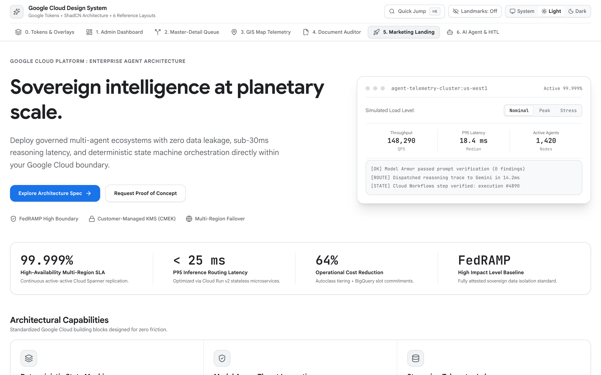

<!-- disableFinding(LINK_RELATIVE_G3DOC) -->
<!-- disableFinding(LINE_OVER_80) -->

# Enterprise Product & Solution Landing Page



*   **Impeccable Mode**: `Persuade` (Executive Solution Landing Page)
*   **Primary Reference**:
    [tokens-and-accessibility.md](tokens-and-accessibility.md)
*   **Target Archetype**: Cloud solution overviews, architectural pattern
    launches, enterprise capability briefings, and interactive ROI calculators.

--------------------------------------------------------------------------------

## 1. Executive Overview

This landing page presents enterprise cloud solutions and foundation patterns
with technical rigor. Designed for technical decision-makers and enterprise
architects, it replaces generic marketing hype with verified architecture,
reproducible benchmarks, and interactive cost modeling.

The layout features a sticky `<header>` with `CUSTOMER_PLACEHOLDER` identity, a
12-column asymmetric hero stage styled with `--g-font-display`, an interactive
ROI calculator powered by ShadCN `Slider` (`@radix-ui/react-slider`), a
12-column architectural bento capability grid (`--g-radius-lg` /
`--g-radius-xl`), and an SLA / security compliance matrix. Every section
organizes content using unified surfaces bounded by `1px` hairlines (`divide-y`
and `divide-x`).

--------------------------------------------------------------------------------

## 2. When to Use vs. When NOT to Use

| Scenario /     | Use        | Alternative                                              | Reason        |
: Task           : Blueprint? :                                                          :               :
| :------------- | :--------- | :------------------------------------------------------- | :------------ |
| Product        | **Yes**    | -                                                        | Editorial     |
: capability     :            :                                                          : narrative     :
: briefing,      :            :                                                          : with          :
: architecture   :            :                                                          : interactive   :
: launch, ROI    :            :                                                          : ROI           :
: hero           :            :                                                          : calculator.   :
| Multi-resource | **No**     | [admin-dashboard.md](admin-dashboard.md)                 | High-density  |
: cloud          :            :                                                          : tables need   :
: inventory,     :            :                                                          : authenticated :
: FinOps cost    :            :                                                          : admin shell.  :
: governance     :            :                                                          :               :
| HITL triage    | **No**     | [master-detail-workspace.md](master-detail-workspace.md) | Operational   |
: queues, alert  :            :                                                          : triage        :
: review,        :            :                                                          : requires      :
: reconciliation :            :                                                          : persistent    :
:                :            :                                                          : split panes.  :
| Real-time      | **No**     | [gis-map-telemetry.md](gis-map-telemetry.md)             | Spatial ops   |
: geospatial     :            :                                                          : require       :
: tracking, live :            :                                                          : full-viewport :
: camera         :            :                                                          : WebGL map     :
: telemetry      :            :                                                          : stage.        :
| Side-by-side   | **No**     | [document-auditor.md](document-auditor.md)               | Document      |
: contract       :            :                                                          : auditing      :
: review, PDF    :            :                                                          : requires      :
: DocAI          :            :                                                          : 50/50 split   :
: verification   :            :                                                          : canvas with   :
:                :            :                                                          : bounding      :
:                :            :                                                          : boxes.        :
| Conversational | **No**     | [ai-agent-workspace.md](ai-agent-workspace.md)           | Multi-turn    |
: AI agent       :            :                                                          : agent chats   :
: workspace      :            :                                                          : require       :
:                :            :                                                          : 2-zone chat   :
:                :            :                                                          : stage.        :

--------------------------------------------------------------------------------

## 3. Spatial Architecture & Landmarks

```text
+------------------------------------------------------------------------------------+
| [Skip Link] <header> Sticky 64px [Logo + CUSTOMER_PLACEHOLDER] [Nav] [Sys/L/D] [CTA]|
+------------------------------------------------------------------------------------+
| <main id="main-content">                                                           |
|  <section aria-label="Hero Stage"> (12 Columns, max-w-7xl)                         |
|    Col 1-7: Overline + H1 (--g-font-display) + Value Prop + CTA buttons                   |
|    Col 8-12: Live Architecture Frame (Tabs: Workflow | IaC | Logs)                 |
|  <section aria-label="Proof Points"> Unified 4-Column Strip (1px divide-x)         |
|  <section aria-label="Interactive ROI"> Sliders (Workloads, Compute) -> Savings   |
|  <section aria-label="Architectural Bento Grid"> 12-Col Bento (radius-lg/xl)       |
|  <section aria-label="Security & Compliance"> Compliance Matrix Table              |
| <footer> 4-Column Directory + Legal & Status Notices                               |
+------------------------------------------------------------------------------------+
```

```text
<body>
  ├── <header> Sticky Navigation (64px, CUSTOMER_PLACEHOLDER, Theme Radio)
  └── <main id="main-content" tabIndex={-1}>
      ├── <section aria-label="Hero"> Asymmetric 12-Col Grid (font-display)
      ├── <section aria-label="Proof Strip"> Unified 4-Cell Metric Banner (divide-x)
      ├── <section aria-label="ROI Calculator"> Interactive Slider Section
      ├── <section aria-label="Bento Grid"> 12-Column Architectural Bento
      ├── <section aria-label="Security Matrix"> Compliance SLA Table
      └── <footer> 4-Column Directory & Governance Links
```

--------------------------------------------------------------------------------

## 4. Required ShadCN Primitives & Package Installation

```bash
bun add lucide-react sonner
bunx --bun shadcn@latest add button badge card tabs slider table separator
```

| UI Control           | ShadCN Primitive           | Architectural            |
:                      :                            : Justification            :
| :------------------- | :------------------------- | :----------------------- |
| Interactive ROI      | `Slider`                   | Smooth dragging with     |
: Modeling             : (`@radix-ui/react-slider`) : keyboard arrows and live :
:                      :                            : calculation.             :
| Architecture Preview | `Tabs`                     | Switches between         |
:                      :                            : Workflow YAML, Terraform :
:                      :                            : IaC, and Trace logs.     :
| Security Posture     | `Table`                    | Semantic `<table>`       |
:                      :                            : comparing Cloud SLA and  :
:                      :                            : compliance tiers.        :
| Toast Feedback       | `Toaster` (`sonner`)       | Confirms deployment      |
:                      :                            : commands and clipboard   :
:                      :                            : copies.                  :

--------------------------------------------------------------------------------

## 5. Key UX, Persuade Mode & WCAG 2.3 Rules

1.  **Zero Em Dashes Everywhere**: Never use em dashes in prose or UI strings.
    Use colons, parentheses, or clean sentence structures.
2.  **Hero Stage with `--g-font-display`**: Use `--g-font-display` for primary
    display headings with tight tracking (`tracking-tight`). Keep prose line
    lengths constrained to `60ch-68ch`.
3.  **Interactive ROI Calculator**: Provide interactive `Slider` controls
    allowing decision-makers to model workload volume and compute spend with
    live calculated cost savings.
4.  **12-Column Architectural Bento Grid**: Use `--g-radius-lg` (`0.5rem`) and
    `--g-radius-xl` (`0.75rem`) containers with `1px solid var(--g-border)`
    boundaries and internal hairline dividers.
5.  **Monochrome Metrics & Strict Badge Discipline**: All metric numbers render
    in neutral primary ink (`text-[var(--g-ink)]`). Reserve `<Badge>` strictly
    for compliance status cells in the SLA table.

--------------------------------------------------------------------------------

## 6. CSS Integration (`src/index.css`)

```css
@import "tailwindcss";
@import "./tokens.css"; /* References tokens-and-accessibility.md */
```

--------------------------------------------------------------------------------

## 7. Complete Reference Implementation

```tsx
import React, { useState, useEffect, useMemo } from "react";
import {
  ArrowRight, Check, CheckCircle2, ChevronRight, Copy, Database,
  ExternalLink, Layers, Lock, Moon, Play, Server, Shield, ShieldCheck,
  Sparkles, Sun, Terminal, Zap
} from "lucide-react";
import { Toaster, toast } from "sonner";
import { Button } from "@/components/ui/button";
import { Badge } from "@/components/ui/badge";
import { Slider } from "@/components/ui/slider";
import { Tabs, TabsContent, TabsList, TabsTrigger } from "@/components/ui/tabs";
import { Table, TableBody, TableCell, TableHead, TableHeader, TableRow } from "@/components/ui/table";

export function MarketingLandingPage() {
  const [theme, setTheme] = useState<"system" | "light" | "dark">("system");
  const [workloads, setWorkloads] = useState([24]);
  const [monthlySpend, setMonthlySpend] = useState([45000]);

  useEffect(() => {
    const root = document.documentElement;
    const media = window.matchMedia("(prefers-color-scheme: dark)");
    const apply = () => root.classList.toggle("dark", theme === "dark" || (theme === "system" && media.matches));
    apply();
    if (theme === "system") { media.addEventListener("change", apply); return () => media.removeEventListener("change", apply); }
  }, [theme]);

  const estimatedSavings = useMemo(() => {
    const baseSavings = monthlySpend[0] * 0.28;
    const efficiencyBonus = workloads[0] * 120;
    return Math.round(baseSavings + efficiencyBonus);
  }, [workloads, monthlySpend]);

  const formatUsd = (val: number) => new Intl.NumberFormat("en-US", { style: "currency", currency: "USD", maximumFractionDigits: 0 }).format(val);

  const copyCommand = (cmd: string) => {
    navigator.clipboard.writeText(cmd);
    toast.success("Command copied to clipboard", { description: cmd });
  };

  return (
    <div className="min-h-screen bg-[var(--g-bg)] text-[var(--g-ink)] flex flex-col">
      <Toaster position="bottom-right" />
      <a href="#main-content" className="sr-only focus:not-sr-only focus:fixed focus:top-3 focus:left-3 focus:z-50 focus:rounded-md focus:bg-[var(--g-blue)] focus:px-4 focus:py-2 focus:text-white">Skip to content</a>

      {/* Sticky Header */}
      <header className="sticky top-0 z-50 h-16 w-full border-b border-[var(--g-border)] bg-[var(--g-surface)]/95 backdrop-blur-md px-6 flex items-center justify-between">
        <div className="flex items-center gap-3">
          <Layers size={20} className="text-[var(--g-blue)]" aria-hidden="true" />
          <span className="font-semibold text-sm tracking-tight">CUSTOMER_PLACEHOLDER Solutions</span>
        </div>
        <nav aria-label="Primary" className="hidden md:flex items-center gap-6 text-xs text-[var(--g-ink-secondary)]">
          <a href="#hero" className="hover:text-[var(--g-ink)] transition-colors">Overview</a>
          <a href="#roi" className="hover:text-[var(--g-ink)] transition-colors">ROI Calculator</a>
          <a href="#bento" className="hover:text-[var(--g-ink)] transition-colors">Capabilities</a>
          <a href="#security" className="hover:text-[var(--g-ink)] transition-colors">Compliance</a>
        </nav>
        <div className="flex items-center gap-3">
          <div className="flex items-center rounded-md border border-[var(--g-border)] bg-[var(--g-surface-dim)] p-0.5">
            {(["system", "light", "dark"] as const).map((mode) => (
              <button key={mode} onClick={() => setTheme(mode)} className={`px-2 py-1 text-xs rounded capitalize ${theme === mode ? "bg-[var(--g-surface)] font-medium shadow-xs" : "text-[var(--g-ink-secondary)]"}`}>{mode}</button>
            ))}
          </div>
          <Button size="sm" onClick={() => toast.success("Deployment requested", { description: "Opening Cloud Shell tutorial." })} className="h-8 text-xs bg-[var(--g-blue)] text-white hover:bg-[var(--g-blue-hover)]">
            Deploy Architecture
          </Button>
        </div>
      </header>

      {/* Main Content */}
      <main id="main-content" tabIndex={-1} className="flex-1">
        {/* Hero Section */}
        <section id="hero" className="border-b border-[var(--g-border)] py-16 lg:py-24 bg-[var(--g-surface)]">
          <div className="mx-auto max-w-7xl px-6 grid grid-cols-1 lg:grid-cols-12 gap-12 items-center">
            <div className="lg:col-span-7 space-y-6">
              <Badge variant="outline" className="border-[var(--g-blue-border)] bg-[var(--g-blue-soft)] text-[var(--g-blue-text)] text-xs">
                PRODUCTION BLUEPRINT | GCP REFERENCE ARCHITECTURE
              </Badge>
              <h1 className="text-4xl sm:text-5xl font-bold tracking-tight font-[var(--font-display)] text-[var(--g-ink)] leading-tight">
                Governed Agentic Workflows for Enterprise Operations
              </h1>
              <p className="text-base text-[var(--g-ink-secondary)] max-w-[60ch] leading-relaxed">
                Connect Cloud Workflows, Gemini Enterprise reasoning, and BigQuery data estates into an auditable, human-in-the-loop automation fabric.
              </p>
              <div className="flex flex-wrap items-center gap-3 pt-2">
                <Button size="lg" className="h-10 text-xs bg-[var(--g-blue)] text-white hover:bg-[var(--g-blue-hover)] gap-2">
                  Launch Interactive Sandbox <ArrowRight size={14} />
                </Button>
                <Button variant="outline" size="lg" onClick={() => copyCommand("git clone https://github.com/GoogleCloudPlatform/enterprise-adk-starter.git")} className="h-10 text-xs gap-2">
                  <Terminal size={14} /> Copy Quickstart Command
                </Button>
              </div>
            </div>

            {/* Architecture Preview Frame */}
            <div className="lg:col-span-5 rounded-xl border border-[var(--g-border)] bg-[var(--g-surface-dim)] overflow-hidden shadow-sm">
              <Tabs defaultValue="workflow" className="w-full">
                <div className="flex items-center justify-between border-b border-[var(--g-border-subtle)] px-3 bg-[var(--g-surface)]">
                  <TabsList className="h-9 bg-transparent">
                    <TabsTrigger value="workflow" className="text-xs">workflow.yaml</TabsTrigger>
                    <TabsTrigger value="terraform" className="text-xs">main.tf</TabsTrigger>
                  </TabsList>
                  <button type="button" onClick={() => copyCommand("gcloud workflows deploy agent-runner")} className="text-[var(--g-ink-secondary)] hover:text-[var(--g-ink)] p-1 cursor-pointer">
                    <Copy size={13} />
                  </button>
                </div>
                <TabsContent value="workflow" className="p-4 font-mono text-xs text-[var(--g-ink)] overflow-x-auto m-0">
                  <pre>{`main:
  steps:
    - init:
        assign:
          - confidence_floor: 0.90
    - call_gemini:
        call: http.post
        args:
          url: "https://agentengine.googleapis.com/v1"
          body:
            intent: "reconciliation_eval"`}</pre>
                </TabsContent>
                <TabsContent value="terraform" className="p-4 font-mono text-xs text-[var(--g-ink)] overflow-x-auto m-0">
                  <pre>{`resource "google_workflows_workflow" "agent" {
  name        = "reconciliation-worker"
  region      = "us-central1"
  service_acc = google_service_account.worker.email
}`}</pre>
                </TabsContent>
              </Tabs>
            </div>
          </div>
        </section>

        {/* Unified Proof Strip */}
        <section aria-label="Quantified Proof Strip" className="border-b border-[var(--g-border)] bg-[var(--g-surface)]">
          <div className="mx-auto max-w-7xl grid grid-cols-2 md:grid-cols-4 divide-y md:divide-y-0 md:divide-x divide-[var(--g-border-subtle)]">
            <div className="p-6 text-center">
              <p className="font-mono text-3xl font-semibold tracking-tight tabular-nums text-[var(--g-ink)]">99.95%</p>
              <p className="text-xs text-[var(--g-ink-secondary)] mt-1">Enterprise Service SLA</p>
            </div>
            <div className="p-6 text-center">
              <p className="font-mono text-3xl font-semibold tracking-tight tabular-nums text-[var(--g-ink)]">&lt; 180ms</p>
              <p className="text-xs text-[var(--g-ink-secondary)] mt-1">P95 Workflow Decision Latency</p>
            </div>
            <div className="p-6 text-center">
              <p className="font-mono text-3xl font-semibold tracking-tight tabular-nums text-[var(--g-ink)]">FedRAMP</p>
              <p className="text-xs text-[var(--g-ink-secondary)] mt-1">High Boundary Certification</p>
            </div>
            <div className="p-6 text-center">
              <p className="font-mono text-3xl font-semibold tracking-tight tabular-nums text-[var(--g-ink)]">0%</p>
              <p className="text-xs text-[var(--g-ink-secondary)] mt-1">Model Data Training Policy</p>
            </div>
          </div>
        </section>

        {/* Interactive ROI Calculator */}
        <section id="roi" className="border-b border-[var(--g-border)] py-16 bg-[var(--g-bg)]">
          <div className="mx-auto max-w-4xl px-6 space-y-8">
            <div className="text-center space-y-2">
              <h2 className="text-2xl font-bold font-[var(--font-display)]">Interactive FinOps ROI Calculator</h2>
              <p className="text-xs text-[var(--g-ink-secondary)]">Estimate annual operating cost reductions with governed agent automation.</p>
            </div>

            <div className="rounded-xl border border-[var(--g-border)] bg-[var(--g-surface)] p-6 space-y-6 shadow-sm">
              <div className="space-y-3">
                <div className="flex justify-between text-xs">
                  <span className="font-medium text-[var(--g-ink)]">Active Workloads / Pipelines</span>
                  <span className="font-mono font-semibold tabular-nums text-[var(--g-blue)]">{workloads[0]} workloads</span>
                </div>
                <Slider value={workloads} min={5} max={100} step={1} onValueChange={setWorkloads} />
              </div>

              <div className="space-y-3">
                <div className="flex justify-between text-xs">
                  <span className="font-medium text-[var(--g-ink)]">Current Monthly Cloud Spend</span>
                  <span className="font-mono font-semibold tabular-nums text-[var(--g-blue)]">{formatUsd(monthlySpend[0])}/mo</span>
                </div>
                <Slider value={monthlySpend} min={10000} max={250000} step={5000} onValueChange={setMonthlySpend} />
              </div>

              <div className="pt-4 border-t border-[var(--g-border-subtle)] flex items-center justify-between">
                <div>
                  <span className="text-xs font-medium text-[var(--g-ink-secondary)]">Estimated Monthly Savings</span>
                  <p className="text-3xl font-bold font-mono tabular-nums text-[var(--g-green-text)] mt-0.5">{formatUsd(estimatedSavings)}/mo</p>
                </div>
                <Button size="sm" onClick={() => toast.success("Estimate saved", { description: "Downloadable PDF report prepared." })} className="h-8 text-xs bg-[var(--g-blue)] text-white hover:bg-[var(--g-blue-hover)]">
                  Export Business Case
                </Button>
              </div>
            </div>
          </div>
        </section>

        {/* 12-Column Bento Grid */}
        <section id="bento" className="border-b border-[var(--g-border)] py-16 bg-[var(--g-surface)]">
          <div className="mx-auto max-w-7xl px-6 space-y-8">
            <div className="space-y-1">
              <h2 className="text-2xl font-bold font-[var(--font-display)]">Architectural Capabilities</h2>
              <p className="text-xs text-[var(--g-ink-secondary)]">Engineered to eliminate manual review fatigue and operational drift.</p>
            </div>

            <div className="grid grid-cols-1 md:grid-cols-12 gap-6">
              <div className="md:col-span-8 rounded-xl border border-[var(--g-border)] bg-[var(--g-surface-dim)] p-6 space-y-3">
                <div className="flex items-center gap-2 text-[var(--g-blue)]">
                  <Zap size={18} />
                  <h3 className="text-base font-semibold text-[var(--g-ink)]">Deterministic Orchestration</h3>
                </div>
                <p className="text-xs text-[var(--g-ink-secondary)] leading-relaxed">
                  Cloud Workflows acts as the zero-server state machine. Every API execution, rate limit retry, and callback gate executes deterministically without fragile polling daemons.
                </p>
              </div>

              <div className="md:col-span-4 rounded-xl border border-[var(--g-border)] bg-[var(--g-surface-dim)] p-6 space-y-3">
                <div className="flex items-center gap-2 text-[var(--g-purple)]">
                  <Sparkles size={18} />
                  <h3 className="text-base font-semibold text-[var(--g-ink)]">Model Armor Safeguards</h3>
                </div>
                <p className="text-xs text-[var(--g-ink-secondary)] leading-relaxed">
                  Sanitizes multi-turn prompt payloads with real-time prompt injection filtering and sensitive DLP redacting before inferences touch Vertex AI.
                </p>
              </div>
            </div>
          </div>
        </section>

        {/* Security & Compliance Matrix Table */}
        <section id="security" className="py-16 bg-[var(--g-bg)]">
          <div className="mx-auto max-w-7xl px-6 space-y-6">
            <div className="space-y-1">
              <h2 className="text-2xl font-bold font-[var(--font-display)]">Security & Operational Governance Matrix</h2>
              <p className="text-xs text-[var(--g-ink-secondary)]">Boundary specifications across standard and dedicated sovereign enclaves.</p>
            </div>

            <div className="rounded-xl border border-[var(--g-border)] bg-[var(--g-surface)] overflow-hidden shadow-sm">
              <Table>
                <TableHeader className="bg-[var(--g-surface-dim)]">
                  <TableRow className="border-b border-[var(--g-border)]">
                    <TableHead className="text-xs font-semibold text-[var(--g-ink)]">Control Domain</TableHead>
                    <TableHead className="text-xs font-semibold text-[var(--g-ink)]">Standard Tier</TableHead>
                    <TableHead className="text-xs font-semibold text-[var(--g-ink)]">Enterprise Sovereign Enclave</TableHead>
                    <TableHead className="text-right text-xs font-semibold text-[var(--g-ink)]">Status</TableHead>
                  </TableRow>
                </TableHeader>
                <TableBody>
                  <TableRow className="border-b border-[var(--g-border-subtle)]">
                    <TableCell className="text-xs font-medium text-[var(--g-ink)]">Network Perimeters</TableCell>
                    <TableCell className="text-xs text-[var(--g-ink-secondary)]">Standard VPC Firewall</TableCell>
                    <TableCell className="text-xs text-[var(--g-ink)] font-mono">VPC Service Controls (VPC-SC)</TableCell>
                    <TableCell className="text-right"><Badge variant="outline" className="text-[10px] border-[var(--g-green-border)] text-[var(--g-green-text)]">Active</Badge></TableCell>
                  </TableRow>
                  <TableRow className="border-b border-[var(--g-border-subtle)]">
                    <TableCell className="text-xs font-medium text-[var(--g-ink)]">Encryption Keys</TableCell>
                    <TableCell className="text-xs text-[var(--g-ink-secondary)]">Google-Managed Keys</TableCell>
                    <TableCell className="text-xs text-[var(--g-ink)] font-mono">Customer-Managed CMEK (Cloud KMS)</TableCell>
                    <TableCell className="text-right"><Badge variant="outline" className="text-[10px] border-[var(--g-green-border)] text-[var(--g-green-text)]">Active</Badge></TableCell>
                  </TableRow>
                </TableBody>
              </Table>
            </div>
          </div>
        </section>
      </main>

      {/* Footer */}
      <footer className="border-t border-[var(--g-border)] bg-[var(--g-surface)] py-8 px-6 text-xs text-[var(--g-ink-secondary)]">
        <div className="mx-auto max-w-7xl flex flex-col sm:flex-row items-center justify-between gap-4">
          <span>CUSTOMER_PLACEHOLDER | Enterprise Cloud Foundation Blueprint</span>
          <div className="flex items-center gap-4">
            <a href="#hero" className="hover:text-[var(--g-ink)]">Terms</a>
            <a href="#hero" className="hover:text-[var(--g-ink)]">Privacy</a>
            <a href="#hero" className="hover:text-[var(--g-ink)]">Security Whitepaper</a>
          </div>
        </div>
      </footer>
    </div>
  );
}

export default MarketingLandingPage;
```

--------------------------------------------------------------------------------

## 8. Verification & Accessibility Checklist

-   [ ] Sticky header renders `CUSTOMER_PLACEHOLDER` with theme selector.
-   [ ] Primary headings use `--g-font-display` with tight tracking.
-   [ ] Interactive ROI calculator uses ShadCN `Slider` with live state updates.
-   [ ] 12-column architectural bento grid uses `--g-radius-lg` and
    `--g-radius-xl`.
-   [ ] Security compliance matrix uses semantic `<table>` tags.
-   [ ] Strict zero em dash policy enforced across all copy.
