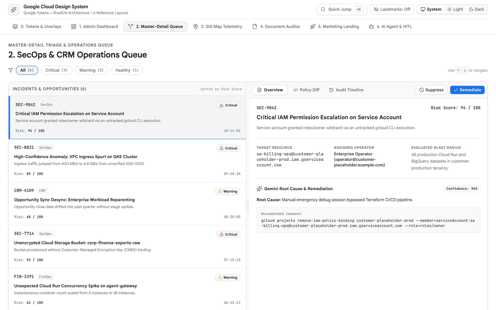

<!-- disableFinding(LINK_RELATIVE_G3DOC) -->
<!-- disableFinding(LINE_OVER_80) -->
<!-- disableFinding("master") -->
<!-- disableFinding("Master") -->

# Master-Detail Triage & Operations Queue (`Operate` Mode)



*   **Impeccable Mode**: `Operate` (`operate.md`, `layout.md`, `craft-floor.md`)
*   **Primary Reference**:
    [tokens-and-accessibility.md](tokens-and-accessibility.md)
*   **Target Archetype**: Human-in-the-loop (HITL) reconciliation queues, SecOps
    alert triage, exception approval, and support incident dispatch.

--------------------------------------------------------------------------------

## 1. Executive Overview

The Master-Detail Triage & Operations Queue eliminates page-bounce latency
during high-velocity operational review. Instead of opening modals or navigating
between URLs, operators work inside a fixed-viewport (`100vh`) horizontal split
workspace powered by `react-resizable-panels`: a left queue paired with a
persistent right-hand `<aside>` detail inspector, defaulting to a 50/50 split
with a movable divider (`col-resize` cursor, double-click reset to 50/50; NEVER
render ratio buttons in top bar).

Stepping through queue rows with `ArrowUp` / `ArrowDown` immediately updates the
right inspector across tabs (`Overview`, `Evidence`, `Timeline`). To prevent
"card soup", the inspector renders as a **single unified surface**
(`bg-[var(--g-surface)]`) where metadata grids (`<dl>`) and narrative sections
are organized by `1px` hairlines (`divide-y divide-[var(--g-border-subtle)]`)
rather than nested bordered boxes.

--------------------------------------------------------------------------------

## 2. When to Use vs. When NOT to Use

| Scenario /     | Use        | Alternative                                    | Reason          |
: Task           : Blueprint? :                                                :                 :
| :------------- | :--------- | :--------------------------------------------- | :-------------- |
| HITL           | **Yes**    | -                                              | Persistent      |
: reconciliation :            :                                                : split pane with :
: queues         :            :                                                : keyboard        :
: (confidence `< :            :                                                : stepping        :
: 0.90`), SecOps :            :                                                : (`↑`/`↓`).      :
: triage         :            :                                                :                 :
| Fleet-wide     | **No**     | [admin-dashboard.md](admin-dashboard.md)       | Wide tables     |
: spend tables,  :            :                                                : require         :
: 4-metric       :            :                                                : full-width      :
: rollups        :            :                                                : canvas and      :
:                :            :                                                : slide-over      :
:                :            :                                                : drawers.        :
| Real-time GIS  | **No**     | [gis-map-telemetry.md](gis-map-telemetry.md)   | Spatial ops     |
: vehicle        :            :                                                : require         :
: tracking,      :            :                                                : full-viewport   :
: heatmaps       :            :                                                : map with        :
:                :            :                                                : floating HUDs.  :
| Side-by-side   | **No**     | [document-auditor.md](document-auditor.md)     | Document        |
: PDF compliance :            :                                                : auditing        :
: auditing       :            :                                                : requires 50/50  :
:                :            :                                                : split canvas    :
:                :            :                                                : with bounding   :
:                :            :                                                : boxes.          :
| Public         | **No**     | [marketing-landing.md](marketing-landing.md)   | Unauthenticated |
: marketing      :            :                                                : surfaces        :
: landing page,  :            :                                                : require         :
: ROI hero       :            :                                                : editorial bento :
:                :            :                                                : grids.          :
| Multi-turn     | **No**     | [ai-agent-workspace.md](ai-agent-workspace.md) | Conversational  |
: conversational :            :                                                : workflows       :
: agent          :            :                                                : require a       :
: workspace      :            :                                                : 2-zone chat     :
:                :            :                                                : stage.          :

--------------------------------------------------------------------------------

## 3. Spatial Architecture & Landmarks

```text
+------------------------------------------------------------------------------------+
| [Skip Link] <header> 56px [Queue Title] [⌘K Search] [Theme] [Primary Actions]     |
+------------------------------------+-----------------------------------------------+
| <main id="main-content"> Left Pane | <aside aria-label="Inspector"> Right Pane     |
| Filter bar + Keyboard Table (↑/↓)  | Tabs: Overview | Evidence | Timeline          |
| [Row 1: Low Confidence Match]  <-- | Single unified surface with divide-y dividers |
| [Row 2: Quota Anomaly]             | <dl> 2-col metadata grid                      |
| [Row 3: IAM Escalation]            | Sticky Bottom Action Bar (Approve/Reject)     |
+------------------------------------+-----------------------------------------------+
```

```text
<body>
  ├── <header> Global App Bar (56px, Search ⌘K, Theme, Actions)
  └── <ResizablePanelGroup direction="horizontal" className="h-[calc(100vh-56px)]">
      ├── <ResizablePanel defaultSize={50} minSize={25}>
      │   └── <main id="main-content" tabIndex={-1}> Filterable Queue (aria-selected)
      ├── <ResizableHandle withHandle /> (Movable 50/50, Double-Click Reset)
      └── <ResizablePanel defaultSize={50} minSize={25}>
          └── <aside aria-label="Inspector"> Single Unified Surface (divide-y)
              ├── <Tabs> Overview | Evidence | Timeline
              └── <footer> Sticky Action Bar (Approve, Reject, AlertDialog)
```

--------------------------------------------------------------------------------

## 4. Required ShadCN Primitives & Package Installation

```bash
bun add lucide-react react-resizable-panels sonner
bunx --bun shadcn@latest add resizable tabs badge button input select table sheet alert-dialog separator
```

| UI Control             | ShadCN Primitive      | Architectural Justification |
| :--------------------- | :-------------------- | :-------------------------- |
| Split Pane Workspace   | `ResizablePanelGroup` | Movable 50/50 split shell   |
:                        :                       : with double-click 50/50     :
:                        :                       : reset.                      :
| Detail Tabs            | `Tabs`                | Switches between Overview,  |
:                        :                       : Evidence, and Timeline      :
:                        :                       : inside inspector.           :
| Rejection Confirmation | `AlertDialog`         | Focus-trapped confirmation  |
:                        :                       : modal for irreversible      :
:                        :                       : rejections.                 :
| Status Badges          | `Badge`               | Max 1 status badge per row  |
:                        :                       : in the queue table.         :

--------------------------------------------------------------------------------

## 5. Key UX, Unified Surface & WCAG 2.3 Rules

1.  **Movable 50/50 Split-Pane Divider Rule**: Initialize at 50/50
    (`defaultSize={50}`) with a mouse-draggable `ResizableHandle withHandle`
    (`col-resize` cursor). Double-clicking the handle resets back to 50/50.
    NEVER render ratio preset buttons in the top app bar.
2.  **Top App Bar Density & Nav Rail Footer**: Fixed `56px` (`h-14`) top bar
    capped to identity, search `⌘K`, theme toggle, and primary CTA buttons. Place
    language `EN | ES`, settings, and reset in the nav rail footer; NEVER top
    bar.
3.  **Keyboard Queue Navigation**: Support `ArrowUp` and `ArrowDown` row
    navigation with `aria-selected` tracking so operators can triage without
    taking their hands off the keyboard.
4.  **Inspector Single Unified Surface (Ban "Card Soup")**: Never nest bordered
    card boxes inside the inspector `<aside>`. Use a single
    `bg-[var(--g-surface)]` canvas divided by
    `divide-y divide-[var(--g-border-subtle)]` and a
    `<dl className="grid grid-cols-2 gap-4">` metadata grid.
5.  **Symmetrical Select Padding & Cursor**: All `<SelectTrigger>` controls use
    `px-3` (`12px` caret inset). Interactive elements require `cursor-pointer`.
6.  **Toast Notifications & Destructive Guards**: Trigger `sonner` toasts on
    decisions (`Approve`, `Escalate`). Separate destructive actions (`Reject`)
    by at least `8px` (`gap-2`).

--------------------------------------------------------------------------------

## 6. CSS Integration (`src/index.css`)

```css
@import "tailwindcss";
@import "./tokens.css"; /* References tokens-and-accessibility.md */
```

--------------------------------------------------------------------------------

## 7. Complete Reference Implementation

```tsx
import React, { useState, useEffect, useMemo, useRef } from "react";
import {
  Activity, AlertTriangle, ArrowDown, ArrowUp, CheckCircle2, ChevronRight,
  Filter, Layers, Moon, RefreshCw, Search, ShieldAlert, Sparkles, Sun, XCircle
} from "lucide-react";
import { Toaster, toast } from "sonner";
import { ImperativePanelHandle } from "react-resizable-panels";
import { ResizableHandle, ResizablePanel, ResizablePanelGroup } from "@/components/ui/resizable";
import { Tabs, TabsContent, TabsList, TabsTrigger } from "@/components/ui/tabs";
import { Table, TableBody, TableCell, TableHead, TableHeader, TableRow } from "@/components/ui/table";
import { Button } from "@/components/ui/button";
import { Badge } from "@/components/ui/badge";
import { Input } from "@/components/ui/input";
import { Select, SelectContent, SelectItem, SelectTrigger, SelectValue } from "@/components/ui/select";
import { AlertDialog, AlertDialogAction, AlertDialogCancel, AlertDialogContent, AlertDialogDescription, AlertDialogFooter, AlertDialogHeader, AlertDialogTitle } from "@/components/ui/alert-dialog";

interface QueueItem {
  id: string; title: string; entity: string; confidence: number;
  severity: "high" | "medium" | "low"; status: "pending" | "approved" | "rejected";
  createdAt: string; summary: string; rationale: string;
}

const INITIAL_ITEMS: QueueItem[] = [
  { id: "REC-9041", title: "Vendor Match: Acme Corp vs Acme Global LLC", entity: "Acme Corp", confidence: 0.84, severity: "high", status: "pending", createdAt: "10m ago", summary: "Discrepancy in tax ID and invoice bank branch routing code.", rationale: "Name similarity score 94%, but vendor EIN belongs to legacy entity." },
  { id: "REC-9042", title: "Billing Delta: Cloud Run v2 Compute Surcharge", entity: "Compute Engine", confidence: 0.96, severity: "low", status: "pending", createdAt: "24m ago", summary: "Automated rate discount reconciliation match.", rationale: "Surcharge reconciled with CUD commitment tiered volume schedule." },
  { id: "REC-9043", title: "IAM Policy Drift: projects/customer-prod", entity: "IAM / Security", confidence: 0.72, severity: "high", status: "pending", createdAt: "1h ago", summary: "Over-permissive role assignment detected outside Terraform state.", rationale: "Direct role binding bypasses Cloud Workflows approved change window." },
  { id: "REC-9044", title: "Storage Tiering: gs://archive-logs-2025", entity: "Cloud Storage", confidence: 0.89, severity: "medium", status: "pending", createdAt: "2h ago", summary: "Coldline lifecycle transition verification required.", rationale: "Access logs show 4 object reads over 90-day window, qualifying for Archive." },
];

export function MasterDetailWorkspace() {
  const [theme, setTheme] = useState<"system" | "light" | "dark">("system");
  const [items, setItems] = useState<QueueItem[]>(INITIAL_ITEMS);
  const [selectedId, setSelectedId] = useState<string>(INITIAL_ITEMS[0].id);
  const [searchQuery, setSearchQuery] = useState("");
  const [severityFilter, setSeverityFilter] = useState("all");
  const [rejectItem, setRejectItem] = useState<QueueItem | null>(null);
  const leftPanelRef = useRef<ImperativePanelHandle>(null);

  useEffect(() => {
    const root = document.documentElement;
    const media = window.matchMedia("(prefers-color-scheme: dark)");
    const apply = () => root.classList.toggle("dark", theme === "dark" || (theme === "system" && media.matches));
    apply();
    if (theme === "system") { media.addEventListener("change", apply); return () => media.removeEventListener("change", apply); }
  }, [theme]);

  const filtered = useMemo(() => items.filter((item) => {
    const matchSearch = item.title.toLowerCase().includes(searchQuery.toLowerCase()) || item.id.toLowerCase().includes(searchQuery.toLowerCase());
    const matchSev = severityFilter === "all" || item.severity === severityFilter;
    return matchSearch && matchSev;
  }), [items, searchQuery, severityFilter]);

  const selectedItem = useMemo(() => items.find((i) => i.id === selectedId) || filtered[0] || null, [items, selectedId, filtered]);

  const handleKeyDown = (e: React.KeyboardEvent) => {
    if (e.key !== "ArrowDown" && e.key !== "ArrowUp") return;
    e.preventDefault();
    const currIdx = filtered.findIndex((i) => i.id === selectedItem?.id);
    if (currIdx === -1) return;
    const nextIdx = e.key === "ArrowDown" ? Math.min(filtered.length - 1, currIdx + 1) : Math.max(0, currIdx - 1);
    setSelectedId(filtered[nextIdx].id);
  };

  const handleApprove = (id: string) => {
    setItems((prev) => prev.map((item) => item.id === id ? { ...item, status: "approved" } : item));
    toast.success("Reconciliation approved", { description: `${id} processed successfully.` });
  };

  const handleConfirmReject = () => {
    if (!rejectItem) return;
    setItems((prev) => prev.map((item) => item.id === rejectItem.id ? { ...item, status: "rejected" } : item));
    toast.info("Item rejected", { description: `${rejectItem.id} marked as exception.` });
    setRejectItem(null);
  };

  return (
    <div className="flex h-screen w-screen flex-col overflow-hidden bg-[var(--g-bg)] text-[var(--g-ink)]">
      <Toaster position="bottom-right" />
      <a href="#main-content" className="sr-only focus:not-sr-only focus:fixed focus:top-3 focus:left-3 focus:z-50 focus:rounded-md focus:bg-[var(--g-blue)] focus:px-4 focus:py-2 focus:text-white">Skip to content</a>

      {/* Top App Bar (56px) */}
      <header className="flex h-14 w-full shrink-0 items-center justify-between border-b border-[var(--g-border)] bg-[var(--g-surface)] px-4 z-40">
        <div className="flex items-center gap-3">
          <Layers size={18} className="text-[var(--g-blue)]" aria-hidden="true" />
          <span className="font-semibold text-sm">HITL Operations & Operations Queue</span>
          <Badge variant="outline" className="text-xs bg-[var(--g-surface-dim)] font-mono">{filtered.length} pending</Badge>
        </div>
        <div className="flex items-center gap-3">
          <div className="flex items-center rounded-md border border-[var(--g-border)] bg-[var(--g-surface-dim)] p-0.5">
            {(["system", "light", "dark"] as const).map((mode) => (
              <button key={mode} onClick={() => setTheme(mode)} className={`px-2 py-1 text-xs rounded capitalize ${theme === mode ? "bg-[var(--g-surface)] font-medium shadow-xs" : "text-[var(--g-ink-secondary)]"}`}>{mode}</button>
            ))}
          </div>
        </div>
      </header>

      {/* Resizable 2-Pane Workspace */}
      <ResizablePanelGroup direction="horizontal" className="flex-1 overflow-hidden">
        {/* Left Queue Panel */}
        <ResizablePanel ref={leftPanelRef} defaultSize={50} minSize={25} className="flex flex-col border-r border-[var(--g-border)] bg-[var(--g-surface-dim)]">
          <main id="main-content" tabIndex={-1} onKeyDown={handleKeyDown} className="flex flex-col h-full focus:outline-none">
            {/* Search & Filter Bar */}
            <div className="flex items-center gap-2 p-3 border-b border-[var(--g-border-subtle)] bg-[var(--g-surface)]">
              <div className="relative flex-1">
                <Search size={14} className="absolute left-2.5 top-2.5 text-[var(--g-ink-secondary)]" />
                <Input placeholder="Filter queue (↑/↓ to navigate)..." value={searchQuery} onChange={(e) => setSearchQuery(e.target.value)} className="h-8 pl-8 text-xs bg-[var(--g-surface-dim)]" />
              </div>
              <Select value={severityFilter} onValueChange={setSeverityFilter}>
                <SelectTrigger className="h-8 w-28 px-3 text-xs bg-[var(--g-surface-dim)]"><SelectValue placeholder="Severity" /></SelectTrigger>
                <SelectContent>
                  <SelectItem value="all">All</SelectItem>
                  <SelectItem value="high">High</SelectItem>
                  <SelectItem value="medium">Medium</SelectItem>
                  <SelectItem value="low">Low</SelectItem>
                </SelectContent>
              </Select>
            </div>

            {/* Queue Table */}
            <div className="flex-1 overflow-y-auto">
              <Table>
                <TableHeader className="bg-[var(--g-surface-dim)] sticky top-0 z-10">
                  <TableRow className="border-b border-[var(--g-border)]">
                    <TableHead className="text-xs font-semibold text-[var(--g-ink)]">Item & Title</TableHead>
                    <TableHead className="text-xs font-semibold text-[var(--g-ink)]">Severity</TableHead>
                    <TableHead className="text-right text-xs font-semibold text-[var(--g-ink)]">Confidence</TableHead>
                  </TableRow>
                </TableHeader>
                <TableBody>
                  {filtered.map((item) => {
                    const isSelected = selectedItem?.id === item.id;
                    return (
                      <TableRow key={item.id} aria-selected={isSelected} onClick={() => setSelectedId(item.id)} className={`cursor-pointer border-b border-[var(--g-border-subtle)] transition-colors ${isSelected ? "bg-[var(--g-surface-high)] font-medium" : "hover:bg-[var(--g-surface)]"}`}>
                        <TableCell className="py-2.5">
                          <div className="flex items-center gap-1.5">
                            <span className="font-mono text-xs text-[var(--g-ink-secondary)]">{item.id}</span>
                            {item.status !== "pending" && <span className="text-[10px] uppercase font-mono text-[var(--g-ink-secondary)]">({item.status})</span>}
                          </div>
                          <div className="text-xs font-medium text-[var(--g-ink)] truncate max-w-[280px]">{item.title}</div>
                        </TableCell>
                        <TableCell className="py-2.5">
                          {item.severity === "high" && <Badge variant="outline" className="border-[var(--g-red-border)] bg-[var(--g-red-soft)] text-[var(--g-red-text)] text-[10px]">P1 High</Badge>}
                          {item.severity === "medium" && <Badge variant="outline" className="border-[var(--g-amber-border)] bg-[var(--g-amber-soft)] text-[var(--g-amber-text)] text-[10px]">P2 Med</Badge>}
                          {item.severity === "low" && <Badge variant="outline" className="border-[var(--g-blue-border)] bg-[var(--g-blue-soft)] text-[var(--g-blue-text)] text-[10px]">P3 Low</Badge>}
                        </TableCell>
                        <TableCell className="py-2.5 text-right font-mono text-xs tabular-nums text-[var(--g-ink)]">
                          <span className={item.confidence < 0.9 ? "text-[var(--g-amber-text)] font-semibold" : "text-[var(--g-green-text)]"}>
                            {(item.confidence * 100).toFixed(0)}%
                          </span>
                        </TableCell>
                      </TableRow>
                    );
                  })}
                </TableBody>
              </Table>
            </div>
          </main>
        </ResizablePanel>

        <ResizableHandle
          withHandle
          className="cursor-col-resize hover:bg-[var(--g-blue)] transition-colors"
          onDoubleClick={() => leftPanelRef.current?.resize(50)}
          title="Drag to resize split panes. Double-click to reset to 50/50"
        />

        {/* Right Detail Inspector */}
        <ResizablePanel defaultSize={50} minSize={25} className="flex flex-col bg-[var(--g-surface)]">
          {selectedItem ? (
            <aside aria-label="Item Inspector" className="flex flex-col h-full">
              <Tabs defaultValue="overview" className="flex flex-col h-full">
                {/* Inspector Header */}
                <div className="flex items-center justify-between p-4 border-b border-[var(--g-border-subtle)]">
                  <div>
                    <span className="font-mono text-xs text-[var(--g-ink-secondary)]">{selectedItem.id}</span>
                    <h2 className="text-sm font-semibold text-[var(--g-ink)] mt-0.5">{selectedItem.title}</h2>
                  </div>
                  <TabsList className="bg-[var(--g-surface-dim)] h-8">
                    <TabsTrigger value="overview" className="text-xs h-7">Overview</TabsTrigger>
                    <TabsTrigger value="evidence" className="text-xs h-7">Evidence</TabsTrigger>
                  </TabsList>
                </div>

                {/* Single Unified Surface with divide-y hairlines */}
                <div className="flex-1 overflow-y-auto p-5 divide-y divide-[var(--g-border-subtle)] space-y-4">
                  <TabsContent value="overview" className="mt-0 space-y-4">
                    <dl className="grid grid-cols-2 gap-4 pb-4">
                      <div>
                        <dt className="text-xs text-[var(--g-ink-secondary)]">Target Entity</dt>
                        <dd className="text-sm font-medium text-[var(--g-ink)]">{selectedItem.entity}</dd>
                      </div>
                      <div>
                        <dt className="text-xs text-[var(--g-ink-secondary)]">Detected Timestamp</dt>
                        <dd className="text-sm font-mono text-[var(--g-ink)]">{selectedItem.createdAt}</dd>
                      </div>
                      <div>
                        <dt className="text-xs text-[var(--g-ink-secondary)]">Confidence Score</dt>
                        <dd className="text-sm font-mono tabular-nums text-[var(--g-ink)]">{(selectedItem.confidence * 100).toFixed(1)}%</dd>
                      </div>
                      <div>
                        <dt className="text-xs text-[var(--g-ink-secondary)]">Current State</dt>
                        <dd className="text-sm capitalize font-medium text-[var(--g-ink)]">{selectedItem.status}</dd>
                      </div>
                    </dl>

                    <div className="pt-4">
                      <h3 className="text-xs font-semibold uppercase tracking-wider text-[var(--g-ink-secondary)] mb-1">Discrepancy Summary</h3>
                      <p className="text-xs leading-relaxed text-[var(--g-ink)]">{selectedItem.summary}</p>
                    </div>

                    <div className="pt-4">
                      <h3 className="text-xs font-semibold uppercase tracking-wider text-[var(--g-ink-secondary)] mb-1 flex items-center gap-1.5">
                        <Sparkles size={14} className="text-[var(--g-purple)]" /> Gemini Reconciliation Rationale
                      </h3>
                      <p className="text-xs leading-relaxed text-[var(--g-ink-secondary)]">{selectedItem.rationale}</p>
                    </div>
                  </TabsContent>

                  <TabsContent value="evidence" className="mt-0 pt-4 space-y-3">
                    <h3 className="text-xs font-semibold uppercase tracking-wider text-[var(--g-ink-secondary)]">Payload Evidence Diff</h3>
                    <pre className="p-3 rounded-lg border border-[var(--g-border-subtle)] bg-[var(--g-surface-dim)] font-mono text-xs overflow-x-auto text-[var(--g-ink)]">
{`{
  "entity": "${selectedItem.entity}",
  "matchStatus": "REQUIRES_HUMAN_CONFIRMATION",
  "confidence": ${selectedItem.confidence}
}`}
                    </pre>
                  </TabsContent>
                </div>

                {/* Sticky Decision Footer */}
                <footer className="p-4 border-t border-[var(--g-border-subtle)] bg-[var(--g-surface-dim)] flex items-center justify-between">
                  <Button variant="outline" size="sm" onClick={() => setRejectItem(selectedItem)} className="h-8 text-xs text-[var(--g-red)] hover:bg-[var(--g-red-soft)] border-[var(--g-border)]">
                    <XCircle size={14} className="mr-1.5" /> Reject Match
                  </Button>
                  <Button size="sm" onClick={() => handleApprove(selectedItem.id)} className="h-8 text-xs bg-[var(--g-blue)] text-white hover:bg-[var(--g-blue-hover)]">
                    <CheckCircle2 size={14} className="mr-1.5" /> Approve & Resume Workflow
                  </Button>
                </footer>
              </Tabs>
            </aside>
          ) : (
            <div className="flex flex-1 items-center justify-center text-xs text-[var(--g-ink-secondary)]">Select an item from the queue</div>
          )}
        </ResizablePanel>
      </ResizablePanelGroup>

      {/* Reject Alert Dialog */}
      <AlertDialog open={!!rejectItem} onOpenChange={(open) => !open && setRejectItem(null)}>
        <AlertDialogContent className="bg-[var(--g-surface)] border border-[var(--g-border)]">
          <AlertDialogHeader>
            <AlertDialogTitle className="text-base text-[var(--g-ink)]">Reject Reconciliation Match?</AlertDialogTitle>
            <AlertDialogDescription className="text-xs text-[var(--g-ink-secondary)]">
              Rejecting <span className="font-semibold text-[var(--g-ink)]">{rejectItem?.id}</span> triggers an exception escalation in Cloud Workflows.
            </AlertDialogDescription>
          </AlertDialogHeader>
          <AlertDialogFooter className="gap-2">
            <AlertDialogCancel className="h-8 text-xs">Cancel</AlertDialogCancel>
            <AlertDialogAction onClick={handleConfirmReject} className="h-8 text-xs bg-[var(--g-red)] text-white hover:opacity-90">
              Confirm Rejection
            </AlertDialogAction>
          </AlertDialogFooter>
        </AlertDialogContent>
      </AlertDialog>
    </div>
  );
}

export default MasterDetailWorkspace;
```

--------------------------------------------------------------------------------

## 8. Verification & Accessibility Checklist

-   [ ] Top lint directives preserved (`<!-- disableFinding("master") -->`,
    `LINK_RELATIVE_G3DOC`, `LINE_OVER_80`).
-   [ ] Movable 50/50 split divider with draggable `ResizableHandle withHandle`
    and double-click reset to 50/50, zero ratio buttons in top bar.
-   [ ] Keyboard queue navigation implemented (`ArrowUp` / `ArrowDown` updating
    `aria-selected`).
-   [ ] Inspector renders as single unified surface with `divide-y` hairlines
    and `<dl>` key-value grid.
-   [ ] Max 1 status badge per queue row.
-   [ ] Rejection dialog provides 8px gap between Cancel and Confirm buttons.
